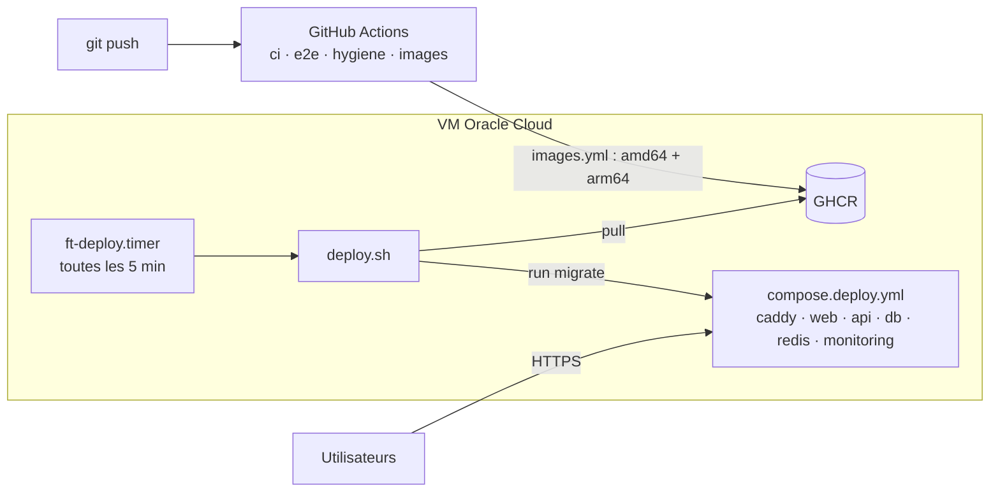

# 11 · Infrastructure et déploiement (Module 10)

## 1. Ce qu'il faut comprendre

- Une **image Docker** est un paquet figé (système + dépendances + code). Un **conteneur**
  est une image qui tourne.
- **Docker Compose** décrit plusieurs conteneurs (des **services**), leur **réseau**, leurs
  **volumes** (données qui survivent au conteneur) et leurs variables d'environnement.
- Un **Dockerfile multi-étapes** construit dans des étapes intermédiaires et ne garde dans
  l'image finale que le nécessaire.

Le sujet exige : application **conteneurisée**, lancée par **une seule commande**,
**HTTPS**, secrets dans un **`.env` non commité** avec un `.env.example` commité.

## 2. Explication dans Transcendence

### Les fichiers Compose

| Fichier | Quand | Rôle |
|---|---|---|
| `compose.yml` | toujours | la topologie : 12 services, réseau `ft`, 8 volumes |
| `compose.override.yml` | chargé **automatiquement** par `docker compose` (dev) | étape `dev` des images, code monté, rechargement à chaud, ports db/redis en loopback, monitoring derrière le profil `monitoring`, service `workspace` (devcontainer) derrière le profil `devcontainer` |
| `compose.prod.yml` | `make` (avec `-f compose.yml -f compose.prod.yml`) | étape `prod`, `NODE_ENV=production`, `restart: unless-stopped`, `SESSION_SECRET` **obligatoire** (`${SESSION_SECRET:?…}`), mots de passe Grafana obligatoires |
| `compose.deploy.yml` (+ `.proxy.yml`) | serveur de production | images tirées de GHCR, service `migrate`, pas de build |

### Les 12 services (`compose.yml`) [CONFIRMED]

| Service | Image | Port interne | Rôle |
|---|---|---|---|
| `caddy` | `caddy:2.11.4-alpine` | **80, 443 (tcp+udp) publiés** ; 2019 admin, 2020 métriques | entrée HTTPS |
| `web` | build `apps/web/Dockerfile` | 3000 | Next.js |
| `api` | build `apps/api/Dockerfile` | 3001, 9464 (métriques) | NestJS |
| `db` | `pgvector/pgvector:0.8.6-pg18-trixie` | 5432 | PostgreSQL |
| `redis` | `redis:8.10.1-alpine`, `--appendonly yes` | 6379 | Redis persistant (AOF) |
| `prometheus` | build `infra/monitoring/prometheus` | 9090 | collecte des métriques, 256 Mo max |
| `alertmanager` | build | 9093 | envoi des alertes (webhook Discord) |
| `grafana` | build | 3000 (servi sous `/grafana`) | tableaux de bord |
| `node-exporter`, `postgres-exporter`, `redis-exporter`, `blackbox-exporter` | images officielles | 9100, 9187, 9121, 9115 | métriques de l'hôte, de Postgres, de Redis, sondes HTTP |

Ordre de démarrage : `api` attend `db` et `redis` **healthy** (`pg_isready`, `redis-cli
ping`) ; `caddy` attend `web` et `api` (healthy en prod).

**Réseau** : un seul réseau bridge `ft` ; les services se joignent par leur **nom**
(`http://api:3001`, `db:5432`).

**Volumes** : `pg-data`, `redis-data`, `caddy-data` (dont la **CA interne**), `caddy-config`,
`avatars-data`, `prometheus-data`, `alertmanager-data`, `grafana-data`.
En dev, des volumes nommés masquent chaque `node_modules`, `dist`, `.next` et le client
Prisma généré, pour que l'hôte et le conteneur ne se marchent pas dessus.

### Les Dockerfiles (`apps/api/Dockerfile`, `apps/web/Dockerfile`)

Mêmes étapes pour les deux apps : `base` (`node:24.18-bookworm-slim`, pnpm via corepack)
→ `deps` (`pnpm install --frozen-lockfile`, cache BuildKit) → `dev` / `ci` / `build` →
(`prune` pour l'API) → **`prod`** : Node seul, npm et corepack supprimés, utilisateur
**`node` (non root)**, **`tini`** comme PID 1, **`HEALTHCHECK`**. L'API lance
`node dist/main.js`, le web `node apps/web/server.js` (sortie *standalone* de Next).

Pourquoi **Debian slim et pas Alpine** : Prisma et argon2 (modules natifs) posent des
problèmes sur musl/arm64 (`docs/TECHNICAL_PLAN.md` §3).

### Les variables d'environnement (`.env.example`, noms seulement)

`NODE_ENV`, `APP_VERSION`, `POSTGRES_USER`, `POSTGRES_PASSWORD`, `POSTGRES_DB`,
`DATABASE_URL`, `REDIS_URL`, `SESSION_SECRET`, `API_INTERNAL_URL`, `HTTP_PORT`,
`HTTPS_PORT`, `POSTGRES_HOST_PORT`, `REDIS_HOST_PORT`, `CADDY_EXTRA_HOSTNAME`,
`LOCAL_WORKSPACE_FOLDER`, `LLM_PROVIDER`, `LLM_API_KEY`, `LLM_MODEL`,
`GRAFANA_ADMIN_PASSWORD`, `GRAFANA_SECRET_KEY`, `DISCORD_WEBHOOK_URL`, `DEMO_PASSWORD`.

`make` crée `.env` depuis `.env.example` s'il manque et **génère** les deux secrets
Grafana (`make env-file`). `scripts/check-env-example.sh` vérifie en CI que `.env.example`
contient toutes les variables utilisées.

### Le Makefile : la commande unique

`.DEFAULT_GOAL := all`. Donc **`make` tout court** exécute :

```
make = ci → run → monitoring-check → playwright
  ci   : contrôles (version TS, .env.example, monitoring, frontières des apps, prisma format
         et drift), pnpm run ci (format, lint, typecheck, tests + couverture, build),
         prisma migrate deploy, tests e2e de l'API (Supertest)
  run  : up (build prod + démarrage, attente « healthy ») → db-ready (migrate + seed) → certs
  monitoring-check : chaque cible Prometheus « up », chaque règle saine
  playwright : installe Chromium/Firefox/WebKit, lance tous les tests navigateur
```

C'est volontairement **le chemin de l'évaluateur** : ce que `make` lance est exactement ce
qui est testé.

### Commandes (lues dans le `Makefile` et le `README.md`)

Lancer le projet de zéro :

```bash
cp .env.example .env
```

```bash
make
```

Juste démarrer la pile de production, sans les tests :

```bash
make run
```

Développer avec rechargement à chaud :

```bash
make dev
```

Ajouter le monitoring en dev :

```bash
make monitoring-up
```

Autres commandes utiles : `make down` (arrêt, volumes conservés), `make logs`
(`SERVICES="api web"`), `make ps`, `make shell SERVICE=api`, `make test` (tests
unitaires), `make test-e2e`, `make migrate`, `make migrate-new NAME=…`, `make seed`,
`make studio` (Prisma Studio sur `127.0.0.1:5555`), `make redis-ui` (`127.0.0.1:5540`),
`make reset-db` (**destructif**), `make certs`, `make clean`, `make help`, `make doctor`.

Ensuite :

| URL | Quoi |
|---|---|
| `https://localhost` | l'application |
| `https://localhost/api/docs` | Swagger |
| `https://localhost/grafana` | Grafana (`admin`, mot de passe dans `.env`) |

`make certs` exporte la CA locale de Caddy dans `./certs` pour que le navigateur fasse
confiance au certificat. Comptes de démo : définir `DEMO_PASSWORD` avant `make`, puis
`demo-anna@example.com` … `demo-felix@example.com` (dev seulement).

**Statut de vérification** : les commandes `pnpm install --frozen-lockfile` et
`pnpm run test` ont été exécutées avec succès pendant la préparation de ce cours
[CONFIRMED] ; `make`, `make run`, `make dev` n'ont **pas** pu être lancés ici faute de
démon Docker [UNVERIFIED]. **Lance `make` une fois toi-même avant la soutenance.**

### La CI (`.github/workflows/`)

| Workflow | Contenu |
|---|---|
| `ci.yml` | TS épinglé, format, lint, typecheck, frontières des apps, config du monitoring (`promtool`, `amtool`, `caddy validate`), tests unitaires par app dans l'étape `ci` de Docker, tests des paquets, tests Supertest contre un vrai Postgres + Redis, build |
| `e2e.yml` | images de prod + `compose up`, contrôle du monitoring, **Playwright, un job par navigateur**, « console gate », pages légales, test de redémarrage de l'API (Chromium) |
| `hygiene.yml` | gitleaks (secrets), commitlint (messages de commit), dérive de `.env.example`, `prisma migrate diff` |
| `images.yml` | à chaque push (toute branche, tags `v*`) : build **multi-arch** amd64 + arm64 sur runners natifs, scan Trivy, push sur **GHCR** |

### Le déploiement (`docs/DEPLOYMENT.md`, `infra/deploy/`)

- Une VM **Oracle Cloud** (Ubuntu 24.04) avec Docker ; trois fichiers sur l'hôte :
  `compose.deploy.yml`, le `Caddyfile` (`infra/caddy/Caddyfile.prod`, certificat ACME
  automatique pour le domaine public) et un `.env`.
- Un **timer systemd** (`ft-deploy.timer`, toutes les **5 min**) lance `deploy.sh` :
  `docker compose pull` → si toutes nos images portent **la même révision Git** (sinon la
  publication est en cours, on attend) et qu'elles ont changé → `run --rm migrate` → `up -d`
  → nettoyage. Il n'y a donc **pas de déploiement poussé** depuis la CI : le serveur
  **tire** les images publiées par `images.yml`.

### Développement vs production

| | Dev (`make dev`) | Prod (`make` / serveur) |
|---|---|---|
| Image | étape `dev`, code monté | étape `prod`, rien de monté |
| Rechargement | `next dev`, `nest start --watch` | non |
| Ports | 443 + db/redis sur `127.0.0.1` | 80/443 seulement |
| Monitoring | optionnel (`make monitoring-up`) | toujours |
| Cookie `secure` | non (`NODE_ENV=development`) | oui |
| Démo | possible | jamais (le seed l'interdit hors dev) |

## 3. Exemple concret

Devant le jury : `make` (≈ plusieurs minutes, les tests tournent), ouvrir
`https://localhost`, montrer Swagger `/api/docs`, montrer Grafana `/grafana`, puis
`make ps` pour lister les 12 conteneurs « healthy ». Si le temps manque : `make run`.

## 4. Fichiers à connaître

- `Makefile`, `compose.yml`, `compose.override.yml`, `compose.prod.yml`, `compose.deploy.yml`
- `apps/api/Dockerfile`, `apps/web/Dockerfile`
- `infra/caddy/Caddyfile`, `infra/caddy/Caddyfile.prod`
- `.env.example`, `infra/deploy/deploy.sh`, `infra/deploy/ft-deploy.timer`
- `.github/workflows/*.yml`, `docs/DEPLOYMENT.md`, `docs/MONITORING.md`

## 5. Schéma

Voir [diagrams/INFRASTRUCTURE.md](diagrams/INFRASTRUCTURE.md).



## 6. Ce qu'il faut retenir

1. **`make`** = la commande unique (tests + pile de prod + seed + Playwright).
2. **12 services**, un réseau `ft`, **seul Caddy** publie des ports.
3. **4 fichiers Compose** : base, dev (auto), prod, déploiement.
4. Images **multi-étapes**, prod **non root** + `tini` + `HEALTHCHECK`, Debian slim.
5. Secrets dans **`.env`** (non commité) ; Compose **refuse** de démarrer la prod sans `SESSION_SECRET`.
6. **4 workflows** CI ; images **multi-arch** sur GHCR.
7. Déploiement en **pull** par un timer systemd, migrations avant `up`.
8. Monitoring : **Prometheus + Grafana + Alertmanager (Discord)**, 25 règles d'alerte.

## 7. Questions possibles à l'oral

1. Comment lance-t-on votre projet ?
2. Que se passe-t-il exactement quand je tape `make` ?
3. Comment les migrations sont-elles appliquées en production ?
4. Pourquoi l'image de prod n'est-elle pas lancée en root ?
5. Comment gérez-vous les secrets ?

## 8. Réponses attendues

1. « `cp .env.example .env` puis `make`. L'application est sur `https://localhost`. »
2. « Les contrôles de la CI en local, puis la construction des images de prod, le démarrage
   en attendant que tout soit « healthy », les migrations et le seed, l'export du
   certificat, la vérification du monitoring et enfin les tests Playwright. »
3. « Le script de déploiement lance un conteneur `migrate` qui fait `prisma migrate deploy`
   avant de relancer les services. En local, `make db-ready` fait la même chose. »
4. « Si le processus est compromis, il n'a pas les droits root dans le conteneur. On
   supprime aussi npm et corepack de l'image finale pour réduire la surface. »
5. « Dans `.env`, ignoré par Git ; `.env.example` montre les clés sans les vraies
   valeurs ; gitleaks vérifie à chaque PR qu'aucun secret n'est commité ; la prod refuse
   de démarrer sans `SESSION_SECRET`. »

## 9. Mini-exercice

Dans `compose.yml`, trouve la condition qui fait attendre l'API. Que se passerait-il sans
elle au premier démarrage ?

## 10. Auto-évaluation

1. Quel fichier Compose est chargé automatiquement ?
2. Quelle étape du Dockerfile tourne en production ?
3. À quelle fréquence le serveur vérifie-t-il les nouvelles images ?
4. Quels ports sont publiés en dev, et sur quelle interface ?
5. Quel workflow publie les images ?

### Corrections

1. `compose.override.yml` (avec `compose.yml`).
2. `prod`.
3. Toutes les 5 minutes (`OnUnitActiveSec=5min`).
4. 80/443 (Caddy) + 5432 et 6379 sur `127.0.0.1` seulement.
5. `images.yml`.

Mini-exercice : `depends_on: db: condition: service_healthy` (et redis). Sans elle, l'API
démarrerait avant que Postgres accepte les connexions, `$connect()` échouerait dans
`onModuleInit` et le conteneur planterait.
