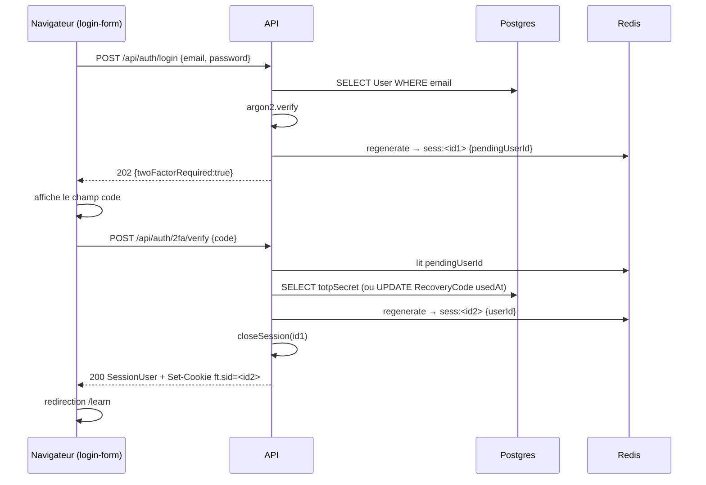
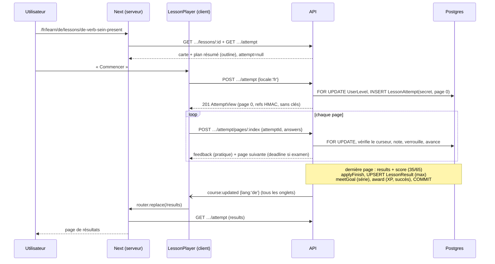

# 12 · Les flux complets de l'application (Module 11)

## 1. Ce qu'il faut comprendre

Un flux « de bout en bout » suit **une action de l'utilisateur à travers toutes les
couches** : navigateur → Caddy → Next ou API → base → réponse → affichage. C'est ce qui
prouve au jury que tu comprends **le système**, pas seulement des fichiers.

On en suit six, les plus importants :

1. Inscription et premier cours
2. Connexion avec 2FA
3. Test de placement
4. Jouer une leçon jusqu'au score
5. Demande d'ami et présence
6. Déconnexion

## 2. Explication dans Transcendence

### Flux 1 · Inscription et premier cours

| Étape | Qui | Quoi | Fichier |
|---|---|---|---|
| 1 | Utilisateur | remplit `/fr/signup` et valide | — |
| 2 | Front (client) | `SignUpFormSchema.safeParse` ; si erreur, message traduit | `signup-form.tsx` |
| 3 | Front | `POST /api/auth/signup { email, displayName, password }` | `lib/auth-client.ts` |
| 4 | Caddy | `/api/*` → `api:3001` | `Caddyfile` |
| 5 | API | throttler IP (10/min), `@Public()`, `CreateUserSchema` | `auth.controller.ts` |
| 6 | API | argon2id → `INSERT User` (doublon → 409) | `auth.service.ts` |
| 7 | API | `session.regenerate` + `userId` → `SET sess:<id>` dans Redis | `auth.controller.ts` |
| 8 | Réponse | `201 SessionUser` + `Set-Cookie: ft.sid` | — |
| 9 | Front | `router.replace('/onboarding')` | — |
| 10 | Front (serveur) | page onboarding : `GET /api/courses` (cookie recopié) → aucun cours | `onboarding/page.tsx` |
| 11 | Utilisateur | choisit « allemand, 30 min » | `choose-course.tsx` |
| 12 | API | `POST /api/courses` → `INSERT UserLevel(level=null)` | `courses.service.ts` |
| 13 | Front | étape « choisir un niveau » : placement ou choix direct | `choose-level.tsx` |

**Enregistré** : 1 `User`, 1 `UserLevel`, 1 session Redis. **Affiché** : l'écran de niveau.

### Flux 2 · Connexion avec 2FA

### Flux 3 · Le test de placement

| Étape | Front | API | Données |
|---|---|---|---|
| Démarrer | `startPlacement('de')` → `POST /api/placement { lang }` | verrou Redis ; pas de test en cours ; cours existant ; session initiale (B1, lo=0, hi=5) ; tirage | `HSET user:<id>:eval`, `UserSeenQuestion` |
| Question | `question-screen.tsx` affiche question + options mélangées + chrono | `PlacementQuestionSchema.strict()` sans `answer` | — |
| Répondre | `POST /api/placement/answers { questionId, choice }` | verrou ; délai dépassé ? (réponse vide) ; `questionId` = question courante ? ; choix valide ? ; ajustement lo/hi/niveau ; résultat ou question suivante | Redis ; regarnissage LLM en arrière-plan si ≤ 3 non vues |
| Fin | `result-screen.tsx` : niveau + rapport | `getResult` ; si au moins une réponse : `CoursesService.setLevel` + `course:updated` | `UserLevel.level`, `User.activeLang` |
| Abandon | `DELETE /api/placement` | supprime les clés Redis | — |

### Flux 4 · Jouer une leçon jusqu'au score

Points à dire : le **navigateur ne note rien** ; le chrono est la `deadline` stockée ;
le score n'est **jamais** envoyé par le client ; tout est dans **une transaction** avec
verrou de ligne.

### Flux 5 · Demande d'ami et présence

1. Alice cherche « bob » : `GET /api/users?q=bob` (`ILIKE`, 20 résultats max).
2. Clic « Ajouter » (`friend-buttons.tsx`) → `POST /api/friends/requests/<bob>`.
3. API : `pairKey(alice, bob)` ; pas de ligne → `INSERT Friendship(pending)` ;
   `friend:request` vers `user:<bob>` **et** `user:<alice>`.
4. L'onglet `/friends` de Bob reçoit l'événement → `router.refresh()` → la demande apparaît.
5. Bob accepte → `UPDATE status = accepted` → `friend:accepted` aux deux.
6. Désormais, quand Alice ouvre un onglet, son socket fait `INCR presence:alice` → 1 → Bob
   reçoit `presence:update online` ; 10 s après la fermeture de son dernier onglet, `offline`.

### Flux 6 · Déconnexion

`LogOutButton` → `POST /api/auth/logout` → l'API fait `session.destroy` (`DEL sess:<id>`),
puis `closeSession(<id>)` (ferme **tous** les sockets de cette session, dans tous les
onglets), puis `clearCookie('ft.sid')` → `204` → côté onglet, `closeSocket()` (fermeture
volontaire, pas de reconnexion), `router.replace('/')` et `router.refresh()`. Les autres
onglets voient une déconnexion serveur, retentent discrètement, sont refusés avec
`auth.sessionRequired` et passent à l'état `signedOut`.
(`apps/web/components/log-out-button.tsx`, `apps/api/src/auth/auth.controller.ts`)

## 3. Exemple concret

Le flux 4 est celui à raconter en premier au jury : il montre la sécurité (le serveur
possède la vérité), la concurrence (verrou + transaction), la base (upsert du meilleur
score), la logique métier (série, XP) et le temps réel (événement après commit).

## 4. Fichiers à connaître

Pour chaque flux, les fichiers sont dans les tableaux ci-dessus. Les tests qui les
couvrent : `e2e/tests/auth.spec.ts`, `onboarding.spec.ts`, `placement.spec.ts`,
`lesson.spec.ts`, `friends.spec.ts`, `live.spec.ts` ; et côté API
`apps/api/test/auth.e2e-spec.ts`, `two-factor.e2e-spec.ts`, `placement.e2e-spec.ts`,
`attempts.e2e-spec.ts`, `friends.e2e-spec.ts`, `gateway.e2e-spec.ts`.

## 5. Schéma

Tous les diagrammes de flux sont regroupés dans [diagrams/MAIN-FEATURE-FLOWS.md](diagrams/MAIN-FEATURE-FLOWS.md).

## 6. Ce qu'il faut retenir

1. Tout flux d'écriture : **client → `/api` via Caddy → guard → pipe Zod → service → transaction → réponse**.
2. Tout flux de lecture d'une page : **Next serveur → `http://api:3001` avec le cookie**.
3. Après une écriture : **`router.refresh()`** ici, **événement socket** ailleurs.
4. La connexion change **toujours** d'id de session.
5. La fin de leçon est **une seule transaction** : résultat, série, XP, succès.
6. Les événements d'amitié vont **aux deux** utilisateurs.

## 7. Questions possibles à l'oral

1. Racontez-moi ce qui se passe quand je termine une leçon.
2. Que se passe-t-il si je soumets deux fois la même page (double clic) ?
3. Où est stocké l'état d'un test de placement en cours ?
4. Comment la page « aujourd'hui » d'un autre onglet est-elle mise à jour ?

## 8. Réponses attendues

1. Raconter le flux 4 : dernière page soumise, notée, tentative close, score calculé
   35/65, `applyFinish` dans la même transaction (meilleur score, objectif, série, XP,
   succès), commit, `course:updated`, redirection vers les résultats.
2. « La première passe ; la deuxième trouve un curseur déjà avancé et reçoit `409
   attempt.stale`. Comme la transaction verrouille la ligne du cours, les deux ne peuvent
   pas s'exécuter en même temps. »
3. « Dans Redis, `user:<id>:eval` (hash) et `user:<id>:eval_questions`, une heure
   d'expiration, avec un verrou `user:<id>:eval_lock`. Les questions vues sont aussi dans
   Postgres (`UserSeenQuestion`) pour ne pas les reposer plus tard. »
4. « L'API émet `course:updated` vers la room de l'utilisateur après le commit ;
   `RefreshOn` le reçoit et fait `router.refresh()`. »

## 9. Mini-exercice

Dessine le flux 1 en diagramme de séquence (5 participants : navigateur, Caddy, API,
Postgres, Redis), sans regarder.

## 10. Auto-évaluation

1. Combien de requêtes HTTP faut-il pour une connexion avec 2FA ?
2. Quelle étape du flux 3 peut appeler Gemini ?
3. Pendant le flux 4, où vit la deadline de l'examen ?
4. Pourquoi l'onglet B d'une session déconnectée passe-t-il à « signedOut » ?

### Corrections

1. Deux (`/login` puis `/2fa/verify`).
2. Le tirage d'une question (démarrer ou répondre), quand une catégorie a ≤ 3 questions non vues, en arrière-plan.
3. Dans `LessonAttempt.deadline` en base ; le client n'affiche qu'un compte à rebours.
4. Son socket est fermé par le serveur (`closeSession`), il retente, la poignée de main est refusée avec `auth.sessionRequired` (plus de `sess:<id>`), ce que `afterConnectError` traduit en `signedOut`.
