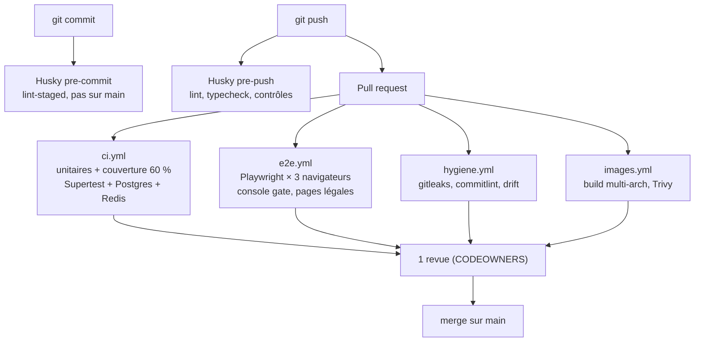

# 13 · Tests et qualité (Module 12)

## 1. Ce qu'il faut comprendre

Trois niveaux de tests, du plus rapide au plus réaliste :

| Niveau | Teste | Outil chez nous |
|---|---|---|
| **Unitaire** | une fonction ou une classe isolée (dépendances simulées) | Vitest |
| **Intégration HTTP** (« e2e » de l'API) | l'API entière, vraies requêtes, **vrai Postgres et Redis** | Vitest + Supertest |
| **Bout en bout navigateur** | l'application complète en production, dans un vrai navigateur | Playwright |

La **couverture** mesure la part du code exécutée par les tests.

## 2. Explication dans Transcendence

### Ce qui existe (compté dans le dépôt) [CONFIRMED]

| Paquet | Fichiers de test | Tests (exécution du 15/11/2026) |
|---|---|---|
| `apps/api` (unitaires `src/**/*.spec.ts`) | 44 | **1 184** ✅ |
| `packages/shared` | 17 | **435** ✅ |
| `apps/web` (`lib/*.test.ts`) | 25 | **290** ✅ |
| `packages/ui` | 1 | **10** ✅ |
| `apps/api/test/*.e2e-spec.ts` (Supertest) | 16 | non exécutés ici (pas de Docker) [UNVERIFIED] |
| `e2e/tests/*.spec.ts` (Playwright) | 22 | non exécutés ici [UNVERIFIED] |

Commande exécutée : `pnpm run test` → `Tasks: 6 successful, 6 total`.

### Organisation

- **Unitaires à côté du code** : `auth.service.ts` ↔ `auth.service.spec.ts`. Les règles
  pures (`roadmap.rules.spec.ts` : 661 lignes, `gamification.rules.spec.ts`,
  `lesson-search.spec.ts`) sont testées sans base ; le moteur de leçon dans
  `packages/shared/src/lessons/player/*.test.ts` (plan, attempt, score, redact, view).
  Le temps est injecté (`now`) : on teste les délais sans attendre.
- **Le LLM est simulé** : `FixtureProvider`, et `gemini.provider.spec.ts` simule `fetch`.
- **API e2e** (`apps/api/test/`) : chaque fichier démarre l'app avec **le même
  `configureApp`** que la prod (`app.e2e-spec.ts`, `auth`, `two-factor`, `courses`,
  `placement`, `lessons`, `attempts`, `finish`, `gamification`, `friends`, `users`,
  `gateway` (vrai client socket.io), `metrics`, `error-codes`, `seed`, `demo`). Config :
  `apps/api/vitest.config.e2e.mts`.
- **Playwright** (`e2e/`) : 3 projets (`chromium`, `firefox`, `webkit`) contre
  `https://localhost` (pile de prod). Fichiers : `auth`, `onboarding`, `placement`,
  `course`, `today`, `dashboard`, `lesson`, `lesson-regressions`, `friends`, `live`
  (temps réel entre deux pages), `avatar`, `i18n`, `legal`, `landing`, `layout`,
  `layout-gate`, `time-zone`, `monitoring`, `signup-budget`, `smoke`, **`console`**,
  **`restart`** (redémarre l'API et vérifie la reconnexion).

### Deux tests qui sont des critères de rejet du sujet

- **Console gate** (`e2e/support/console-guard.ts`, `console.spec.ts`) : **toute** erreur ou
  avertissement console, exception non attrapée ou requête échouée fait échouer la route.
  C'est pour lui que la reconnexion du socket sonde l'API avant de composer.
- **Pages légales** (`legal.spec.ts`) : `/privacy` et `/terms` répondent avec du vrai contenu.

### La « signup budget »

L'inscription est limitée à 10 par minute et par IP. La suite Playwright crée beaucoup de comptes :
elle **fait la queue** pour respecter la limite (`e2e/support/signup-budget.ts`). Règle de
l'équipe : *ce sont les tests qui plient, pas la limite* (commentaire de `auth.controller.ts`).

### Les outils de qualité

| Outil | Où | Ce qu'il bloque |
|---|---|---|
| **Couverture ≥ 60 %** lignes et fonctions | `vitest.config.mts` de api, web, shared | job de tests en CI |
| **ESLint**, **Prettier**, **tsc** | `turbo run lint typecheck`, `format:check` | CI + hook `pre-push` |
| **Husky** | `.husky/pre-commit` (pas de commit sur `main`, `lint-staged`), `pre-push` (TS, `.env.example`, frontières, lint, typecheck), `commit-msg` (commitlint) | localement |
| **commitlint** | `.github/commitlint.config.mjs` | messages type `feat: …`, `fix(api): …` |
| **gitleaks** | `hygiene.yml` | secrets commités |
| **Prisma drift** | `scripts/check-prisma-drift.sh` | schéma ≠ migrations |
| **Monitoring config** | `promtool`, `amtool`, `caddy validate`, tests des alertes (`infra/monitoring/prometheus/tests/alerts.test.yml`) | config cassée |
| **CODEOWNERS** + au moins 1 revue | `.github/CODEOWNERS`, règles de `main` (`docs/TECHNICAL_PLAN.md` §5) | fusion sans relecture |

### Ce qui est testé, et ce qui ne l'est pas

| Fonctionnalité | Tests | Remarque |
|---|---|---|
| Auth, 2FA, sessions | unitaires + API e2e + Playwright | bien couvert |
| Placement | unitaires (4 services) + API e2e + 20 tests Playwright | bien couvert |
| Plan du jour, série, objectif | `roadmap.rules.spec.ts`, `goal.spec.ts`, e2e | bien couvert |
| Moteur de leçon (score, masquage, curseur) | `shared` + `attempts.e2e-spec.ts` + Playwright | bien couvert |
| Gamification | `gamification.rules.spec.ts` + `gamification.e2e-spec.ts` | serveur seulement ; pas d'UI à tester |
| Amis, présence, gateway | unitaires + `gateway.e2e-spec.ts` + `live.spec.ts` | couvert |
| Recherche de leçons | `lesson-search.spec.ts` | API seulement ; pas de page |
| Composants React | **pas de tests unitaires de composants** dans `apps/web` (seulement `lib/`) ; couverts par Playwright | [CONFIRMED] |
| Lecteur pour vocabulaire / fonctions / lecture (UI) | — | n'existe pas encore |
| Chat, RAG | — | n'existent pas |
| Gemini réel | non (simulé) ; `pnpm --filter @ft/api generation:try` pour un essai manuel | |

### Limitations et problèmes connus

- Hypothèse d'**une seule instance** d'API (présence, throttler et regarnissage en mémoire). [CONFIRMED par les commentaires du code]
- Le throttler est **en mémoire** : un redémarrage remet les compteurs à zéro. [INFERRED]
- Pas de **Content-Security-Policy**. [CONFIRMED doc]
- Le README contient encore des **TODO** (logins de l'équipe, organisation, communication) à remplir avant la soutenance. [CONFIRMED `README.md`]
- Certaines lignes de `docs/PRODUCT_ARCHITECTURE.md` §2 sont périmées (i18n « not wired »). [CONFIRMED]

### Comment exécuter

Tests unitaires (sans Docker) :

```bash
pnpm install --frozen-lockfile
```

```bash
pnpm run test
```

Avec couverture :

```bash
pnpm run test:cov
```

Tout ce que fait la CI, en local (lance Postgres et Redis dans Docker) :

```bash
make ci
```

Les tests navigateur contre la pile de prod :

```bash
make test-e2e
```

Rapport Playwright : `make report`.

## 3. Exemple concret

`apps/api/src/lessons/roadmap.rules.spec.ts` teste `plan()` avec des listes de leçons et de
résultats construites à la main : aucune base, aucun serveur, des centaines de cas en
quelques millisecondes. Le même scénario est ensuite vérifié de bout en bout par
`apps/api/test/finish.e2e-spec.ts` avec Postgres.

## 4. Fichiers à connaître

- `apps/api/vitest.config.mts`, `apps/api/vitest.config.e2e.mts`
- `apps/api/test/app.e2e-spec.ts`, `apps/api/test/attempts.e2e-spec.ts`
- `e2e/playwright.config.ts`, `e2e/support/console-guard.ts`, `e2e/tests/console.spec.ts`
- `.github/workflows/ci.yml`, `e2e.yml`, `hygiene.yml`
- `.husky/*`

## 5. Schéma



## 6. Ce qu'il faut retenir

1. **≈ 1 900 tests unitaires** verts ; 16 fichiers Supertest ; 22 fichiers Playwright.
2. Supertest sur **vraie base** avec le **même pipeline** que la prod (`configureApp`).
3. Playwright sur **3 moteurs**, contre les **images de prod**.
4. **Console gate** et **pages légales** : critères de rejet, testés en CI.
5. Couverture minimale **60 %**, bloquante.
6. Hooks Husky, commitlint, gitleaks, drift Prisma.
7. Les **règles pures** sont faciles à tester parce que le temps et la base sont injectés.
8. Pas de tests unitaires de composants React : Playwright les couvre.

## 7. Questions possibles à l'oral

1. Comment testez-vous l'API ?
2. Comment testez-vous sans clé Gemini ?
3. Comment garantissez-vous zéro erreur console ?
4. Quelle couverture visez-vous ?
5. Qu'est-ce qui n'est pas testé ?

## 8. Réponses attendues

1. « À deux niveaux : des tests unitaires sur les services et les règles pures, avec
   Prisma et Redis simulés ; puis des tests HTTP avec Supertest contre l'application
   complète, démarrée avec le même `configureApp` que la production, sur un vrai Postgres
   et un vrai Redis. »
2. « Le fournisseur LLM est injecté par Nest. En test et par défaut, c'est une fixture qui
   renvoie des réponses écrites à l'avance. Le fournisseur Gemini a ses propres tests où `fetch` est simulé. »
3. « Un test Playwright parcourt toutes les routes, y compris la navigation côté client, sur
   le build de prod, et échoue à la moindre erreur, avertissement, exception ou requête
   échouée. Il tourne en CI sur les trois navigateurs. »
4. « 60 % de lignes et de fonctions au minimum, bloquant en CI, à augmenter, jamais à baisser. »
5. « Les composants React n'ont pas de tests unitaires (ils sont couverts par Playwright),
   et l'appel réel à Gemini n'est pas testé automatiquement. »

## 9. Mini-exercice

Ouvre `e2e/tests/live.spec.ts`. Explique comment on peut tester un événement temps réel
avec deux pages Playwright.

## 10. Auto-évaluation

1. Combien de navigateurs Playwright teste-t-il ?
2. Pourquoi les tests e2e de l'API appellent-ils `configureApp` ?
3. Que vérifie `restart.spec.ts` ?
4. Quel hook empêche de commiter sur `main` ?

### Corrections

1. Trois : Chromium, Firefox, WebKit.
2. Pour tester exactement le même pipeline (préfixe, sessions, pipe, filtre, WebSocket) que la production.
3. Qu'après un redémarrage de l'API, l'application se reconnecte sans erreur console.
4. `.husky/pre-commit`.
