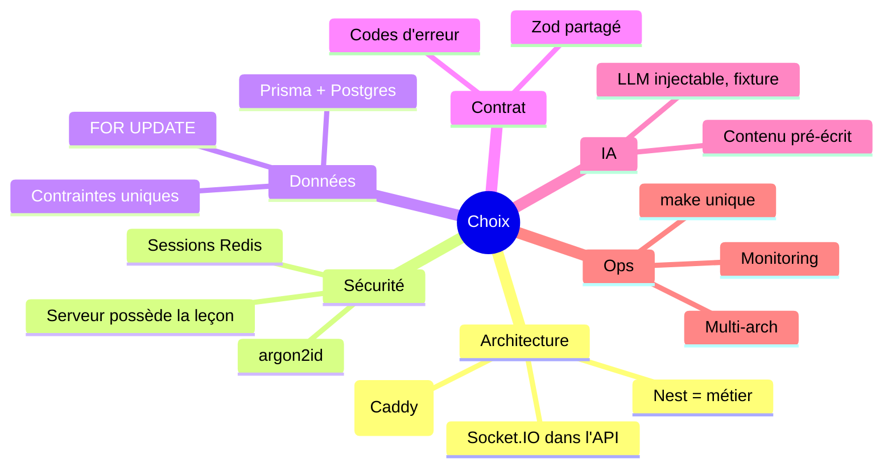

# 14 · Les choix techniques (Module 13)

## 1. Ce qu'il faut comprendre

Défendre un choix, c'est dire : **le problème**, **la solution retenue**, **ce qu'elle
apporte**, **ce qu'elle coûte**, **les alternatives**. Un jury apprécie surtout qu'on
connaisse les **inconvénients**.

Chaque décision ci-dessous porte une source :
- **[DOCUMENTÉ]** : la raison est écrite par l'équipe (doc ou commentaire de code) ;
- **[DÉDUIT]** : la raison est déduite de l'implémentation, l'intention n'est pas écrite.

## 2. Explication dans Transcendence

### D1 · NestJS possède le métier, Next.js n'affiche que [DOCUMENTÉ `ARCHITECTURE.md` §1]

| | |
|---|---|
| Problème | Deux runtimes serveur (Next et Nest) pourraient tous deux toucher la base. |
| Solution | Pas de Prisma dans `apps/web` ; Next appelle l'API comme un navigateur. |
| Avantages | Une seule porte vers les données, règles écrites une fois, réponse claire en soutenance, l'API sert aussi un éventuel « Public API ». |
| Inconvénients | Un saut réseau de plus pour le SSR ; deux applications à déployer. |
| Alternatives | Next.js seul en full-stack (server actions + Prisma) ; Nest + SPA sans SSR. |

### D2 · Sessions serveur dans Redis plutôt que JWT [DÉDUIT, appuyé par les commentaires de `app.setup.ts` et `auth.guard.ts`]

| | |
|---|---|
| Problème | Rester connecté de façon sûre. |
| Solution | `express-session` + `connect-redis`, cookie opaque `httpOnly` `SameSite=Lax`. |
| Avantages | Révocation immédiate (logout, compte supprimé, fermeture des sockets), rien de lisible côté client, simple sur une seule origine. |
| Inconvénients | Un aller-retour Redis par requête ; état côté serveur (à partager si plusieurs instances). |
| Alternatives | JWT en cookie, JWT + refresh token, OAuth (exclu). |

### D3 · Une seule origine derrière Caddy [DOCUMENTÉ `ARCHITECTURE.md` §2, `TECHNICAL_PLAN.md` §1]

| | |
|---|---|
| Problème | HTTPS obligatoire ; front et API sur deux ports = CORS, cookies tiers. |
| Solution | Caddy termine le TLS (CA interne en local) et route `/api`, `/ws`, `/grafana`, `/`. |
| Avantages | Pas de CORS, cookie first-party, un seul certificat, un seul port publié. |
| Inconvénients | Un composant de plus ; `trust proxy` à régler correctement. |
| Alternatives | Nginx (plus de configuration TLS), Traefik. |

### D4 · Zod partagé, pas class-validator [DOCUMENTÉ `app.setup.ts`, `ARCHITECTURE.md` §8]

| | |
|---|---|
| Problème | Le sujet exige la validation **front et back** ; deux implémentations divergent. |
| Solution | Schémas dans `@ft/shared`, DTO par `nestjs-zod`, mêmes schémas dans les formulaires. |
| Avantages | Une règle = un endroit ; types TypeScript dérivés ; Swagger généré. |
| Inconvénients | S'écarte du standard NestJS (class-validator) ; adaptateur supplémentaire. |
| Alternatives | class-validator + duplication côté front ; tRPC. |

### D5 · Des codes d'erreur, pas des phrases [DOCUMENTÉ `validation.pipe.ts`, `error-code.filter.ts`]

| | |
|---|---|
| Problème | L'API ne connaît pas la langue de l'interface. |
| Solution | `message` = un code de `ERROR_CODES` ; traduction dans le navigateur ; filtre global de secours. |
| Avantages | i18n complète des erreurs, contrat testable (`error-codes.e2e-spec.ts`). |
| Inconvénients | Il faut maintenir la liste et trois traductions par code. |
| Alternatives | `Accept-Language` côté API. |

### D6 · Le serveur possède la leçon [DOCUMENTÉ `PRODUCT_ARCHITECTURE.md` §3 « No route takes a score », `docs/LESSONS.md` §10]

| | |
|---|---|
| Problème | Un score calculé dans le navigateur se falsifie ; les réponses dans le JS se lisent. |
| Solution | Plan reconstruit côté serveur, page au curseur seulement, réfs HMAC, deadline serveur, score serveur. |
| Avantages | Score fiable, pas de fuite de réponses, reprise après rechargement, plusieurs onglets cohérents. |
| Inconvénients | Un aller-retour par page ; logique plus complexe (≈ 30 fichiers dans `lessons/player`). |
| Alternatives | Envoyer la leçon complète et noter côté client (simple, mais trichable). |

### D7 · Contenu écrit à l'avance plutôt que généré en direct [DOCUMENTÉ `PRODUCT_ARCHITECTURE.md` §2 « Open, for the team »]

| | |
|---|---|
| Problème | Un LLM en direct coûte, varie, peut se tromper, et l'évaluateur n'a pas de clé. |
| Solution | Leçons écrites avec Claude Code, **validées** (`validateLesson`), versionnées en JSON. |
| Avantages | Qualité contrôlée, aucun coût à l'usage, tests déterministes. |
| Inconvénients | Il faut écrire 3 990 leçons (216 faites) ; affaiblit le module LLM/RAG. |
| Alternatives | Génération à la volée avec cache ; RAG sur un corpus. |

### D8 · Fournisseur LLM injectable, « fixture » par défaut [DOCUMENTÉ `TECHNICAL_PLAN.md` §5, `llm.module.ts`]

| | |
|---|---|
| Problème | Pas de clé en CI ni chez l'évaluateur ; coûts ; tests instables. |
| Solution | Interface `LlmProvider`, jeton `LLM_PROVIDER`, `FixtureProvider` ou `GeminiProvider` selon `.env`. |
| Avantages | Zéro coût par défaut, tests stables, changement de fournisseur en une variable. |
| Inconvénients | En démo par défaut, l'IA « en ligne » n'est pas visible. |

### D9 · Verrou de ligne `FOR UPDATE` sur le cours [DOCUMENTÉ `goal.ts`]

| | |
|---|---|
| Problème | Deux onglets qui finissent une leçon en même temps pourraient compter la série deux fois. |
| Solution | Chaque écriture sur la journée d'un cours commence par `SELECT … FOR UPDATE` (SQL brut, Prisma n'a pas d'équivalent). |
| Avantages | Exigence « pas de race condition » du sujet, simple à raisonner. |
| Inconvénients | Sérialise les écritures d'un même cours (négligeable : un humain). |
| Alternatives | Verrou Redis, contraintes uniques seules, transactions `SERIALIZABLE`. |

### D10 · Contraintes uniques plutôt que vérification préalable [DOCUMENTÉ `auth.service.ts`, `pair.ts`]

Insérer et attraper `P2002`, `pairKey` trié pour les amitiés, PK composite pour les
succès. **Avantage** : aucune course possible. **Inconvénient** : la logique dépend de
codes d'erreur Prisma.

### D11 · Socket.IO dans l'API, push « relis » [DOCUMENTÉ `PRODUCT_ARCHITECTURE.md` §3, `ARCHITECTURE.md` §4]

| | |
|---|---|
| Solution | Une passerelle `/ws`, même cookie, rooms `user:<id>`, événements après commit qui déclenchent `router.refresh()`. |
| Avantages | Une seule auth, un seul transport ; pas de deuxième état côté client. |
| Inconvénients | Un refresh = un rendu serveur complet ; une seule instance supportée. |
| Alternatives | Server-Sent Events, WebSocket natif, polling. |

### D12 · Prisma 7 + PostgreSQL (+ pgvector prévu) [DOCUMENTÉ `TECHNICAL_PLAN.md` §1]

ORM = module mineur ; `schema.prisma` sert de documentation ; pgvector évitait une
deuxième base pour le RAG. **Inconvénient actuel** : pgvector est inutilisé.

### D13 · Monorepo pnpm + Turborepo, TypeScript partout [DOCUMENTÉ `TECHNICAL_PLAN.md` §1]

`node_modules` strict, tâches en cache, contrat partagé. Inconvénient : outillage plus
complexe (volumes Docker pour masquer `node_modules`, versions épinglées).

### D14 · Debian slim, non-root, multi-arch [DOCUMENTÉ `TECHNICAL_PLAN.md` §3]

Éviter les bugs Prisma/argon2 sur musl ; images amd64 + arm64 (Mac M, serveur ARM).

### D15 · `make` = le chemin de l'évaluateur, tests compris [DOCUMENTÉ `TECHNICAL_PLAN.md` §4]

Ce qui est lancé est ce qui est testé. Inconvénient : `make` est long.

### D16 · Monitoring complet [DOCUMENTÉ `docs/MONITORING.md`]

Prometheus + Grafana + Alertmanager (25 règles), métriques métier
(`ft_placement_exams_total`, `ft_lesson_attempts_total`…), port de métriques séparé.

### D17 · Pas de store global côté front [DÉDUIT]

La vérité est sur le serveur ; `router.refresh()` suffit. Alternative : React Query,
Redux. Inconvénient : moins d'optimisme (on attend la réponse).

### D18 · Throttler en mémoire, une seule instance [DÉDUIT + commentaires `question-stock.service.ts`]

Simple ; à revoir (stockage Redis) si on passe à plusieurs instances (#158).

## 3. Exemple concret

« Pourquoi pas un JWT ? » → D2 : révocation. Démontre-le : `POST /logout` supprime
`sess:<id>` et ferme les sockets de la session ; avec un JWT, le jeton resterait valide.

## 4. Fichiers à connaître

`docs/TECHNICAL_PLAN.md`, `docs/PRODUCT_ARCHITECTURE.md`, `docs/ARCHITECTURE.md`,
`docs/VERSIONS.md`, `docs/LESSONS.md`, et les commentaires de `app.setup.ts`,
`auth.guard.ts`, `goal.ts`, `validation.pipe.ts`.

## 5. Schéma

## 6. Ce qu'il faut retenir

1. Chaque choix a un **coût** : sache le dire.
2. Les trois plus défendables : **Nest = métier**, **sessions serveur**, **serveur possède la leçon**.
3. Les trois plus discutables : **pgvector inutilisé**, **LLM peu visible**, **une seule instance**.
4. Distingue toujours **documenté** et **déduit**.

## 7. Questions possibles à l'oral

1. Si c'était à refaire, que changeriez-vous ?
2. Votre architecture tient-elle 10 000 utilisateurs ?
3. Pourquoi ne pas avoir généré les leçons en direct avec le LLM ?

## 8. Réponses attendues

1. « Je brancherais le RAG plus tôt ou je retirerais pgvector ; je finirais les écrans des
   trois autres types de leçon avant d'élargir ; je mettrais le stockage du throttler et
   les rooms Socket.IO dans Redis pour pouvoir lancer plusieurs instances. »
2. « Le goulot serait l'instance unique d'API : présence, throttler et regarnissage sont en
   mémoire, et les rooms ne traversent pas les instances. Il faudrait l'adaptateur Redis
   de Socket.IO et un stockage Redis pour le throttler. Postgres et Redis tiennent la charge. »
3. « Coût, latence, qualité et reproductibilité : l'évaluateur n'a pas de clé, et une leçon
   fausse générée en direct ne serait vue par personne avant l'apprenant. On écrit donc
   avec l'IA, mais on valide avant de publier. »

## 9. Mini-exercice

Choisis D6 et présente-le en 45 secondes, inconvénients compris, à voix haute.

## 10. Auto-évaluation

1. Quelle décision répond à l'exigence « pas de race condition » ?
2. Pourquoi le fournisseur LLM est-il « fixture » par défaut ?
3. Quel est le principal inconvénient de D11 ?

### Corrections

1. D9 (verrou `FOR UPDATE`) et D10 (contraintes uniques).
2. Pas de clé chez l'évaluateur ni en CI, pas de coût, tests déterministes.
3. Une seule instance d'API supportée ; chaque événement provoque un rendu serveur complet.
