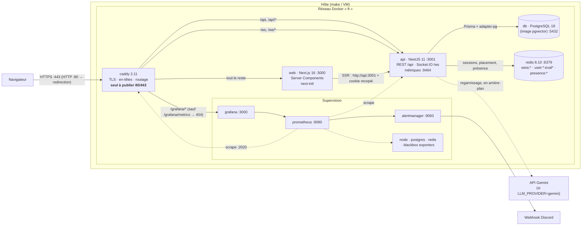

# Diagramme · Architecture globale

Vérifié contre `compose.yml`, `compose.prod.yml` et `infra/caddy/Caddyfile` (commit `477b3d4`).

## Lecture

1. Une seule entrée : Caddy. Tout le reste n'est joignable que par le réseau `ft`.
2. Même origine pour les pages, l'API et le WebSocket.
3. Next n'a aucun accès aux données : il passe par l'API, comme le navigateur.
4. Postgres = durable ; Redis = éphémère.
5. Le monitoring lit, il n'est jamais sur le chemin d'une requête utilisateur.
