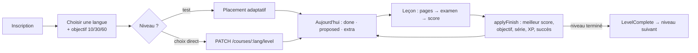
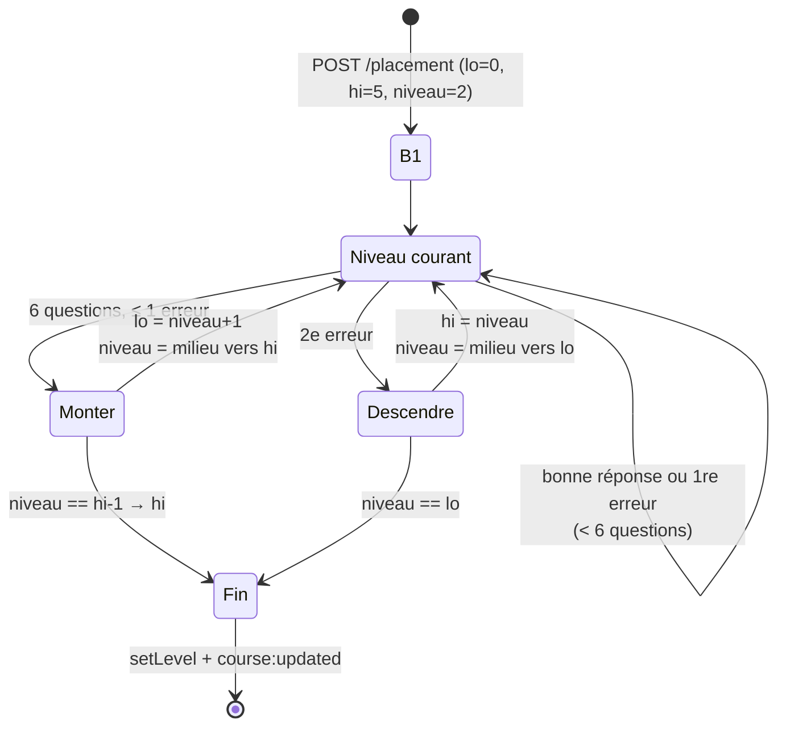
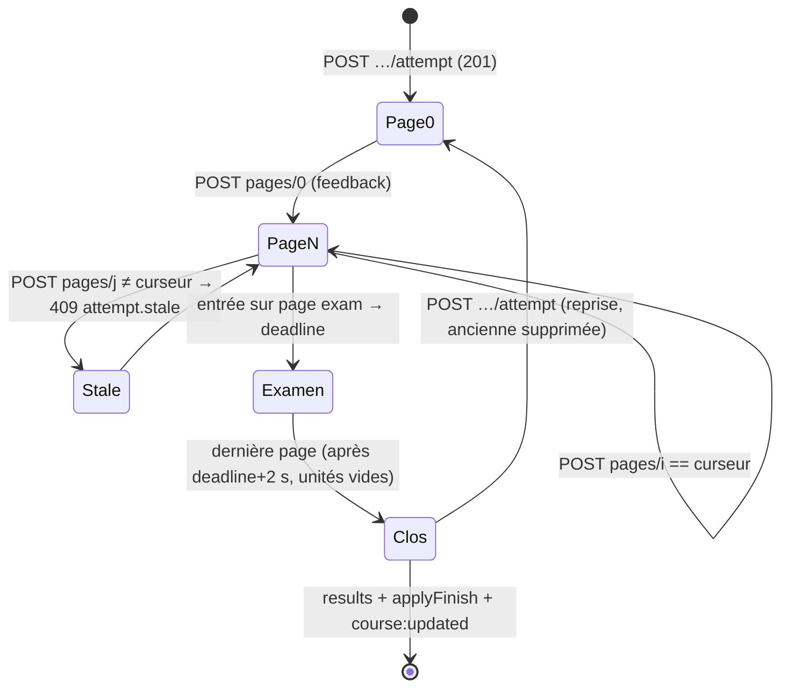
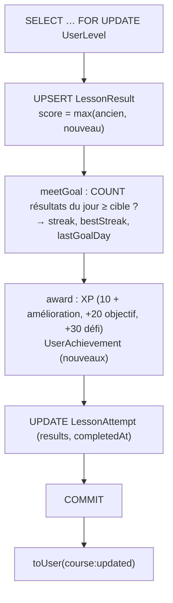
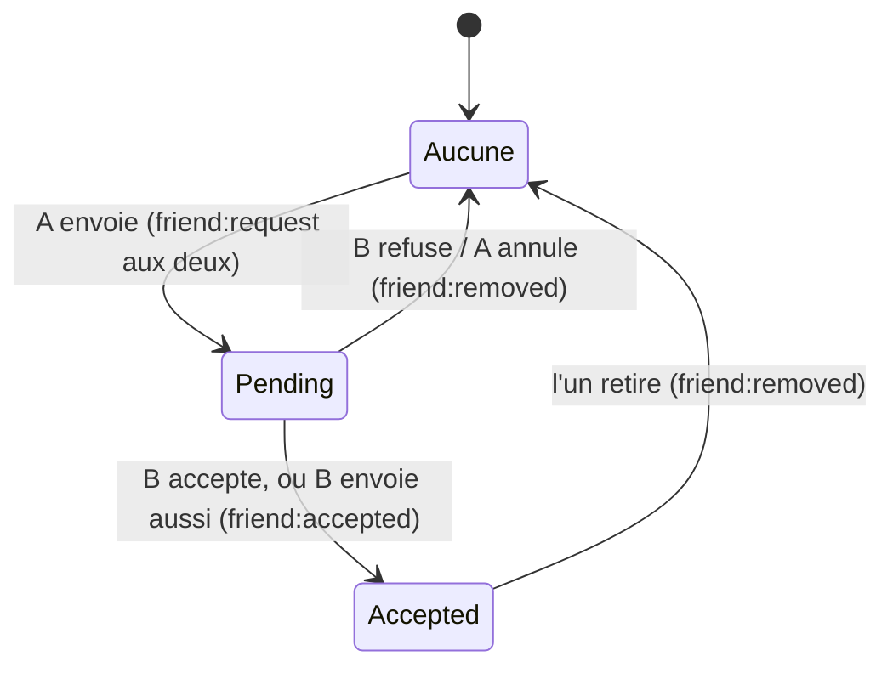

# Diagramme · Flux des fonctionnalités principales

## Le parcours apprenant

## Placement (machine à états)

## Une tentative de leçon

## Fin de leçon : ce qui est écrit, dans une seule transaction

## Amitié

