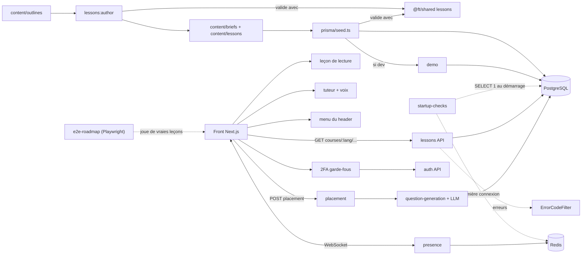

# Mes modules — sommaire

Un dossier par module où j'ai travaillé. Chaque dossier contient des diagrammes mermaid (fichiers, chemin d'exécution, décisions), un exemple concret pas à pas et une section « Questions possibles à l'oral ».

La liste complète des fichiers que j'ai touchés est dans [docs/code-ownership.md](../../code-ownership.md). Mon parcours en chiffres est dans [ma-trace.md](ma-trace.md).

## Ordre de lecture conseillé

| # | Dossier | Code | PR |
| - | ------- | ---- | -- |
| 1 | [shared-lessons/](shared-lessons/README.md) — schémas et validateurs des leçons (**priorité**) | `packages/shared/src/lessons/` | #142, #162 |
| 2 | [lessons-api/](lessons-api/README.md) — routes today, liste, détail, recherche | `apps/api/src/lessons/` | #128, #178 |
| 3 | [lessons-api/request-lifecycle.md](lessons-api/request-lifecycle.md) — vie d'une requête NestJS | `app.setup.ts`, `app.module.ts` | — |
| 4 | [error-codes/](error-codes/README.md) — un code d'erreur dans chaque réponse | `error-code.filter.ts`, `validation.pipe.ts` | #126 |
| 5 | [throttler/](throttler/README.md) — limite de requêtes par identité | `apps/api/src/throttler/` | #20 |
| 6 | [startup-checks/](startup-checks/README.md) — refuser une mauvaise `DATABASE_URL` ou `REDIS_URL` au démarrage | `prisma.service.ts`, `redis.service.ts` | #222 |
| 7 | [seed/](seed/README.md) — remplir la base depuis `content/` | `apps/api/prisma/seed.ts` | #58, #140, #142, #143 |
| 8 | [llm-question-generation/](llm-question-generation/README.md) — questions générées par LLM | `apps/api/src/llm/`, `question-generation/` | #69, #111, #121 |
| 9 | [lessons-author/](lessons-author/README.md) — outil `lessons:author` | `apps/api/scripts/lessons/` | #178 |
| 10 | [demo/](demo/README.md) — apprenants de démo | `apps/api/src/demo/` | #143 |
| 11 | [presence/](presence/README.md) — statut en ligne : compteur Redis, point vert des amis | `apps/api/src/presence/`, `presence-dot.tsx`, `lib/presence.ts` | #195 |
| 12 | [reading-lesson/](reading-lesson/README.md) — la leçon de lecture dans le navigateur | `components/lesson/kinds/reading.tsx`, `lib/reading.ts` | #203 |
| 13 | [tutor-and-voice/](tutor-and-voice/README.md) — réponses du tuteur en Markdown, voix « Écouter » | `tutor-answer.tsx`, `lib/voice.ts` | #214 |
| 14 | [header-menu/](header-menu/README.md) — menu du header, cartes du cours, écrans de téléphone | `header-menu.tsx`, `course-menu.tsx`, `scroll-lock.ts` | #220 |
| 15 | [two-factor-guards/](two-factor-guards/README.md) — garde-fous de la 2FA | `two-factor.service.ts`, `two-factor-panel.tsx` | #218, #219 |
| 16 | [e2e-roadmap/](e2e-roadmap/README.md) — test navigateur du parcours et des leçons | `e2e/tests/roadmap.spec.ts`, `e2e/support/lesson-play.ts` | #202, #203, #220 |
| 17 | [privacy-and-tu/](privacy-and-tu/README.md) — politique de confidentialité honnête, tutoiement en français | `lib/legal-content/`, `messages/fr.json`, `content/` | #206, #125, #208 |

## Fichiers par dossier

- **shared-lessons/** : [README](shared-lessons/README.md) · [schemas](shared-lessons/schemas.md) · [validation](shared-lessons/validation.md) · [domain](shared-lessons/domain.md) · [questions-oral](shared-lessons/questions-oral.md)
- **lessons-api/** : [README](lessons-api/README.md) · [request-lifecycle](lessons-api/request-lifecycle.md)
- **error-codes/** : [README](error-codes/README.md)
- **throttler/** : [README](throttler/README.md)
- **startup-checks/** : [README](startup-checks/README.md)
- **seed/** : [README](seed/README.md)
- **llm-question-generation/** : [README](llm-question-generation/README.md) · [providers](llm-question-generation/providers.md) · [prompt](llm-question-generation/prompt.md)
- **lessons-author/** : [README](lessons-author/README.md) · [CONCEPTS](lessons-author/concepts.md)
- **demo/** : [README](demo/README.md) · [CONCEPTS](demo/concepts.md)
- **presence/** : [README](presence/README.md)
- **reading-lesson/** : [README](reading-lesson/README.md)
- **tutor-and-voice/** : [README](tutor-and-voice/README.md)
- **header-menu/** : [README](header-menu/README.md)
- **two-factor-guards/** : [README](two-factor-guards/README.md)
- **e2e-roadmap/** : [README](e2e-roadmap/README.md)
- **privacy-and-tu/** : [README](privacy-and-tu/README.md)

## Comment tout s'enchaîne

