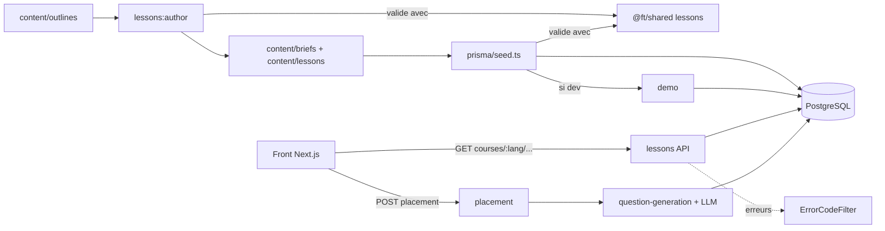

# Mes modules — sommaire

Un dossier par module où j'ai travaillé. Chaque dossier contient des diagrammes mermaid (fichiers, chemin d'exécution, décisions), un exemple concret pas à pas et une section « Questions possibles à l'oral ».

## Ordre de lecture conseillé

| # | Dossier | Code | PR |
| - | ------- | ---- | -- |
| 1 | [shared-lessons/](shared-lessons/README.md) — schémas et validateurs des leçons (**priorité**) | `packages/shared/src/lessons/` | #142, #162 |
| 2 | [lessons-api/](lessons-api/README.md) — routes today, liste, détail, recherche | `apps/api/src/lessons/` | #128, #178 |
| 3 | [lessons-api/request-lifecycle.md](lessons-api/request-lifecycle.md) — vie d'une requête NestJS | `app.setup.ts`, `app.module.ts` | — |
| 4 | [error-codes/](error-codes/README.md) — un code d'erreur dans chaque réponse | `error-code.filter.ts`, `validation.pipe.ts` | #126 |
| 5 | [throttler/](throttler/README.md) — limite de requêtes par identité | `apps/api/src/throttler/` | #20 |
| 6 | [seed/](seed/README.md) — remplir la base depuis `content/` | `apps/api/prisma/seed.ts` | #58, #140, #142, #143 |
| 7 | [llm-question-generation/](llm-question-generation/README.md) — questions générées par LLM | `apps/api/src/llm/`, `question-generation/` | #69, #111, #121 |
| 8 | [lessons-author/](lessons-author/README.md) — outil `lessons:author` | `apps/api/scripts/lessons/` | #178 |
| 9 | [demo/](demo/README.md) — apprenants de démo | `apps/api/src/demo/` | #143 |
| 10 | presence/ — statut en ligne (`PresenceService`, compteur Redis, point vert) : **pas encore écrit** | `apps/api/src/presence/`, `apps/web/components/presence-dot.tsx` | #195 |

## Fichiers par dossier

- **shared-lessons/** : [README](shared-lessons/README.md) · [schemas](shared-lessons/schemas.md) · [validation](shared-lessons/validation.md) · [domain](shared-lessons/domain.md) · [questions-oral](shared-lessons/questions-oral.md)
- **lessons-api/** : [README](lessons-api/README.md) · [request-lifecycle](lessons-api/request-lifecycle.md)
- **error-codes/** : [README](error-codes/README.md)
- **throttler/** : [README](throttler/README.md)
- **seed/** : [README](seed/README.md)
- **llm-question-generation/** : [README](llm-question-generation/README.md) · [providers](llm-question-generation/providers.md) · [prompt](llm-question-generation/prompt.md)
- **lessons-author/** : [README](lessons-author/README.md) · [CONCEPTS](lessons-author/concepts.md)
- **demo/** : [README](demo/README.md) · [CONCEPTS](demo/concepts.md)

## Comment tout s'enchaîne

