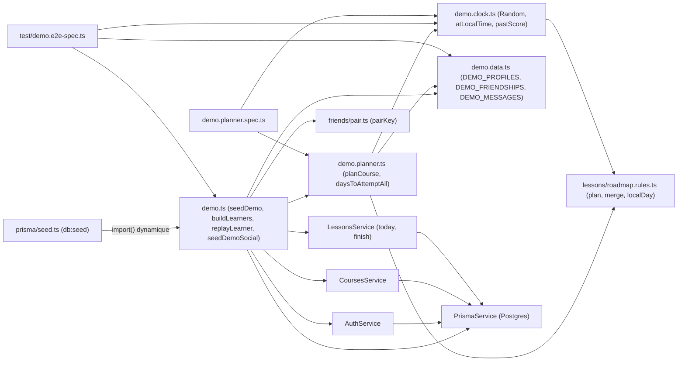
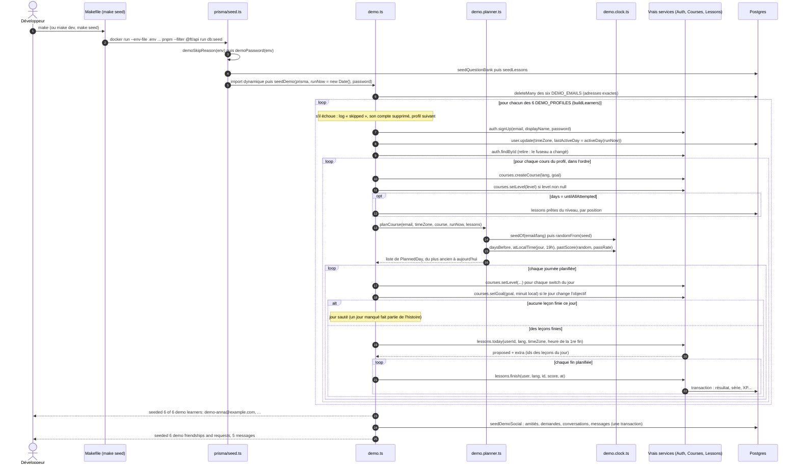
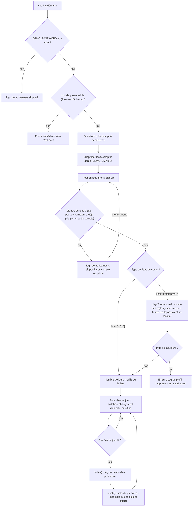

# Module annexe · Les apprenants de démo (PR #143, issue #85)

> Auteur : Endrit (#143). Ajouts d'autres depuis : Bastian (#171 : le replay ne prend que les leçons
> « prêtes », et `slice(0, offered.length)` au lieu d'une erreur), Victor (#181 : `new SocketsService()` ;
> #193 : `lastActiveDay`).

> Fichiers de ce dossier :
> - **README.md** (ce fichier) : le rôle, le déclenchement, les fichiers, les diagrammes, un
>   exemple réel, les questions d'oral.
> - [concepts.md](concepts.md) : PRNG à graine fixe, déterminisme, horloge injectée, fuseaux
>   horaires, expliqués simplement.

---

## 1. À quoi sert ce module ?

Quand on lance l'application en développement, la base est vide : aucun utilisateur n'a de série (streak), de résultats, ni de niveau terminé. Pour tester ou montrer les pages (« Aujourd'hui », la série, « Récemment actifs », « Commencer A2 »…), il faut des comptes **qui ont déjà un passé**.

Le module `demo` crée **6 apprenants de démo** (`demo-anna@example.com` … `demo-felix@example.com`) avec des semaines d'historique.

**L'idée importante : on ne fabrique pas les lignes de la base à la main.** On **rejoue** la vie de chaque apprenant, **jour par jour**, en appelant les **vrais services** de l'API (`AuthService.signUp`, `CoursesService.createCourse` / `setLevel`, `LessonsService.today` / `finish`), avec une **horloge simulée** (on leur passe la date au lieu de lire l'heure réelle).

**Analogie : un magnétoscope.** On a le scénario de chaque personnage (`demo.data.ts`). Le planificateur (`demo.planner.ts`) découpe le scénario en journées. Le replay (`demo.ts`) « joue » chaque journée devant les vrais services, en avançant l'horloge à la main. Comme ce sont les vraies règles qui décident, les séries, les résultats et les niveaux terminés sont **forcément cohérents**. Et si les règles changent plus tard (par exemple l'XP, #95), les apprenants de démo en profitent automatiquement.

---

## 2. Quand et comment c'est déclenché

Le module n'est **jamais** appelé par l'API en marche. Il est appelé par le **seed** ([apps/api/prisma/seed.ts](../../../../apps/api/prisma/seed.ts)), le script qui remplit la base.

**Seed** = « graine » : le script qui met les données de départ dans la base (banque de questions, leçons, et ici les apprenants de démo).

### La condition

Dans `seed.ts`, `demoSkipReason(env)` : `DEMO_PASSWORD` doit être **non vide**. Sinon : « DEMO_PASSWORD is empty ».

`NODE_ENV` ne joue plus aucun rôle (au début, il fallait aussi `NODE_ENV=development`) : la démo existe dans un checkout **et** sur un serveur, dès que `DEMO_PASSWORD` est rempli.

Puis `demoPassword(env)` vérifie le mot de passe avec les **mêmes règles que l'inscription** (`PasswordSchema` : 12 à 128 caractères, une minuscule, une majuscule, un chiffre). S'il est mauvais, le seed **échoue tout de suite, avant d'écrire quoi que ce soit**.

Le code de démo est chargé avec un `import()` **dynamique**, seulement si on en a besoin : « un seed sans `DEMO_PASSWORD` ne lit même pas le code de démo ».

### Qui lance le seed ?

| Chemin | Lance le seed ? | Démo créée ? |
|---|---|---|
| `make` (cible `all` : ci → run → …) | oui, via `run` → `db-ready` → `seed` | oui si `.env` a `DEMO_PASSWORD` rempli ([.env.example](../../../../.env.example) le laisse vide) |
| `make dev` (stack de dev, hot reload) | oui, via `db-ready` → `seed` | idem |
| `make run` / `make seed` / `make db-ready` | oui | idem |
| Déploiement ([compose.deploy.yml](../../../../compose.deploy.yml), service `migrate`) | oui, `prisma migrate deploy && db:seed` | **oui** si le `.env` du serveur a `DEMO_PASSWORD` : ce conteneur reçoit `DATABASE_URL` et `DEMO_PASSWORD`, rien d'autre |
| Sans fichier `.env` | oui | **non** : `DEMO_PASSWORD` absent |

Détails du [Makefile](../../../../Makefile) : `make seed` construit l'image « tooling » puis lance `docker run --rm --network … --env-file .env <image> pnpm --filter @ft/api run db:seed`. Le seed lit donc le `.env` du dépôt (**pas** les variables des fichiers compose). `DEMO_PASSWORD` est une clé « seed only » (`SEED_ONLY` dans [scripts/check-env-example.sh](../../../../scripts/check-env-example.sh)) : sur un serveur, seul le service ponctuel `migrate` la reçoit, jamais un service qui tourne en continu.

Le script `db:seed` est `tsx prisma/seed.ts` ([apps/api/package.json](../../../../apps/api/package.json)).

### Ordre dans le seed

```
seedQuestionBank  →  seedLessons  →  (si autorisé) seedDemo(prisma, { runNow: new Date(), password })
```

Les leçons doivent être chargées **avant**, car les apprenants de démo jouent les leçons « prêtes » de la base.

---

## 3. Les fichiers et leur rôle

| Fichier | Rôle |
|---|---|
| [demo.data.ts](../../../../apps/api/src/demo/demo.data.ts) | **Les scénarios**, en données pures : `DEMO_PROFILES` (6 profils), `DEMO_FRIENDSHIPS` et `DEMO_MESSAGES` (ce qu'ils partagent), `demoEmail`, `demoDisplayName`, `DEMO_EMAILS`, `SMALLEST_LEVEL = 12` |
| [demo.planner.ts](../../../../apps/api/src/demo/demo.planner.ts) | **Le planificateur**, pur (pas de base) : `planCourse` transforme un cours en liste de journées (changements de niveau, heures et scores des leçons finies). `daysToAttemptAll` calcule combien de jours il faut pour tout tenter |
| [demo.clock.ts](../../../../apps/api/src/demo/demo.clock.ts) | **Le temps et le hasard**, purs : `daysBefore`, `atLocalTime` (minuit ou 19 h dans un fuseau), `seedOf` (graine depuis un texte), `randomFrom` (générateur aléatoire à graine fixe, type `Random`), `pastScore` |
| [demo.ts](../../../../apps/api/src/demo/demo.ts) | **Le replay** : `seedDemo` (supprime puis recrée les 6), `buildLearners` (les construit un par un, saute celui qui échoue), `replayLearner` (un apprenant, renvoie son id), `replayCourse` (un cours jour par jour), `seedDemoSocial` (amitiés, demandes, messages) |
| [demo.planner.spec.ts](../../../../apps/api/src/demo/demo.planner.spec.ts) | Tests unitaires du planificateur, de l'horloge et des données : profils, 12 leçons prêtes dans `content/`, amitiés et messages (sans base) |
| [demo.e2e-spec.ts](../../../../apps/api/test/demo.e2e-spec.ts) | Test **e2e** contre un vrai Postgres : rejoue les profils d'anna, ben, chloe, david et eva sous d'autres emails et vérifie la page « Aujourd'hui », puis `buildLearners` et `seedDemoSocial` |
| [seed.ts](../../../../apps/api/prisma/seed.ts) | Le déclencheur : `demoSkipReason`, `demoPassword`, puis `seedDemo` |
| [lessons.service.ts](../../../../apps/api/src/lessons/lessons.service.ts) | `today(...)` et `finish(...)`. `finish` existe **uniquement pour le replay** : aucune route HTTP ne l'appelle |
| [roadmap.rules.ts](../../../../apps/api/src/lessons/roadmap.rules.ts) | Les vraies règles réutilisées par le planificateur : `plan`, `merge`, `localDay`, `previousDay` |

### Les 6 profils (résumé de `demo.data.ts`)

| Profil | Fuseau | Ce que la page montre (sur Français A1, le niveau de démo) |
|---|---|---|
| anna | Europe/Zurich | série 3, objectif du jour atteint, `streak3` gagné aujourd'hui |
| ben | America/New_York | série 10, « Atteins l'objectif pour la garder », 1 sur 3 aujourd'hui (10 min par jour jusqu'à ce matin, 30 depuis) ; ses résultats A1 survivent à un passage en A2 puis retour |
| chloe | Asia/Tokyo | série 0, meilleure 7 (objectif monté à 30 il y a deux jours, raté) ; aujourd'hui 2 sur 3 dont un raté |
| david | Europe/London | série 6 encore vivante, 0 aujourd'hui |
| eva | Europe/Berlin | Français A1 terminé, « Commencer A2 » |
| felix | UTC | pas de français ; son cours d'anglais n'a pas de niveau → arrive à l'étape 2 de l'onboarding |

Chaque niveau a **12 leçons prêtes** dans `content/` (`SMALLEST_LEVEL = 12`, et une spec unitaire vérifie que le Français A1 en a au moins autant). anna, ben, chloe et david finissent **moins de 12 leçons en tout**, aujourd'hui compris (3, 11, 10 et 6) : une leçon reste non tentée, donc le niveau n'est jamais terminé, et les scores du jour tombent sur des leçons pas encore réussies, donc chaque carte du jour affiche le score écrit dans les données (75 pour ben, 85 et 40 pour chloe).

Entre eux (`DEMO_FRIENDSHIPS`, `DEMO_MESSAGES`) : anna est amie avec ben et chloe, a une demande de felix qui l'attend (le badge) et une envoyée à david, et 2 messages non lus de ben (le badge du chat) ; chloe et anna ont échangé 3 messages, lus, un jour avant le seed ; ben et david, eva et chloe sont amis aussi.

Chaque cours d'un profil a : `lang`, `level` (ou `null`), `switches` (changements de niveau, « il y a N jours »), `goal` (objectif quotidien en minutes), `goalChanges` (changements d'objectif, « il y a N jours » : un `setGoal` à minuit local, avant les leçons du jour), `passRate` (part des leçons passées dans le passé), `days` (nombre de leçons finies chaque jour passé, hier en premier, **ou** `{ untilAllAttempted: n }`), `todayScores` (scores d'aujourd'hui, **fixes**).

### Diagramme des dépendances entre fichiers



`demo.ts` est dans `src/` (pas dans `prisma/`) **exprès** : si un service gagne une dépendance, c'est le **typecheck** qui casse, pas le seed au moment de l'exécuter.

Les services sont construits **à la main** (`new AuthService(prisma)`, `new CoursesService(prisma, new SocketsService())`…), car le seed tourne avec `tsx`, **hors de NestJS** (pas d'injection de dépendances). Le `SocketsService` n'est attaché à aucun serveur socket : les changements de niveau et d'objectif du replay ne notifient personne.

---

## 4. Le chemin d'exécution complet

### 4.1 Diagramme de séquence



### 4.2 Les décisions



Note : si le niveau d'un cours « extra » n'a pas de leçon prête, `today()` n'en propose aucune, et le replay ne finit **rien** ce jour-là au lieu de faire échouer le seed (`slice(0, offered.length)`). Aujourd'hui chaque niveau a 12 leçons prêtes, donc les cours « extra » finissent bien des leçons ; le `slice` sert pour une base sans leçons.

---

## 5. Que se passe-t-il concrètement ? Exemple pas à pas

Hypothèse : `.env` contient `DEMO_PASSWORD=Correct-Horse-9`, et on lance `make seed` le 26 octobre 2026 à 10:00 UTC.

1. `make seed` construit l'image tooling et lance `pnpm --filter @ft/api run db:seed` dans un conteneur, avec `.env`.
2. `demoSkipReason` renvoie `null` (tout est bon), `demoPassword` valide le mot de passe.
3. Les questions puis les leçons sont chargées.
4. `seedDemo` est importé, puis appelé avec `runNow = 2026-10-26T10:00Z`.
5. Il supprime les six utilisateurs `demo-anna@example.com` … `demo-felix@example.com`, par leurs adresses exactes (`DEMO_EMAILS`, jamais un motif `demo-*`) (la cascade supprime leurs cours et résultats, leurs amitiés et leurs conversations). Quelqu'un connecté en `demo.anna` est déconnecté : nouveaux ids.
6. **anna** (Europe/Zurich, Français A1, objectif 10 min, `days: [1, 1]`, `todayScores: [80]`) :
   - `signUp` crée `demo-anna@example.com` (pseudo `demo.anna`) ;
   - on écrit son fuseau et `lastActiveDay` (elle apparaît dans « Récemment actifs » sans avoir ouvert de socket) ;
   - `createCourse(fr, 10)` puis `setLevel(A1)` ;
   - `planCourse` : aujourd'hui pour elle = `localDay(runNow, 'Europe/Zurich')` = `2026-10-26`. Le plus ancien jour = 2 jours avant. Le générateur est initialisé avec `seedOf('demo-anna@example.com/fr')`.
     - **24 octobre** : 1 fin à 19:00 heure de Zurich, score tiré par `pastScore(random, 0.8)`.
     - **25 octobre** : 1 fin à 19:00, score suivant de la même série.
     - **26 octobre (aujourd'hui)** : 1 fin avec le score fixe 80, placée au milieu entre minuit local et `runNow`.
   - Pour chaque jour : `lessons.today(...)` à l'heure de la première fin donne les leçons proposées ; `lessons.finish(...)` termine la première avec le score prévu. Ce sont les vraies règles qui calculent la série (3), l'objectif du jour atteint, et `streak3`, gagné aujourd'hui.
7. **eva** (Français A1, `untilAllAttempted: 6`) : `daysToAttemptAll` simule, avec les **vraies** fonctions `plan` et `merge`, des journées de 6 leçons jusqu'à ce que chaque leçon prête de A1 ait un résultat (une leçon ratée revient d'abord le lendemain, donc ça dépend des scores ; avec 12 leçons prêtes : 3 jours de 6). Puis `planCourse` recrée **une nouvelle série aléatoire avec la même graine** : le replay obtient **exactement les mêmes scores** que ceux utilisés pour le calcul. Avec `passRate: 0.9`, plus de 80 % passent : le niveau est terminé, la page montre « Commencer A2 ».
8. Les 4 autres suivent le même chemin. Pour ben et chloe, un `setGoal` à minuit local fait passer l'objectif de 10 à 30 (ben aujourd'hui, chloe il y a deux jours). Fin : `seeded 6 of 6 demo learners: demo-anna@example.com, …`. Puis `seedDemoSocial` écrit les amitiés, la demande et les messages : `seeded 6 demo friendships and requests, 5 messages`.
9. Si on relance `make seed` **le même jour**, on obtient les mêmes scores, jours, séries et résultats. Pas la même XP : le défi du jour dépend de l'id du cours, un nouvel uuid à chaque seed. Un autre jour, les dates glissent pour que « aujourd'hui » soit toujours le jour du lancement.

---

## 6. Le test e2e (`demo.e2e-spec.ts`)

- Il tourne contre un **vrai Postgres** (`pnpm --filter @ft/api run test:e2e`, lancé aussi par la CI dans [ci.yml](../../../../.github/workflows/ci.yml)).
- Il **n'utilise jamais** les vrais comptes démo ni `seedDemo` (qui supprimerait les six apprenants de démo de la base). Il rejoue les profils d'**anna**, **ben**, **chloe**, **david** et **eva** sous des emails `replay-<nom>-<stamp>@example.com`, et seulement leur cours de français. eva a un email fixe (`replay-eva-pinned@example.com`) : son niveau terminé dépend des scores, donc de l'email.
- La CI ne charge pas de leçons : le test crée des leçons factices `fr-test-demo-aa`, `-ab`… pour atteindre 12 leçons prêtes en A1 (`SMALLEST_LEVEL`), la taille pour laquelle les profils sont écrits.
- L'instant est **injecté** : `RUN_NOW` = 00:03 à Tokyo le 26/10/2026 (encore le 25 en UTC).
- Vérifications :
  - anna : série `{ current: 3, best: 3, today: true }`, objectif atteint, 1 leçon à 80, `streak3` dans `earnedToday` ;
  - ben : série `{ current: 10, best: 10, today: false }`, 1 leçon faite à 75 (`done`), cible 3 (objectif 30), niveau pas terminé, `streak7` gagné, toujours en A1 après le passage A2 → A1, et tous ses résultats A1 conservés ;
  - chloe : jour `2026-10-26`, série `{ current: 0, best: 7 }`, scores `[85, 40]`, statuts `['done', 'failed']`, niveau pas terminé, `streak7` gagné ;
  - la première fin du jour de chloe est stockée au `2026-10-25` en UTC mais compte pour **son** jour, le 26 : preuve que les fuseaux sont bien gérés ;
  - david : série `{ current: 6, best: 6, today: false }`, rien aujourd'hui, niveau pas terminé ;
  - eva : toutes les leçons tentées, niveau terminé, `levelAfter` A2, `levelA1` gagné ;
  - `buildLearners` : un apprenant dont le pseudo est déjà pris, et un qui échoue après son inscription, sont sautés sans laisser de compte ; le suivant est construit ;
  - `seedDemoSocial` sur six utilisateurs nus : 1 demande en attente pour anna, 2 messages non lus de ben, amie avec chloe, pas avec felix ; sans ben, aucune ligne de ben.
- `afterAll` supprime ses utilisateurs (tous les `replay-*`) puis ses leçons factices (les utilisateurs d'abord : leurs résultats bloqueraient la suppression des leçons).

---

## 7. Questions possibles à l'oral

**Q : Pourquoi rejouer avec les vrais services au lieu d'insérer les lignes directement ?**

R : Pour que les données respectent **toutes** les règles (série, objectif, niveau terminé). Écrire les lignes à la main, c'est risquer des états impossibles. Et quand une règle évolue (XP), la démo suit sans rien changer.

**Q : C'est quoi une « horloge injectée » ?**

R : Le code ne lit pas `new Date()` lui-même : il reçoit l'instant en paramètre (`now`, `at`). On peut donc lui faire croire qu'on est il y a 12 jours, à 19 h.

**Q : Comment les scores sont-ils « aléatoires » mais toujours les mêmes ?**

R : Un générateur pseudo-aléatoire (mulberry32) initialisé avec une **graine** calculée depuis l'email et la langue (`seedOf`, hash FNV-1a). Même graine → même suite de nombres → mêmes scores.

**Q : Pourquoi une graine par apprenant ET par langue ?**

R : Pour qu'ajouter un cours « extra » ne décale pas les scores du cours de français.

**Q : Pourquoi `pastScore` tire toujours deux nombres ?**

R : Pour que changer le `passRate` ne décale pas tous les scores suivants : chaque score consomme toujours exactement deux tirages.

**Q : Pourquoi les scores d'aujourd'hui sont-ils fixes ?**

R : Pour que l'état d'aujourd'hui (ce que la page montre) ne dépende jamais du hasard.

**Q : La démo peut-elle apparaître en production ?**

R : Oui, sur un serveur dont le `.env` a `DEMO_PASSWORD` : le service `migrate` du déploiement le passe au seed, et les 6 sont recréés à chaque release. Seul `migrate` reçoit le mot de passe, jamais l'api. Sans `DEMO_PASSWORD`, la démo est sautée, et le code de démo n'est même pas importé, mais les apprenants déjà créés restent, avec l'ancien mot de passe : la commande pour les supprimer est dans [deployment.md](../../../operations/deployment.md#demo-learners).

**Q : Que se passe-t-il si on relance le seed ?**

R : Il supprime les 6 comptes démo et les recrée, avec leurs amitiés et leurs messages. Le « aujourd'hui » des apprenants est donc toujours celui du lancement.

**Q : Et si un apprenant échoue pendant un déploiement ?**

R : `buildLearners` le note dans le log (« skipped »), supprime ce qu'il a écrit et passe au suivant : le seed finit sans erreur, donc le déploiement continue. Le mot de passe, lui, est vérifié avant toute écriture : un mauvais fait échouer le seed tout de suite.

**Q : Pourquoi anna, ben, chloe et david finissent-ils moins de 12 leçons ?**

R : Un niveau est terminé quand toutes ses leçons sont tentées et que 80 % sont réussies, et une leçon ratée revient en premier. Avec 12 leçons prêtes, en finir 12 ou plus finit par tout tenter : le niveau serait terminé, comme pour eva. Et les scores du jour tomberaient sur des leçons déjà réussies, où le meilleur score est gardé (le 75 de ben s'afficherait 93). Avec moins de 12, une leçon reste non tentée, et chaque carte du jour montre son score. Pour une longue série avec peu de leçons, ben et chloe commencent à 10 minutes (une leçon par jour), puis montent l'objectif avec `goalChanges`.

**Q : Pourquoi les amitiés et les messages sont-ils écrits directement, sans les services ?**

R : Rien n'en découle (pas de série, pas de résultat), donc il n'y a pas de règle à faire respecter en les rejouant. Et les services gênent : `FriendsService` veut Redis pour la présence, `MessagesService.send` met l'heure réelle et consomme une limite de débit. `seedDemoSocial` écrit donc les lignes dans une transaction, avec les mêmes clés que `MessagesService.send` (`pairKey`, le plus petit id en premier), et une spec unitaire vérifie les règles (messages seulement entre amis acceptés, une ligne par paire).

**Q : Pourquoi `finish` existe dans `LessonsService` si aucune route ne l'appelle ?**

R : Il sert au replay : finir une leçon avec un score donné, à un instant donné, dans une transaction, en passant par la même logique (`applyFinish`) que le vrai jeu.

**Q : Comment gères-tu les fuseaux horaires ?**

R : `atLocalTime` calcule l'instant UTC qui correspond à « minuit » ou « 19 h » dans le fuseau de l'apprenant, en mesurant le décalage deux fois pour les jours de changement d'heure. Le test e2e le vérifie avec chloe à Tokyo.

**Q : `daysToAttemptAll`, c'est quoi ?**

R : Pour eva, on ne sait pas d'avance combien de jours il faut pour tout tenter (une leçon ratée revient d'abord). On simule les vraies règles (`plan`, `merge`) jour par jour avec les mêmes scores que le replay, jusqu'à ce que toutes les leçons aient un résultat. Garde-fou : 365 jours maximum.

**Q : Pourquoi les services sont-ils créés avec `new` ?**

R : Le seed tourne hors de NestJS (avec `tsx`), donc pas d'injection de dépendances. On construit les services à la main avec le même `PrismaService`.
