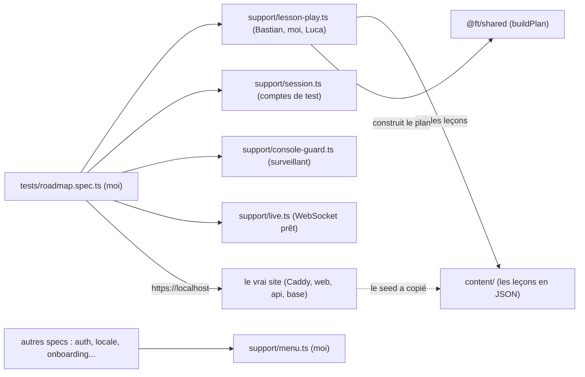
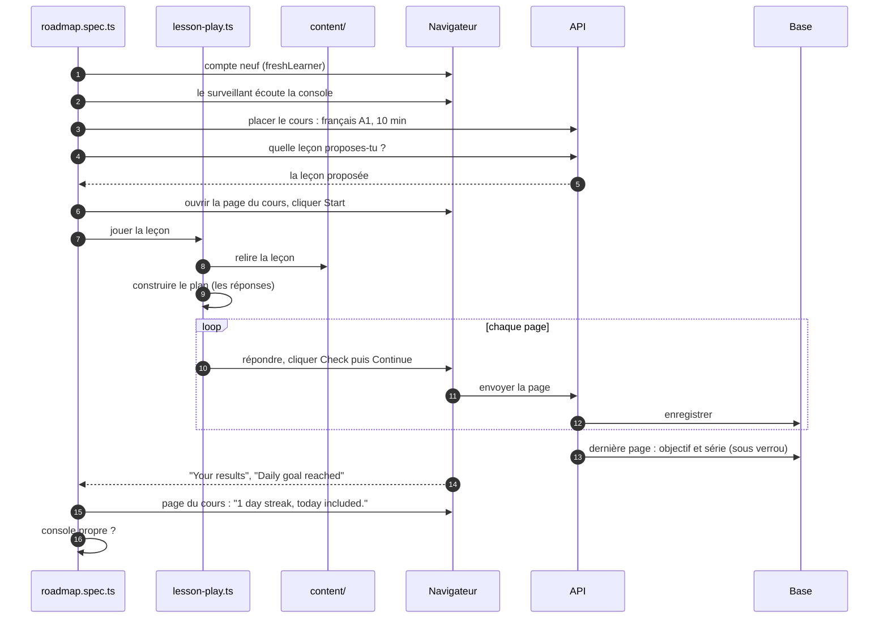
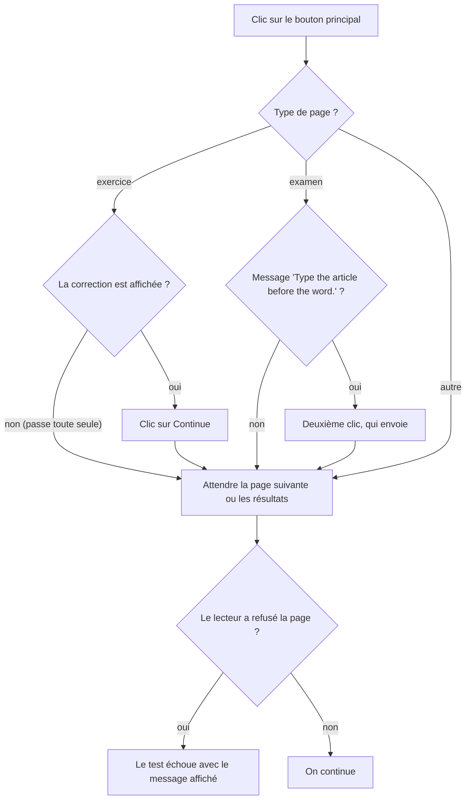
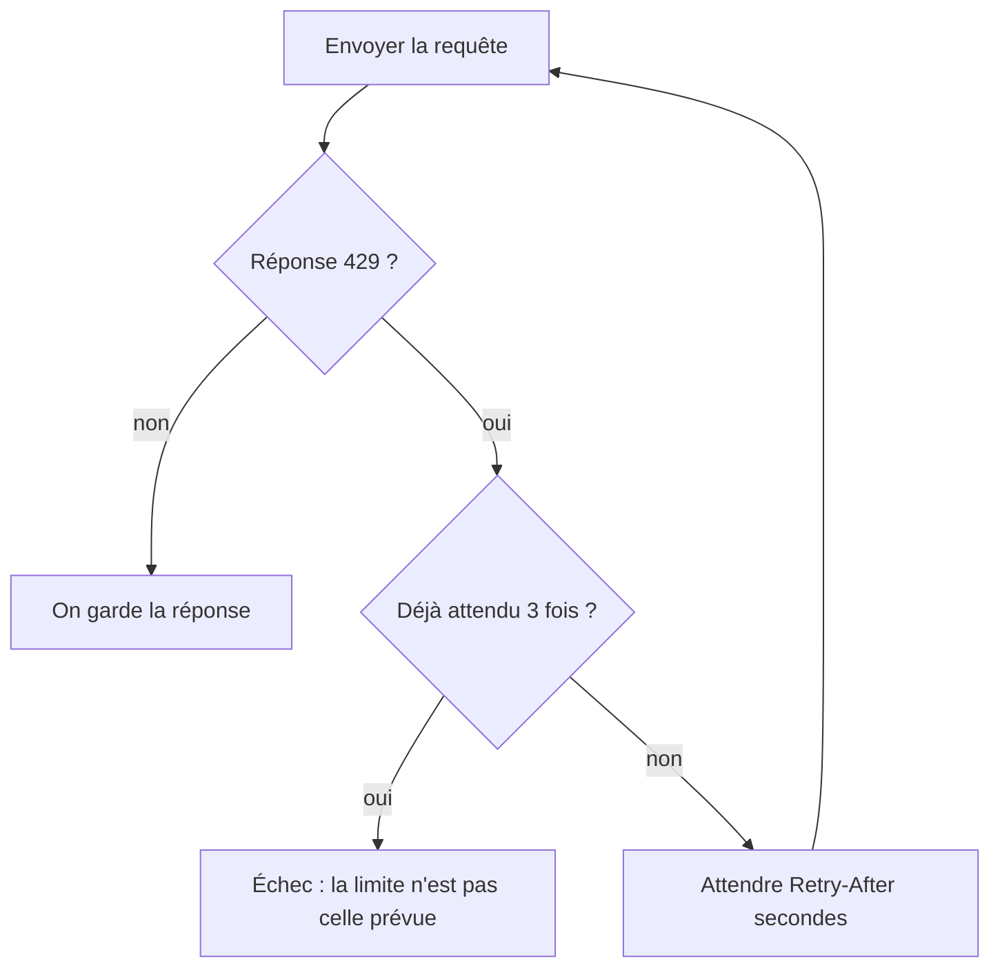
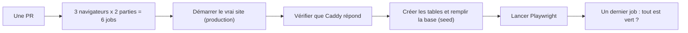

# Tests navigateur : la boucle parcours et leçon (`roadmap.spec.ts`)

> PR concernée : **#202** « test(e2e): #96 the roadmap and lesson loop on real lessons » (squash `bc624d3`). Puis **#203** (squash `0778fce`, la leçon de lecture #148), qui ajoute trois cas de lecture au même fichier. Puis **#220** (squash `8586314`), qui crée `menu.ts`.
> Fichiers à moi : [roadmap.spec.ts](../../../../e2e/tests/roadmap.spec.ts) (créé en #202, complété en #203) et [menu.ts](../../../../e2e/support/menu.ts) (créé en #220). Dans [lesson-play.ts](../../../../e2e/support/lesson-play.ts), j'ai écrit `playToLastPage` (#202) et `skimDocument` (#203).
> **Pas à moi** : `lesson-play.ts` a été **créé par Bastian** (`bastian-schnitzler`, #192, puis #197). **Luca** l'a aussi modifié (#205 : le bouton « Continue to the exam »). [console-guard.ts](../../../../e2e/support/console-guard.ts) et [live.ts](../../../../e2e/support/live.ts) sont de VictorBro. [session.ts](../../../../e2e/support/session.ts) est partagé (VictorBro, Luca, Bastian, moi). La config Playwright et le workflow CI sont surtout de VictorBro et Bastian.
> Voir aussi : [../throttler/README.md](../throttler/README.md) (la limite de 100 requêtes par minute) et [../seed/README.md](../seed/README.md) (comment les leçons arrivent dans la base).

## 1. À quoi ça sert

### L'idée en mots simples

Un **test end-to-end** (« e2e », de bout en bout) joue le rôle d'un **vrai utilisateur**. Un robot ouvre un vrai navigateur. Il va sur le vrai site. Il clique sur les vrais boutons. Le site parle à la vraie API et à la vraie base de données. Rien n'est faux.

`roadmap.spec.ts` teste **le chemin principal d'un apprenant** (issue #96) :

1. Il s'inscrit et choisit un cours : français, niveau A1.
2. Il choisit un **objectif quotidien** : 10, 30 ou 60 minutes par jour.
3. La page du cours lui **propose** des leçons.
4. Il joue une leçon, page par page, jusqu'aux résultats.
5. L'objectif du jour est atteint. Sa **série** de jours commence.
6. Il retrouve la leçon dans la liste, marquée **Passed** (réussie).

Le test utilise les **vraies leçons** du dossier [`content/`](../../../../content/). Ce sont celles que les apprenants jouent. Si une vraie leçon casse l'écran de jeu, le test casse aussi.

### Le vrai problème : connaître les réponses

Le navigateur ne reçoit **jamais** les bonnes réponses. Sinon, un apprenant pourrait tricher en lisant la page.

Alors comment le robot sait-il quoi répondre ? Il fait comme un élève qui a le livre du prof. Il relit la leçon directement dans `content/`. Il construit la même liste de questions et de réponses que l'API (le « plan »). Puis il retrouve chaque question à l'écran grâce à son texte.

### Ce que le fichier vérifie (13 cas)

| Cas | En une phrase |
|---|---|
| objectif 10 | La leçon proposée remplit l'objectif et lance une série d'un jour. |
| objectif 30 | Une leçon avec zéro bonne réponse compte quand même pour la journée. |
| objectif 60 | La page du cours propose six leçons. |
| deux onglets | Deux leçons finies en même temps ne remplissent l'objectif qu'une fois. |
| refaire une leçon | Refaire une leçon le même jour monte le meilleur score à 100. |
| liste des leçons | Le filtre Passed, la page 2 par l'adresse, et la liste sans JavaScript. |
| Coming soon | Une leçon pas prête : « Coming soon » dans la liste, page 404 si on va à son adresse. |
| grammaire, vocabulaire, fonctions | Une leçon de chaque type jouée à 100, puis Passed dans la liste. |
| lecture (#203) | Une leçon de lecture jouée à 100, le compte à rebours sauté avec une fausse horloge. |
| lecture et rechargement (#203) | Recharger la page ne redonne pas de temps et ne réaffiche pas le texte caché. |
| tablette et téléphone (#203) | Le texte à lire est à côté des questions sur tablette, au-dessus sur téléphone. |

### Mots techniques

| Mot | Explication simple |
|---|---|
| **Playwright** | Une bibliothèque qui pilote de vrais navigateurs (Chromium, Firefox, WebKit) depuis du code. Comme une télécommande pour navigateur. |
| **Spec** | Un fichier de tests (`*.spec.ts`). |
| **Fixture** | Quelque chose que Playwright prépare avant le test et range après. Ici : un compte déjà inscrit. |
| **`freshLearner`** | Une fixture : un compte tout neuf, créé juste pour ce test. |
| **`onboarded`** | Une fixture : un compte partagé entre plusieurs tests, déjà inscrit en français A1. |
| **Locator** | Une façon de trouver un élément de la page. Par exemple « le bouton qui s'appelle Start the lesson ». |
| **`getByRole`** | Chercher un élément par son rôle (bouton, lien, titre) et son nom, comme le ferait un lecteur d'écran. |
| **Assertion** | Une vérification : `expect(...)`. Si elle est fausse, le test échoue. |
| **Assertion qui réessaie** | `toBeVisible()` ne regarde pas une seule fois. Il réessaie jusqu'à 10 secondes. Pas besoin d'écrire « attends 2 secondes ». |
| **`page.request`** | Appeler l'API directement, avec les cookies de l'utilisateur connecté. Comme passer par la porte de service au lieu de la vitrine. |
| **Contexte** | Un navigateur « propre », avec ses propres cookies. Deux contextes du même compte = deux onglets. |
| **Console guard** | Un surveillant de la console du navigateur. Une erreur ou un avertissement = le test échoue. |
| **Hydratation** | Next.js envoie d'abord une page HTML « morte ». Ensuite React rend les boutons actifs. Un clic trop tôt ne fait rien. |
| **Plan d'une leçon** | La liste des pages et des questions d'une leçon, avec les bonnes réponses. |
| **Unité** | Une question du plan. |
| **429** | Le code HTTP « trop de requêtes ». Il vient avec `Retry-After` : le nombre de secondes à attendre. |
| **Objectif quotidien** | Une leçon compte pour 10 minutes. Donc 10 min = 1 leçon, 30 = 3, 60 = 6. |
| **Série (streak)** | Le nombre de jours de suite où l'objectif a été atteint. |

## 2. Les fichiers

| Fichier | Rôle | Auteur |
|---|---|---|
| [e2e/tests/roadmap.spec.ts](../../../../e2e/tests/roadmap.spec.ts) | Les 13 cas. | moi (#202, #203) |
| [e2e/support/lesson-play.ts](../../../../e2e/support/lesson-play.ts) | Joue une leçon : dans le navigateur, ou directement par l'API. | **Bastian** (création), moi (`playToLastPage`, `skimDocument`), **Luca** (#205) |
| [e2e/support/menu.ts](../../../../e2e/support/menu.ts) | `openMenu` : ouvre le menu de l'en-tête. Utilisé par d'autres specs (auth, locale, onboarding…), pas par `roadmap.spec.ts`. | moi (#220) |
| [e2e/support/session.ts](../../../../e2e/support/session.ts) | Les comptes de test (`freshLearner`, `onboarded`) et `placeCourse`. | VictorBro, Luca, Bastian, moi |
| [e2e/support/console-guard.ts](../../../../e2e/support/console-guard.ts) | Le surveillant de la console (`watchConsole`) et `settle`. | VictorBro |
| [e2e/support/live.ts](../../../../e2e/support/live.ts) | `liveConnection` : attend que la connexion temps réel (WebSocket) soit prête. | VictorBro |
| [e2e/playwright.config.ts](../../../../e2e/playwright.config.ts) | Les réglages : 3 navigateurs, pas de nouvel essai, 2 tests en parallèle. | VictorBro, Bastian, Luca |
| [.github/workflows/e2e.yml](../../../../.github/workflows/e2e.yml) | Le lancement automatique sur GitHub à chaque PR. | VictorBro, Bastian |
| [e2e/package.json](../../../../e2e/package.json) | Le script `test:e2e`. | équipe |
| [Makefile](../../../../Makefile) | `make test-e2e`, `make playwright`, `make playwright-all`. | équipe |

### Diagramme des fichiers et dépendances



Le dossier `content/` sert deux fois. Le **seed** le copie dans la base : c'est ce que le site affiche. Et `lesson-play.ts` le relit : c'est comme ça qu'il connaît les réponses.

## 3. Le code, morceau par morceau

> Les extraits sont raccourcis : `// ...` marque ce qui est coupé, et les commentaires en français sont des explications ajoutées ici. Le code exact est dans le fichier lié.

### 3.1 Choisir les leçons tout seul

**Ce qui se passe.** Le test ne contient pas de liste de leçons écrite à la main. Il va chercher dans `content/` toutes les leçons de français A1 qui sont prêtes. Puis il les range de la plus courte à la plus longue.

**Pourquoi.** Une nouvelle leçon est testée sans que personne pense à l'ajouter. Et les cas qui jouent plusieurs leçons prennent les plus courtes : chaque page est une requête, et l'API n'en accepte que 100 par minute.

```ts
const BY_LENGTH = KINDS.flatMap((kind) => contentLessons(LANG, LEVEL, kind))
  .map((id) => {
    const { pages } = lessonPlan(id);
    return { id, pages: pages.length, units: pages.flatMap((p) => p.units).length };
  })
  .sort((a, b) => a.pages - b.pages || a.units - b.units || a.id.localeCompare(b.id))
  .map(({ id }) => id);
const SHORTEST = BY_LENGTH[0]!;
```

- `contentLessons` lit les fichiers de `content/briefs/` et garde la bonne langue, le bon niveau et le bon type.
- On trie par nombre de pages, puis de questions, puis par nom. Le nom sert à départager : l'ordre est toujours le même.

### 3.2 Ouvrir une page sans laisser de désordre

**Ce qui se passe.** Avant de faire quoi que ce soit sur une page, le test attend qu'elle soit **calme** : connexion temps réel prête, plus aucune requête en cours.

**Pourquoi.** Quitter une page qui travaille encore écrit un avertissement dans la console. Le surveillant ferait échouer le test pour rien. C'est comme attendre que quelqu'un ait fini sa phrase avant de partir.

```ts
async function visit(page: Page, url: string): Promise<void> {
  const live = liveConnection(page);
  await page.goto(url);
  await live;
  await settle(page);
}
```

On « arme » l'attente du WebSocket **avant** d'ouvrir la page. Sinon, la réponse pourrait arriver avant qu'on écoute.

### 3.3 Un cas complet : « objectif 10 »

**Ce qui se passe, étape par étape.**

1. Un compte neuf est créé.
2. Le surveillant de console commence à écouter.
3. Le compte est placé en français A1 avec 10 minutes par jour.
4. On demande à l'API quelle leçon elle propose.
5. On ouvre la page du cours. On voit « Reach your daily goal to start a streak. »
6. On clique sur Start, puis sur « Start the lesson ».
7. On joue toute la leçon avec les bonnes réponses.
8. On voit « Daily goal reached », puis « 1 day streak, today included. »
9. La console doit être restée propre.

```ts
test('goal 10: the proposed lesson meets the goal and starts the streak', async ({
  freshLearner: page,
}) => {
  const violations = watchConsole(page);
  await placeCourse(page, { lang: LANG, level: LEVEL, dailyGoal: 10 });
  const [proposed] = (await readToday(page)).proposed;
  // ...
  await page.getByRole('button', { name: 'Start the lesson' }).click();
  await page.waitForURL(/\/play$/);
  await playToResults(page, proposed!.id);
  await expect(page.getByText('Daily goal reached')).toBeVisible();
  // ...
  await expect(page.getByText('1 day streak, today included.')).toBeVisible();
  expectSilent(violations);
});
```

**Pourquoi un compte neuf ?** Jouer une leçon change l'objectif et la série du compte. D'autres tests lisent ces valeurs sur le compte partagé. Un compte neuf ne dérange personne.

**Pourquoi `placeCourse` passe par l'API ?** Choisir le cours n'est pas ce qu'on teste ici. Un autre test (onboarding) vérifie déjà ces écrans. Passer par l'API est plus rapide.

### 3.4 Le cas « deux onglets » : la course

**Ce qui se passe.** L'objectif est de 3 leçons. On en finit une. Puis on prépare deux autres leçons jusqu'à leur **dernière page**, dans deux onglets. Et on envoie les deux dernières pages **exactement en même temps**.

**Ce qu'on vérifie.** Une seule des deux réponses dit « objectif atteint à l'instant » (`goalJustMet`).

**Pourquoi c'est un vrai risque.** Imagine deux caissiers qui lisent le même compteur « 2 leçons faites » au même moment. Chacun ajoute la sienne et crie « 3, objectif atteint ! ». On l'aurait compté deux fois. Côté API, `lockCourse` dans [goal.ts](../../../../apps/api/src/lessons/goal.ts) (de Luca) verrouille la ligne du cours (`FOR UPDATE`) : le deuxième attend que le premier ait fini. Le test prouve que ce verrou marche.

```ts
const sendOne = await playToLastPage(page.request, LANG, second!);
const sendOther = await playToLastPage(other.request, LANG, third!);
const finished = await Promise.all([sendOne(), sendOther()]);

const met = finished.map((attempt) => attempt.results!.finish.goalJustMet);
expect(met.filter(Boolean), 'the goal met by one of the two').toHaveLength(1);
```

`Promise.all` lance les deux en même temps et attend les deux.

### 3.5 `playToLastPage` : préparer sans finir (ma partie de `lesson-play.ts`)

**Ce qui se passe.** La fonction joue une leçon par l'API, **toutes les pages sauf la dernière**. Puis elle rend une **fonction** qui enverra la dernière page quand on l'appellera.

**Pourquoi une fonction ?** Une promesse part tout de suite, comme une lettre déjà postée. Une fonction, c'est une lettre prête dans la main : on la poste quand on veut. Ici, on veut poster les deux en même temps.

```ts
while (attempt.current !== null && attempt.current.index < last) await sendCurrent();
expect(attempt.current?.index, `${id}: the cursor on its last page`).toBe(last);
return async () => {
  const finished = await sendCurrent();
  expect(finished.current, `${id}: finished by its last page`).toBeNull();
  return finished;
};
```

Avant #202, il n'y avait que `finishThroughApi`, qui jouait tout d'un coup. Maintenant, `finishThroughApi` utilise simplement `playToLastPage` puis appelle la fonction.

### 3.6 Attendre quand l'API dit « trop de requêtes » (Bastian)

**Ce qui se passe.** Si l'API répond 429, le test attend le nombre de secondes indiqué, puis réessaie. Au maximum 3 fois.

**Pourquoi.** L'API accepte 100 requêtes par minute et par compte (mon guard, voir [../throttler/README.md](../throttler/README.md)). Une leçon par l'API, c'est une requête par page. Si on dépasse encore après 3 attentes, c'est que la limite n'est pas celle prévue : on échoue exprès.

```ts
const response = await request.post(url, { data });
if (response.status() !== 429) return response;
if (waits === MAX_RATE_LIMIT_WAITS) {
  throw new Error(`${url}: still 429 after ${waits} waits for the rate limit`);
}
const seconds = Number(response.headers()['retry-after'] ?? '5');
```

### 3.7 `playLesson` : jouer dans le navigateur (Bastian)

**Ce qui se passe.** C'est une boucle :

1. Quelle page est à l'écran ? Le lecteur l'écrit dans un attribut `data-page-index`.
2. On répond aux questions de cette page, avec les gestes d'un apprenant : taper, cocher, cliquer les mots dans l'ordre.
3. On clique le bouton principal (Check, Continue, Next…).
4. On recommence, jusqu'à la page des résultats.

```ts
for (;;) {
  if (/\/results$/.test(new URL(page.url()).pathname)) return;
  const index = await pageIndex(page);
  if (stop?.(index)) return;
  await answerPage(page, plan.pages[index]!, (unit) => isRight(order.get(unit.id) ?? 0), {
    skim,
  });
  await sendPage(page);
  // ...
}
```

- `share` dit quelle part des réponses doit être juste : 1 = tout juste, 0 = tout faux, 0.5 = une sur deux.
- `stop` permet de s'arrêter sur une page précise (utile pour la lecture).
- Une mauvaise réponse tapée est `'zzz'`. Un mauvais ordre, c'est le bon ordre à l'envers.

### 3.8 `skimDocument` : la page « lire vite » (ma partie, #203)

**Ce qui se passe dans une leçon de lecture.** Une page montre un texte pendant un temps limité. Ensuite le texte disparaît et une question s'ouvre : « Answer from memory » (réponds de mémoire).

**Ce que vérifie la fonction.**

- Pendant la lecture : la question est cachée, et le bouton Check est désactivé.
- On range le texte : soit avec le bouton « I've finished reading », soit en **sautant le temps**.
- Après : le texte a disparu, la question est visible et a le **focus** (le curseur du clavier est dessus), Check est actif.

**Sauter le temps.** Le compte à rebours tourne dans le navigateur. `page.clock.install()` remplace l'horloge du navigateur par une fausse. `fastForward` l'avance d'un coup. Le test n'attend pas une vraie minute.

```ts
if (how === 'finish') {
  await finished.click();
} else {
  const [m, s] = (await page.getByTestId('skim-time-left').innerText()).split(':').map(Number);
  await page.clock.fastForward((m! * 60 + s! + 1) * 1000);
}
await expect(reading).toHaveCount(0);
await expect(question).toBeFocused();
```

### 3.9 `openMenu` (#220)

**Ce qui se passe.** Depuis #220, l'en-tête range ses liens derrière un bouton **Menu**. `openMenu` ouvre ce menu.

**Le piège.** Le bouton arrive dans le HTML avant que React le rende actif (l'hydratation). Un clic trop tôt est perdu. Alors on **réessaie** : « si le menu n'est pas ouvert, clique ; puis vérifie qu'il est ouvert ».

```ts
await expect(async () => {
  if ((await button.getAttribute('aria-expanded')) !== 'true') await button.click();
  await expect(button).toHaveAttribute('aria-expanded', 'true', { timeout: 1_000 });
}).toPass();
```

`aria-expanded="true"` est l'attribut qui dit « ce menu est ouvert ». Le nom du bouton est un paramètre, car en allemand il s'appelle `Menü`.

## 4. Le chemin d'exécution

### 4.1 Séquence : le cas « objectif 10 »



### 4.2 Décision : après un clic sur le bouton principal



### 4.3 Décision : l'API répond 429



### 4.4 Sur GitHub (CI)

La **CI** (intégration continue) lance les tests automatiquement à chaque PR.



Les tests sont coupés en deux parties pour aller plus vite : `lesson.spec.ts` seul (il est très long), et tout le reste. `roadmap.spec.ts` est dans « le reste ».

## 5. Un exemple concret pas à pas

**Le cas « refaire une leçon », sur la leçon la plus courte.**

Aujourd'hui, les trois leçons les plus courtes de français A1 sont :

| Leçon | Pages | Questions |
|---|---|---|
| `fr-indefinite-articles-and-noun-gender` | 13 | 33 |
| `fr-here-there-now-tomorrow` | 14 | 34 |
| `fr-er-verbs-present` | 14 | 41 |

Donc la plus courte est `fr-indefinite-articles-and-noun-gender`. *(Calculé sur le `content/` actuel. Si une leçon plus courte arrive, le test la prendra tout seul.)*

1. Un compte neuf est placé en français A1, 10 minutes par jour.
2. On ouvre la leçon et on clique « Start the lesson ».
3. On joue avec une réponse juste sur deux : sur 33 questions, 16 sont justes.
4. L'API donne un score **sous 100**. La page de la leçon affiche « Best score: » avec ce score.
5. Sur la page des résultats, on clique « Retake the lesson », puis on confirme avec « Retake ».
6. On revient bien à la **première page** de la leçon.
7. On rejoue tout juste : « Score: 100 / 100 ».
8. La page de la leçon affiche « Best score: 100% ».
9. La console est restée propre.

**Les autres leçons jouées.** Grammaire : `fr-er-verbs-present`. Vocabulaire : `fr-alphabet-and-accents`. Fonctions : `fr-greetings-and-goodbyes` (la première par ordre alphabétique). Lecture : `fr-reading-a-travel-blog`, en français A2, car le A1 n'a pas encore de leçon de lecture prête.

## 6. Les tests

Ce dossier **est** un test. Voici comment le lancer.

| Commande | Ce qu'elle fait |
|---|---|
| `make test-e2e` | Démarre le site, puis lance tous les tests navigateur. |
| `make playwright` | Le site doit déjà tourner. Lance les tests sur Chromium, puis efface les comptes de test de la base. |
| `make playwright-all` | Pareil, sur les trois navigateurs, comme la CI. |
| `pnpm --filter @ft/e2e run test:e2e roadmap.spec.ts --project=chromium` | Seulement ce fichier, sur Chromium (le site doit tourner). |
| `make report` | Montre le dernier rapport de Playwright sur le port 9323. |

Trois réglages à connaître dans [playwright.config.ts](../../../../e2e/playwright.config.ts) :

- **On teste le site de production**, à `https://localhost`, à travers Caddy. Pas le serveur de développement : celui-ci écrit des avertissements dans la console, et le surveillant échouerait toujours.
- **Aucun nouvel essai** (`retries: 0`). Si un test passe au deuxième essai, c'est l'application qui est instable. Un nouvel essai cacherait le bug.
- **Trois navigateurs** : Chromium, Firefox, WebKit. Le sujet demande plusieurs navigateurs.

Une leçon jouée page par page est longue. Le fichier donne donc 4 minutes à chaque cas (`timeout: 240_000`), au lieu de 30 secondes par défaut.

## 7. Les concepts à savoir expliquer

1. **Test e2e ou test unitaire.** Un test unitaire vérifie une seule fonction, vite, avec des faux. Un test e2e vérifie tout le système, plus lentement, sans faux. Il attrape ce qu'un test unitaire ne voit pas : une vraie leçon qui casse l'écran, un bouton qui ne s'active pas.
2. **Connaître les réponses sans tricher.** Le test relit `content/` et construit le même plan que l'API. Pas de route spéciale pour les tests, pas de lecture de la base.
3. **Les vérifications qui réessaient.** On n'écrit jamais « attends 2 secondes ». On écrit « ce texte doit être visible », et Playwright attend jusqu'à 10 secondes.
4. **Un compte neuf quand on change quelque chose.** Sinon, un test dérangerait les autres.
5. **La course et le verrou.** Deux fins en même temps ne doivent compter l'objectif qu'une fois. Le verrou de la base les met en file. Le test le prouve.
6. **La console propre.** Zéro erreur, zéro avertissement : c'est une exigence du sujet. D'où les attentes avant de quitter une page.
7. **La fausse horloge.** On saute le compte à rebours au lieu de l'attendre.
8. **Sans JavaScript.** La liste des leçons doit s'afficher même sans JavaScript, car le serveur la construit.
9. **Tablette et téléphone.** On change la taille de la fenêtre (834 px, puis 390 px) et on compare la position du texte et des questions.

## 8. Questions possibles à l'oral

**Q : Pourquoi Playwright et pas Cypress ou Selenium ?**

R : Playwright pilote les trois moteurs (Chromium, Firefox, WebKit) avec le même code, et le sujet demande plusieurs navigateurs. Il réessaie ses vérifications tout seul et sait faire plusieurs onglets et une fausse horloge. Le choix a été fait au début du projet (config de VictorBro).

**Q : Pourquoi les vraies leçons et pas une leçon de test ?**

R : Ce sont celles que les apprenants jouent. Une fausse leçon pourrait marcher alors qu'une vraie casse l'écran. Et les nouvelles leçons sont testées sans liste à tenir.

**Q : Le navigateur n'a pas les réponses. Comment le test répond juste ?**

R : Il relit la leçon dans `content/` et construit le même plan que l'API, avec `buildPlan`. Il retrouve chaque question à l'écran par son texte.

**Q : Pourquoi un compte neuf par cas ?**

R : Jouer une leçon change l'objectif et la série. Le compte partagé doit garder les siens pour d'autres tests. Le seul cas qui ne fait que lire (« Coming soon ») utilise le compte partagé.

**Q : Que prouve le cas des deux onglets ?**

R : Que l'objectif n'est compté qu'une fois quand deux leçons finissent en même temps. Côté API, un verrou (`FOR UPDATE`) fait passer les deux fins l'une après l'autre.

**Q : Pourquoi `playToLastPage` rend une fonction et pas une promesse ?**

R : Une promesse part tout de suite. Une fonction attend qu'on l'appelle. Avec deux fonctions prêtes, on lance les deux dernières pages au même moment.

**Q : Et la limite de 100 requêtes par minute ?**

R : On joue les leçons les plus courtes. Et sur un 429, le test attend le temps indiqué, au maximum 3 fois.

**Q : Pourquoi aucun nouvel essai quand un test échoue ?**

R : Le test vérifie la console. S'il passe au deuxième essai, c'est l'application qui est instable. Un nouvel essai cacherait le bug.

**Q : Pourquoi le site de production et pas le serveur de développement ?**

R : Le serveur de développement écrit des avertissements dans la console. Le surveillant échouerait toujours, ou il faudrait ignorer des messages, et on raterait les vrais problèmes.

**Q : Comment tu testes le compte à rebours sans attendre ?**

R : Avec une fausse horloge : `page.clock.install()`, puis `fastForward` du temps restant. Un autre cas utilise le vrai temps, pour vérifier qu'un rechargement ne redonne pas de temps.

**Q : À quoi sert `openMenu` ?**

R : À ouvrir le menu de l'en-tête (#220). Un clic avant l'hydratation est perdu, donc la fonction réessaie jusqu'à voir `aria-expanded="true"`.

**Q : Tout `lesson-play.ts` est de toi ?**

R : Non. Bastian l'a créé (#192, #197) et Luca l'a modifié (#205). J'ai ajouté `playToLastPage` (#202) et `skimDocument` (#203).
