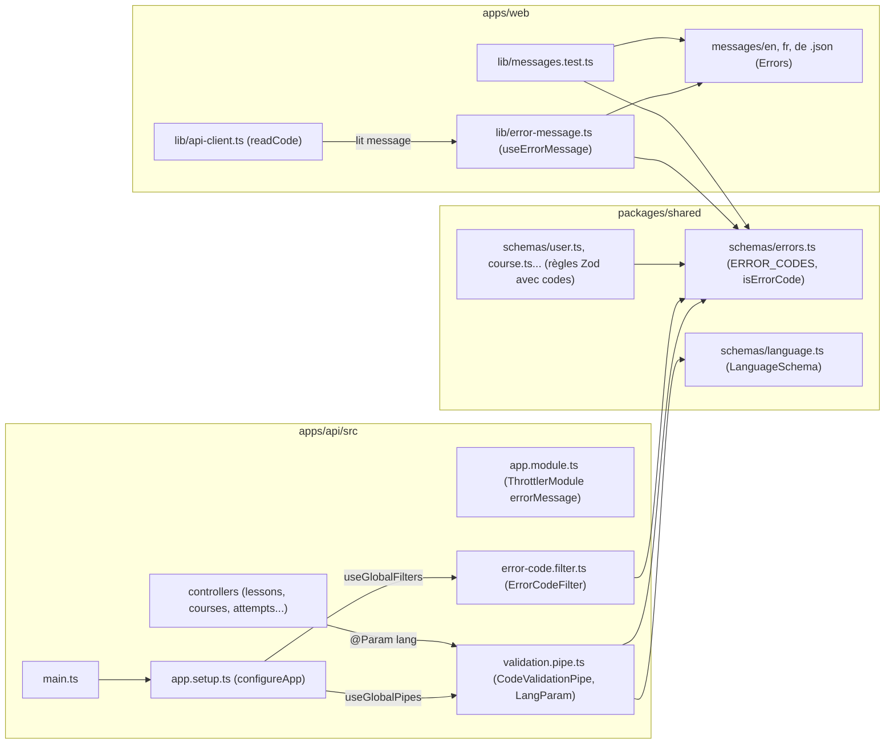
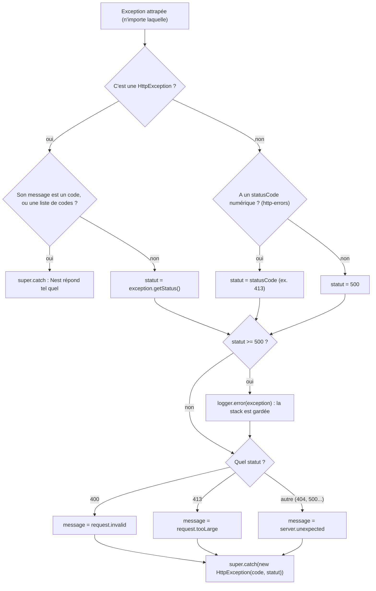
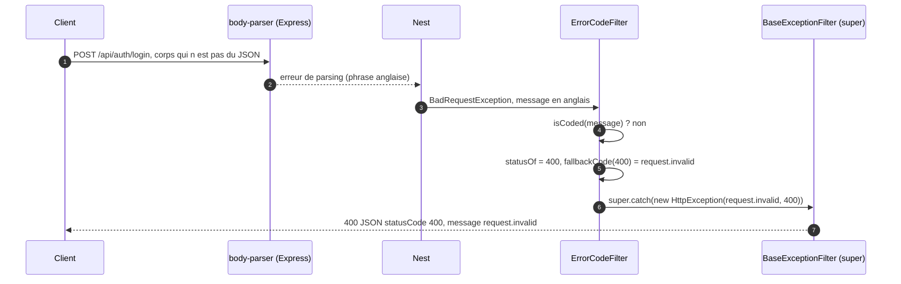
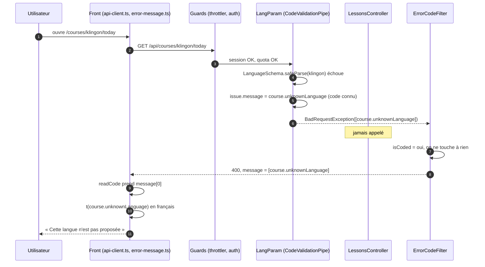

# Codes d'erreur : le socle (`error-code.filter.ts`, `validation.pipe.ts`)

> PR concernée : **#126** (« send an error code in every error message », ticket #108).
> Pour voir où ces pièces se placent dans le trajet d'une requête : [../lessons-api/request-lifecycle.md](../lessons-api/request-lifecycle.md).

## 1. À quoi ça sert

**Le problème.** L'API ne connaît pas la langue de l'utilisateur. Seul le navigateur la connaît. Si l'API renvoie une phrase anglaise (`"Validation failed"`, `"Cannot GET /api/foo"`, `"Internal server error"`), un apprenant français voit de l'anglais, ou le message générique « Une erreur est survenue ».

**La règle (le « contrat »).** Dans toute réponse d'erreur de l'API, le champ `message` contient **un code** de la liste `ERROR_CODES`, jamais une phrase. Exemples : `course.notFound`, `request.invalid`, `server.rateLimited`. Le front traduit ce code dans la langue de l'utilisateur (en, fr, de).

**Les deux pièces que j'ai écrites pour tenir ce contrat :**

| Pièce | Type Nest | Ce qu'elle fait |
|---|---|---|
| `CodeValidationPipe` | **pipe** (douane des paramètres) | Quand un corps ou un paramètre ne respecte pas son schéma Zod, elle met les **codes** dans `message` (au lieu de `"Validation failed"`). |
| `ErrorCodeFilter` | **filtre d'exception** (service après-vente) | Dernier filet : toute erreur dont `message` n'est pas un code est réécrite avec un code de secours. |

### Mots techniques

| Mot | Explication simple |
|---|---|
| **Pipe** | Une fonction que Nest appelle **avant** le controller sur un paramètre. Elle valide (et peut transformer). Si elle lance une exception, le controller n'est jamais appelé. |
| **Filtre d'exception** | Une classe que Nest appelle quand une exception n'est pas attrapée. Elle décide de la réponse HTTP envoyée. `@Catch()` sans argument = elle attrape **tout**. |
| **`HttpException`** | L'exception de Nest qui porte un statut HTTP (`NotFoundException` = 404, `ConflictException` = 409…). |
| **`BaseExceptionFilter`** | Le filtre par défaut de Nest. Le nôtre en hérite et appelle `super.catch(...)` pour garder le format standard `{ statusCode, message }`. |
| **Zod** | Bibliothèque de schémas. Chaque règle a un message ; chez nous ce message **est** un code (`.min(3, 'displayName.tooShort')`). |
| **`nestjs-zod`** | Fait le lien entre Zod et Nest : `createZodDto` (DTO depuis un schéma) et `createZodValidationPipe` (fabrique de pipe). |
| **body-parser** | Le middleware Express qui lit le JSON du corps. Sa limite par défaut est 100 kB. |

## 2. Les fichiers

| Fichier | Rôle | Auteur |
|---|---|---|
| [error-code.filter.ts](../../../../apps/api/src/error-code.filter.ts) | `ErrorCodeFilter` + fonctions `messageOf`, `isCoded`, `statusOf`, `fallbackCode`. | moi (#126) |
| [validation.pipe.ts](../../../../apps/api/src/validation.pipe.ts) | `CodeValidationPipe` (#126), `LangParam` (#126/#128). `UserIdParam` a été ajouté ensuite par VictorBro (#155, amis). | moi + VictorBro |
| [app.setup.ts](../../../../apps/api/src/app.setup.ts) | **Branche** le pipe et le filtre pour toute l'app : `app.useGlobalPipes(new CodeValidationPipe())` et `app.useGlobalFilters(new ErrorCodeFilter(app.getHttpAdapter()))`. | équipe |
| [app.module.ts](../../../../apps/api/src/app.module.ts) | `ThrottlerModule.forRoot({ …, errorMessage: 'server.rateLimited' })` : le throttler envoie lui aussi un code (#126). | équipe |
| [main.ts](../../../../apps/api/src/main.ts) | Crée l'app et appelle `configureApp(app)` (dans `app.setup.ts`). | équipe |
| [packages/shared/src/schemas/errors.ts](../../../../packages/shared/src/schemas/errors.ts) | `ERROR_CODES` (la liste), le type `ErrorCode`, `isErrorCode()`. **Le contrat partagé** entre API et front. | équipe |
| [packages/shared/src/schemas/language.ts](../../../../packages/shared/src/schemas/language.ts) | `LanguageSchema = z.enum(LEARNABLE_LANGUAGES, 'course.unknownLanguage')` : utilisé par `LangParam`. | équipe |
| [apps/web/lib/api-client.ts](../../../../apps/web/lib/api-client.ts) | `readCode(body)` : lit `message` (ou `message[0]` si c'est un tableau). Sans corps JSON → `server.unexpected`. Réseau coupé → `network.unreachable`. | front |
| [apps/web/lib/error-message.ts](../../../../apps/web/lib/error-message.ts) | `useErrorMessage()` : transforme un code en phrase traduite (`Errors.<code>`). Code inconnu → `unknown`. | front |
| [apps/web/messages/fr.json](../../../../apps/web/messages/fr.json) (et `en.json`, `de.json`) | Les traductions, section `Errors`. | équipe |
| [apps/web/lib/messages.test.ts](../../../../apps/web/lib/messages.test.ts) | Vérifie que `Errors` contient **exactement** les clés de `ERROR_CODES`, dans les 3 langues. | équipe |
| [apps/api/test/error-codes.e2e-spec.ts](../../../../apps/api/test/error-codes.e2e-spec.ts) | Test e2e : une requête par source d'erreur, et vérifie que `message` est un code. | moi (#126, en grande partie) |

Où `LangParam` est utilisé : `lessons.controller.ts`, `attempts.controller.ts`, `courses.controller.ts`, `discussion.controller.ts`. (`UserIdParam` : `users.controller.ts`, `friends.controller.ts`, `messages.controller.ts`.)

### Diagramme des fichiers et dépendances



## 3. Le contrat `ERROR_CODES`

- Défini une seule fois : `packages/shared/src/schemas/errors.ts`, un tableau `as const`.
- `type ErrorCode = (typeof ERROR_CODES)[number]` : TypeScript connaît la liste exacte.
- `isErrorCode(value)` : vrai si `value` est dans la liste.
- Les schémas Zod partagés utilisent ces codes comme messages. Le **même** schéma tourne dans le navigateur (validation du formulaire) et dans l'API (validation du corps).
- Le WebSocket aussi : `packages/shared/src/events/socket.ts` a `code: z.enum(ERROR_CODES)`.
- Sécurité anti-oubli : `messages.test.ts` échoue si un code n'a pas ses 3 traductions.

Codes liés à ce socle :

| Code | Statut | Qui l'envoie | Traduction fr |
|---|---|---|---|
| `request.invalid` | 400 | le filtre (JSON cassé) ou le pipe (règle sans code) | « La requête est illisible » |
| `request.tooLarge` | 413 | le filtre (corps > 100 kB) | « La requête est trop volumineuse » |
| `server.unexpected` | 404, 500, autre | le filtre (route inconnue, crash) | « Le serveur a répondu HTTP {status} » |
| `server.rateLimited` | 429 | le throttler | « Trop de tentatives. Nouvel essai possible dans une minute » |
| `course.unknownLanguage` | 400 | `LangParam` | « Cette langue n'est pas proposée » |
| `auth.sessionRequired` | 401 | `AuthGuard` | « Connexion requise pour continuer » |

## 4. `CodeValidationPipe` en détail

```ts
export const CodeValidationPipe = createZodValidationPipe({
  createValidationException: (error: unknown) =>
    new BadRequestException(
      error instanceof ZodError
        ? [...new Set(error.issues.map((issue) =>
            isErrorCode(issue.message) ? issue.message : 'request.invalid'))]
        : 'request.invalid',
    ),
});
```

En mots simples :

1. `createZodValidationPipe` (de `nestjs-zod`) fabrique une **classe** de pipe. On change une seule chose : l'exception lancée en cas d'échec.
2. Zod renvoie une liste de problèmes (`issues`). Chaque problème a un `message`.
3. Si ce message est un code connu, on le garde. Sinon (par exemple le corps n'est pas un objet, un champ a un mauvais type), Zod a mis une phrase anglaise par défaut : on la remplace par `request.invalid`.
4. `new Set(...)` enlève les doublons : trois champs mal typés donnent **un** `request.invalid`, pas trois.
5. `BadRequestException([...])` → statut 400, et `message` est le tableau de codes.

Résultat :

```json
{ "statusCode": 400, "message": ["email.invalid", "password.tooShort"], "error": "Bad Request" }
```

**Deux usages :**

- **Global** : `app.useGlobalPipes(new CodeValidationPipe())`. Il valide tout paramètre dont le type est un DTO créé avec `createZodDto` (corps, query). Ex. : `LessonQueryDto` sur `GET lessons`.
- **Par paramètre** : `LangParam = new CodeValidationPipe(LanguageSchema)`. Une seule instance, partagée. Utilisée ainsi : `@Param('lang', LangParam) lang: Language`. `/api/courses/klingon/...` → `400 ["course.unknownLanguage"]`, et le service ne reçoit jamais `'klingon'`.

## 5. `ErrorCodeFilter` en détail

```ts
@Catch()
export class ErrorCodeFilter extends BaseExceptionFilter {
  override catch(exception: unknown, host: ArgumentsHost): void {
    if (exception instanceof HttpException && isCoded(messageOf(exception.getResponse()))) {
      super.catch(exception, host);       // déjà un code : Nest répond normalement
      return;
    }
    const status = statusOf(exception);
    if (status >= 500) this.logger.error(exception);   // un bug : on garde la stack
    super.catch(new HttpException(fallbackCode(status), status), host);
  }
}
```

Les fonctions d'aide :

| Fonction | Rôle |
|---|---|
| `messageOf(response)` | La réponse d'une `HttpException` est soit une chaîne, soit un objet `{ message, … }`. On récupère `message`. |
| `isCoded(message)` | Vrai si c'est **un** code valide, ou un tableau **non vide** dont **tous** les éléments sont des codes. |
| `statusOf(exception)` | `HttpException` → son statut. Erreur de body-parser (`http-errors`) → son `statusCode` (ex. 413). Sinon → 500. |
| `fallbackCode(status)` | 400 → `request.invalid` ; 413 → `request.tooLarge` ; tout le reste → `server.unexpected`. |

Ce que le filtre attrape (ce qui ne passe jamais par notre code) :

- **JSON cassé** : Nest transforme l'erreur du parseur en `BadRequestException` avec une phrase anglaise → 400 `request.invalid`.
- **Corps > 100 kB** : body-parser lance une erreur `http-errors` avec `statusCode: 413` (ce n'est **pas** une `HttpException`) → 413 `request.tooLarge`.
- **Route inconnue** : Nest lance `NotFoundException("Cannot GET /api/…")` → 404 `server.unexpected`.
- **Crash** (`throw new Error('boom')` dans un handler) → 500 `server.unexpected`, et la stack est loggée sous le nom `ExceptionsHandler` (comme Nest le fait).

Un filtre posé sur une route (`@UseFilters(AvatarTooLargeFilter)` dans `users.controller.ts`) passe **avant** le filtre global, donc il garde sa propre réponse.

### Diagramme de décision du filtre



### Diagramme de séquence : un corps JSON cassé



### Diagramme de séquence : un paramètre invalide (pipe), puis le front



## 6. Que se passe-t-il concrètement ?

### Cas 1 : un handler plante

Dans le test e2e, une route de test fait `throw new Error('boom')`.

1. La requête passe les guards (le test utilise un agent avec session, sinon `AuthGuard` répondrait 401 avant).
2. Le handler lance `Error('boom')`. Ce n'est pas une `HttpException`.
3. `ErrorCodeFilter.catch` : premier `if` faux.
4. `statusOf` : pas de `statusCode` → 500.
5. `500 >= 500` → `logger.error(exception)` : la stack « boom » part dans les logs.
6. `fallbackCode(500)` → `server.unexpected`.
7. `super.catch(new HttpException('server.unexpected', 500))` → réponse :

```json
{ "statusCode": 500, "message": "server.unexpected" }
```

8. Le front affiche « Le serveur a répondu HTTP 500 » (il lit le statut dans la réponse).

### Cas 2 : un corps trop gros

`POST /api/auth/login` avec un email de 200 000 caractères.

1. body-parser lit le corps et s'arrête à 100 kB : il lance une erreur `http-errors` avec `statusCode: 413`.
2. Le filtre : pas une `HttpException` → `statusOf` lit `statusCode` = 413.
3. 413 < 500 → pas de log (c'est l'erreur du client, pas un bug).
4. `fallbackCode(413)` → `request.tooLarge`.

```json
{ "statusCode": 413, "message": "request.tooLarge" }
```

## 7. Le test e2e (`error-codes.e2e-spec.ts`)

Il démarre la vraie app avec `configureApp(app)` (comme `main.ts`) et ajoute un `CrashController` de test. Un cas par source d'erreur :

| Cas | Statut | `message` attendu |
|---|---|---|
| Corps d'inscription invalide | 400 | tableau contenant `email.invalid`, seulement des codes |
| `PATCH /api/courses/klingon` | 400 | `["course.unknownLanguage"]` |
| `GET /api/courses` sans session | 401 | `auth.sessionRequired` |
| Corps `{not json` | 400 | `request.invalid` |
| Corps JSON `[1]` (pas un objet) | 400 | `["request.invalid"]` (vient du **pipe**, d'où le tableau) |
| Corps > 100 kB | 413 | `request.tooLarge` |
| Route inconnue | 404 | `server.unexpected` |
| Crash | 500 | `server.unexpected` + `Logger.error` appelé avec `boom` |
| 6ᵉ login en une minute depuis la même IP | 429 | `server.rateLimited` |
| 21ᵉ inscription en une minute depuis la même IP | 429 | `server.rateLimited` |

Astuce du test : chaque cas utilise sa propre adresse `X-Forwarded-For` (`198.51.100.x`, plage réservée à la documentation) pour ne pas consommer le quota des autres cas.

## 8. Questions possibles à l'oral

**Q : Pourquoi renvoyer des codes et pas des phrases ?**
R : L'API ne connaît pas la langue du lecteur. Le navigateur, si. Le code est traduit côté front dans `messages/{en,fr,de}.json`.

**Q : Différence entre un pipe et un filtre ?**
R : Le pipe agit **avant** le controller, sur les paramètres : il valide et peut refuser. Le filtre agit **après** une exception : il fabrique la réponse d'erreur.

**Q : Pourquoi un filtre en plus du pipe ?**
R : Certaines erreurs ne passent jamais par notre code : JSON cassé, corps trop gros (body-parser), route inconnue (routeur Nest), crash imprévu. Le filtre est le dernier filet.

**Q : Pourquoi `@Catch()` sans argument ?**
R : Pour attraper **toutes** les exceptions, pas seulement une classe.

**Q : Pourquoi hériter de `BaseExceptionFilter` ?**
R : Pour garder le format de réponse standard de Nest (`{ statusCode, message }`) et sa gestion des cas spéciaux. On ne change que le message.

**Q : Pourquoi logger seulement les 500 ?**
R : Un 500 est un bug : on veut la stack. Un 4xx est une erreur du client : pas besoin de remplir les logs.

**Q : Pourquoi le `Set` dans le pipe ?**
R : Pour ne pas répéter le même code. Trois champs mal typés donnent un seul `request.invalid`.

**Q : Que fait `isCoded` avec `["email.invalid", "Some sentence"]` ?**
R : Il renvoie faux : **tous** les éléments doivent être des codes, car le front peut lire n'importe lequel (il lit le premier). Le filtre remplace alors par le code de secours.

**Q : Où sont branchés le pipe et le filtre ?**
R : Dans `configureApp()` (`app.setup.ts`) : `useGlobalPipes` et `useGlobalFilters`. `main.ts` et les tests e2e appellent tous les deux `configureApp`.

**Q : Comment éviter qu'un code n'ait pas de traduction ?**
R : `apps/web/lib/messages.test.ts` compare les clés `Errors` des 3 fichiers de langue avec `ERROR_CODES`. S'il en manque une, le test échoue.

**Q : Que se passe-t-il si le front reçoit un code inconnu ?**
R : `useErrorMessage` utilise `unknown` : « Une erreur est survenue. Réessaie. » Jamais de texte anglais brut.
