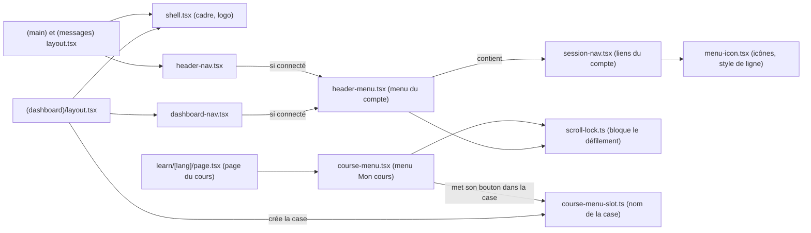
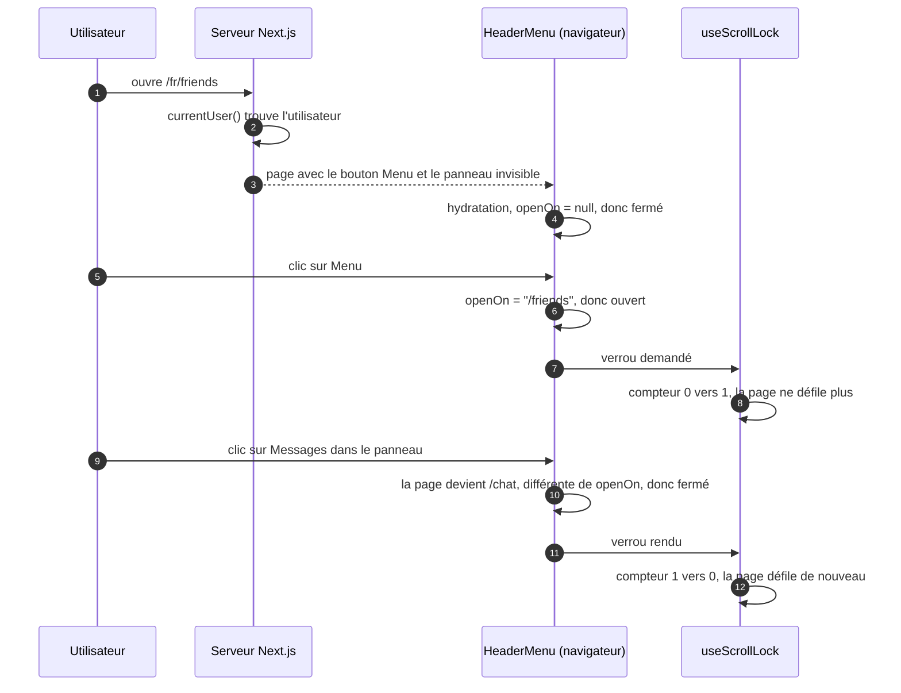
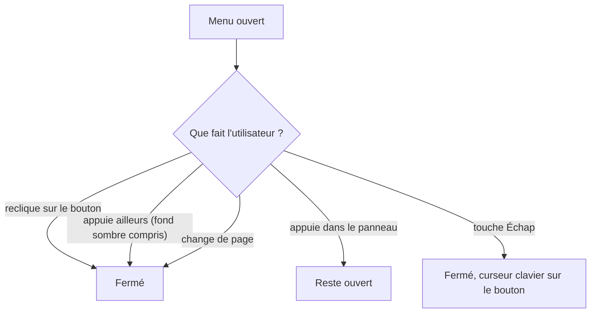
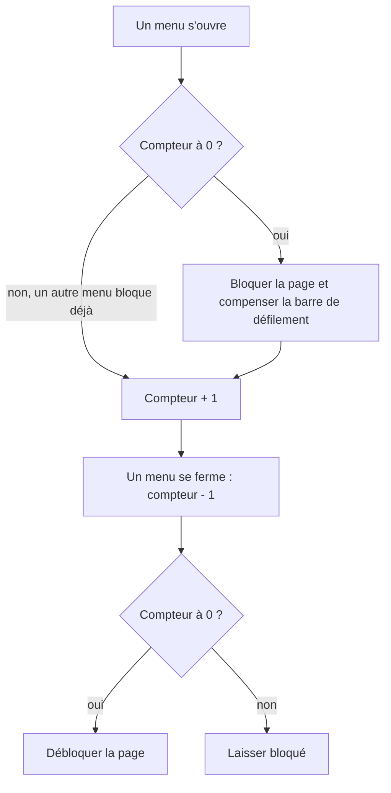
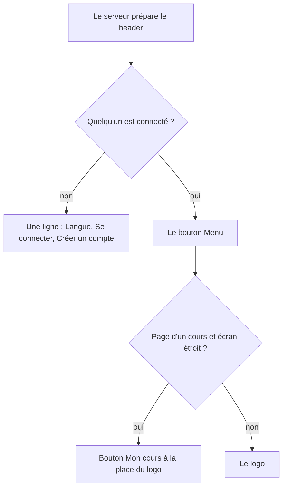

# Le menu du header et les cartes du cours

> PR concernée : **#220** (« fix(web): header menu, course cards and phone layouts », squash `8586314`). Les deux commits de la PR sont à moi (`VYAntares`).
> **Créés par moi** : [header-menu.tsx](../../../../apps/web/components/header-menu.tsx), [menu-icon.tsx](../../../../apps/web/components/menu-icon.tsx), [scroll-lock.ts](../../../../apps/web/components/scroll-lock.ts), [course-menu.tsx](../../../../apps/web/app/[locale]/(dashboard)/learn/[lang]/course-menu.tsx), [course-menu-slot.ts](../../../../apps/web/lib/course-menu-slot.ts), [e2e/support/menu.ts](../../../../e2e/support/menu.ts).
> **Pas à moi** (je les ai seulement modifiés) : `header-nav.tsx` (créé par Victor, #27), `session-nav.tsx` (Victor, #5, puis Luca et Anaïs), `shell.tsx` et `(dashboard)/layout.tsx` (Victor, dans sa #21 fusionnée dans ma #20 ; le layout a été déplacé sous `[locale]` par Luca, #26), `dashboard-nav.tsx` et la page du cours `learn/[lang]/page.tsx` (Victor, #64, puis Luca, Bastian, Anaïs), `course-switcher.tsx` (Victor), `language-switcher.tsx` (Luca), `log-out-button.tsx` (Victor), `connection-status.tsx` (Victor, #181). Les tests e2e touchés ont été écrits par d'autres : j'y ai seulement ajouté l'ouverture du menu.
> Après moi, Luca a retouché `header-nav.tsx` et `shell.tsx` (#225, le lien du logo). Les extraits ci-dessous sont le code **actuel**.

## 1. À quoi ça sert

**Le problème.** Sur un téléphone, le header (la barre du haut) d'un utilisateur connecté était trop chargé. Il y avait le logo, le choix du cours, le choix de la langue, le profil, Amis, Messages, Se déconnecter. En allemand, les mots sont longs, et ça débordait.

Deuxième problème, sur la page d'un cours. La colonne de droite (réglages, rang, défi, statistiques, test de niveau) passait **sous toutes les leçons** sur téléphone. Il fallait descendre tout en bas pour la voir.

**Ma solution, en trois pièces :**

1. **Le menu du compte (`HeaderMenu`).** Tous ces éléments vont derrière **un seul bouton** ☰. Sur tous les écrans. Le bouton montre aussi le nombre de messages non lus.
2. **Le menu « Mon cours » (`CourseMenu`).** Sur un écran étroit, les cartes du cours vont derrière un bouton « Mon cours ». Ce bouton prend la place du logo. Sur un grand écran, rien ne change : les cartes restent en colonne à droite.
3. **Le blocage du défilement (`useScrollLock`).** Quand un menu est ouvert, la page derrière ne bouge plus.

Un **visiteur** (pas connecté) garde l'ancien header. Il n'a que trois éléments : Langue, Se connecter, Créer un compte. Ils tiennent sur une ligne. Et cacher « Se connecter » serait une mauvaise idée.

La même PR a aussi découpé la colonne du cours en **cartes séparées**, et corrigé deux pages sur téléphone (le profil, et une ligne d'ami).

### Mots techniques

| Mot | Explication simple |
|---|---|
| **Header** | La barre en haut de chaque page. |
| **Composant serveur** | Un morceau de page fabriqué **sur le serveur**. Il peut lire le cookie de session, donc savoir qui est connecté. Il ne peut pas réagir à un clic. |
| **Composant client** | Un morceau de page qui tourne **aussi dans le navigateur**. Il peut réagir à un clic et se souvenir d'un état (ouvert / fermé). Il commence par `'use client'`. |
| **État** (`useState`) | Une petite mémoire du composant. Quand elle change, React redessine. |
| **`useEffect`** | « Fais ceci après l'affichage. » La fonction qu'il renvoie sert à **ranger** (retirer un écouteur, remettre un style). |
| **Écouteur d'événement** | Un bout de code qui attend un événement (un clic, une touche) pour réagir. |
| **Hydratation** | Le moment où React, dans le navigateur, branche les clics sur la page reçue du serveur. Avant, un clic ne fait rien. Comme une télé branchée mais pas encore allumée. |
| **Portail** | Afficher un élément **ailleurs** dans la page que là où il est écrit. |
| **Breakpoint** (`sm`, `lg`) | Une largeur d'écran où le style change. `sm` = 640 px, `lg` = 1024 px. `max-lg:` veut dire « en dessous de 1024 px ». |
| **`pathname`** | Le chemin de la page, sans la langue. Par exemple `/learn/fr`. |

## 2. Les fichiers

| Fichier | Rôle | Auteur |
|---|---|---|
| [header-menu.tsx](../../../../apps/web/components/header-menu.tsx) | Le bouton ☰, le fond sombre et le panneau du menu du compte. | moi (#220) |
| [menu-icon.tsx](../../../../apps/web/components/menu-icon.tsx) | Les petites icônes des lignes du menu, et le style commun d'une ligne (`MENU_ROW`). | moi (#220) |
| [scroll-lock.ts](../../../../apps/web/components/scroll-lock.ts) | `useScrollLock` : bloque le défilement de la page quand un menu est ouvert. | moi (#220) |
| [course-menu.tsx](../../../../apps/web/app/[locale]/(dashboard)/learn/[lang]/course-menu.tsx) | `CourseMenu` : les cartes du cours, pliées derrière « Mon cours » sur écran étroit. | moi (#220) |
| [course-menu-slot.ts](../../../../apps/web/lib/course-menu-slot.ts) | Le nom de la case du header où va le bouton « Mon cours ». | moi (#220) |
| [e2e/support/menu.ts](../../../../e2e/support/menu.ts) | `openMenu` : une aide pour que les tests ouvrent le menu. | moi (#220) |
| [header-nav.tsx](../../../../apps/web/components/header-nav.tsx) | La droite du header (pages hors cours). J'ai ajouté : connecté → menu, visiteur → une ligne. | Victor (#27), Luca ; moi |
| [dashboard-nav.tsx](../../../../apps/web/components/dashboard-nav.tsx) | Pareil pour les pages de cours, avec le choix du cours en plus. | Victor (#64), Luca ; moi |
| [session-nav.tsx](../../../../apps/web/components/session-nav.tsx) | Les liens du compte. J'en ai fait des lignes de menu avec icônes. | Victor (#5), Luca, Anaïs ; moi |
| [shell.tsx](../../../../apps/web/components/shell.tsx) | Le cadre de toutes les pages. J'ai mis le header au-dessus de la page (`z-50`) et caché le logo quand « Mon cours » est là. | Victor (#21), Luca ; moi |
| [(dashboard)/layout.tsx](../../../../apps/web/app/[locale]/(dashboard)/layout.tsx) | Le cadre des pages de cours. J'ai ajouté la case pour « Mon cours ». | Victor (#21), Luca (#26) ; moi |
| [learn/[lang]/page.tsx](../../../../apps/web/app/[locale]/(dashboard)/learn/[lang]/page.tsx) | La page d'un cours. J'ai mis les cartes dans `CourseMenu`. | Victor (#64), Luca, Bastian, Anaïs ; moi |
| [course-switcher.tsx](../../../../apps/web/components/course-switcher.tsx), [language-switcher.tsx](../../../../apps/web/components/language-switcher.tsx), [log-out-button.tsx](../../../../apps/web/components/log-out-button.tsx) | Les deux listes déroulantes et le bouton de déconnexion. J'ai ajouté une icône et un style « dans le menu ». | Victor, Luca ; moi |
| [connection-status.tsx](../../../../apps/web/components/connection-status.tsx) | La pastille « Reconnexion… ». J'ai ajouté une classe pour qu'elle reste visible. | Victor (#181) ; moi |
| `messages/en.json`, `fr.json`, `de.json` | Nouveaux textes : « Menu », « Mon cours », « Ton rang ». | équipe ; moi |

### Diagramme des fichiers et dépendances



## 3. Le code, morceau par morceau

> Les extraits sont raccourcis : `// ...` marque ce qui est coupé, et les commentaires en français sont des explications ajoutées ici. Le code exact est dans le fichier lié.

### 3.1 Connecté ou pas ?

**En mots simples.** Le serveur regarde qui est connecté. Visiteur : on garde une simple ligne. Connecté : on met les mêmes éléments dans le menu.

```tsx
export async function HeaderNav() {
  const user = await currentUser();
  const items = (
    <>
      <LanguageSwitcher />
      <SessionNav />
    </>
  );

  return user === null ? (
    <div className="flex ...">{items}</div>
  ) : (
    <HeaderMenu>{items}</HeaderMenu>
  );
}
```

`DashboardNav` fait la même chose pour les pages de cours, avec en plus le choix du cours.

### 3.2 Ouvert ou fermé ?

**En mots simples.** Le menu ne retient pas « ouvert : oui / non ». Il retient **sur quelle page** on l'a ouvert. Il est ouvert seulement si on est encore sur cette page. Donc quand on clique un lien et qu'on change de page, il se ferme **tout seul**.

Pourquoi c'est utile : le header ne disparaît pas quand on change de page. Sans cette astuce, le menu resterait ouvert sur la nouvelle page.

```tsx
const pathname = usePathname();
const [openOn, setOpenOn] = useState<string | null>(null);
const open = openOn === pathname;
useScrollLock(open);
// ...
onClick={() => setOpenOn(open ? null : pathname)}
```

### 3.3 Fermer quand on clique ailleurs, ou avec Échap

**En mots simples.** Quand le menu est ouvert, on écoute les appuis sur toute la page. Si l'appui est en dehors du bouton et du panneau, on ferme. La touche Échap ferme aussi, et remet le curseur du clavier sur le bouton. Quand le menu se ferme, on retire l'écouteur.

```tsx
useEffect(() => {
  if (!open) return;
  function onPointerDown(event: PointerEvent) {
    const target = event.target as Node;
    if (!button.current?.contains(target) && !panel.current?.contains(target)) setOpenOn(null);
  }
  document.addEventListener('pointerdown', onPointerDown);
  return () => document.removeEventListener('pointerdown', onPointerDown);
}, [open]);
```

`pointerdown` = « on appuie », avec une souris, un doigt ou un stylet.

### 3.4 Le bouton, le fond sombre et le panneau

**En mots simples.** Il y a trois choses à l'écran :

- **Le fond sombre** couvre toute la page. Mais il est rangé *dans* le header, juste derrière lui. Résultat : la page est assombrie, le logo et le bouton restent bien visibles. Pour ça, j'ai mis le header sur un calque au-dessus de la page (`relative z-50` dans `shell.tsx`).
- **Le bouton** ☰ porte le badge rouge des messages non lus. Un lecteur d'écran l'entend comme « Menu 1 message non lu ».
- **Le panneau** contient les liens. Fermé, il est **invisible** mais toujours là.

```tsx
<div aria-hidden className={`fixed inset-0 -z-10 bg-slate-950/75 ... ${open ? 'opacity-100' : 'pointer-events-none opacity-0'}`} />

<button aria-expanded={open} /* ... */>
  <span className="sr-only">{t('menu')}</span>
  {/* ... icône ☰ ou ✕ */}
  <UnreadTotalBadge />
</button>

<div data-header-menu className={`${open ? '' : 'invisible'} absolute top-full ...`}>
  {children}
</div>
```

**Pourquoi « invisible » et pas « caché » ?** La pastille « Reconnexion… » est rangée dans ce panneau. Avec « caché » (`display: none`), tout le contenu disparaît, pastille comprise. Avec « invisible », un enfant a le droit de se rendre visible. La pastille le fait.

**`data-header-menu`** est une étiquette sur le panneau. Les listes déroulantes (cours, langue) la détectent et prennent un style « ligne de menu » (icône, hauteur confortable).

### 3.5 Les lignes du menu

**En mots simples.** Chaque ligne a une icône dans une case de même taille. Donc tous les textes commencent au même endroit. Une ligne fait au moins 44 px de haut : assez pour un doigt.

```tsx
export const MENU_ROW = 'flex min-h-11 w-full ... items-center gap-3 rounded-lg px-3 ...';
// dans session-nav.tsx :
<Link href="/friends" className={MENU_ROW}>
  <MenuIcon name="friends" />
  {friends('title')}
</Link>
```

### 3.6 Bloquer le défilement

**En mots simples.** Quand un menu s'ouvre, on interdit à la page de défiler. Sinon, un glissement du doigt sur le fond sombre ferait bouger la page derrière.

Deux détails :

- **La barre de défilement.** Sur ordinateur, la cacher élargit la page d'environ 15 px. Tout sauterait sur le côté. Donc on mesure sa largeur et on la remet en marge à droite. Sur téléphone, elle ne prend pas de place : rien à faire.
- **Le compteur.** Deux menus peuvent être ouverts un court instant (on passe de « Mon cours » au ☰). Chaque menu ouvert ajoute 1. Chaque menu fermé enlève 1. On ne débloque qu'à 0. Comme la dernière personne qui quitte la pièce éteint la lumière.

```ts
let holders = 0;

export function useScrollLock(locked: boolean): void {
  useEffect(() => {
    if (!locked) return;
    const root = document.documentElement;
    if (holders === 0) {
      const scrollbar = window.innerWidth - root.clientWidth;
      root.style.overflow = 'hidden';
      if (scrollbar > 0) document.body.style.paddingRight = `${scrollbar}px`;
    }
    holders += 1;
    return () => {
      holders -= 1;
      if (holders === 0) {
        root.style.overflow = '';
        document.body.style.paddingRight = '';
      }
    };
  }, [locked]);
}
```

### 3.7 « Mon cours » : un bouton écrit dans la page, affiché dans le header

**En mots simples.** Le bouton « Mon cours » dépend de la page du cours. Mais il doit apparaître dans le header, qui vient d'un autre fichier (le layout). Solution en deux temps :

1. Le layout prépare une **case vide** dans le header, à côté du logo.
2. La page du cours, une fois chargée dans le navigateur, trouve cette case et y **téléporte** son bouton (c'est le portail).

```tsx
// (dashboard)/layout.tsx
<Wordmark href="/learn" />
<div id={COURSE_MENU_SLOT} className="contents" />
```

```tsx
// course-menu.tsx
useEffect(() => {
  setSlot(document.getElementById(COURSE_MENU_SLOT));
}, []);
// ...
{slot === null ? null : createPortal(<button data-course-menu-button /* ... */>{t('myCourse')}</button>, slot)}
```

- `className="contents"` : la case ne prend aucune place. Le bouton se range comme s'il était directement dans le header.
- On cherche la case dans un `useEffect`, car la page HTML n'existe que dans le navigateur, pas sur le serveur.

**Pourquoi le nom de la case est dans son propre fichier (`course-menu-slot.ts`) ?** Le layout tourne sur le serveur. S'il importait ce nom depuis `course-menu.tsx` (un fichier `'use client'`), il ne recevrait pas le texte `'course-menu-slot'`, mais une sorte de « renvoi » vers le navigateur. L'`id` serait faux. Un petit fichier neutre règle le problème.

### 3.8 Le logo laisse sa place

**En mots simples.** Sur un écran étroit, si le bouton « Mon cours » existe dans la page, le logo se cache. C'est une règle CSS, sans JavaScript. Tant que le bouton n'est pas arrivé, le logo reste : le header n'est jamais vide.

```tsx
<Link href={href} className="... max-lg:[:root:has([data-course-menu-button])_&]:hidden">
```

`:has(...)` veut dire « si la page contient… ».

### 3.9 Le panneau des cartes

**En mots simples.** C'est le même bloc de cartes sur tous les écrans. Sur grand écran : une colonne normale à droite. Sur écran étroit : caché quand c'est fermé. Ouvert, il flotte sous le header, avec son propre défilement s'il est trop long.

```tsx
<aside className={`${className} ${open ? '' : 'max-lg:hidden'} max-lg:fixed max-lg:top-16 max-lg:overflow-y-auto ...`}>
  {children}
</aside>
```

Dans la page du cours, l'ancien `<aside>` est devenu `<CourseMenu>`, avec cinq cartes : les réglages du cours, le rang, le défi du jour, les statistiques, et le lien vers le test de niveau. Le rang et le défi étaient avant en haut de la page, au-dessus des leçons.

## 4. Le chemin d'exécution

### 4.1 Ouvrir le menu, puis suivre un lien



### 4.2 Quand le menu se ferme



### 4.3 Le verrou de défilement



### 4.4 Ce que montre le header



## 5. Un exemple concret pas à pas

**Alice est connectée, sur un téléphone de 360 px de large, en français. Elle a 1 message non lu.**

1. Elle ouvre `/fr/learn/fr`. Le serveur voit qu'elle est connectée. Il met le bouton ☰ dans le header, avec un badge rouge « 1 ».
2. Dans le navigateur, la page du cours trouve la case du header et y met le bouton « Mon cours ». Le logo se cache.
3. Elle touche « Mon cours ». Le menu retient `/learn/fr`. Il est ouvert. Le compteur du verrou passe à 1. La barre de défilement ne prend pas de place sur téléphone, donc rien à compenser.
4. Les cinq cartes apparaissent sous le header, sur un fond sombre. Elle glisse le doigt : la page derrière ne bouge pas.
5. Elle touche ☰. C'est en dehors du panneau « Mon cours », donc celui-ci se ferme. Le menu du compte s'ouvre. Le verrou reste en place.
6. Elle voit : Cours, Langue, son nom avec son avatar, Amis, Messages avec le « 1 », puis Se déconnecter.
7. Elle touche « Messages ». La page devient `/chat`. Ce n'est plus `/learn/fr`, donc le menu se ferme tout seul. Le compteur revient à 0 : la page défile de nouveau.

**Bob, sur ordinateur.** Sa barre de défilement fait 15 px. Il ouvre ☰ : la page est bloquée, et 15 px de marge sont ajoutés à droite. Rien ne saute. Il appuie sur Échap : le menu se ferme, et le curseur du clavier revient sur ☰.

## 6. Les tests

Il n'y a **pas de test unitaire** pour ces menus. Ils sont testés dans un vrai navigateur avec **Playwright** (un robot qui clique dans la page). Comme les liens du compte sont maintenant cachés derrière ☰, j'ai ajouté « ouvrir le menu » dans les tests existants.

| Fichier | Ce qui est vérifié |
|---|---|
| [e2e/support/menu.ts](../../../../e2e/support/menu.ts) | `openMenu` clique le bouton jusqu'à ce qu'il dise « ouvert ». Il réessaie, car un clic avant l'hydratation ne fait rien. |
| [e2e/tests/messages.spec.ts](../../../../e2e/tests/messages.spec.ts) | Le nombre de non-lus arrive en direct **sur le bouton** (« Menu 1 unread message »). En allemand sur téléphone, le header tient dans l'écran, menu fermé **et** ouvert. Suivre le lien ferme le menu. |
| [e2e/tests/auth.spec.ts](../../../../e2e/tests/auth.spec.ts) | Se déconnecter, et voir son nom dans le menu. |
| [e2e/tests/course.spec.ts](../../../../e2e/tests/course.spec.ts), [onboarding.spec.ts](../../../../e2e/tests/onboarding.spec.ts) | Changer de cours et ajouter une langue depuis le menu. |
| [e2e/tests/locale.spec.ts](../../../../e2e/tests/locale.spec.ts), [time-zone.spec.ts](../../../../e2e/tests/time-zone.spec.ts) | Changer de langue ou de cours depuis le menu. Après le changement, le menu s'est fermé : le test lit la valeur d'une liste devenue invisible (`includeHidden: true`). |
| [e2e/tests/restart.spec.ts](../../../../e2e/tests/restart.spec.ts) | Après un redémarrage de l'API, le bouton « Menu » est revenu. |

**Commandes** (depuis la racine du dépôt) :

```bash
make test-e2e                      # démarre l'application si besoin, puis tous les tests Playwright
make playwright                    # si l'application tourne déjà (make up)
pnpm --filter @ft/e2e run test:e2e tests/messages.spec.ts   # un seul fichier
```

## 7. Les concepts à savoir expliquer

- **Serveur qui choisit, navigateur qui réagit.** Le serveur sait qui est connecté. Le menu, dans le navigateur, gère les clics.
- **Retenir la page plutôt que « ouvert / fermé ».** Le menu se ferme tout seul quand la page change.
- **Écouter seulement quand c'est utile**, et retirer l'écouteur en fermant.
- **Le portail** : écrire un bouton à un endroit, l'afficher à un autre.
- **« Invisible » n'est pas « caché »** : dans un parent invisible, un enfant peut rester visible.
- **Le compteur du verrou** : seul le dernier menu fermé débloque la page.
- **Compenser la barre de défilement** pour que la page ne saute pas.
- **Accessibilité** : le bouton dit s'il est ouvert, il a un nom lu à voix haute, Échap rend le curseur au bouton, les lignes sont assez grandes pour un doigt.

## 8. Questions possibles à l'oral

**Q : Pourquoi un menu sur tous les écrans, pas seulement sur téléphone ?**

R : Mon premier commit le faisait seulement sur téléphone. Le second l'a mis partout. Un seul header à maintenir et à tester, et de la place pour ajouter des liens.

**Q : Pourquoi le visiteur n'a pas de menu ?**

R : Il n'a que trois éléments, ils tiennent sur une ligne. Les cacher cacherait « Se connecter », son lien le plus important.

**Q : Pourquoi retenir la page et pas juste « ouvert » ?**

R : Le header reste en place quand on change de page. Avec un simple « ouvert », le menu resterait ouvert sur la page suivante. En retenant la page, il se ferme tout seul.

**Q : Comment le menu se ferme-t-il ?**

R : Reclic sur le bouton, appui en dehors du menu, touche Échap, ou changement de page.

**Q : Pourquoi le panneau fermé est « invisible » et pas « caché » ?**

R : La pastille « Reconnexion… » est dedans. Avec « caché », elle disparaîtrait aussi. Avec « invisible », elle peut rester visible.

**Q : À quoi sert le compteur du verrou ?**

R : Les deux menus partagent le même verrou. Quand on passe de l'un à l'autre, les deux le tiennent un instant. Sans compteur, le premier fermé débloquerait la page alors que l'autre est ouvert.

**Q : Pourquoi une marge à droite quand on bloque la page ?**

R : Sur ordinateur, bloquer la page cache la barre de défilement. La page s'élargit et tout saute. La marge remplace la barre.

**Q : Pourquoi un portail pour « Mon cours » ?**

R : Le bouton appartient à la page du cours, mais il doit s'afficher dans le header, qui vient du layout. Le portail l'affiche là-bas en le gardant relié à sa page.

**Q : Pourquoi le nom de la case dans un fichier à part ?**

R : Le layout tourne sur le serveur. Importé depuis un fichier `'use client'`, il recevrait un renvoi vers le navigateur et pas le texte. L'`id` serait faux.

**Q : Comment le logo disparaît-il ?**

R : Une règle CSS : sur écran étroit, si la page contient le bouton « Mon cours », le logo est caché. Avant que le bouton arrive, le logo reste.

**Q : Pourquoi pas de test unitaire ?**

R : Le comportement dépend du vrai navigateur : la mise en page, la visibilité, l'hydratation, la navigation. Playwright le teste dans un vrai navigateur, y compris « le header tient sur un téléphone ».

**Q : Pourquoi `openMenu` réessaie ?**

R : Le bouton arrive du serveur. Si le robot clique avant l'hydratation, rien ne se passe. Il reclique jusqu'à voir le menu ouvert.

**Q : Tous ces fichiers sont à toi ?**

R : Non. J'ai créé les six fichiers du menu (menu, icônes, verrou, « Mon cours », la case, l'aide de test). Le cadre, le header, les liens du compte, le layout et la page du cours ont été créés par Victor, et retouchés par Luca, Bastian et Anaïs. Je les ai modifiés pour brancher le menu.
