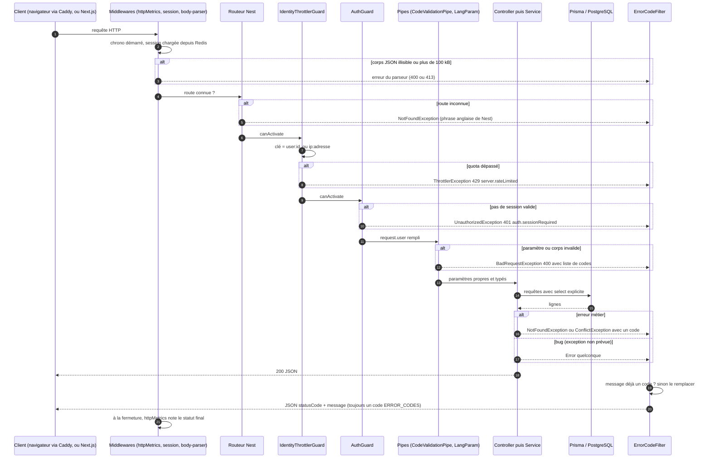
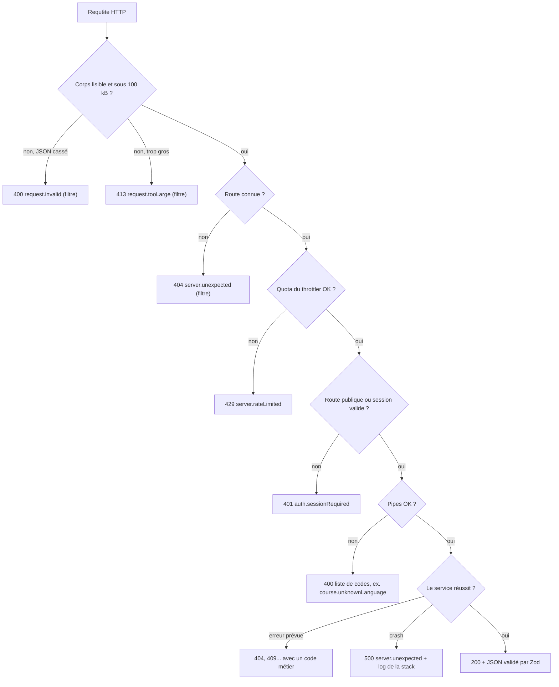

# Cycle de vie d'une requête dans notre API NestJS

Ce document relie trois modules :

- [le throttler](../throttler/README.md) (`IdentityThrottlerGuard`) : **qui** compte-t-on pour la limite de requêtes ;
- [les codes d'erreur](../error-codes/README.md) (`CodeValidationPipe`, `LangParam`, `ErrorCodeFilter`) : **comment** une erreur devient un code ;
- [l'API des leçons](README.md) : un exemple de route « métier ».

## 1. Les étapes, dans l'ordre

NestJS fait passer chaque requête HTTP par une chaîne d'étapes. L'ordre est fixe :

1. **Middlewares** (Express) : du code qui voit la requête brute, avant Nest.
2. **Guards** (vigiles) : « as-tu le droit de passer ? » Ils renvoient `true` ou lancent une exception.
3. **Interceptors** : du code autour du handler (avant/après). Nous n'en avons pas de global ; seul l'upload d'avatar utilise `FileInterceptor`.
4. **Pipes** (douane) : vérifient et transforment les paramètres (`@Param`, `@Query`, `@Body`).
5. **Handler** : la méthode du controller, qui appelle le service.
6. **Exception filters** (service après-vente) : si une étape lance une exception, elle saute directement ici. Le filtre fabrique la réponse d'erreur.

## 2. Où chaque pièce est branchée dans notre projet

| Pièce | Type Nest | Branchée où | Portée |
|---|---|---|---|
| `httpMetrics` | middleware | `app.use(httpMetrics)` dans [app.setup.ts](../../../../apps/api/src/app.setup.ts) | toutes les requêtes |
| `express-session` (+ Redis) | middleware | `app.use(sessionMiddleware)` dans [app.setup.ts](../../../../apps/api/src/app.setup.ts) | toutes |
| parseur JSON (body-parser, limite 100 kB) | middleware | ajouté par Nest lui-même au démarrage (`app.init()`) | toutes |
| `IdentityThrottlerGuard` | guard global | `{ provide: APP_GUARD, useClass: IdentityThrottlerGuard }` dans [app.module.ts](../../../../apps/api/src/app.module.ts) | toutes les routes |
| `AuthGuard` | guard global | `{ provide: APP_GUARD, useClass: AuthGuard }` dans [auth.module.ts](../../../../apps/api/src/auth/auth.module.ts) | toutes, sauf `@Public()` |
| `CodeValidationPipe` | pipe global | `app.useGlobalPipes(new CodeValidationPipe())` dans [app.setup.ts](../../../../apps/api/src/app.setup.ts) | tout paramètre typé par un DTO Zod (`@Body`, `@Query`) |
| `LangParam` | pipe de paramètre | `@Param('lang', LangParam)` dans les controllers | le `:lang` des URL |
| `ErrorCodeFilter` | filtre global | `app.useGlobalFilters(new ErrorCodeFilter(...))` dans [app.setup.ts](../../../../apps/api/src/app.setup.ts) | toutes les exceptions |
| `AvatarTooLargeFilter` | filtre local | `@UseFilters(...)` dans `users.controller.ts` | upload d'avatar seulement (passe avant le filtre global) |

`configureApp()` est appelée par [main.ts](../../../../apps/api/src/main.ts) **et** par les tests e2e. Les tests passent donc par exactement la même chaîne que la production.

## 3. Le diagramme de séquence global



> « Routeur Nest » : la partie de Nest qui associe une URL à une méthode de controller (aucun fichier à nous).

## 4. Les décisions, en un seul schéma



## 5. Ordre des deux guards globaux

Les deux guards sont globaux (`APP_GUARD`). Nest les exécute dans l'ordre où il les enregistre. Il scanne d'abord le module racine (`AppModule`, où est déclaré `IdentityThrottlerGuard`), puis les modules importés (`AuthModule`, où est déclaré `AuthGuard`). Donc **le throttler passe avant l'authentification**.

Conséquence : un anonyme qui inonde une route privée est compté sur son adresse IP et reçoit `429` après 100 requêtes (la limite par défaut), avant même le `401`.

> Point à vérifier : cet ordre est déduit du fonctionnement de Nest (`scanner.js`), aucun test du projet ne le fixe explicitement.

## 6. Exemple : une requête qui traverse tout

`GET /api/courses/xx/today`, avec une session valide.

1. `httpMetrics` démarre le chrono. `express-session` charge la session.
2. Pas de corps (GET) : le parseur ne fait rien.
3. Le routeur trouve `LessonsController.today` (la route existe, `:lang` vaut `xx`).
4. `IdentityThrottlerGuard` : clé `user:<id>`, sous la limite → passe.
5. `AuthGuard` : la session a un `userId`, l'utilisateur existe → passe.
6. `LangParam` : `LanguageSchema` refuse `xx`. Le message Zod de cette règle est `course.unknownLanguage`. `CodeValidationPipe` lance `BadRequestException(['course.unknownLanguage'])`.
7. Le controller n'est **jamais** appelé. La base n'est pas touchée.
8. `ErrorCodeFilter` : le message est un tableau de codes valides → il laisse Nest répondre normalement.

```json
{ "statusCode": 400, "message": ["course.unknownLanguage"], "error": "Bad Request" }
```

9. Le front lit `message[0]` (`readCode`) et affiche la traduction de `Errors.course.unknownLanguage` dans la langue de l'utilisateur.

## 7. Questions possibles à l'oral

**Q : Dans quel ordre passent middleware, guard, pipe et filtre ?**

R : Middleware → guard → (interceptor) → pipe → handler. Le filtre d'exception n'intervient que si une exception est lancée, à n'importe quelle étape.

**Q : Pourquoi `httpMetrics` est un middleware et pas un interceptor ?**

R : Un interceptor tourne après les guards. Il ne verrait jamais les 401, les 429, les routes inconnues ou les erreurs du parseur. Le middleware voit tout.

**Q : Pourquoi `configureApp` est une fonction séparée de `main.ts` ?**

R : Pour que les tests e2e construisent l'app avec exactement les mêmes pipes, filtres et middlewares que la production.

**Q : Une erreur dans un pipe atteint-elle le controller ?**

R : Non. L'exception saute directement au filtre. Le controller et la base ne sont pas touchés.
