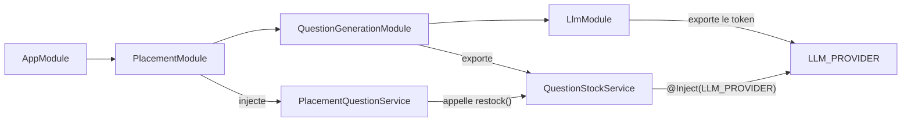
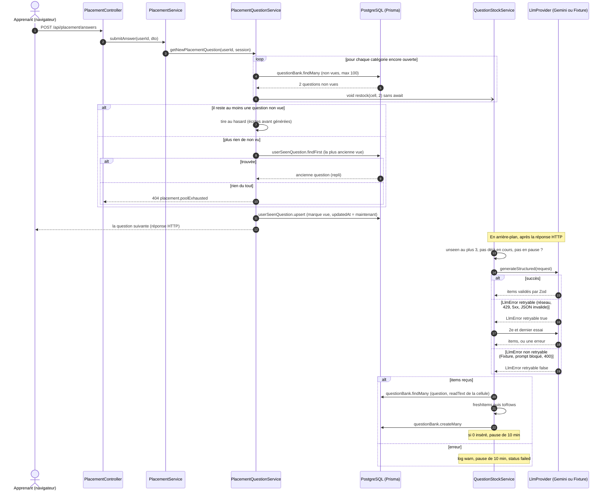
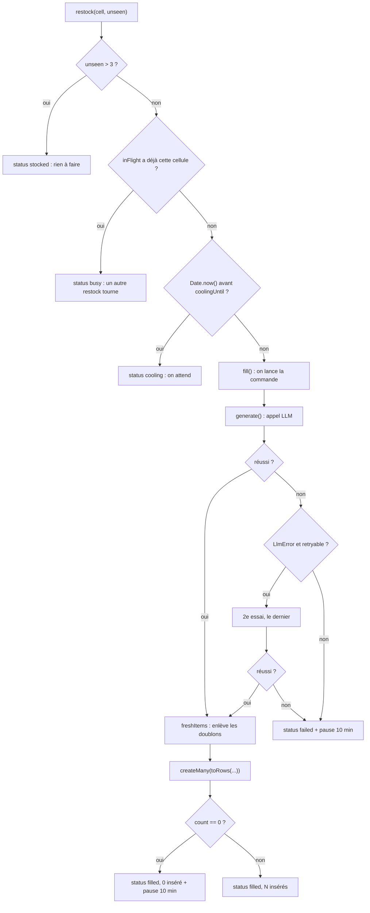
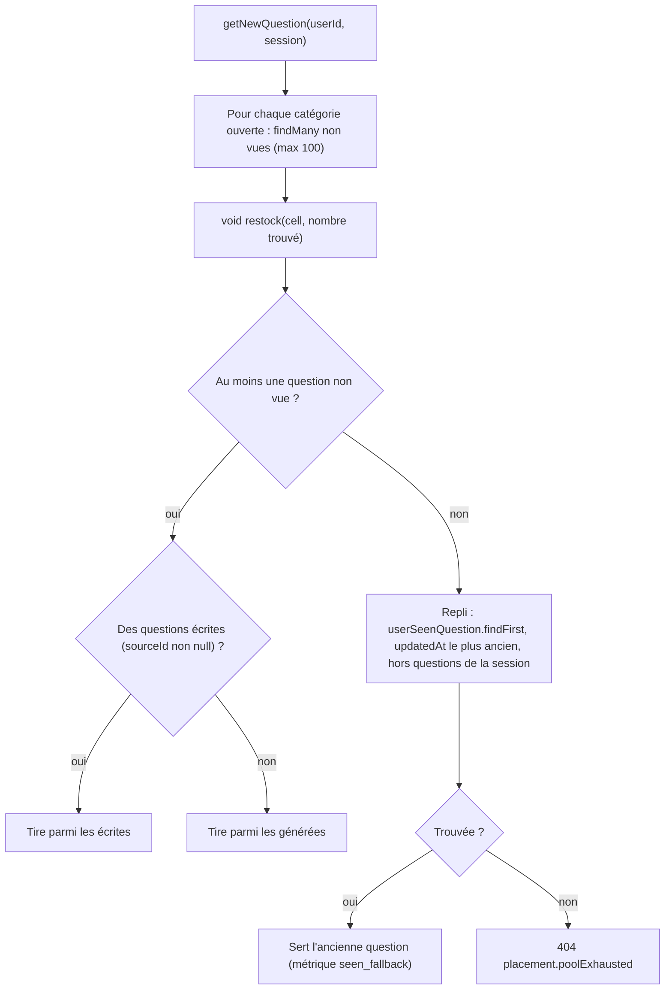

# Module : génération de questions par LLM (`llm/` + `question-generation/`)

> Dossiers du code : [`apps/api/src/llm/`](../../../../apps/api/src/llm/) et
> [`apps/api/src/question-generation/`](../../../../apps/api/src/question-generation/).
>
> Ce dossier contient trois fichiers :
>
> - **ce README** : la vue d'ensemble, le chemin complet, les concepts, les questions d'oral ;
> - [providers.md](providers.md) : l'abstraction `LlmProvider` (interface, Gemini, Fixture, factory, token) ;
> - [prompt.md](prompt.md) : le prompt envoyé au LLM, un exemple réel, la validation et l'insertion.
>
> Les deux longues docs « ligne par ligne » existent déjà, à côté du code :
> [GEMINI_PROVIDER.md](../../../../apps/api/src/llm/GEMINI_PROVIDER.md) et
> [QUESTION_GENERATION.md](../../../../apps/api/src/question-generation/QUESTION_GENERATION.md).
> Ce cours-ci est la version « pour l'oral » : plus courte, avec des schémas.

---

## 1. À quoi sert le module, en mots simples

Le test de placement pose des questions à choix multiple (QCM). Ces questions sont rangées
dans la table `QuestionBank` de la base de données.

Une question appartient à une **cellule** : une langue + un niveau + une catégorie.
Exemple : `fr / B1 / grammar`. Il y a 3 catégories : `grammar`, `vocabulary`, `reading`.

Le problème : un apprenant qui refait le test finit par avoir **tout vu** dans une cellule.
Les questions écrites à la main (le « seed », voir [../seed/](../seed/README.md)) ne suffisent pas.

La solution : quand un apprenant n'a presque plus de questions **non vues** dans une cellule
(3 ou moins), l'API demande à un **LLM** (un modèle de langage, ici Gemini de Google) d'écrire
un nouveau lot de questions. L'API vérifie ce lot, enlève les doublons, puis l'enregistre.

### L'analogie : le rayon d'un magasin

- La **banque de questions** est un rayon de magasin. Chaque cellule est une étagère.
- L'**apprenant** est un client qui prend des produits sur l'étagère.
- `QuestionStockService` est le **gestionnaire de stock** : quand une étagère est presque vide,
  il passe commande. Il ne sert pas les clients, il remplit seulement.
- Le **LLM** est le **fournisseur**. Le gestionnaire ne parle pas directement au fournisseur :
  il passe par un **bon de commande standard** (l'interface `LlmProvider`).
- Il y a deux fournisseurs possibles :
  - **Gemini** : le vrai fournisseur, qui livre (et qui coûte de l'argent) ;
  - **Fixture** : un fournisseur « fermé », qui refuse toutes les commandes. On l'utilise quand
    on n'a pas de clé API (en développement, en CI).
- Si la livraison n'arrive pas, le magasin **ressort un ancien produit** : la question que
  l'apprenant a vue il y a le plus longtemps (table `UserSeenQuestion`). C'est le **repli**.
- Si le fournisseur échoue, le gestionnaire **attend 10 minutes** avant de recommander
  (le « cooldown »), pour ne pas payer et spammer pour rien.

---

## 2. Qui a écrit quoi (historique `git log`)

Ce que `git log` montre sur ces deux dossiers :

| PR | Auteur (git) | Ce qui a été fait |
|---|---|---|
| #69 | EA | Première version : `LlmProvider` + token `LLM_PROVIDER` (fichier `llm.interface.ts`), `FixtureProvider` qui renvoyait des fausses questions, `GeminiProvider`, un gros `QuestionGenerationService` (dossier `questions-generation/` avec un **s**) qui faisait tout : décider, appeler le LLM, réessayer, insérer, **et** servir la question avec le repli sur `UserSeenQuestion`. Script `scripts/try-generation.ts` (la commande `generation:try` du `package.json` arrive seulement avec #104). |
| #104 | ninisse (la PR), VictorBro (les commits LLM dedans) | **Grosse refonte**. La PR est d'Anaïs (`ninisse`), mais ses changements LLM viennent de commits de Victor, comme le dit [llm-interface.md](../../../modules/llm-interface.md#who-built-it). `llm.interface.ts` devient `llm.provider.ts` avec `StructuredRequest` (schéma Zod) et `LlmError` (champ `retryable`). Ajout de `llm.factory.ts`. `FixtureProvider` ne renvoie plus de fausses questions : il échoue. Le service est découpé : `question-stock.service.ts` (remplir) + `question-batch.ts` (fonctions pures) + `prompts/question-batch.prompt.ts`. Servir la question et le repli passent dans `PlacementQuestionService`. |
| #111 | EA | Modèle par défaut : `gemini-3.6-flash`. |
| #121 | EA | Commentaires pédagogiques dans tout le code + les docs `GEMINI_PROVIDER.md` et `QUESTION_GENERATION.md`. Pas de changement de logique visible (le diff ne touche que des commentaires). |
| #130 | VictorBro | Monitoring (Prometheus) : champ `reason` dans `LlmError` (type `LlmFailure`), compteurs de requêtes / tokens / durée dans Gemini, `showProvider` dans la factory, `counted` et `failureReason` dans le service de stock. |
| #201 | luca-mattei | Le tuteur des leçons : `streamText` dans l'interface, dans Gemini et dans le Fixture (qui répond un texte fixe), le nouveau `DisabledProvider` (`LLM_PROVIDER=disabled`), et le timeout Gemini passé de 60 à 90 s. |

**À savoir dire à l'oral** : « J'ai posé l'abstraction provider, le token d'injection,
Gemini, la génération et le repli dans la PR #69. Ensuite l'équipe a refactoré : la
validation est passée dans le provider, le service a été séparé en "remplir" et "servir",
et on a ajouté des métriques. » Le détail avant / après est dans
[QUESTION_GENERATION.md §9](../../../../apps/api/src/question-generation/QUESTION_GENERATION.md)
et [GEMINI_PROVIDER.md §13](../../../../apps/api/src/llm/GEMINI_PROVIDER.md).

---

## 3. Les fichiers et leur rôle

### `llm/` : parler à un LLM, n'importe lequel

| Fichier | Rôle |
|---|---|
| [llm.provider.ts](../../../../apps/api/src/llm/llm.provider.ts) | Le **contrat**. Le token `LLM_PROVIDER` (un `Symbol`), l'interface `LlmProvider` (deux méthodes : `generateStructured` pour les questions, `streamText` pour le tuteur des leçons), le type `StructuredRequest` (purpose, system, user, schema), la classe d'erreur `LlmError` (`retryable`, `reason`). |
| [llm.factory.ts](../../../../apps/api/src/llm/llm.factory.ts) | `createLlmProvider` : lit `LLM_PROVIDER`, `LLM_API_KEY`, `LLM_MODEL` et construit **le bon** provider. Plante au démarrage si la config est fausse. |
| [llm.module.ts](../../../../apps/api/src/llm/llm.module.ts) | Le module NestJS. Enregistre le token `LLM_PROVIDER` avec `useFactory` et l'**exporte**. |
| [gemini.provider.ts](../../../../apps/api/src/llm/gemini.provider.ts) | Le vrai provider : un appel HTTP `fetch` à l'API Gemini, timeout 90 s, lecture de la réponse, validation Zod, erreurs `LlmError`, métriques. |
| [fixture.provider.ts](../../../../apps/api/src/llm/fixture.provider.ts) | Le provider « sans clé » : `generateStructured` **échoue toujours** (`LlmError`, `retryable: false`, `reason: 'disabled'`). `streamText` (le tuteur) renvoie un texte fixe. Aucun réseau, aucun coût. |
| [disabled.provider.ts](../../../../apps/api/src/llm/disabled.provider.ts) | `LLM_PROVIDER=disabled` : aucun LLM, même pas le tuteur fixe. Les deux méthodes échouent tout de suite avec `reason: 'disabled'` (#201). |
| `*.spec.ts` | Les tests unitaires (Vitest) de chaque fichier. |

### `question-generation/` : remplir la banque

| Fichier | Rôle |
|---|---|
| [question-generation.module.ts](../../../../apps/api/src/question-generation/question-generation.module.ts) | Importe `LlmModule`, fournit et exporte `QuestionStockService`. |
| [question-stock.service.ts](../../../../apps/api/src/question-generation/question-stock.service.ts) | **Le cœur.** `restock` (faut-il commander ?), `fill` (générer, dédoublonner, insérer), `generate` (appel LLM + 1 retry si `retryable`). Seuil `RESTOCK_AT = 3`, pause `COOLDOWN_MS = 10 min`. |
| [question-batch.ts](../../../../apps/api/src/question-generation/question-batch.ts) | Fonctions **pures** (sans base, sans LLM) : le type `Cell`, `freshItems` (enlève les doublons), `toRows` (prépare les lignes à insérer), la table `TIME_LIMIT_S`. |
| [prompts/question-batch.prompt.ts](../../../../apps/api/src/question-generation/prompts/question-batch.prompt.ts) | `buildQuestionBatchPrompt(cell)` : construit le texte `system` + `user` envoyé au LLM. Voir [prompt.md](prompt.md). |

### Les fichiers voisins utiles

| Fichier | Pourquoi il compte |
|---|---|
| [packages/shared/src/schemas/item.ts](../../../../packages/shared/src/schemas/item.ts) | `generatedBatchSchema(category)` : le schéma Zod qui **valide** la réponse du LLM. Les constantes `TOPICS`, `VOCABULARY_BATCH_SIZE = 10`, `READING_BATCH_SIZE = 5`, `OPTIONS_PER_ITEM = 4`. |
| [placement-question.service.ts](../../../../apps/api/src/placement/placement-question.service.ts) | **L'appelant.** Tire une question, déclenche `restock` en arrière-plan, et fait le **repli** sur `UserSeenQuestion`. |
| [placement.module.ts](../../../../apps/api/src/placement/placement.module.ts) | Importe `QuestionGenerationModule`. |
| [placement.controller.ts](../../../../apps/api/src/placement/placement.controller.ts) | Les routes HTTP du test de placement. |
| [scripts/try-generation.ts](../../../../apps/api/scripts/try-generation.ts) | Script manuel (`pnpm --filter @ft/api generation:try b1 grammar`) : lance un vrai restock hors HTTP, pour tester Gemini. |
| [.env.example](../../../../.env.example) | Les variables `LLM_PROVIDER`, `LLM_API_KEY`, `LLM_MODEL`. |

---

## 4. Qui appelle le module, et quelles routes HTTP le déclenchent

Le câblage des modules NestJS :



**Un seul appelant dans l'API** : `PlacementQuestionService.getNewQuestion`. Il appelle
`this.stock.restock(...)` une fois par catégorie, **à chaque question tirée**.
(Le script `try-generation.ts` l'appelle aussi, mais à la main, hors HTTP.)
Le token `LLM_PROVIDER` a un autre client, hors de ce module : `DiscussionService`, le tuteur des leçons (#201), qui appelle `streamText`.

Les routes qui tirent une nouvelle question (préfixe global `api`, voir `API_PREFIX` dans
[app.setup.ts](../../../../apps/api/src/app.setup.ts)) :

| Route | Méthode du contrôleur | Déclenche un tirage ? |
|---|---|---|
| `POST /api/placement` | `startPlacement` | **Oui** : la 1re question. |
| `POST /api/placement/answers` | `submitAnswer` | **Oui** : la question suivante (si le test n'est pas fini). Aussi quand la question a expiré (timeout). |
| `GET /api/placement` | `getPlacement` | **Non** : lecture seule, il relit la question en cours. |
| `DELETE /api/placement` | `quitPlacement` | Non. |

Donc : **aucune route ne s'appelle "generate"**. La génération est un **effet de bord**
d'un tirage de question, et elle tourne **en arrière-plan**.

---

## 5. Le chemin d'exécution complet (diagramme de séquence)

Scénario : un apprenant répond à une question. L'API tire la suivante. Dans la cellule
`fr / B1 / grammar`, il ne lui reste que 2 questions non vues.



Point clé : **le tirage n'attend pas la génération**. L'apprenant reçoit sa question tout
de suite (ou une ancienne en repli). Les nouvelles questions serviront aux tirages
**suivants**. Un appel Gemini peut prendre des dizaines de secondes (timeout à 90 s) :
on ne fait pas attendre un humain pour ça.

---

## 6. Les décisions (flowchart)

### 6.1 `restock` : faut-il commander ?

Code : `restock` et `fill` dans
[question-stock.service.ts](../../../../apps/api/src/question-generation/question-stock.service.ts).



### 6.2 Le tirage côté placement (où vit le repli)

Code : `getNewQuestion` dans
[placement-question.service.ts](../../../../apps/api/src/placement/placement-question.service.ts).



Pourquoi le repli « tourne » : servir une question fait un `upsert` sur `UserSeenQuestion`
qui remet `updatedAt` à maintenant. La prochaine fois, la plus ancienne sera donc **une autre**.

---

## 7. Que se passe-t-il concrètement : un exemple pas à pas

Situation : Léa passe le test en français. Elle est au niveau B1. Avec `LLM_PROVIDER=gemini`.

1. Léa envoie `POST /api/placement/answers` avec `{ questionId, choice: "soit" }`.
2. `PlacementService.submitAnswer` prend un verrou Redis, vérifie la réponse, ajuste le niveau.
   Le test n'est pas fini : il faut une nouvelle question.
3. `PlacementQuestionService.getNewQuestion` cherche, pour `grammar`, les questions B1 en
   français que Léa n'a **jamais vues** (`userSeenQuestions: { none: { userId } }`). Il en trouve **2**.
4. Il appelle `void this.stock.restock({ lang: 'fr', level: 'B1', category: 'grammar' }, 2)`.
   Le mot `void` veut dire : « je lance, je n'attends pas ».
5. Il tire une des 2 questions et la renvoie à Léa. **La réponse HTTP part.**
6. En parallèle, `restock` voit `2 <= 3`, la clé `"fr:B1:grammar"` n'est pas dans `inFlight`,
   pas de pause en cours. Il lance `fill` et range la promesse dans `inFlight`.
7. `generate` construit la requête :
   - `purpose: "question-batch:grammar"` (pour les logs et les métriques) ;
   - `schema: generatedBatchSchema('grammar')` (13 items, un par topic) ;
   - `system` et `user` venant de `buildQuestionBatchPrompt` (voir [prompt.md](prompt.md)).
     Le `user` vaut exactement : `Write 13 B1 grammar questions in "fr", one per topic.`
8. `GeminiProvider` envoie un `POST` à
   `https://generativelanguage.googleapis.com/v1beta/models/gemini-3.6-flash:generateContent`,
   avec la clé dans le header `x-goog-api-key`.
9. Gemini répond avec du JSON. Le provider vérifie `finishReason === "STOP"`, recolle le texte,
   fait `JSON.parse`, puis `schema.safeParse`. Tout est bon : il renvoie `{ items: [13 questions] }`.
10. `fill` lit les questions déjà présentes dans `fr/B1/grammar` et appelle `freshItems`.
    Disons que 1 question était déjà là (même texte, aux espaces et majuscules près) : il en reste 12.
11. `toRows` ajoute à chaque item `lang: 'fr'`, `level: 'B1'`, `category: 'grammar'`,
    `sourceId: null`, `timeLimitS: 60` (B1 grammaire dans `TIME_LIMIT_S`).
12. `createMany` insère 12 lignes. Log : `restocked fr:B1:grammar: 12 of 13 questions were new`.
13. `.finally` retire la clé de `inFlight`. Au prochain tirage, Léa a 12 nouvelles questions.

Même scénario avec `LLM_PROVIDER=fixture` : à l'étape 8, `FixtureProvider` lance
`LlmError('LLM_PROVIDER=fixture writes no questions', false, 'disabled')`. Pas de retry
(`retryable: false`). `fill` attrape l'erreur, met la cellule en pause 10 minutes, renvoie
`failed`. Quand Léa aura tout vu, le **repli** lui ressortira sa question la plus ancienne.

Le détail du prompt, de la réponse et des lignes insérées est dans [prompt.md](prompt.md).

---

## 8. Les concepts à savoir expliquer

### 8.1 Injection de dépendances (DI) NestJS par token

**Injection de dépendances** : une classe ne crée pas elle-même les objets dont elle a besoin.
Elle les **demande** dans son constructeur, et NestJS les lui **donne**.

D'habitude, on demande par **classe** : `constructor(private prisma: PrismaService)`.
NestJS utilise le type de la classe comme « nom ».

Mais `LlmProvider` est une **interface**. En TypeScript, une interface **disparaît à la
compilation** : en JavaScript, il n'en reste rien. NestJS ne peut donc pas s'en servir comme nom.

Solution : un **token**, c'est-à-dire un nom qui existe à l'exécution. Ici un `Symbol` :

```ts
// llm.provider.ts
export const LLM_PROVIDER = Symbol('LLM_PROVIDER');
```

Le module dit « sous ce nom, voici l'objet » :

```ts
// llm.module.ts (commentaires retirés)
@Module({
  providers: [
    {
      provide: LLM_PROVIDER,
      inject: [ConfigService],
      useFactory: (config: ConfigService) =>
        createLlmProvider({
          LLM_PROVIDER: config.get('LLM_PROVIDER'),
          LLM_API_KEY: config.get('LLM_API_KEY'),
          LLM_MODEL: config.get('LLM_MODEL'),
        }),
    },
  ],
  exports: [LLM_PROVIDER],
})
export class LlmModule {}
```

Le service dit « donne-moi l'objet rangé sous ce nom » :

```ts
// question-stock.service.ts
constructor(
  private readonly prisma: PrismaService,
  @Inject(LLM_PROVIDER) private readonly llm: LlmProvider,
) {}
```

`useFactory` : une fonction que Nest appelle **une seule fois, au démarrage**. Ce qu'elle
renvoie est l'objet partagé (un **singleton** : une seule instance pour toute l'API).
`Symbol` plutôt qu'une chaîne `'LLM_PROVIDER'` : un `Symbol` est unique, aucun risque de collision
avec un autre provider qui aurait le même texte.

### 8.2 Pourquoi une interface provider

- **Le code métier ne connaît pas Gemini.** `QuestionStockService` appelle juste
  `generateStructured`. Changer de fournisseur (OpenAI, Mistral…) = écrire une classe de plus
  et ajouter un `case` dans la factory. Le service ne bouge pas.
- **Tests sans réseau et sans coût.** En CI on tourne avec `fixture`. Dans les tests unitaires,
  on passe un faux objet qui respecte l'interface.
- **Le compilateur vérifie.** `class GeminiProvider implements LlmProvider` : s'il manque la
  méthode, ça ne compile pas.

C'est le **pattern Strategy** (plusieurs implémentations interchangeables d'un même contrat)
combiné à une **factory** (une fonction qui choisit laquelle construire). Détails et
classDiagram : [providers.md](providers.md).

### 8.3 Les variables d'environnement : quel provider, quand

| `LLM_PROVIDER` | `LLM_API_KEY` | Résultat au démarrage |
|---|---|---|
| absent ou `fixture` | ignorée | `FixtureProvider` (défaut dans `createLlmProvider` **et** dans `compose.yml`) |
| `gemini` | remplie | `GeminiProvider`, modèle `LLM_MODEL` ou `gemini-3.6-flash` par défaut |
| `gemini` | vide | **L'API refuse de démarrer** : `LLM_PROVIDER=gemini needs LLM_API_KEY` |
| `disabled` | ignorée | `DisabledProvider` : aucun appel LLM, tout échoue avec `reason: 'disabled'` |
| autre chose (`gpt`…) | — | **L'API refuse de démarrer** : `LLM_PROVIDER must be "fixture", "gemini" or "disabled"` |

En déploiement, [compose.deploy.yml](../../../../compose.deploy.yml) **exige** `LLM_PROVIDER`
(`${LLM_PROVIDER:?...}`) : on doit choisir explicitement. Pourquoi planter au démarrage ?
Sinon l'erreur n'apparaîtrait qu'au premier restock, pendant qu'un apprenant utilise l'app.

### 8.4 Retry, cooldown, `inFlight` : les garde-fous

- **Retry (un seul).** Seulement si l'erreur est une `LlmError` avec `retryable: true`.
  C'est le **provider** qui décide, car c'est lui qui sait : un 429 ou un 503 peut passer au
  2e essai, une clé invalide (401) ou un prompt bloqué non.
- **Cooldown de 10 min.** Après un échec, ou un lot sans rien de nouveau. Sans ça, un LLM en
  panne serait appelé **à chaque question tirée** de chaque apprenant : coût et logs inutiles.
- **`inFlight` (une `Map` cellule → promesse).** Empêche deux restocks de la même cellule en
  même temps, même si 50 apprenants tirent au même moment. C'est sûr parce que JavaScript
  exécute une chose à la fois : entre `inFlight.has` et `inFlight.set` il n'y a pas d'`await`.
- **`restock` ne rejette jamais.** `fill` attrape toutes les erreurs. C'est obligatoire : la
  promesse n'est pas attendue (`void`), et une promesse rejetée sans `catch`
  (« unhandled rejection ») peut faire planter le processus Node.
- **Limite connue** : ces `Map` sont en mémoire, donc par processus. Avec plusieurs serveurs API,
  chacun aurait les siennes (il faudrait un verrou Redis). Le projet tourne avec une seule instance.

### 8.5 La validation : ne jamais faire confiance au LLM

Un LLM peut renvoyer n'importe quoi. Trois barrières :

1. **`responseJsonSchema`** envoyé à Gemini : il contraint la forme du JSON (champs, types, tailles).
2. **`schema.safeParse`** (Zod) dans le provider : revérifie tout, y compris ce que JSON Schema ne
   sait pas dire (`.refine` : la réponse est bien dans les options, 4 options différentes,
   un item par topic, passages de lecture distincts).
3. **Le serveur fixe lui-même** `level`, `timeLimitS` et `sourceId: null`. Le modèle ne choisit
   jamais le niveau : une question ne peut pas être rangée au mauvais niveau.

Et `sourceId: null` marque une question **générée, non relue par un humain**. Le placement sert
toujours les questions écrites **avant** les générées.

### 8.6 Idempotence (ici, au sens large)

**Idempotent** : faire l'opération deux fois donne le même résultat qu'une fois.
Le restock n'est **pas** strictement idempotent (deux restocks peuvent ajouter des questions
différentes). Mais il est **protégé contre les doublons** : `freshItems` compare le texte
normalisé (`trim`, minuscules, espaces compressés) de `readText + question` avec ce qui est déjà
en base **et** avec les autres items du même lot. Le seed, lui, est vraiment idempotent : voir
[../seed/README.md](../seed/README.md).

### 8.7 Pas de transaction ici, pourquoi c'est acceptable

L'insertion est **un seul** `createMany` : une seule requête SQL, donc atomique à elle seule.
Il n'y a pas plusieurs écritures à garder ensemble. (Petite fenêtre : entre le `findMany` de
dédoublonnage et le `createMany`, une autre écriture pourrait passer ; `inFlight` l'évite pour
la même cellule dans le même processus.)

---

## 9. Les tests

| Fichier | Ce qu'il vérifie |
|---|---|
| [llm.factory.spec.ts](../../../../apps/api/src/llm/llm.factory.spec.ts) | Le bon provider selon les variables, les erreurs de config. |
| [llm.module.spec.ts](../../../../apps/api/src/llm/llm.module.spec.ts) | Le token `LLM_PROVIDER` est bien fourni par le module. |
| [gemini.provider.spec.ts](../../../../apps/api/src/llm/gemini.provider.spec.ts) | `fetch` simulé : corps envoyé, header de clé, erreurs HTTP, blocage, réponse coupée, JSON invalide. |
| [gemini.provider.stream.spec.ts](../../../../apps/api/src/llm/gemini.provider.stream.spec.ts) | `streamText` avec un faux `fetch` (le tuteur, #201). |
| [fixture.provider.spec.ts](../../../../apps/api/src/llm/fixture.provider.spec.ts) | `generateStructured` rejette toujours, non retryable ; `streamText` envoie le texte fixe, ou échoue sur `#blocked`, `#timeout`, `#fail-midstream`. |
| [disabled.provider.spec.ts](../../../../apps/api/src/llm/disabled.provider.spec.ts) | Les deux méthodes échouent avec `disabled`. |
| [question-stock.service.spec.ts](../../../../apps/api/src/question-generation/question-stock.service.spec.ts) | stocked / busy / cooling / filled / failed, le retry, la pause. |
| [question-batch.spec.ts](../../../../apps/api/src/question-generation/question-batch.spec.ts) | `freshItems` et `toRows`. |
| [question-batch.prompt.spec.ts](../../../../apps/api/src/question-generation/prompts/question-batch.prompt.spec.ts) | Le contenu du prompt selon la cellule. |

Lancer : `pnpm --filter @ft/api test`.

---

## 10. Questions possibles à l'oral

**Q : À quoi sert ce module, en une phrase ?**
R : Quand un apprenant n'a plus que 3 questions non vues ou moins dans une cellule, il demande
au LLM un nouveau lot, le valide, enlève les doublons et l'enregistre dans `QuestionBank`.

**Q : Pourquoi un token `LLM_PROVIDER` et pas juste la classe ?**
R : `LlmProvider` est une interface. Les interfaces disparaissent à la compilation, Nest ne peut
pas les utiliser comme clé. Le `Symbol` est une vraie valeur à l'exécution.

**Q : Comment l'API choisit entre Gemini et Fixture ?**
R : Au démarrage, `useFactory` appelle `createLlmProvider` avec `LLM_PROVIDER`. `fixture` par
défaut. `gemini` exige `LLM_API_KEY`, sinon l'API ne démarre pas. `disabled` coupe tout LLM.

**Q : Pourquoi le Fixture ne renvoie pas de fausses questions ?**
R : Au début (#69) il en renvoyait. Mais une fausse question insérée en base est servie aux
apprenants comme une vraie. Maintenant il échoue, et le repli prend le relais.

**Q : L'apprenant attend-il la réponse de Gemini ?**
R : Non. `restock` est appelé avec `void`, sans `await`. Il reçoit sa question tout de suite ;
les nouvelles serviront aux tirages suivants.

**Q : Que se passe-t-il si Gemini est en panne ?**
R : `LlmError` retryable → un 2e essai. S'il échoue aussi : log, pause de 10 min pour cette
cellule, statut `failed`. L'apprenant n'est pas bloqué : on lui sert sa plus ancienne question vue.

**Q : Pourquoi ne réessayer qu'une fois, et pas toujours ?**
R : Chaque appel coûte des tokens. Un prompt bloqué ou une clé invalide donnera le même
résultat à chaque fois. Le provider marque `retryable` uniquement les erreurs passagères
(réseau, 408, 429, 5xx, JSON invalide).

**Q : Comment éviter que 50 apprenants déclenchent 50 appels ?**
R : La `Map inFlight`. Le service est un singleton, donc la `Map` est partagée. Si la cellule
y est déjà : statut `busy`.

**Q : Qu'est-ce que le repli sur `UserSeenQuestion` ?**
R : S'il n'y a plus aucune question non vue, on sert celle que l'apprenant a vue il y a le plus
longtemps (`orderBy: { updatedAt: 'asc' }`), hors questions de la session en cours. Servir
remet `updatedAt` à maintenant, donc les replis tournent.

**Q : Comment tu vérifies que le LLM n'a pas écrit n'importe quoi ?**
R : Gemini reçoit un JSON Schema. Puis Zod revérifie : nombre d'items, 4 options différentes,
réponse présente dans les options, un item par topic en grammaire. Le niveau et le temps sont
fixés par le serveur.

**Q : Comment tu reconnais un doublon ?**
R : `itemKey` = passage + question, normalisés (espaces, majuscules). Un `Set` des clés déjà
en base ; on garde seulement les items dont la clé est nouvelle.

**Q : Qu'est-ce qui change si on veut ajouter OpenAI ?**
R : Une classe `OpenAiProvider implements LlmProvider`, un `case 'openai'` dans la factory.
Rien dans `QuestionStockService` ni dans le placement.

**Q : Quelle est la limite de ce design ?**
R : `inFlight` et `coolingUntil` sont en mémoire, donc valables pour une seule instance de l'API.
Avec plusieurs instances, il faudrait un verrou partagé (Redis).

**Q : Quelle route HTTP lance la génération ?**
R : Aucune directement. `POST /api/placement` et `POST /api/placement/answers` tirent une
question, et chaque tirage appelle `restock` en arrière-plan. `GET /api/placement` est en
lecture seule et ne tire rien.
