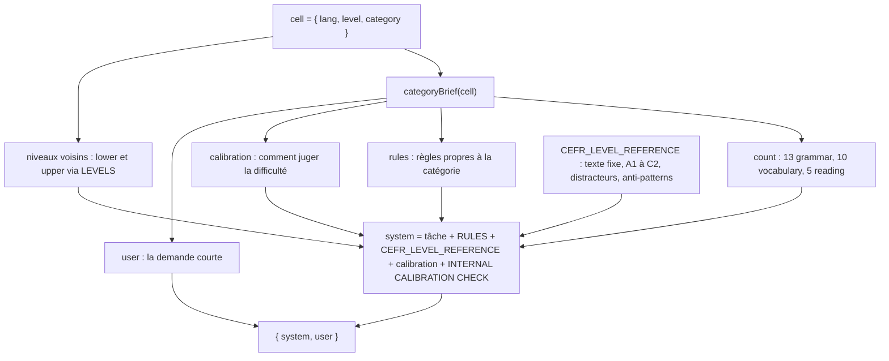
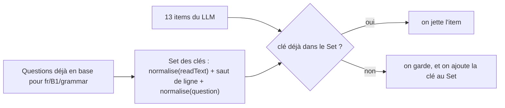

# Le prompt, la réponse, la validation et l'insertion

> Retour au [README du module](README.md).
> Code : [prompts/question-batch.prompt.ts](../../../../apps/api/src/question-generation/prompts/question-batch.prompt.ts),
> [question-batch.ts](../../../../apps/api/src/question-generation/question-batch.ts),
> [question-stock.service.ts](../../../../apps/api/src/question-generation/question-stock.service.ts),
> schémas dans [packages/shared/src/schemas/item.ts](../../../../packages/shared/src/schemas/item.ts).

---

## 1. Les mots à connaître

- **Prompt** : le texte qu'on envoie au LLM pour lui dire quoi faire.
- **Message `system`** : les règles du jeu et le rôle du modèle (« tu es un concepteur d'examens »).
  Long, presque identique d'un appel à l'autre.
- **Message `user`** : la demande précise de cet appel (« écris 13 questions B1 »). Court.
- **CECR / CEFR** : le cadre européen des niveaux de langue, A1 (débutant) à C2 (maîtrise).
- **Distracteur** : une mauvaise réponse d'un QCM, qui doit être plausible.
- **Lot (batch)** : l'ensemble des questions demandées en un seul appel.

`buildQuestionBatchPrompt(cell)` ne fait **que du texte** : pas de réseau, pas de base. Il est
donc facile à tester ([question-batch.prompt.spec.ts](../../../../apps/api/src/question-generation/prompts/question-batch.prompt.spec.ts)).

---

## 2. Comment le prompt est assemblé



Taille des lots (constantes de `@ft/shared`, les **mêmes** que celles lues par le schéma Zod,
donc le prompt et la validation ne peuvent pas se contredire) :

| Catégorie | Nombre | Règle spéciale |
|---|---|---|
| `grammar` | 13 = `TOPICS.length` | exactement **une question par topic** |
| `vocabulary` | 10 = `VOCABULARY_BATCH_SIZE` | tester le vocabulaire, pas la grammaire ; topic parmi `VOCABULARY_TOPICS` |
| `reading` | 5 = `READING_BATCH_SIZE` | chaque question a **son propre** passage (`readText`) de 25 à 100 mots |

Ce que le prompt ne dit **pas** : le format JSON. Il est envoyé à part, à Gemini, sous forme de
JSON Schema (`responseJsonSchema`). Le prompt ne porte que les règles de **contenu**.

---

## 3. Le vrai prompt, raccourci (cellule `fr / B1 / grammar`)

Texte produit par `buildQuestionBatchPrompt({ lang: 'fr', level: 'B1', category: 'grammar' })`.
Les `[...]` marquent les coupures ; le reste est le texte exact du code.

**`system`**

```text
You are an expert CEFR language exam designer.
Write 13 multiple-choice placement questions for category "grammar", in language "fr", at CEFR level B1.

RULES
- "question" is one sentence with a single blank written "___".
- Write exactly one question for each of these topics, none repeated or skipped: nouns_and_determiners, pronouns, verbs_morphology, verb_usage, syntax_and_sentence_structure, subordinate_clauses, prepositions_and_case, adjectives, adverbs, agreement, negation, comparison_and_quantity, information_structure_and_pragmatics.
- Each question has 4 different options, and "answer" repeats the correct one verbatim. Exactly one option is correct; the other three are plausible but unambiguously wrong (see DISTRACTOR QUALITY).
- Everything (passages, questions, options) is in "fr".
- Calibrate every item with the CEFR LEVEL REFERENCE below. Each item must be clearly harder than typical A2 material. No item may require knowledge normally associated with B2 or above.
- No two questions in the batch may be the same.

CEFR LEVEL REFERENCE: USE THIS AS THE PRIMARY DIFFICULTY CALIBRATION
[...]
B1: Intermediate / Threshold
- Overall ability: functionally independent in most familiar situations. [...]
- Grammar: systematic use of the main tenses [...]; basic conditionals [...]; relative clauses; [...]
- Examples: "If I had more time, I ___ take a course in Spanish." (would); [...]
[... A1 à C2, FUNDAMENTAL CALIBRATION RULE, DISTRACTOR QUALITY, ANTI-PATTERNS ...]

TOPIC CALIBRATION
Each topic must be tested at the depth appropriate to B1, not at its most advanced form. [...] The blank must target the linguistic point of the topic; the rest of the sentence must stay within B1.

INTERNAL CALIBRATION CHECK
Before writing each item, silently verify:
1. What linguistic ability is this question testing?
2. Is that ability appropriate for B1?
[... 3 à 8 ...]
Revise the item if any answer is unsatisfactory. Never put this check or your reasoning in the reply.
```

**`user`**

```text
Write 13 B1 grammar questions in "fr", one per topic.
```

Remarques à savoir dire :

- La phrase « harder than typical A2 / nothing B2 or above » vient de `lower` et `upper`, calculés
  avec `LEVELS.indexOf(level)`. Pour A1 il n'y a pas de `lower`, pour C2 pas de `upper` : la
  phrase est simplement omise.
- Les exemples de la référence CECR sont **en anglais** et le prompt dit de **ne pas les copier
  ni les traduire**. Un seul texte sert donc pour les trois langues.
- La « vérification interne » demande au modèle de se relire **en silence** : le raisonnement ne
  doit pas apparaître dans la réponse JSON.

---

## 4. La requête complète vue par le service

Dans `QuestionStockService.generate` :

```ts
const request = {
  purpose: `question-batch:${cell.category}`,   // "question-batch:grammar"
  schema: generatedBatchSchema(cell.category),  // 13 items, un par topic
  ...buildQuestionBatchPrompt(cell),            // ajoute system et user
} as const;
```

`...` (spread) recopie les champs `system` et `user` dans l'objet. `as const` garde `purpose`
comme le texte exact `"question-batch:grammar"` et pas juste `string`, pour qu'il corresponde au
type `LlmPurpose`.

---

## 5. Une réponse de Gemini (exemple illustratif)

> Cet exemple a la **forme exacte** que lit `gemini.provider.ts` (`candidates`, `finishReason`,
> `parts`, `usageMetadata`), mais les questions sont un exemple écrit pour ce cours, pas une
> capture d'un vrai appel. Les nombres de tokens sont indicatifs.

```json
{
  "candidates": [
    {
      "finishReason": "STOP",
      "content": {
        "parts": [
          { "text": "Je dois vérifier chaque topic...", "thought": true },
          { "text": "{\"items\":[{\"topic\":\"subordinate_clauses\",\"question\":\"Bien qu'il ___ fatigué, il est venu à la réunion.\",\"options\":[\"soit\",\"est\",\"était\",\"sera\"],\"answer\":\"soit\"},{\"topic\":\"pronouns\",\"question\":\"C'est le livre ___ je t'ai parlé hier.\",\"options\":[\"dont\",\"que\",\"qui\",\"où\"],\"answer\":\"dont\"}, ... 11 autres ...]}" }
        ]
      }
    }
  ],
  "usageMetadata": { "promptTokenCount": 5200, "candidatesTokenCount": 1400, "thoughtsTokenCount": 300, "totalTokenCount": 6900 }
}
```

Ce que fait le provider, dans l'ordre (`replyText` puis `parseReply`) :

1. Pas de `promptFeedback.blockReason` : pas bloqué.
2. `finishReason === "STOP"` : réponse complète.
3. Garde les `parts` **sans** `thought: true`, colle leur `text`.
4. `JSON.parse` → un objet `{ items: [...] }`.
5. `generatedBatchSchema('grammar').safeParse(objet)` :
   - `items` a exactement 13 éléments ;
   - les 13 `topic` sont tous différents (un par topic) ;
   - chaque item a 4 `options` non vides et **toutes différentes** ;
   - `answer` est **dans** `options` (mot pour mot).
6. Log : `question-batch:grammar on gemini-3.6-flash: 5200 in, 1400 out, 300 thinking, 6900 total tokens, 8123 ms`.

Le schéma n'est **pas strict** : si le modèle ajoute un champ (`"level": "B1"`), il est ignoré au
lieu de faire échouer le lot. Le niveau et le temps viennent de toute façon du serveur.

---

## 6. Dédoublonnage et lignes insérées

### 6.1 `freshItems`



`normalise` = `trim` + minuscules + plusieurs espaces → un seul. Donc
`"Bien qu'il  ___ fatigué"` et `"bien qu'il ___ fatigué"` sont **le même** texte.
Ajouter la clé au `Set` en gardant un item élimine aussi les doublons **à l'intérieur** du lot.

### 6.2 `toRows`

```ts
items.map((item) => ({ ...item, ...cell, sourceId: null, timeLimitS }));
```

Une ligne réellement insérée, pour le premier item de l'exemple :

```json
{
  "topic": "subordinate_clauses",
  "question": "Bien qu'il ___ fatigué, il est venu à la réunion.",
  "options": ["soit", "est", "était", "sera"],
  "answer": "soit",
  "lang": "fr",
  "level": "B1",
  "category": "grammar",
  "sourceId": null,
  "timeLimitS": 60
}
```

`id`, `createdAt`, `updatedAt` sont remplis par Postgres / Prisma (`@default(uuid())`,
`@default(now())`, `@updatedAt`). `readText` est absent → `NULL` en base.

### 6.3 `TIME_LIMIT_S` : le temps vient du serveur

Secondes par question (tableau de [docs/content/item-bank.md](../../../content/item-bank.md), valeur haute de chaque fourchette) :

| | A1 | A2 | B1 | B2 | C1 | C2 |
|---|---|---|---|---|---|---|
| vocabulary | 30 | 45 | 45 | 45 | 60 | 60 |
| grammar | 30 | 45 | 60 | 60 | 75 | 90 |
| reading | 75 | 105 | 90 | 120 | 165 | 180 |

`Record<QuestionCategory, Record<Level, number>>` : TypeScript vérifie qu'aucune catégorie et
aucun niveau n'est oublié.

### 6.4 L'insertion

```ts
const { count } = await this.prisma.questionBank.createMany({ data: toRows(cell, freshItems(items, stored)) });
```

Une seule requête SQL pour toutes les lignes. `count` = nombre réellement inséré. Si `count` vaut
0 (le modèle n'a écrit que des questions déjà connues), la cellule part en pause 10 minutes.

---

## 7. Questions d'oral sur cette partie

**Q : Pourquoi séparer `system` et `user` ?**
R : `system` = les règles, longues et stables. `user` = la demande courte de l'appel. C'est le
format attendu par l'API Gemini (`systemInstruction` et `contents`).

**Q : Pourquoi ne pas décrire le JSON dans le prompt ?**
R : On l'envoie comme JSON Schema (`responseJsonSchema`), généré depuis le schéma Zod. Une seule
source de vérité : le format ne peut pas diverger entre le prompt et la validation.

**Q : Pourquoi le niveau n'est pas demandé au modèle dans la réponse ?**
R : Le modèle pourrait se tromper et ranger une question au mauvais niveau. `toRows` prend le
niveau de la cellule, jamais celui du modèle.

**Q : Pourquoi une question par topic en grammaire ?**
R : Pour couvrir tous les points de grammaire de façon équilibrée, et le schéma Zod le vérifie
(`new Set(topics).size === TOPICS.length`).

**Q : Pourquoi des exemples en anglais pour toutes les langues ?**
R : Un seul texte à maintenir. Le prompt dit de ne pas les copier : ils montrent la **difficulté**,
le modèle construit l'équivalent dans la langue cible.
