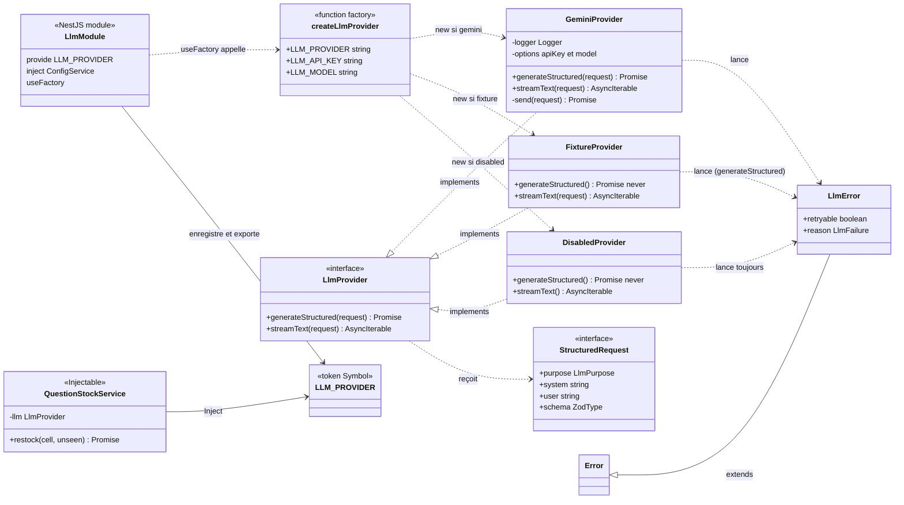
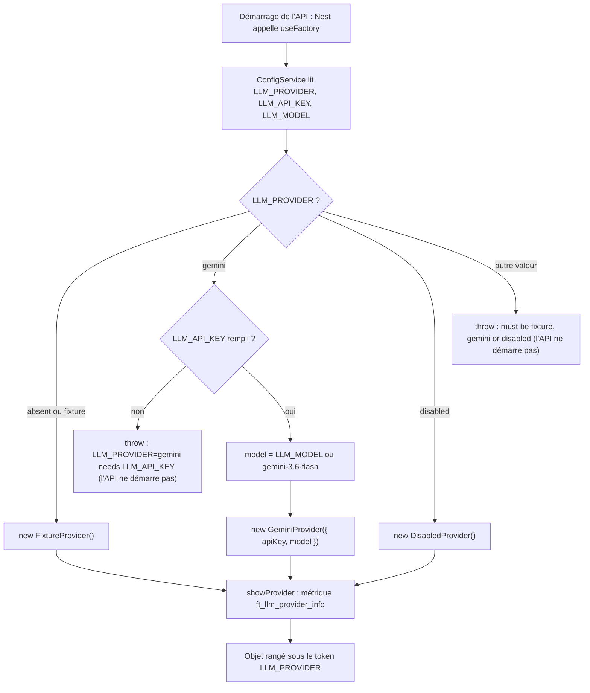
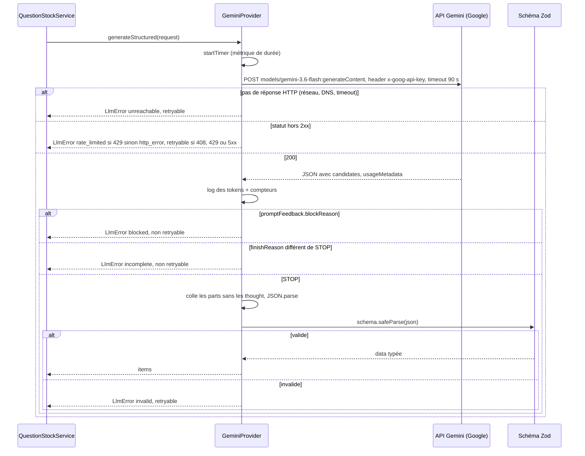

# L'abstraction `LlmProvider` : interface, Gemini, Fixture, factory, token

> Retour au [README du module](README.md).
> Code : [llm.provider.ts](../../../../apps/api/src/llm/llm.provider.ts),
> [llm.factory.ts](../../../../apps/api/src/llm/llm.factory.ts),
> [llm.module.ts](../../../../apps/api/src/llm/llm.module.ts),
> [gemini.provider.ts](../../../../apps/api/src/llm/gemini.provider.ts),
> [fixture.provider.ts](../../../../apps/api/src/llm/fixture.provider.ts),
> [disabled.provider.ts](../../../../apps/api/src/llm/disabled.provider.ts).

---

## 1. L'idée en une image

Une **prise électrique** : l'appareil (le service de stock) a une prise standard. Peu importe ce qui est derrière le mur (Gemini, Fixture, un futur OpenAI), tant que ça respecte la forme de la prise.

- La **forme de la prise** = l'interface `LlmProvider`.
- L'**électricien** qui branche le bon câble au démarrage = la factory `createLlmProvider`.
- L'**étiquette** sur la prise = le token `LLM_PROVIDER`.

---

## 2. Le diagramme de classes



Lecture :

- `<|..` = « implémente » (une classe respecte une interface).
- `<|--` = « hérite de » (`LlmError extends Error`).
- `..>` = « utilise / crée ».
- `GeminiProvider`, `FixtureProvider` et `DisabledProvider` **n'ont pas** `@Injectable()` : Nest ne les construit pas lui-même. C'est la factory qui fait `new`. Nest ne voit que le résultat, rangé sous le token.

---

## 3. Le contrat, mot à mot

```ts
// llm.provider.ts (commentaires retirés)
export interface LlmProvider {
  generateStructured<S extends z.ZodType>(request: StructuredRequest<S>): Promise<z.output<S>>;
  streamText(request: StreamRequest): AsyncIterable<string>;
}
```

`streamText` (ajouté en #201) sert au tuteur des leçons : il renvoie la réponse morceau par morceau. Les questions de placement n'utilisent que `generateStructured`.

- `<S extends z.ZodType>` : un **générique**. `S` est le type du schéma Zod passé dans la requête.
- `Promise<z.output<S>>` : la réponse arrivera plus tard (`await`) et aura **la forme décrite par le schéma**. Si on passe le schéma de grammaire, TypeScript sait que le résultat a `items`.
- Résultat : **pas de cast** (`as T`) dans l'appelant. Dans la PR #69, la signature était `generateStructured<T>(prompt): Promise<T>` : l'appelant choisissait `T` sans aucune vérification.

`StructuredRequest` :

| Champ | Rôle | Exemple |
|---|---|---|
| `purpose` | Étiquette pour les logs et les métriques. Type `` `question-batch:${QuestionCategory}` `` (ou `'lesson-discussion'` pour le tuteur) : une faute de frappe ne compile pas. | `"question-batch:grammar"` |
| `system` | Les règles et le rôle du modèle. | `"You are an expert CEFR language exam designer..."` |
| `user` | La demande précise. | `"Write 13 B1 grammar questions in \"fr\", one per topic."` |
| `schema` | Le schéma Zod qui décrit **et** vérifie la réponse. | `generatedBatchSchema('grammar')` |

---

## 4. La factory : quel provider, quand



Où sont les valeurs :

| Endroit | `LLM_PROVIDER` | Commentaire |
|---|---|---|
| [.env.example](../../../../.env.example) | `fixture` | Clé vide exprès : une vraie clé commitée serait une fuite. |
| [compose.yml](../../../../compose.yml) (dev) | `${LLM_PROVIDER:-fixture}` | Défaut `fixture`. |
| [compose.deploy.yml](../../../../compose.deploy.yml) (prod) | `${LLM_PROVIDER:?set LLM_PROVIDER to fixture, gemini or disabled}` | Obligatoire : docker compose refuse de lancer sans. |
| [llm.factory.ts](../../../../apps/api/src/llm/llm.factory.ts) | `LLM_PROVIDER = 'fixture'` (défaut du paramètre) | Dernier filet de sécurité. |

**Pourquoi un échec au démarrage ?** « Fail fast » : une mauvaise config doit casser tout de suite, avec un message clair, et pas plus tard au premier restock pendant qu'un apprenant utilise l'app.

**Différence avec #69** : avant, `GeminiProvider` lisait le `ConfigService` **à chaque appel** et découvrait la clé manquante au premier appel. Maintenant la factory vérifie une fois, et Gemini reçoit juste `{ apiKey, model }`.

---

## 5. `GeminiProvider` : le trajet d'un appel



Le corps envoyé (fonction `requestBody`) :

```json
{
  "systemInstruction": { "parts": [{ "text": "<le texte system>" }] },
  "contents": [{ "role": "user", "parts": [{ "text": "<le texte user>" }] }],
  "generationConfig": {
    "responseMimeType": "application/json",
    "responseJsonSchema": "<z.toJSONSchema(schema)>"
  }
}
```

Attention : les règles écrites avec `.refine()` (réponse dans les options, options différentes, un item par topic) **ne passent pas** dans le JSON Schema. Gemini ne les voit pas. Elles sont vérifiées après, par `safeParse`. C'est pour ça qu'une erreur `invalid` est **retryable** : le modèle écrit autre chose à chaque appel.

### Tableau des erreurs (`LlmFailure`)

| `reason` | Quand | `retryable` |
|---|---|---|
| `unreachable` | Pas de réponse HTTP : réseau, DNS, timeout 90 s | oui |
| `rate_limited` | HTTP 429 | oui |
| `http_error` | Autre statut hors 2xx. 408 et 5xx : oui. 400, 401, 403, 404 : non | dépend |
| `blocked` | Gemini refuse le prompt (filtres de sécurité) | non |
| `incomplete` | `finishReason` n'est pas `STOP` (ex. `MAX_TOKENS`) | non |
| `invalid` | La réponse n'est pas du JSON, ou ne passe pas le schéma Zod | oui |
| `disabled` | Le Fixture (pour les questions) ou le `DisabledProvider` : aucun LLM derrière | non |

`reason` est une **liste fixe** de mots (et pas le message libre) parce que Prometheus compte les échecs par `reason` : il faut un petit nombre de valeurs possibles. Ajouté en #130.

---

## 6. `FixtureProvider` : pourquoi il échoue toujours

```ts
async generateStructured(): Promise<never> {
  throw new LlmError('LLM_PROVIDER=fixture writes no questions', false, 'disabled');
}
```

- `Promise<never>` : cette promesse n'a **jamais** de valeur, elle est toujours rejetée. `never` est compatible avec n'importe quel type, donc le contrat est respecté.
- Il ignore la requête : une méthode avec moins de paramètres respecte quand même l'interface.
- `retryable: false` : réessayer échouerait pareil.
- `reason: 'disabled'` : le service de stock compte ces échecs à part (`llm_disabled`), pour que l'alerte « restocks en échec » ne sonne pas sur une stack sans clé, où c'est normal.

**Pourquoi pas de fausses questions (comme en #69) ?** Une fausse question insérée dans `QuestionBank` serait servie à un vrai apprenant comme une vraie. Mieux vaut échouer proprement : le placement ressort alors la question la plus ancienne vue (le repli).

---

## 7. Questions d'oral sur cette partie

**Q : Quelle différence entre `provide` / `useFactory` / `inject` ?**

R : `provide` = le nom (le token). `useFactory` = la fonction qui fabrique l'objet. `inject` = ce que Nest doit passer à cette fonction (ici `ConfigService`).

**Q : Pourquoi `exports: [LLM_PROVIDER]` ?**

R : Sans ça, seul `LlmModule` pourrait l'utiliser. `QuestionGenerationModule` importe `LlmModule` et peut alors injecter le token.

**Q : Pourquoi `GeminiProvider` n'a pas `@Injectable()` ?**

R : Nest ne le construit pas. La factory fait `new GeminiProvider(...)` après avoir vérifié la config. `@Injectable()` ne sert qu'aux classes que Nest instancie lui-même.

**Q : Pourquoi la clé dans un header et pas dans l'URL ?**

R : Les URL finissent souvent dans des logs (proxy, serveur). Un header est moins exposé.

**Q : Qui décide si on réessaie, le service ou le provider ?**

R : Le provider met `retryable`, parce que lui seul connaît HTTP et Gemini. Le service applique juste la règle « un 2e essai si `retryable` ».
