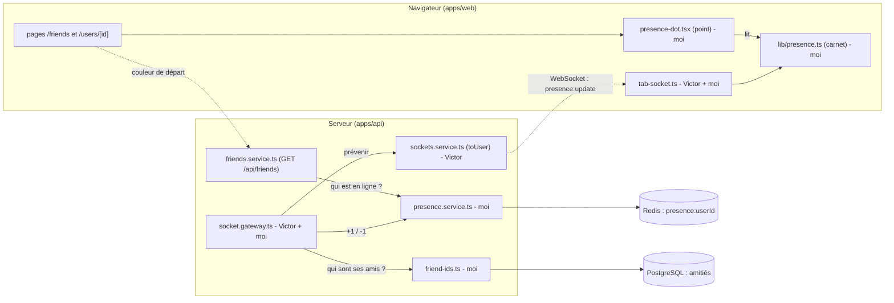
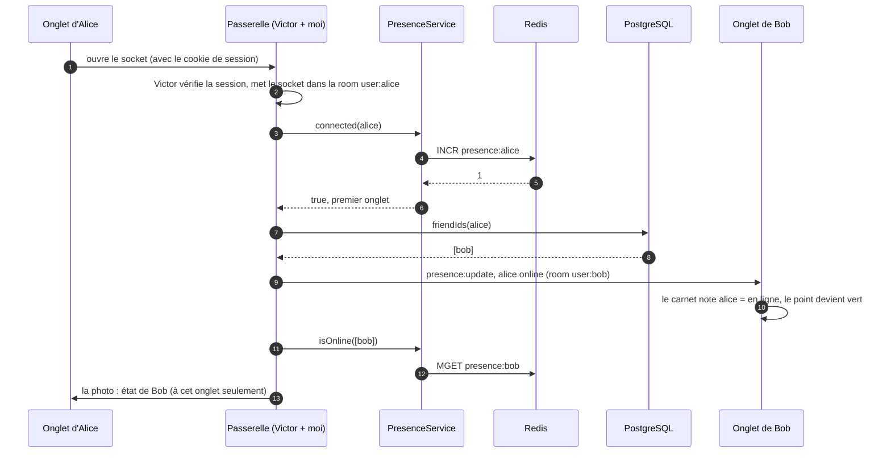
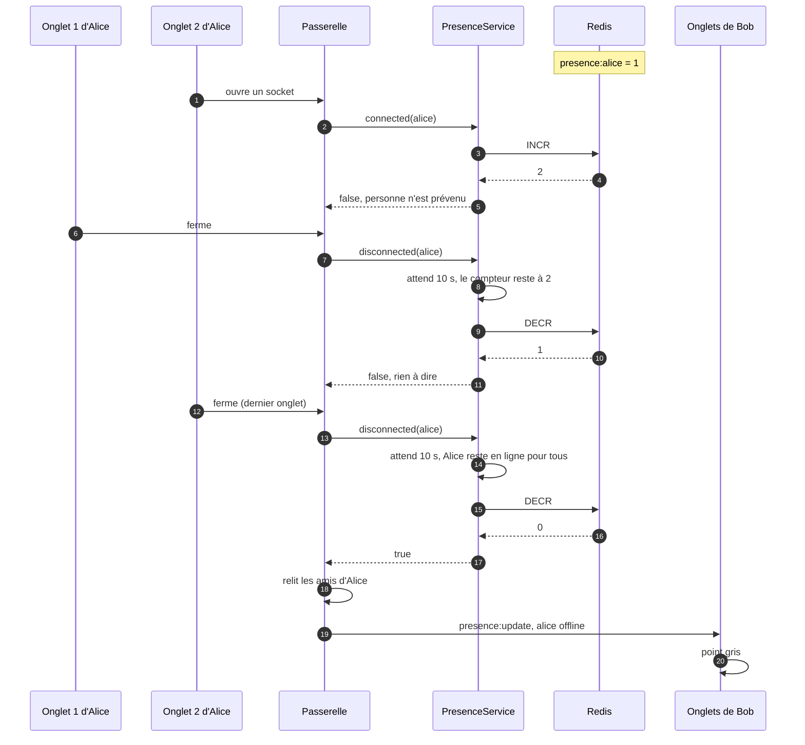
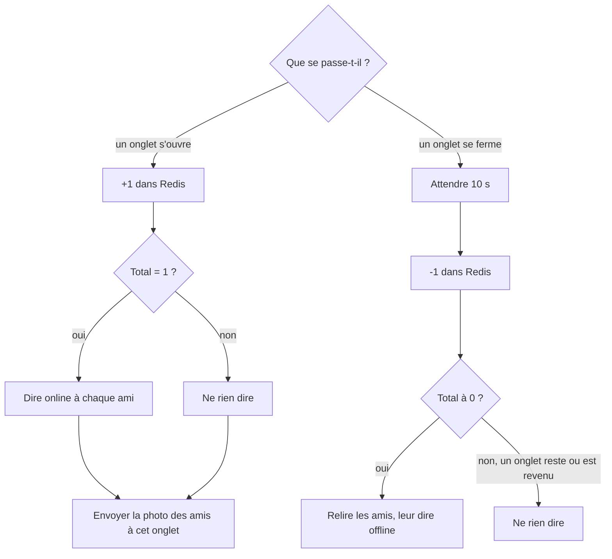
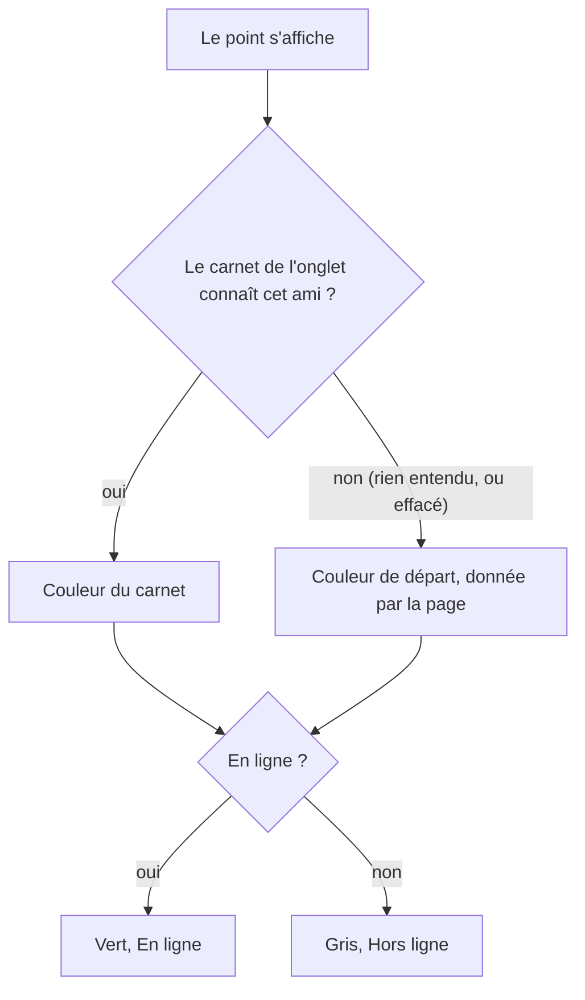

# Statut en ligne : le point vert des amis

> PR concernée : **#195** (« feat: #157 online status », squash `477b3d4`). Les 10 commits d'origine de la PR sont de moi (`VYAntares`). Deux d'entre eux répondent aux relectures de Victor et de Bastian.
> **Fichiers à moi (créés dans #195)** : [presence.service.ts](../../../../apps/api/src/presence/presence.service.ts) et son [test](../../../../apps/api/src/presence/presence.service.spec.ts), [presence.module.ts](../../../../apps/api/src/presence/presence.module.ts), [friend-ids.ts](../../../../apps/api/src/friends/friend-ids.ts) (la fonction `friendIds`), [presence-dot.tsx](../../../../apps/web/components/presence-dot.tsx) (le composant `PresenceDot`), [lib/presence.ts](../../../../apps/web/lib/presence.ts) et son [test](../../../../apps/web/lib/presence.test.ts).
> **Pas à moi** : la connexion temps réel (WebSocket) est de **Victor** (VictorBro), PR **#181** : [socket.gateway.ts](../../../../apps/api/src/gateway/socket.gateway.ts), [sockets.service.ts](../../../../apps/api/src/gateway/sockets.service.ts), [tab-socket.ts](../../../../apps/web/components/tab-socket.ts), les événements de [socket.ts](../../../../packages/shared/src/events/socket.ts). Les amis aussi sont à lui (#189, #193) : [friends.service.ts](../../../../apps/api/src/friends/friends.service.ts), [user-row.tsx](../../../../apps/web/components/user-row.tsx), les pages `/friends` et `/users/[id]`. **Moi, j'ai ajouté la présence dans ces fichiers.**
> **Après moi** : dans sa PR **#200** (messages privés), Victor a ajouté `areFriends` dans `friend-ids.ts`, `AvatarWithDot` dans `presence-dot.tsx`, et les messages non lus dans `arrived()`. Ces parties sont à lui.

## 1. À quoi ça sert

### Le besoin

Sur la page de mes amis, je veux savoir **qui est là en ce moment**. Un point **vert** : il est en ligne. Un point **gris** : il ne l'est pas. Et le point change **tout seul**, sans recharger la page (ticket #157).

### Ce qui rend ça moins simple qu'il n'y paraît

- Une personne peut ouvrir **plusieurs onglets**. Elle est en ligne tant qu'il en reste **un**.
- **Recharger** une page ferme la connexion, puis en ouvre une nouvelle. Les amis ne doivent pas voir le point clignoter.
- **Seuls les amis** voient le point. Quelqu'un qui m'a juste envoyé une demande ne le voit pas. La politique de confidentialité le dit (mise à jour dans #195).
- Si le serveur plante, personne ne doit rester « en ligne » pour toujours.

### L'idée en une image

Imagine une salle avec un **compteur à l'entrée** pour chaque personne. Chaque onglet ouvert, c'est **un passage** : +1. Chaque onglet fermé : −1.

- Le compteur passe de 0 à 1 ? La personne **arrive**. On prévient ses amis.
- Il revient à 0 ? La personne **est partie**. On prévient ses amis.
- Mais avant de retirer 1, on **attend 10 secondes**. Si elle revient vite (un rechargement), personne ne remarque rien.

Ce compteur est rangé dans **Redis**. Il n'y a que deux états : `online` et `offline`. J'ai enlevé l'état `away` (« absent ») : rien dans l'application ne permettait de le reconnaître.

### Mots techniques

| Mot | Explication simple |
|---|---|
| **WebSocket** | Une ligne de téléphone qui reste ouverte entre le navigateur et le serveur. Le serveur peut parler **quand il veut**, sans qu'on lui demande. |
| **Socket** | Une de ces lignes ouvertes. Chez nous : **une par onglet**. |
| **socket.io** | La bibliothèque qu'on utilise pour ces lignes. Elle envoie des messages avec un nom, comme `presence:update`. |
| **Gateway** (passerelle) | La partie du serveur qui reçoit les sockets. Ici `SocketGateway`, écrite par Victor. |
| **Room** (salle) | Un groupe de sockets. La room `user:<id>` contient **tous les onglets** d'une personne. Écrire à la room, c'est écrire à tous ses onglets. |
| **Redis** | Une petite base de données très rapide, qui garde des paires « nom → valeur ». On y range déjà les sessions. |
| **`INCR` / `DECR`** | Ordres Redis : « ajoute 1 » / « retire 1 », et donne-moi le nouveau total. Une clé qui n'existe pas vaut 0. |
| **Délai de grâce** | Les 10 secondes d'attente avant de dire « parti ». Dans le code : `PRESENCE_GRACE_MS = 10_000` (en millisecondes). |
| **Snapshot** (instantané) | Une photo de l'état à un moment. À chaque connexion, le serveur envoie au nouvel onglet l'état de **tous** ses amis. |
| **Rendu serveur** | Next.js prépare la page sur le serveur avant de l'envoyer. Le point a donc déjà une couleur avant que le socket existe. |
| **Hydratation** | Le moment où React « reprend la main » sur la page dans le navigateur. Il doit voir la même chose que le serveur, sinon il se plaint. |

## 2. Les fichiers

| Fichier | Rôle, en une phrase | Auteur |
|---|---|---|
| [presence.service.ts](../../../../apps/api/src/presence/presence.service.ts) | Le compteur dans Redis : +1, −1 après 10 s, « qui est en ligne ? », remise à zéro au démarrage. | moi (#195) |
| [presence.module.ts](../../../../apps/api/src/presence/presence.module.ts) | Rend `PresenceService` utilisable par les autres modules Nest. | moi (#195) |
| [presence.service.spec.ts](../../../../apps/api/src/presence/presence.service.spec.ts) | 11 tests du compteur, avec un faux Redis et une fausse horloge. | moi (#195) |
| [friend-ids.ts](../../../../apps/api/src/friends/friend-ids.ts) | `friendIds` : la liste des amis **acceptés** d'une personne. | moi (#195), `areFriends` par Victor (#200) |
| [socket.gateway.ts](../../../../apps/api/src/gateway/socket.gateway.ts) | La passerelle. J'y ai ajouté : quand un onglet s'ouvre ou se ferme, prévenir les amis. | Victor (#181), présence par moi |
| [socket.gateway.spec.ts](../../../../apps/api/src/gateway/socket.gateway.spec.ts) | J'y ai ajouté 6 tests de présence. | Victor (#181), moi |
| [gateway.module.ts](../../../../apps/api/src/gateway/gateway.module.ts) | J'y ai ajouté l'import de `PresenceModule`. | Victor (#181), moi |
| [sockets.service.ts](../../../../apps/api/src/gateway/sockets.service.ts) | `toUser` : envoie un message à tous les onglets d'une personne. Je l'utilise tel quel. | Victor (#181) |
| [friends.service.ts](../../../../apps/api/src/friends/friends.service.ts) | J'ai ajouté `online` à chaque ami dans `GET /api/friends`. | Victor (#189), moi |
| [friends.module.ts](../../../../apps/api/src/friends/friends.module.ts) | J'y ai ajouté l'import de `PresenceModule`. | Victor (#189), moi |
| [redis.service.ts](../../../../apps/api/src/redis/redis.service.ts) | La connexion Redis unique. J'ai juste mis le commentaire à jour. | Victor, commentaire par moi |
| [socket.ts](../../../../packages/shared/src/events/socket.ts) | Les messages partagés entre serveur et navigateur. J'ai réduit les états à `online` / `offline`. | Victor (#181), moi |
| [friend.ts](../../../../packages/shared/src/schemas/friend.ts) | J'ai ajouté `FriendSchema` : un utilisateur + `online`. | Victor (#189), moi |
| [lib/presence.ts](../../../../apps/web/lib/presence.ts) | Le carnet de l'onglet : « tel ami est en ligne ou non ». | moi (#195) |
| [lib/presence.test.ts](../../../../apps/web/lib/presence.test.ts) | 6 tests du carnet. | moi (#195) |
| [tab-socket.ts](../../../../apps/web/components/tab-socket.ts) | Le socket unique de l'onglet. J'y ai branché le carnet et le hook `useFriendOnline`. | Victor (#181), moi |
| [presence-dot.tsx](../../../../apps/web/components/presence-dot.tsx) | `PresenceDot` : le point vert ou gris. | moi (#195), `AvatarWithDot` par Victor (#200) |
| [user-row.tsx](../../../../apps/web/components/user-row.tsx) | Une ligne de liste. J'ai ajouté la prop `online` : sans elle, pas de point. | Victor (#189), moi |
| [friends/page.tsx](<../../../../apps/web/app/[locale]/(main)/friends/page.tsx>) | Donne `online` aux lignes de la liste d'amis, et à elles seules. | Victor (#189), moi |
| [users/[id]/page.tsx](<../../../../apps/web/app/[locale]/(main)/users/[id]/page.tsx>) | Le profil : un point à côté du nom, si c'est un ami. | Victor (#193), moi |
| [friends.e2e-spec.ts](../../../../apps/api/test/friends.e2e-spec.ts) | J'ai ajouté un test : un ami est prévenu, un simple demandeur non. | Victor (#189), moi |
| [e2e/tests/friends.spec.ts](../../../../e2e/tests/friends.spec.ts) | J'ai ajouté un test dans un vrai navigateur : le point devient gris, puis vert. | Victor (#189), moi |

### Diagramme des fichiers et dépendances



## 3. Le code, morceau par morceau

> Les extraits sont raccourcis : `// ...` marque ce qui est coupé, et les commentaires en français sont des explications ajoutées ici. Le code exact est dans le fichier lié.

### 3.1 Le compteur : une clé par personne

**Ce qui se passe.** Pour chaque personne, Redis garde un nombre : combien d'onglets elle a ouverts. La clé s'appelle `presence:` suivi de son id. Le délai d'attente vaut 10 secondes.

**Pourquoi 10 secondes ?** C'est assez long pour qu'une page rechargée rouvre sa connexion avant que les amis voient un départ.

```ts
export const PRESENCE_GRACE_MS = 10_000;

const presenceKey = (userId: string): string => `presence:${userId}`;
```

La même valeur est recopiée à la main dans le test navigateur. Ce test ne peut pas importer le code du serveur. Les deux commentaires disent : « changez les deux ensemble ».

**Pourquoi Redis et pas une simple variable dans le serveur ?** Le commentaire du code le dit : le compte doit tenir même avec plusieurs serveurs. Une variable n'existe que dans un seul serveur. Redis est partagé.

**Qui fait quoi ?** Ce service **répond à des questions** : « c'est son premier onglet ? », « il est parti ? ». Il ne prévient personne. Prévenir les amis, c'est le travail de la passerelle.

### 3.2 Un onglet s'ouvre : `connected`

**Ce qui se passe.** On ajoute 1. Si le total vaut 1, c'est le **premier** onglet : la personne vient d'arriver. Si le total vaut 2 ou plus, elle était déjà là : on ne dit rien.

```ts
async connected(userId: string): Promise<boolean> {
  const count = await this.redis.client.incr(presenceKey(userId));
  return count === 1;
}
```

Redis exécute les ordres **un par un**. Deux onglets ouverts en même temps donnent donc 1 puis 2. Jamais 1 et 1.

### 3.3 Un onglet se ferme : `disconnected` (le cœur du module)

**Ce qui se passe, dans l'ordre :**

1. On **attend 10 secondes**.
2. **Ensuite** seulement, on retire 1.
3. Si le total tombe à 0, la personne est partie : on répond `true`.

Pendant les 10 secondes, l'onglet fermé **compte encore**. Pour tout le monde, la personne est toujours en ligne.

```ts
async disconnected(userId: string): Promise<boolean> {
  await new Promise((resolve) => setTimeout(resolve, PRESENCE_GRACE_MS).unref());
  const count = await this.redis.client.decr(presenceKey(userId));
  if (count < 0) await this.redis.client.set(presenceKey(userId), '0');
  return count <= 0;
}
```

Deux détails :

- Si le total passe **sous zéro**, on le remet à 0. Sinon, le prochain onglet ne ferait jamais « 1 », et l'arrivée ne serait jamais annoncée.
- `.unref()` veut dire : « cette attente ne doit pas empêcher le serveur de s'éteindre ».

**Pourquoi attendre avant de retirer 1, et pas après ?** Ma première version retirait 1 tout de suite, puis attendait. Victor a demandé de changer en relecture. Prenons un rechargement :

- **Avec l'ancienne façon** : fermeture → total 0. Nouvel onglet → total 1 → « il arrive ! ». Les amis reçoivent un deuxième « en ligne » inutile.
- **Avec la nouvelle façon** : fermeture → total encore 1 pendant l'attente. Nouvel onglet → total 2 → rien à dire. Après 10 s, −1 → total 1 → rien à dire. Les amis n'ont rien vu.

Autre avantage : chaque fermeture retire son 1 exactement 10 s après **elle-même**. Le passage à 0 arrive donc 10 s après la **dernière** fermeture. Une vieille fermeture ne peut pas annoncer un départ à la place d'une plus récente.

### 3.4 « Qui est en ligne ? » : `isOnline`

**Ce qui se passe.** On donne une liste d'amis. Le service lit tous leurs compteurs **en une seule fois**. Il garde ceux dont le total est plus grand que 0.

```ts
async isOnline(ids: string[]): Promise<Set<string>> {
  if (ids.length === 0) return new Set();
  const counts = await this.redis.client.mGet(ids.map(presenceKey));
  return new Set(ids.filter((id, i) => Number(counts[i]) > 0));
}
```

- `mGet` lit plusieurs clés d'un coup. Une seule question à Redis, même pour 50 amis.
- Une clé absente revient vide, ce qui vaut 0 : pas en ligne.
- Liste vide : on ne demande rien, car Redis refuse un `mGet` sans clé.

### 3.5 Au démarrage : tout remettre à zéro

**Le problème.** Si le serveur plante, les « −1 » en attente n'arrivent jamais. Redis, lui, garde les compteurs. Quelqu'un resterait en ligne pour toujours.

**La solution.** Au démarrage, on efface toutes les clés `presence:*`. Aucun onglet ne survit à un redémarrage : tout le monde repart de 0, et chaque onglet qui se reconnecte refait +1.

```ts
async onApplicationBootstrap(): Promise<void> {
  for await (const keys of this.redis.client.scanIterator({ MATCH: 'presence:*' })) {
    if (keys.length > 0) await this.redis.client.del(keys);
  }
}
```

- `onApplicationBootstrap` : une méthode que Nest appelle **une fois**, au démarrage.
- `scanIterator` parcourt les clés **par petits paquets**. Redis n'est pas bloqué pendant ce temps. Les sessions ne sont pas touchées.
- Limite écrite dans le code : « Assumes one API instance ». Avec deux serveurs, celui qui redémarre effacerait aussi les compteurs de l'autre.

### 3.6 Qui sont mes amis ? `friendIds`

**Ce qui se passe.** On cherche dans la base toutes les amitiés **acceptées** où je suis d'un côté. On renvoie l'id de **l'autre** personne.

```ts
export async function friendIds(prisma: PrismaService, me: string): Promise<string[]> {
  const rows = await prisma.friendship.findMany({
    where: { status: 'accepted', OR: [{ requesterId: me }, { addresseeId: me }] },
    // ...
  });
  return rows.map((row) => (row.requesterId === me ? row.addresseeId : row.requesterId));
}
```

- `status: 'accepted'` est la ligne qui **protège la vie privée**. Une demande en attente n'est pas une amitié : la personne ne reçoit rien.
- **Pourquoi une fonction, et pas une méthode du service des amis ?** Le module des amis importe déjà la passerelle. Si la passerelle importait le module des amis, chacun dépendrait de l'autre : un **import circulaire**, que Nest refuse. Une petite fonction évite ce nœud.

### 3.7 Dans la passerelle : brancher la présence

**Ce qui se passe.** Nest appelle `handleConnection` quand un onglet se connecte, et `handleDisconnect` quand il se déconnecte. Ces méthodes sont à Victor. J'y ai ajouté **une ligne** chacune.

```ts
handleConnection(socket: AppSocket): void {
  // ... (Victor : compteur de monitoring, contrôle des messages)
  void this.arrived(socket);
}

handleDisconnect(socket: AppSocket): void {
  // ...
  void this.left(socket.data.userId);
}
```

`void` veut dire : « lance ce travail, mais ne l'attends pas ». Les erreurs sont attrapées à l'intérieur de `arrived` et `left`. Sinon, une erreur que personne n'attend ferait tomber le serveur.

`socket.data.userId` a été rempli par Victor quand il a vérifié la session, au début de la connexion.

### 3.8 Quelqu'un arrive : `arrived`

**Ce qui se passe, en deux temps :**

1. **Prévenir les amis**, si c'est le premier onglet.
2. **Envoyer la photo** au nouvel onglet : l'état de chacun de ses amis. Pourquoi ? La page a été préparée par le serveur un peu avant. Un ami a pu arriver ou partir entre-temps.

```ts
const [first, friends] = await Promise.all([
  this.presence.connected(userId),
  friendIds(this.prisma, userId),
]);
if (first) this.tellFriends(friends, userId, 'online');
const online = await this.presence.isOnline(friends);
for (const friend of friends) {
  const status = online.has(friend) ? 'online' : 'offline';
  socket.emit(SERVER_EVENTS.PRESENCE_UPDATE, presenceUpdate(friend, status));
  // ...
}
```

- `Promise.all` lance les deux questions **en même temps** : le +1 dans Redis et la liste d'amis dans la base.
- `socket.emit` envoie **à ce seul onglet**. Les autres ne reçoivent pas la photo.

### 3.9 Quelqu'un part : `left` et `tellFriends`

**Ce qui se passe.** On attend la réponse de `disconnected` (donc 10 s). S'il reste un onglet, on s'arrête là, sans même chercher les amis. Sinon, on relit la liste d'amis et on leur dit « hors ligne ».

```ts
private async left(userId: string): Promise<void> {
  // ... (try / catch)
  if (!(await this.presence.disconnected(userId))) return;
  this.tellFriends(await friendIds(this.prisma, userId), userId, 'offline');
}

private tellFriends(friends: string[], userId: string, status: PresenceStatus): void {
  const update = presenceUpdate(userId, status);
  for (const friend of friends) {
    this.sockets.toUser(friend, SERVER_EVENTS.PRESENCE_UPDATE, update);
  }
}
```

- **Pourquoi relire les amis au départ ?** Entre l'arrivée et le départ, une amitié a pu commencer ou finir. On prévient les amis **d'aujourd'hui**.
- `toUser` (de Victor) écrit à la room `user:<ami>` : tous les onglets de cet ami, et **personne d'autre**.

Le message envoyé est petit : qui, quel état, et quand.

```ts
{ userId, status, at: new Date().toISOString() }
```

Le format partagé n'accepte que deux états :

```ts
export const PresenceStatusSchema = z.enum(['online', 'offline']);
```

### 3.10 La couleur de départ : `online` dans `GET /api/friends`

**Ce qui se passe.** Quand la page `/friends` est préparée, le serveur demande la liste d'amis. J'ai ajouté une étape : demander à `isOnline` qui est en ligne, et coller `online: true` ou `false` sur chaque ami.

```ts
const online = await this.presence.isOnline(friends.map((friend) => friend.id));
lists.friends = friends.map((friend) => ({ ...friend, online: online.has(friend.id) }));
```

Seule la liste des **amis** reçoit `online`. Les demandes reçues et envoyées ne l'ont pas.

### 3.11 Dans le navigateur : le carnet de l'onglet

**Ce qui se passe.** Chaque onglet tient un **carnet** : « Bob → en ligne, Zoé → hors ligne ». C'est une `Map` (un dictionnaire id → oui/non). Quand un message `presence:update` arrive, on met le carnet à jour. Les points qui lisent le carnet sont prévenus et se redessinent.

```ts
apply(update) {
  const next = update.status === 'online';
  if (online.get(update.userId) === next) return;
  online.set(update.userId, next);
  changed();
},
```

- On ne prévient les points **que si ça change**. La photo envoyée à la connexion répète souvent ce que l'onglet sait déjà.
- Pour un ami dont l'onglet n'a **rien entendu**, le carnet répond « je ne sais pas » (`undefined`). Le point garde alors la couleur de départ.
- Le carnet vit **aussi longtemps que l'onglet**, pas aussi longtemps qu'une page. Si on revient en arrière avec le bouton Retour, la page montre le dernier état connu.

### 3.12 Qui remplit le carnet : `tab-socket.ts`

**Ce qui se passe.** Les « oreilles » du carnet sont posées **avec le socket**, une seule fois. Comme ça, aucun message n'est perdu, même si aucun point n'est à l'écran.

```ts
created.on('connect', () => {
  // ...
  presence.clear();
  // ...
});
created.on(SERVER_EVENTS.PRESENCE_UPDATE, (update) => presence.apply(update));
created.on(SERVER_EVENTS.FRIEND_REMOVED, ({ userId }) => presence.forget(userId));
created.on(SERVER_EVENTS.FRIEND_ACCEPTED, ({ userId }) => presence.forget(userId));
```

| Quand… | Le carnet… | Pourquoi |
|---|---|---|
| l'onglet se (re)connecte | s'efface | Une photo complète va arriver. L'ancien contenu peut être faux. |
| un `presence:update` arrive | se met à jour | Un ami arrive ou part. |
| un ami est retiré | l'oublie | Ce n'est plus un ami. |
| une demande est acceptée | l'oublie | S'il est déjà en ligne, aucun message ne viendra. La page se rafraîchit et donne sa couleur de départ. |
| je me déconnecte du site | s'efface | Le prochain utilisateur de l'onglet ne voit pas mes amis. |

Les deux règles « s'efface à la connexion » et « oublie sur demande acceptée » viennent de la relecture de Bastian.

### 3.13 Le point : `useFriendOnline` et `PresenceDot`

**Ce qui se passe.** Le point demande au carnet : « tu sais quelque chose sur cet ami ? ». Oui : il prend cette valeur. Non : il garde la couleur de départ, celle de la page.

```ts
export function useFriendOnline(userId: string, rendered: boolean): boolean {
  const heard = useSyncExternalStore(
    presence.subscribe,
    () => presence.get(userId),
    () => undefined,
  );
  return heard ?? rendered;
}
```

- `useSyncExternalStore` est un outil React pour lire des données rangées **hors de React**, comme notre carnet.
- Le dernier argument dit : « sur le serveur, je ne sais rien ». Le serveur et la première image dans le navigateur montrent donc la même couleur. React ne se plaint pas.

Le point lui-même :

```tsx
<span
  role="img"
  aria-label={t(live ? 'online' : 'offline')}
  className={`size-3 shrink-0 rounded-full ... ${live ? 'bg-green-500' : 'bg-slate-500'}`}
/>
```

- `aria-label` : un lecteur d'écran dit « En ligne » ou « Hors ligne ». Une personne aveugle ne voit pas la couleur.
- `shrink-0` : à côté d'un nom très long, le point reste rond.

### 3.14 Seuls les amis ont un point

Dans `UserRow`, la prop `online` est **facultative**. Pas de prop, pas de point. La page `/friends` ne la donne qu'aux lignes de la liste d'amis :

```tsx
<UserRow key={user.id} user={user} online={user.online}>
```

Sur un profil, on cherche la personne dans ma liste d'amis. Si elle n'y est pas, pas de point :

```tsx
const friend = lists.friends.find((user) => user.id === profile.id);
```

## 4. Le chemin d'exécution

### 4.1 Alice ouvre un onglet, le point devient vert chez Bob



Le +1 et la liste d'amis partent en même temps (`Promise.all`) ; le dessin les montre l'un après l'autre pour rester lisible.

### 4.2 Deuxième onglet, puis fermetures



### 4.3 Décision : faut-il prévenir les amis ?



### 4.4 Décision : quelle couleur pour le point ?



## 5. Que se passe-t-il concrètement : un exemple pas à pas

Alice et Bob sont amis. Karim a seulement envoyé une demande à Alice. J'écris `alice`, `bob`, `karim` pour lire facilement ; en vrai, ce sont des UUID. Bob regarde sa page `/fr/friends`.

**À 0 s, Alice ouvre l'application.**

1. Redis : `presence:alice` passe de rien à **1**. C'est son premier onglet.
2. Ses amis acceptés : `['bob']`. Karim n'y est pas, sa demande est en attente.
3. Bob reçoit `{ userId: 'alice', status: 'online', at: '<date>' }`. Le point d'Alice devient **vert**.
4. Karim ne reçoit **rien**.
5. L'onglet d'Alice reçoit la photo : l'état de Bob.

**À 30 s, Alice ouvre un deuxième onglet.** Le compteur passe à **2**. Bob ne reçoit rien. Le nouvel onglet reçoit quand même sa photo.

**À 60 s, Alice recharge ce deuxième onglet.**

- L'ancien socket se ferme. L'attente de 10 s commence. Le compteur reste à **2**.
- Une demi-seconde après, le nouveau socket s'ouvre : **3**. Pas de nouvel « en ligne ».
- À 70 s, −1 : **2**. Rien à dire. Bob n'a rien vu.

**À 120 s, Alice ferme ses deux onglets.**

- Deux attentes de 10 s commencent. Pendant ce temps, si Bob recharge sa page, Alice est encore marquée **en ligne**. C'est voulu : la page et les messages disent la même chose.
- Vers 130 s : −1 → **1**, rien. Puis −1 → **0** : Alice est partie.
- On relit ses amis : `['bob']`. Bob reçoit `offline`. Le point devient **gris**.

**Et si le serveur plante à 125 s ?** Les −1 n'arrivent jamais. Redis garde `presence:alice`. Au redémarrage, toutes les clés `presence:*` sont effacées. Tout le monde repart de 0.

## 6. Les tests

| Fichier | Ce qu'il vérifie, en clair |
|---|---|
| [presence.service.spec.ts](../../../../apps/api/src/presence/presence.service.spec.ts) | 11 tests. Redis est remplacé par une `Map`, et l'horloge par une fausse horloge qu'on avance à la main. Ils vérifient : seul le premier onglet dit « arrivé » ; pas de départ tant qu'un onglet reste ; le départ arrive à 10 s pile, pas avant ; pendant l'attente, la personne compte encore comme en ligne ; un rechargement ne donne ni départ ni deuxième arrivée ; le départ suit la **dernière** fermeture ; un total négatif revient à 0 ; le démarrage efface les compteurs mais pas les sessions. |
| [socket.gateway.spec.ts](../../../../apps/api/src/gateway/socket.gateway.spec.ts) (partie `SocketGateway presence`) | 6 tests : les amis sont prévenus au premier onglet, pas au deuxième ; la photo va au nouvel onglet seulement ; les amis sont prévenus quand le dernier onglet est resté fermé ; rien n'est fait si un onglet est revenu ; une panne de Redis est notée dans les logs sans faire tomber le serveur. |
| [friends.service.spec.ts](../../../../apps/api/src/friends/friends.service.spec.ts) | Chaque ami reçoit `online`, et on ne pose la question qu'une fois, pour les amis seulement. |
| [socket.test.ts](../../../../packages/shared/src/events/socket.test.ts) | L'état `away` est refusé. |
| [presence.test.ts](../../../../apps/web/lib/presence.test.ts) | 6 tests du carnet : vide au départ, garde le dernier état, ne prévient que si ça change, sait oublier et s'effacer. |
| [friends.e2e-spec.ts](../../../../apps/api/test/friends.e2e-spec.ts) | Vrai serveur, vrais sockets : l'ami est prévenu ; celui qui a juste envoyé une demande ne l'est pas. |
| [e2e/tests/friends.spec.ts](../../../../e2e/tests/friends.spec.ts) | Deux vrais navigateurs : on ferme le seul onglet de l'ami, son point devient « Offline » ; on le rouvre, il redevient « Online ». Sans recharger la page qui regarde. |

**Commandes :**

```bash
# Tests du serveur liés à la présence (lancés : 3 fichiers, 58 tests, tout passe)
pnpm --filter @ft/api exec vitest run src/presence src/gateway/socket.gateway.spec.ts src/friends

# Test du carnet côté navigateur (lancé : 6 tests, tout passe)
pnpm --filter @ft/web exec vitest run lib/presence.test.ts

# Tous les tests unitaires du projet
make test

# Tests e2e du serveur : il faut PostgreSQL et Redis lancés
# (`make ci` les démarre, applique les migrations, puis lance cette commande)
pnpm --filter @ft/api run test:e2e

# Tests dans de vrais navigateurs (démarre l'application si besoin)
make test-e2e
```

## 7. Les concepts à savoir expliquer

- **Un compteur, pas un oui/non.** Avec un simple oui/non, fermer un onglet sur deux dirait « parti ». Le compteur dit vrai : en ligne tant que le total est au-dessus de 0.
- **On ne parle qu'aux changements.** On prévient les amis seulement quand le total passe de 0 à 1, ou revient à 0. Un troisième onglet ne change rien pour eux.
- **Attendre avant de retirer 1.** Pendant les 10 s, l'onglet fermé compte encore. Un rechargement fait monter le total au lieu de le faire passer par 0. Pas de clignotement.
- **La photo à la connexion.** La page est préparée un peu avant l'ouverture du socket. La photo comble ce petit trou.
- **Couleur de départ, puis couleur entendue.** Le point commence avec la valeur de la page, puis suit ce que l'onglet entend. Serveur et navigateur affichent donc d'abord la même chose.
- **Les rooms.** Écrire à `user:<id>`, c'est écrire à tous les onglets de cette personne, et à elle seule. Jamais à tout le monde.
- **La vie privée par construction.** On ne vérifie pas après coup qui a le droit. On n'envoie simplement l'information qu'aux amis acceptés.
- **Le ménage au démarrage.** Un plantage laisse des compteurs faux. On les efface au démarrage. Hypothèse : un seul serveur.
- **Éviter que deux modules dépendent l'un de l'autre.** D'où `friendIds` en simple fonction.

## 8. Questions possibles à l'oral

**Q : Qu'est-ce qui est à toi, qu'est-ce qui est à Victor ?**
R : Victor a fait la connexion temps réel (#181) : la passerelle, les rooms, `toUser`, le socket de l'onglet. Moi, dans #195, j'ai fait le compteur (`PresenceService`), `friendIds`, le carnet de l'onglet et le point. Et j'ai branché tout ça dans ses fichiers. Plus tard, dans #200, il a ajouté les messages non lus et `AvatarWithDot`.

**Q : Pourquoi Redis, et pas une variable dans le serveur ?**
R : Redis est déjà là pour les sessions. Et le compte reste juste même avec plusieurs serveurs, car Redis est partagé. Une variable n'existerait que dans un serveur.

**Q : Pourquoi un compteur et pas juste « en ligne : oui/non » ?**
R : À cause des onglets multiples. Fermer un onglet sur deux mettrait « non » alors que l'autre est ouvert.

**Q : Pourquoi 10 secondes d'attente ?**
R : Pour les rechargements. La page ferme sa connexion puis en rouvre une. Sans attente, les amis verraient gris puis vert.

**Q : Pourquoi attendre **avant** de retirer 1 ? C'est un choix important.**
R : Ma première version (commit `d5d409d`) retirait 1 tout de suite, puis attendait et relisait. Victor a demandé le changement en relecture (commit `f4f825b`). Avec l'ancienne façon, un rechargement faisait 1 → 0 → 1 : les amis recevaient un deuxième « en ligne ». Et une vieille fermeture pouvait répondre à la place d'une plus récente. Maintenant, l'onglet fermé compte pendant 10 s, et le départ tombe 10 s après la dernière fermeture, une seule fois.

**Q : Et si le serveur plante ? Quelqu'un reste en ligne pour toujours ?**
R : Non. Au démarrage, on efface toutes les clés `presence:*`. Aucun onglet ne survit à un redémarrage, donc tout le monde repart de 0.

**Q : Comment es-tu sûr que seuls les amis voient le statut ?**
R : Les messages ne partent que vers `friendIds`, qui ne garde que les amitiés acceptées. Dans la liste REST, seuls les amis ont `online`. Et un test e2e vérifie qu'un simple demandeur ne reçoit rien.

**Q : À quoi sert la photo envoyée à la connexion ?**
R : La page est préparée par le serveur juste avant l'ouverture du socket. Entre les deux, un ami a pu arriver ou partir. La photo remet tout à jour.

**Q : Pourquoi le carnet est dans `tab-socket.ts` et pas dans le composant du point ?**
R : Pour ne rien rater. Il écoute dès que le socket existe, même quand aucun point n'est à l'écran. Et une page retrouvée avec le bouton Retour montre le dernier état.

**Q : Pourquoi le point part de la valeur de la page ?**
R : Le serveur ne connaît pas le carnet de l'onglet. Si le navigateur affichait autre chose au premier coup, React verrait une différence. Donc on part de la même valeur des deux côtés, puis le carnet prend le relais.

**Q : Pourquoi oublier un ami quand une demande est acceptée ?**
R : Remarque de Bastian. Si le nouvel ami est déjà en ligne, aucun message ne viendra, car rien ne change pour lui. Il faut donc partir de la page rafraîchie, qui contient la bonne valeur.

**Q : Pourquoi `friendIds` est une fonction, et pas dans le service des amis ?**
R : Le module des amis importe la passerelle. Si la passerelle importait le module des amis, les deux dépendraient l'un de l'autre. Une fonction évite ce cercle.

**Q : Pourquoi relire les amis au départ ?**
R : Une amitié a pu commencer ou finir pendant que la personne était connectée. On prévient les amis actuels.

**Q : Pourquoi pas d'état « absent » ?**
R : Rien dans l'application ne permettait de le reconnaître. Je l'ai retiré, et un test vérifie qu'il est refusé.

**Q : Que se passe-t-il si Redis tombe ?**
R : L'erreur est attrapée et écrite dans les logs. Le serveur continue de tourner. Un test le vérifie.
