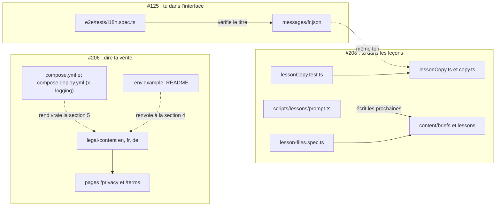
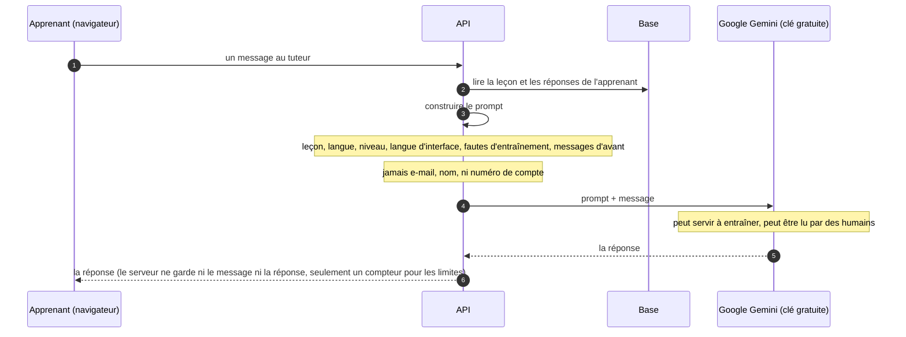
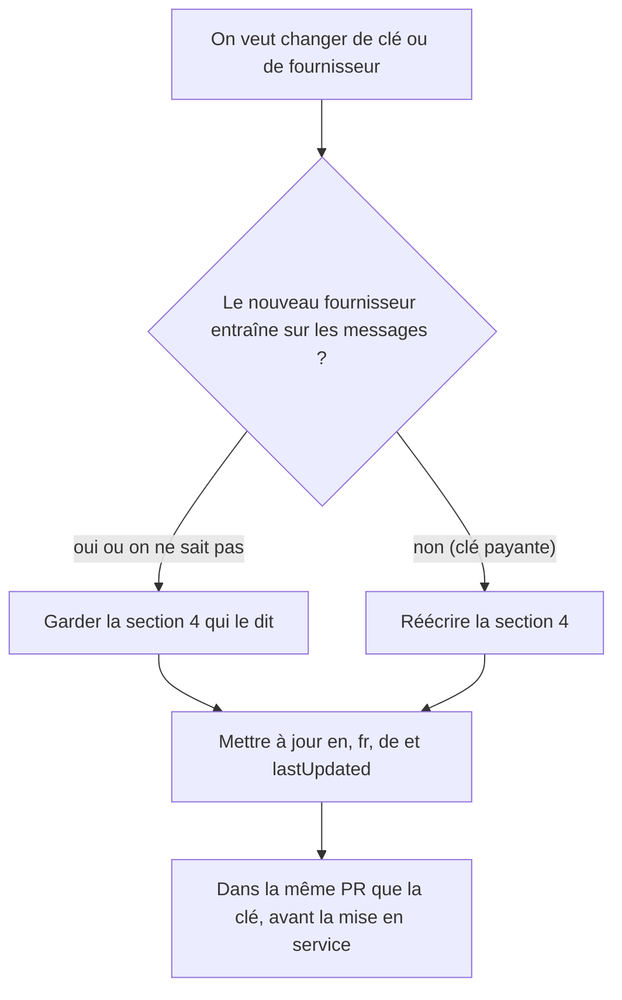
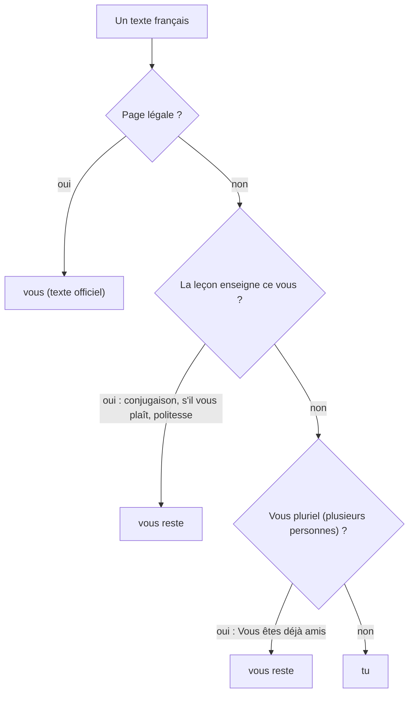

# Dire la vérité dans la politique de confidentialité, et tutoyer l'apprenant

> PR concernées : **#206** « fix: #204 the privacy policy says what the platform does, on a free Gemini key » (squash `32fe3a8`), **#125** « fix(web): #106 address French learners with tu » (squash `b5b0734`), **#208** « fix(shared): consistently address French learners with tu » (squash `843e160`).
> Fichiers à moi : les changements de ces trois PR. #206 : le texte de [en.ts](../../../../apps/web/lib/legal-content/en.ts), [fr.ts](../../../../apps/web/lib/legal-content/fr.ts), [de.ts](../../../../apps/web/lib/legal-content/de.ts), le bloc `x-logging` de [compose.yml](../../../../compose.yml) et [compose.deploy.yml](../../../../compose.deploy.yml), les commentaires de [.env.example](../../../../.env.example), [infra/deploy/.env.example](../../../../infra/deploy/.env.example) et le [README.md](../../../../README.md). #125 : [fr.json](../../../../apps/web/messages/fr.json) et deux lignes de [i18n.spec.ts](../../../../e2e/tests/i18n.spec.ts). #208 : [prompt.ts](../../../../apps/api/scripts/lessons/prompt.ts), le test de [lesson-files.spec.ts](../../../../apps/api/src/lessons/lesson-files.spec.ts), [lessonCopy.ts](../../../../packages/shared/src/lessons/domain/lessonCopy.ts), [lessonCopy.test.ts](../../../../packages/shared/src/lessons/domain/lessonCopy.test.ts), [copy.ts](../../../../packages/shared/src/lessons/player/copy.ts), et 192 fichiers de `content/briefs` et `content/lessons`.
> **Pas à moi** : les pages légales elles-mêmes sont **de Luca et de Victor**. Luca a créé `legal-content/` (#26), [legal.ts](../../../../apps/web/lib/legal.ts) et son test. VictorBro les a beaucoup modifiés ensuite (#27, #64, #189, #193, #200). Le paragraphe sur Gemini pour la discussion avec le tuteur a été ajouté par **Luca** (#205). Moi, j'ai corrigé le texte pour qu'il dise ce que le code fait vraiment. Dans #125, VictorBro est co-auteur (il a fusionné `main` dans ma branche).

## 1. À quoi ça sert

### 1.1 #206 : la politique de confidentialité doit dire la vérité

**Le contexte.** La **politique de confidentialité** est la page `/privacy`. Elle dit quelles données on garde, pourquoi, combien de temps, et à qui on les envoie. Le sujet du projet l'exige. Le **RGPD** (la loi européenne sur les données personnelles) demande aussi que ce texte soit **honnête**.

**Ce qui était faux.** Le texte avait été écrit tôt, pour la plateforme qu'on imaginait. Pas pour celle qu'on a construite. Il promettait par exemple :

- « Nous choisissons des fournisseurs qui n'entraînent pas leurs modèles sur vos messages. » Faux : on utilise une **clé Gemini gratuite**. Sur la version gratuite, Google **peut** utiliser les messages pour entraîner ses modèles, et des personnes chez Google **peuvent** les lire.
- Une recherche dans un « corpus » de documents (RAG). On n'en a pas.
- Des sessions en direct entre deux apprenants. On n'en a pas.
- Un bouton pour exporter ou supprimer son compte. Il n'existe pas encore.
- Des e-mails pour annoncer les changements. La plateforme n'envoie aucun e-mail.
- Des journaux gardés 30 jours. En réalité, Docker les gardait **pour toujours**.
- Des sauvegardes effacées en 90 jours. Il n'y a pas de sauvegarde.

**Ce que j'ai changé.**

1. La section 4 dit maintenant **exactement** ce qui part chez Google quand on parle au tuteur, et que la clé est gratuite.
2. Le reste du texte correspond au code (fuseau horaire et photo de profil collectés, stockage local du navigateur pour les brouillons de leçon, pas d'e-mail, pas de sauvegarde…).
3. Les journaux des conteneurs sont maintenant **limités et tournants**, pour que la section 5 soit vraie.
4. Les fichiers `.env.example` et le README préviennent : passer à une clé payante ou à un autre fournisseur, c'est **changer la politique d'abord**.

Le tout en anglais, français et allemand, avec la date `lastUpdated: '2026-11-20'`.

### 1.2 #125 : tutoyer l'apprenant dans l'interface

**Ce qui n'allait pas.** L'interface allemande dit « du » (tu). L'interface française disait « vous ». Les deux langues ne parlaient pas sur le même ton. Une appli d'apprentissage, c'est plutôt un ton proche, comme un prof particulier.

**Ce que j'ai changé.** Tous les textes de `fr.json` qui parlent à l'apprenant passent au « tu » : pronoms, « ton / ta / tes », impératifs (« Choisis »), verbes conjugués. Les pages légales et la banque de questions ne changent pas.

### 1.3 #208 : tutoyer aussi dans les leçons

**Ce qui n'allait pas.** Après #125, l'interface disait « tu ». Mais les **leçons** disaient encore « vous » : « Votre examen final », « Rappelez-vous chaque mot… », « Choisissez le mot… ». L'apprenant passait du « tu » au « vous » en entrant dans une leçon.

**Ce que j'ai changé.**

1. Les textes fixes ajoutés à chaque leçon (`lessonCopy.ts`, `copy.ts`) passent au « tu ».
2. L'aide en français dans toutes les leçons passe au « tu » : consignes, explications, indices, notes.
3. Le prompt qui fait écrire les leçons par Claude demande maintenant le « tu ». Ainsi, les prochaines leçons ne ramènent pas le « vous ».
4. Deux tests échouent si un « vous » de politesse revient.

**Le « vous » qu'on garde.** Quand la leçon **enseigne** le vous, il reste : les conjugaisons (« nous, vous, ils »), « s'il vous plaît », le vous de politesse, un vous pluriel (« Vous allez vous revoir bientôt »), et les traductions des phrases enseignées.

### Mots techniques

| Mot | Explication simple |
|---|---|
| **RGPD** | La loi européenne sur les données personnelles. Elle demande de dire honnêtement ce qu'on collecte et à qui on l'envoie. |
| **Politique de confidentialité** | La page `/privacy`. Le contrat d'honnêteté entre le site et l'utilisateur sur ses données. |
| **Gemini** | Le modèle de langage (IA) de Google. Chez nous, il répond aux questions de l'apprenant avant l'examen d'une leçon. |
| **Clé gratuite / payante** | Pour utiliser Gemini, il faut une clé. Sur la gratuite, Google peut entraîner ses modèles sur les messages. Sur la payante, non. |
| **Entraîner un modèle** | Lui faire apprendre à partir de textes. Si nos messages servent à ça, ils sortent de notre contrôle. |
| **Prompt** | Le texte qu'on envoie au modèle : les consignes, plus le contenu. |
| **Journal (log)** | Le fichier où un programme écrit ce qu'il fait. Celui de Caddy contient l'adresse IP de chaque visiteur : c'est une donnée personnelle. |
| **Rotation des logs** | Quand un fichier de log est plein, on en commence un nouveau et on efface le plus vieux. Comme un carnet à 3 pages qu'on recycle. |
| **Ancre YAML (`&logging`, `*logging`)** | Écrire un bloc une fois (`&`) et le réutiliser ailleurs (`*`) dans le même fichier. |
| **i18n** | « Internationalisation » : afficher le site en plusieurs langues. Les textes sont dans `messages/en.json`, `fr.json`, `de.json`. |
| **Registre** | Le ton : tutoyer (« tu ») ou vouvoyer (« vous »). |
| **Expression régulière (regex)** | Un motif pour chercher du texte. `/ez$/` = « qui finit par ez ». |

## 2. Les fichiers

| Fichier | Rôle | Auteur |
|---|---|---|
| [apps/web/lib/legal-content/en.ts](../../../../apps/web/lib/legal-content/en.ts), [fr.ts](../../../../apps/web/lib/legal-content/fr.ts), [de.ts](../../../../apps/web/lib/legal-content/de.ts) | Le texte de la politique et des conditions, dans chaque langue. | **Luca** (création #26), **VictorBro**, Luca (#205) ; moi (#195, #206) |
| [apps/web/lib/legal-content/index.ts](../../../../apps/web/lib/legal-content/index.ts) | Choisit le texte selon la langue. | Luca, VictorBro |
| [apps/web/lib/legal.ts](../../../../apps/web/lib/legal.ts), [legal.test.ts](../../../../apps/web/lib/legal.test.ts) | Le type `LegalDocument` et ses tests (longueur, sections). | Luca |
| [compose.yml](../../../../compose.yml), [compose.deploy.yml](../../../../compose.deploy.yml) | Le bloc `x-logging` : logs limités à 3 fichiers de 10 Mo par conteneur. | moi (#206) pour ce bloc |
| [.env.example](../../../../.env.example), [infra/deploy/.env.example](../../../../infra/deploy/.env.example), [README.md](../../../../README.md) | Préviennent que la clé est gratuite et ce que ça implique. | moi (#206) pour ces lignes |
| [apps/web/messages/fr.json](../../../../apps/web/messages/fr.json) | Tous les textes français de l'interface. | équipe ; moi (#125) pour le « tu » |
| [e2e/tests/i18n.spec.ts](../../../../e2e/tests/i18n.spec.ts) | Test navigateur des langues. J'ai changé le titre attendu en français. | Luca, VictorBro ; moi (#125) |
| [packages/shared/src/lessons/domain/lessonCopy.ts](../../../../packages/shared/src/lessons/domain/lessonCopy.ts) | Les consignes fixes des leçons (cartes mémoire, dictée, examen…). | moi (#142, #162, #208) |
| [packages/shared/src/lessons/player/copy.ts](../../../../packages/shared/src/lessons/player/copy.ts) | Les textes fixes du lecteur (« Ton examen final »). | moi (#208) pour cette ligne |
| [packages/shared/src/lessons/domain/lessonCopy.test.ts](../../../../packages/shared/src/lessons/domain/lessonCopy.test.ts) | Échoue sur tout « vous » dans les textes fixes. | moi (#208) |
| [apps/api/src/lessons/lesson-files.spec.ts](../../../../apps/api/src/lessons/lesson-files.spec.ts) | Vérifie les fichiers de `content/`. Mon test : pas de « votre / vos » ni d'impératif en « -ez » dans les consignes. | Bastian, moi |
| [apps/api/scripts/lessons/prompt.ts](../../../../apps/api/scripts/lessons/prompt.ts) | Le prompt qui fait écrire les leçons. Demande le « tu ». `PROMPT_VERSION = 'author-4'`. | moi (#178, #183, #208) |
| `content/briefs/*.json` (82 fichiers), `content/lessons/*.json` (110 fichiers) | Les leçons. Seules les valeurs `fr` changent. | moi (#208) pour ces changements |
| [docs/architecture/product.md](../../../../docs/architecture/product.md) | Section 5 : la décision « clé gratuite » (#204). | modifiée dans #206 (le fichier s’appelait alors `docs/PRODUCT_ARCHITECTURE.md`) |

### Diagramme des fichiers et dépendances



## 3. Le code, morceau par morceau

> Les extraits sont raccourcis : `// ...` marque ce qui est coupé, et les commentaires en français sont des explications ajoutées ici. Le code exact est dans le fichier lié.

### 3.1 #206 : ce qui part chez Google, en clair

**Ce qui se passe.** Avant l'examen d'une leçon, l'apprenant peut poser des questions à un tuteur. Chaque message part chez Google Gemini avec le contexte de la leçon. J'ai écrit **la liste exacte** de ce contexte, en la vérifiant dans le code qui construit le prompt ([discussion-prompt.ts](../../../../apps/api/src/lessons/discussion-prompt.ts)).

Le texte actuel de la section 4 (en français) :

```ts
"Avant chaque examen, le tuteur de la discussion d'une leçon fonctionne avec Google Gemini. Chaque message que vous lui envoyez part chez Google avec le texte de la leçon, la langue et le niveau de la leçon, votre langue d'interface, vos réponses fausses dans ses exercices d'entraînement (l'exercice, ce que vous avez répondu et la bonne réponse) et les messages précédents de la même discussion, mais aucun identifiant de votre compte : ni adresse e-mail, ni nom d'affichage, ni numéro de compte.",
"Ce projet utilise le niveau gratuit de l'API Gemini, et aucun fournisseur qui exclut l'entraînement. Sur le niveau gratuit, Google peut utiliser ces messages et les réponses pour améliorer ses produits, dont ses modèles, et des personnes chez Google peuvent les lire. N'écrivez rien de personnel au tuteur. Passer à un niveau payant ou à un autre fournisseur est une modification de cette politique, faite ici avant de prendre effet.",
```

Et le code qui fait la liste des fautes envoyées, pour comparer :

```ts
export interface Mistake {
  prompt: lessons.player.PlanUnit['prompt'];
  yours: string | null;
  answer: string;
}
```

L'exercice (`prompt`), ce que l'apprenant a répondu (`yours`), la bonne réponse (`answer`). C'est exactement ce que dit la politique.

**Avant #206**, la même section disait :

```ts
'Where a third-party model provider is used, prompts leave our infrastructure and are processed under that provider terms. We select providers that contractually exclude customer prompts from model training. // ...',
```

« Nous choisissons des fournisseurs qui excluent l'entraînement. » C'était le contraire de la réalité.

**Remarque.** La politique française dit « vous ». #125 ne touche pas aux pages légales : elles restent au vouvoiement, comme un texte officiel.

### 3.2 #206 : des journaux qui ne gardent pas tout pour toujours

**Ce qui se passe.** Chaque conteneur écrit ses journaux via Docker. Par défaut, Docker les garde **sans limite**. Le journal de Caddy contient l'adresse IP de chaque visiteur. La politique disait « journaux supprimés après 30 jours » : c'était faux.

**La correction.** Un bloc écrit une fois en haut du fichier, et réutilisé sur chaque service. Au maximum 3 fichiers de 10 Mo par conteneur ; quand c'est plein, le plus vieux est effacé.

```yaml
x-logging: &logging
  driver: json-file
  options:
    max-size: 10m
    max-file: "3"

services:
  caddy:
    logging: *logging
    # ...
```

- `&logging` donne un nom au bloc. `*logging` le recopie.
- C'est sur les 12 services de `compose.yml` et les 13 de `compose.deploy.yml` (qui a en plus `migrate`).
- Il y a **deux copies** du bloc : une ancre YAML ne passe pas d'un fichier à l'autre.

La politique dit maintenant : journaux « limités en taille et supprimés par rotation, les plus anciens d'abord, jamais archivés ».

### 3.3 #206 : prévenir les développeurs

**Ce qui se passe.** Quelqu'un pourrait un jour mettre une clé payante, ou changer de fournisseur, sans penser à la politique. Alors j'ai écrit l'avertissement **là où on met la clé**.

```sh
# Gemini API key, sent in a request header. The project runs on a free key:
# Google may train on what learners write to the tutor, and /privacy says so.
# A paid key or another vendor changes that page first (docs/architecture/product.md
# section 5). With gemini the api refuses to
```

### 3.4 #125 : le « tu » dans l'interface

**Ce qui se passe.** On change les textes de `fr.json`, un par un. La clé (le nom du texte) ne change pas. Seule la phrase change. Le code de l'interface n'a donc rien à modifier.

```json
"headline": "Apprends une langue avec un tuteur qui s'adapte à toi !",
// ...
"chooseCourseHeading": "Que veux-tu apprendre ?",
// ...
"A1": "Tu te débrouilles avec des phrases simples.",
```

Avant : « Apprenez une langue avec un tuteur qui s'adapte à vous ! », « Que voulez-vous apprendre ? », « Vous vous débrouillez… ».

**Le « vous » qui reste.** `"alreadyFriends": "Vous êtes déjà amis"`. Ici « vous » veut dire « vous deux » : c'est un pluriel, pas de la politesse.

Le test navigateur cherchait l'ancien titre. Il a donc fallu le changer :

```ts
name: "Apprends une langue avec un tuteur qui s'adapte à toi",
```

### 3.5 #208 : les textes fixes des leçons

**Ce qui se passe.** Certaines phrases sont ajoutées par le code à **toutes** les leçons : les consignes des cartes mémoire, de la dictée, le titre de l'examen. Elles sont dans `lessonCopy.ts` et `copy.ts`, en trois langues. Je change seulement le français.

```ts
L(
  'Recall each word, then turn the card to check it.',
  'Rappelle-toi chaque mot, puis retourne la carte pour vérifier.',
  'Erinnere dich an jedes Wort und dreh dann die Karte um.',
),
```

```ts
examIntro: L('Your final exam', 'Ton examen final', 'Deine Abschlussprüfung'),
```

Avant : « Rappelez-vous chaque mot, puis retournez la carte… » et « Votre examen final ».

### 3.6 #208 : un test pour que le « vous » ne revienne pas (textes fixes)

**Ce qui se passe.** Le test prend **tous** les textes français fixes. Il découpe chaque texte en mots. Il cherche « vous », « votre », « vos », et les verbes en « -ez ». Il y a deux exceptions : « chez » et « assez », qui finissent par « ez » sans être des verbes.

**Pourquoi c'est sûr ici.** Ces textes fixes n'enseignent jamais le français. Ils n'ont donc **aucune** raison de dire « vous ».

```ts
const formal = (fr: string) =>
  (fr.match(/\p{L}+/gu) ?? []).filter(
    (word) =>
      /^(vous|votre|vos)$/i.test(word) || (/ez$/i.test(word) && !/^(chez|assez)$/i.test(word)),
  );
```

`/\p{L}+/gu` veut dire « une suite de lettres » : c'est la façon de couper en mots, accents compris.

### 3.7 #208 : un test sur les leçons de `content/`

**Ce qui se passe.** Les leçons, elles, **enseignent** parfois le vous. Une étiquette peut dire « Le pluriel : nous, vous, ils, elles ». On ne peut donc pas interdire le mot « vous ». On cherche seulement les signes sûrs d'un vouvoiement :

- « votre » ou « vos » dans une étiquette ou une consigne ;
- une consigne qui **commence** par un impératif en « -ez » (« Choisissez… », « Lisez… »).

```ts
const possessive = (fr: string) => /\b(votre|vos)\b/i.test(fr);
// The first word of each sentence: "Lisez", "Rappelez" (of Rappelez-vous).
const imperative = (fr: string) =>
  fr.split(/(?<=[.?!;:])\s+/).some((sentence) => /ez$/i.test(sentence.split(/[\s-]/)[0]));
```

- `imperative` coupe la consigne en phrases (après `.`, `?`, `!`, `;`, `:`), prend le premier mot de chaque phrase, et regarde s'il finit par « ez ».
- On coupe aussi sur le tiret : « Rappelez-vous » donne « Rappelez ».

Le test ne regarde que les **étiquettes et consignes**. Les explications, elles, ont été corrigées à la main, car on ne peut pas les vérifier aussi simplement sans attraper le vous enseigné.

### 3.8 #208 : les leçons elles-mêmes

**Ce qui se passe.** Dans chaque fichier, seule la valeur `"fr"` change. Même dans les leçons d'allemand ou d'anglais : elles ont une aide en français pour les francophones.

Exemple dans `content/briefs/de-extended-family.json` :

```json
"fr": "Der Onkel est le frère de ton père ou de ta mère.",
```

Avant : « …le frère de votre père ou de votre mère. »

### 3.9 #208 : le prompt de l'auteur de leçons

**Ce qui se passe.** Les leçons sont écrites par Claude, avec un prompt. Si le prompt ne dit rien, les prochaines leçons pourraient revenir au « vous ». J'ai ajouté une règle, et changé la version du prompt (chaque leçon note la version avec laquelle elle a été écrite).

```ts
export const PROMPT_VERSION = 'author-4';
// ...
- The French help around the exercises (instructions, explanations, hints, notes) addresses the learner with tu, as the interface does: "Choisis le mot", "ton nom", never "Choisissez" or "votre nom". Vous stays only where the lesson teaches it.
```

## 4. Le chemin d'exécution

### 4.1 Séquence : un message au tuteur, et ce qui part chez Google



C'est ce chemin que la section 4 de la politique décrit maintenant, mot pour mot.

### 4.2 Décision : quand on change le fournisseur ou la clé



### 4.3 Décision : « tu » ou « vous » dans un texte français



## 5. Un exemple concret pas à pas

**Exemple 1 : ce que Google reçoit (#206).**

Un apprenant francophone fait une leçon d'allemand. À l'entraînement, il s'est trompé sur un mot. Avant l'examen, il demande au tuteur « Pourquoi c'est der Onkel ? ».

1. L'API construit le prompt : « tuteur d'une leçon d'allemand, niveau A1 », « réponds en français » (sa langue d'interface).
2. Elle ajoute sa faute : l'exercice, sa réponse, la bonne réponse.
3. Elle ajoute le contenu de la leçon (les mots, leurs traductions, les exemples).
4. Elle ajoute sa question et les messages d'avant.
5. Tout ça part chez Google. Son e-mail, son nom et son numéro de compte, non.
6. La politique le dit, et dit aussi : clé gratuite, Google peut s'en servir, ne rien écrire de personnel.

**Exemple 2 : la même consigne, avant et après (#208).**

Dans `content/lessons/fr-verb-etre-present.json`, une page de consignes :

| Langue | Avant | Après |
|---|---|---|
| `en` | Choose the word that completes the sentence. | (inchangé) |
| `fr` | Choisissez le mot qui complète la phrase. | Choisis le mot qui complète la phrase. |
| `de` | Wähle das Wort, das den Satz ergänzt. | (inchangé) |

Si quelqu'un remettait « Choisissez… », le test de `lesson-files.spec.ts` trouverait « Choisissez » en début de phrase, qui finit par « ez », et afficherait : `fr-verb-etre-present: Choisissez le mot qui complète la phrase.`

**Exemple 3 : le « vous » qui reste.** Dans `content/lessons/en-greetings.json` : « Vous allez vous revoir bientôt, alors on dit See you later ! ». Ici « vous » désigne les deux personnes du dialogue : c'est un pluriel, il reste.

## 6. Les tests

| Fichier | Ce qu'il vérifie | Commande |
|---|---|---|
| [lessonCopy.test.ts](../../../../packages/shared/src/lessons/domain/lessonCopy.test.ts) | Plus de 60 textes fixes, aucun « vous / votre / vos » ni verbe en « -ez ». Et trois exemples précis (« Ton examen final »…). | `pnpm --filter @ft/shared test` |
| [lesson-files.spec.ts](../../../../apps/api/src/lessons/lesson-files.spec.ts) | Pas de « votre / vos » ni d'impératif en « -ez » dans les étiquettes et consignes des leçons. | `pnpm --filter @ft/api test` |
| [i18n.spec.ts](../../../../e2e/tests/i18n.spec.ts) | Le site en français affiche « Apprends une langue avec un tuteur qui s'adapte à toi ». | `make test-e2e` (le site doit pouvoir démarrer) |
| [legal.test.ts](../../../../apps/web/lib/legal.test.ts) (de Luca) | Chaque document légal est assez long, a des sections non vides avec des ancres uniques, et une date fixe. | `pnpm --filter @ft/web test` |
| [legal.spec.ts](../../../../e2e/tests/legal.spec.ts) | `/privacy` et `/terms` répondent 200 et contiennent du vrai texte. | `make test-e2e` |

`make test` lance tous les tests unitaires du projet d'un coup.

**Ce qu'aucun test ne vérifie** : que le **sens** de la politique correspond au code. Ça, je l'ai fait en relisant le code (le prompt du tuteur, les tables, les cookies, la config Docker). Les tests vérifient seulement que la page existe et a assez de texte.

## 7. Les concepts à savoir expliquer

1. **L'honnêteté de la politique.** Une politique de confidentialité fausse est pire que pas de politique : elle trompe l'utilisateur. Le RGPD demande de dire à qui on envoie les données. Ici, Google, sur une clé gratuite.
2. **Minimiser ce qu'on envoie.** Le prompt est construit avec une liste de ce qui **entre**, pas de ce qui reste dehors. Un nouveau champ ne part pas chez Google par accident. Aucun identifiant du compte n'y est.
3. **Gratuit ou payant.** Sur la clé gratuite, Google peut entraîner et faire lire par des humains. C'est un choix de coût. Il est écrit dans la politique, et le changer oblige à réécrire la politique d'abord.
4. **La rotation des logs.** Les IP sont des données personnelles. Les garder sans limite contredisait la politique. 3 fichiers de 10 Mo par conteneur, le plus vieux effacé.
5. **i18n par clés.** Le code affiche une clé (`HomePage.headline`). Chaque langue donne sa phrase. Changer le ton, c'est changer les phrases, pas le code.
6. **Le registre.** Un seul ton dans toute l'appli : « tu » en français, « du » en allemand. Le « vous » reste seulement là où il est enseigné, pluriel, ou dans un texte officiel.
7. **Bloquer le retour d'un bug.** Corriger ne suffit pas : on ajoute un test qui échoue si le « vous » revient, et une règle dans le prompt pour les futures leçons.

## 8. Questions possibles à l'oral

**Q : Qu'est-ce qui était faux dans la politique de confidentialité ?**

R : Elle promettait un fournisseur qui n'entraîne pas sur les messages, alors que la clé Gemini est gratuite. Elle parlait aussi de choses qui n'existent pas : RAG, sessions en direct, bouton d'export, e-mails, sauvegardes, logs de 30 jours.

**Q : Qu'est-ce qui part exactement chez Google ?**

R : Le message, les messages d'avant, le contenu de la leçon, sa langue et son niveau, la langue d'interface, et les fautes d'entraînement (exercice, réponse donnée, bonne réponse). Jamais l'e-mail, le nom ou le numéro de compte.

**Q : Pourquoi une clé gratuite et pas payante ?**

R : C’est la décision prise pour le projet (#204), écrite dans `docs/architecture/product.md` section 5. Une clé payante coûterait quelques dizaines d’euros pour tout le projet, mais ce n’est pas le point important. Le point important : une clé gratuite est acceptable **si on le dit**. Passer à une clé payante, c'est changer la politique dans la même PR.

**Q : Pourquoi toucher à Docker dans une PR sur la politique ?**

R : La politique dit que les logs avec des IP sont limités et effacés par rotation. Sans le bloc `x-logging`, Docker les gardait pour toujours. Soit on change le texte, soit on change le système : j'ai rendu le système vrai.

**Q : Pourquoi deux copies du bloc `x-logging` ?**

R : Une ancre YAML ne marche que dans son propre fichier. `compose.yml` et `compose.deploy.yml` ont donc chacun la leur.

**Q : Les pages légales, c'est toi qui les as écrites ?**

R : Non. Luca les a créées (#26), VictorBro les a beaucoup modifiées, et Luca a ajouté le paragraphe Gemini pour la discussion (#205). Moi, j'ai corrigé le contenu pour qu'il corresponde au code (#206).

**Q : Pourquoi « tu » et pas « vous » ?**

R : L'allemand disait déjà « du ». Une appli d'apprentissage parle comme un prof particulier, sur un ton proche. Et il faut **un seul** ton partout.

**Q : Pourquoi la politique de confidentialité dit encore « vous » ?**

R : C’est un texte officiel. #125 ne touche pas aux pages légales : son message de commit le dit (« Legal pages and the question bank stay unchanged »).

**Q : Pourquoi ne pas simplement interdire le mot « vous » dans toutes les leçons ?**

R : Parce que les leçons l'enseignent : « nous, vous, ils », « s'il vous plaît », le vous de politesse. Le test des leçons cherche seulement les signes sûrs : « votre », « vos », ou une consigne qui commence par un verbe en « -ez ».

**Q : Et dans les textes fixes, pourquoi le test est plus strict ?**

R : Ces textes n'enseignent jamais le français. Ils n'ont aucune raison de dire « vous ». Donc on interdit tout, sauf « chez » et « assez ».

**Q : Comment tu empêches les prochaines leçons de revenir au « vous » ?**

R : Le prompt de l'auteur de leçons demande le « tu », et sa version passe à `author-4`. Et si une leçon arrive quand même avec « Choisissez… », `lesson-files.spec.ts` échoue.

**Q : Pourquoi changer des leçons d'allemand et d'anglais pour le « tu » français ?**

R : Elles ont une aide en français pour les apprenants francophones. Seules les valeurs `"fr"` changent.
