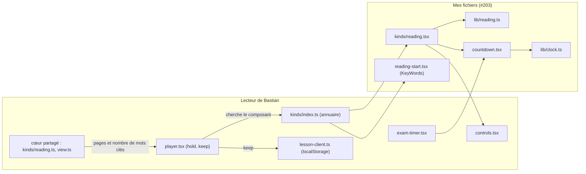
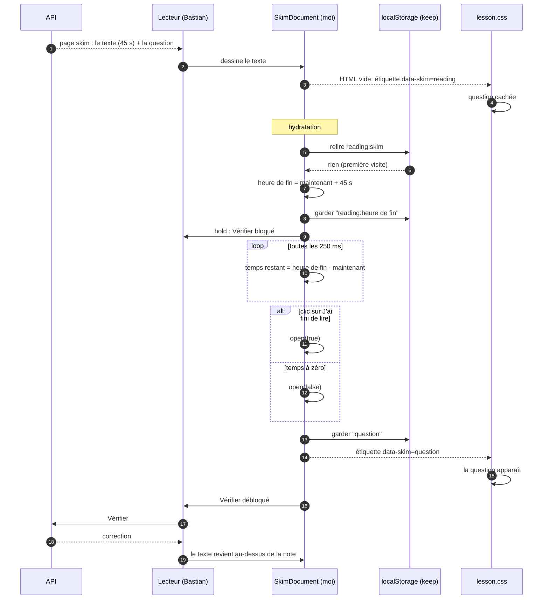
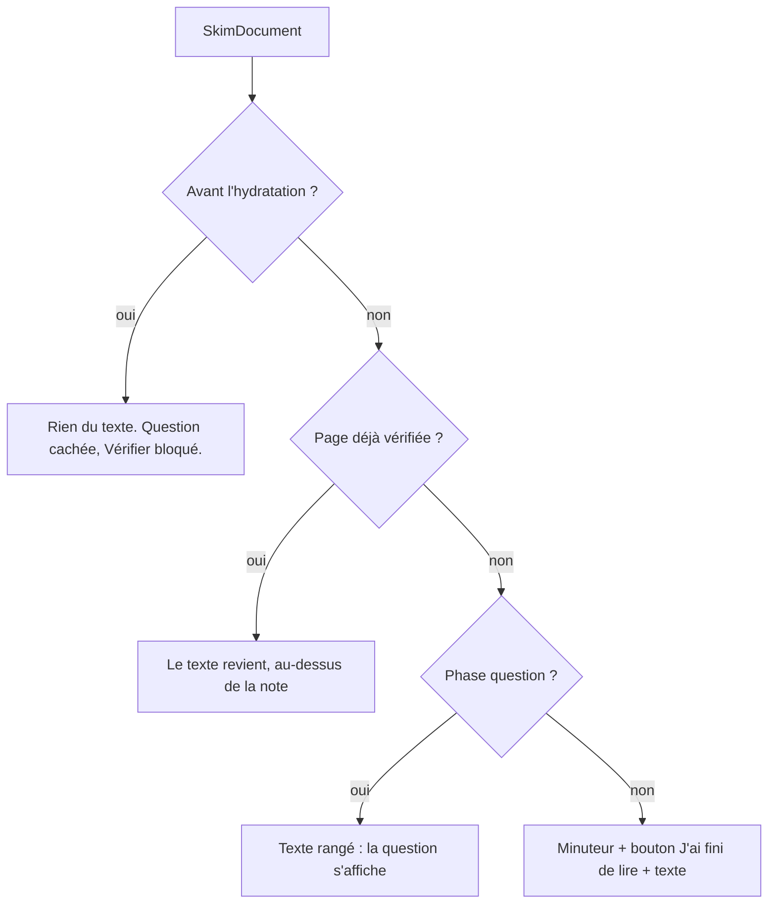
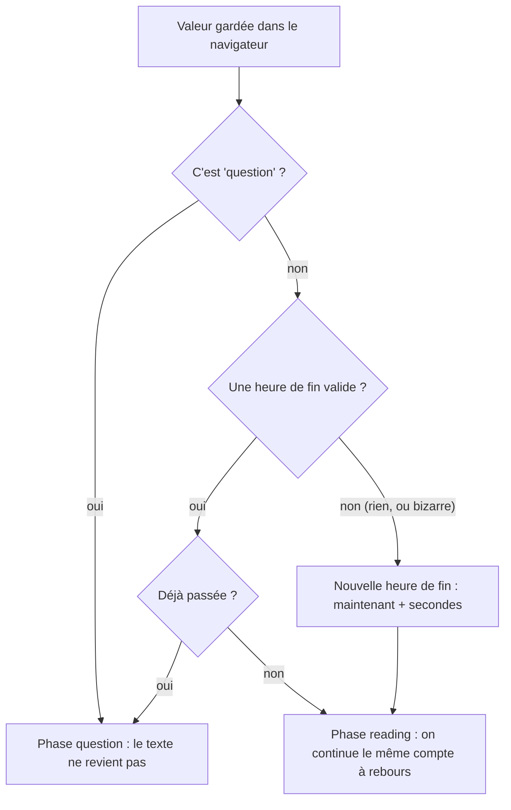

# La leçon de lecture dans le navigateur : `kinds/reading.tsx`

> PR concernée : **#203** « feat(web): #148 the reading lesson » (squash `0778fce`). Les 12 commits d'origine de la PR (`refs/pr/203`) sont tous à mon nom (VYAntares).
> **À moi** (créés dans #203) : [reading.tsx](../../../../apps/web/components/lesson/kinds/reading.tsx), [reading.test.tsx](../../../../apps/web/components/lesson/kinds/reading.test.tsx), [reading-start.tsx](../../../../apps/web/components/lesson/kinds/reading-start.tsx), [lib/reading.ts](../../../../apps/web/lib/reading.ts), [lib/reading.test.ts](../../../../apps/web/lib/reading.test.ts), [countdown.tsx](../../../../apps/web/components/lesson/countdown.tsx), [lib/clock.ts](../../../../apps/web/lib/clock.ts).
> **Pas à moi, retouché par moi dans #203** : le lecteur de leçon de **Bastian** (bastian-schnitzler, #192 et #197) : [player.tsx](../../../../apps/web/app/[locale]/(dashboard)/learn/[lang]/lessons/[id]/play/player.tsx), [exam-timer.tsx](../../../../apps/web/app/[locale]/(dashboard)/learn/[lang]/lessons/[id]/play/exam-timer.tsx), [controls.tsx](../../../../apps/web/components/lesson/controls.tsx), [kinds/index.ts](../../../../apps/web/components/lesson/kinds/index.ts), [lesson.css](../../../../apps/web/app/lesson.css) ; et le cœur partagé du lecteur, aussi de Bastian (#174) : [player/kinds/reading.ts](../../../../packages/shared/src/lessons/player/kinds/reading.ts), [kind.ts](../../../../packages/shared/src/lessons/player/kinds/kind.ts), [view.ts](../../../../packages/shared/src/lessons/player/view.ts).
> **Expliqué ailleurs** : le schéma et la validation des leçons de lecture (`schemas/reading.ts`, `validation/reading.ts`, `domain/readingLesson.ts`, à moi, #142) : [../shared-lessons/schemas.md](../shared-lessons/schemas.md), [../shared-lessons/validation.md](../shared-lessons/validation.md), [../shared-lessons/domain.md](../shared-lessons/domain.md). Les tests Playwright de #203 : [../e2e-roadmap/README.md](../e2e-roadmap/README.md). Le lecteur en entier (en anglais) : [docs/web/07-lesson-player.md](../../../web/07-lesson-player.md).

## 1. À quoi ça sert

On a 4 types de leçons : vocabulaire, grammaire, fonctions, lecture. Bastian a écrit le **lecteur de leçon** : la page qui joue une leçon, page après page. Il savait jouer les trois premiers types. La lecture, non : une leçon de lecture ne pouvait pas démarrer.

**#203 ajoute la lecture.** Une leçon de lecture a 5 étapes :

| Étape | Ce que voit l'apprenant |
|---|---|
| `flashcards` | des cartes à retourner : le sens devant, le mot clé derrière |
| `matching` | relier chaque mot clé à son sens |
| `skim` (survol) | le texte avec un compte à rebours, puis une question **de mémoire** |
| `detail` / `structure` | le texte **à côté** des questions (QCM, vrai/faux, remettre des phrases dans l'ordre) |
| `exam` | l'examen chronométré, sur un **deuxième** texte |

La partie difficile, c'est le **survol**. Le texte reste affiché quelques secondes (45 dans l'exemple). Puis il disparaît, et la question s'ouvre. On répond de mémoire. Et si on recharge la page, on ne doit pas récupérer du temps, ni revoir le texte.

**L'idée qui rend ça simple** : le lecteur de Bastian ne demande jamais « quel type de leçon est-ce ? ». Il a un **annuaire** : pour chaque type de bloc, le composant qui sait le dessiner. Moi, j'ai écrit les composants de la lecture, et je les ai ajoutés à l'annuaire. Je n'ai presque rien changé dans son code.

### Mots techniques

| Mot | Explication simple |
|---|---|
| **Composant React** | Une fonction qui reçoit des données et renvoie un morceau de page. |
| **Client component** (`'use client'`) | Un composant qui tourne aussi dans le navigateur. Il peut donc réagir aux clics et avoir un état. |
| **Hydratation** | Le serveur envoie d'abord une page HTML « figée ». Ensuite React se branche dessus dans le navigateur et la rend vivante. Comme une maquette qu'on branche sur le courant. |
| **Hook** | Une fonction React en `use…` qui donne un pouvoir au composant. `useState` : une valeur qui change. `useEffect` : du code lancé après l'affichage, dans le navigateur. `useRef` : une petite boîte qui garde une valeur sans redessiner. |
| **Item** | Un bloc d'une page (un texte, une question…). |
| **Renderer** | Le composant qui dessine un type d'item. |
| **`hold`** | Une fonction donnée par le lecteur : « bloque le bouton Vérifier ». |
| **`keep`** | Une fonction donnée par le lecteur : « garde cette petite valeur dans le navigateur ». |
| **`localStorage`** | Un petit carnet du navigateur, clé → texte, qui survit au rechargement. |
| **Lecteur d'écran** | Un logiciel qui lit la page à voix haute pour les personnes aveugles. Les attributs `role` et `aria-…` lui donnent des informations. |

## 2. Les fichiers

| Fichier | Rôle | Auteur |
|---|---|---|
| [kinds/reading.tsx](../../../../apps/web/components/lesson/kinds/reading.tsx) | Les 7 composants de la lecture (`readingRenderers`) | moi (#203) |
| [kinds/reading-start.tsx](../../../../apps/web/components/lesson/kinds/reading-start.tsx) | `KeyWords` : la ligne « 5 mots clés » de la page de présentation | moi (#203) |
| [lib/reading.ts](../../../../apps/web/lib/reading.ts) | La logique sans affichage : trouver les mots clés dans le texte, calculer le compte à rebours | moi (#203) |
| [countdown.tsx](../../../../apps/web/components/lesson/countdown.tsx) | `Countdown` : la boîte du minuteur, pour le survol **et** l'examen | moi (#203) |
| [lib/clock.ts](../../../../apps/web/lib/clock.ts) | `clock(45)` → `0:45` | moi (#203) |
| [lib/reading.test.ts](../../../../apps/web/lib/reading.test.ts), [kinds/reading.test.tsx](../../../../apps/web/components/lesson/kinds/reading.test.tsx) | Les tests | moi (#203) |
| [kinds/index.ts](../../../../apps/web/components/lesson/kinds/index.ts) | L'annuaire des types de leçon. J'y ai ajouté la ligne `reading`. | Bastian (#192) |
| [controls.tsx](../../../../apps/web/components/lesson/controls.tsx) | Les boutons de réponse. J'ai ajouté `useOrderFocus` et l'option `labelledBy`. | Bastian (#192) |
| [exam-timer.tsx](../../../../apps/web/app/[locale]/(dashboard)/learn/[lang]/lessons/[id]/play/exam-timer.tsx) | Le minuteur de l'examen. Il utilise maintenant ma boîte `Countdown`. | Bastian (#192) |
| [player.tsx](../../../../apps/web/app/[locale]/(dashboard)/learn/[lang]/lessons/[id]/play/player.tsx) | Le lecteur. Une seule ligne changée (`reading_keyword_matching` dans `SLIDING_ITEMS`). | Bastian (#192, #197) |
| [lib/lesson-client.ts](../../../../apps/web/lib/lesson-client.ts) | `loadKept` / `saveKept` : ce qu'il y a derrière `keep`. Je l'utilise seulement. | Bastian (#192) |
| [lesson.css](../../../../apps/web/app/lesson.css) | Les styles. J'ai ajouté le bloc « Reading (#148) » à la fin. | Bastian (#192) |
| [player/kinds/reading.ts](../../../../packages/shared/src/lessons/player/kinds/reading.ts) | La lecture dans le cœur partagé. J'ai changé `start` (le nombre de mots clés). | Bastian (#174) |
| [kind.ts](../../../../packages/shared/src/lessons/player/kinds/kind.ts), [view.ts](../../../../packages/shared/src/lessons/player/view.ts) | Les formes de données envoyées au navigateur. J'ai changé des commentaires seulement. | Bastian (#174) |

### Diagramme des fichiers et dépendances



## 3. Le code, morceau par morceau

> Les extraits sont raccourcis : `// ...` marque ce qui est coupé, et les commentaires en français sont des explications ajoutées ici. Le code exact est dans le fichier lié.

### 3.1 Se brancher sur le lecteur de Bastian

**En mots simples.** Le lecteur reçoit une page. Pour chaque bloc, il regarde son type (`reading_document`, `reading_choice`…) et cherche le composant dans l'annuaire. J'ai ajouté mes composants dans cet annuaire.

Le lecteur de Bastian ([player.tsx](../../../../apps/web/app/[locale]/(dashboard)/learn/[lang]/lessons/[id]/play/player.tsx)) :

```tsx
const Renderer = ITEM_RENDERERS[item.type] as React.ComponentType<ItemProps> | undefined;
// ...
return <Renderer item={item} {...props} />;
```

Ma ligne dans l'annuaire ([kinds/index.ts](../../../../apps/web/components/lesson/kinds/index.ts)) :

```ts
{ kind: 'reading', renderers: readingRenderers, startFields: [KeyWords] },
```

Et la liste de mes composants ([reading.tsx](../../../../apps/web/components/lesson/kinds/reading.tsx)) :

```tsx
export const readingRenderers: ItemRenderers = {
  reading_flashcards: ReadingFlashcards,
  reading_keyword_matching: KeywordMatching,
  reading_document: ReadingDocument,
  reading_skim_choice: SkimChoice,
  // ...
};
```

Avec cette ligne, `playable('reading')` devient vrai : la leçon peut démarrer. Le serveur, lui, savait déjà jouer la lecture (le cœur partagé). Il n'a pas changé.

### 3.2 La page de présentation : seulement « 5 mots clés »

**En mots simples.** Avant de commencer, la leçon a une page de présentation. Pour la lecture, j'affiche le nombre de mots clés. Rien d'autre.

**Pourquoi rien d'autre ?** Au début, j'affichais aussi la « situation » de la leçon. Puis j'ai vu qu'elle **donnait la réponse** de la question de survol. Exemple : dans `fr-reading-a-travel-blog`, la situation dit que Camille écrit « pour raconter ses trois jours à Marseille ». Et la bonne réponse du survol est « Pour raconter ses trois jours à Marseille ». Je l'ai donc retirée (commit `42b7510a`). Le genre (SMS, blog…) n'est pas montré non plus, pour la même raison.

Dans le cœur partagé ([player/kinds/reading.ts](../../../../packages/shared/src/lessons/player/kinds/reading.ts)) :

```ts
start: (brief) => ({ words: brief.keywords.length }),
```

### 3.3 Surligner les mots clés : `markKeywords`

**En mots simples.** Le texte arrive en paragraphes, avec la liste des mots clés. Il faut les surligner. `markKeywords` découpe un paragraphe en morceaux : « texte normal » ou « mot clé ». Trois règles :

1. Toutes les fois où le mot apparaît (« avant » deux fois → deux surlignages).
2. Le plus long d'abord : « on se voit » gagne contre « on ».
3. Mot entier seulement : « avant » n'est pas surligné dans « aup**avant** ».

```ts
const WORD_CHAR = /[\p{L}\p{N}]/u; // une lettre (é, ß, ü…) ou un chiffre

export function markKeywords(paragraph: string, highlights: readonly string[]): Segment[] {
  const marks = [...new Set(highlights.filter((h) => h.trim() !== ''))].sort(
    (a, b) => b.length - a.length,   // le plus long d'abord
  );
  // ... pour chaque mot : chaque position trouvée avec indexOf,
  // gardée seulement si c'est un mot entier et si elle ne chevauche pas une autre
}
```

La recherche respecte les majuscules : « Après » ne surligne pas « après-midi ». Le composant `DocumentText` met ensuite chaque mot clé dans une balise `<mark>`. On n'injecte jamais de HTML brut : React traite le texte comme du texte.

### 3.4 Le compte à rebours du survol : une heure de fin

**En mots simples.** On ne compte pas « il reste 45 secondes ». On note **l'heure de fin** : « le survol finit à 14 h 05 min 30 s ». À chaque instant, temps restant = heure de fin − maintenant. Comme un minuteur de cuisine réglé sur une heure précise : si on sort de la pièce et qu'on revient, il n'a pas pris de retard.

Pourquoi ? Deux raisons :
- Un onglet caché ralentit ses minuteurs. Avec une heure de fin, l'affichage se recale tout seul.
- Après un rechargement, on retrouve la même heure de fin. Le temps ne repart pas de zéro.

Le survol a deux phases : `reading` (on lit, avec une heure de fin) et `question` (le texte est rangé).

```ts
export type SkimState = { phase: 'reading'; deadline: number } | { phase: 'question' };
```

Cet état est gardé dans le navigateur, avec `keep`, sous la forme d'un petit texte : `"reading:1045000"` ou `"question"`. Au chargement, `readSkim` relit ce texte :

```ts
export function readSkim(kept: string | null, now: number, seconds: number): SkimState {
  if (kept === 'question') return { phase: 'question' };
  // ... sinon on relit l'heure de fin, ou on en crée une : now + seconds * 1000
  // Une heure de fin trop lointaine n'a pas été écrite par nous : on recommence.
  return deadline <= now ? { phase: 'question' } : { phase: 'reading', deadline };
}
```

Le serveur ne garde pas cette heure de fin (c'est écrit dans #203). C'est le minuteur **de ce navigateur**. Le minuteur de l'**examen**, lui, vient du serveur.

### 3.5 Le composant du survol : `SkimDocument`

**En mots simples.** Ce composant fait quatre choses :

1. **Il attend l'hydratation.** Le serveur ne connaît ni l'heure du navigateur, ni son `localStorage`. Donc au début, l'état vaut `null`, et on n'affiche pas le texte.
2. **Il lance le minuteur.** Toutes les 250 ms, il relit l'heure. À zéro, il range le texte.
3. **Il bloque le bouton Vérifier** tant qu'on lit (`hold`).
4. **Il déplace le focus** sur la question quand le texte disparaît.

```tsx
const [state, setState] = useState<SkimState | null>(null); // null avant l'hydratation

// 1. Après l'hydratation : on relit l'état gardé, ou on en crée un.
useEffect(() => {
  const at = Date.now();
  const kept = readSkim(keep.load(SKIM_KEY), at, seconds);
  keep.save(SKIM_KEY, skimValue(kept));
  setState(kept);
  // ...
}, [keep, seconds]);

// 2. Le minuteur : toutes les 250 ms.
const tick = () => {
  // ...
  if (secondsLeft(deadline, at) === 0) timeUp();
};

// 3. Vérifier bloqué tant qu'on lit.
hold('skim', reading && feedback === null ? { kind: 'block' } : null);
```

Quand le temps est fini, ou quand l'apprenant clique « J'ai fini de lire », la fonction `open` fait le changement :

```tsx
function open(byHand: boolean) {
  const next: SkimState = { phase: 'question' };
  keep.save(SKIM_KEY, skimValue(next)); // un rechargement ne remontrera pas le texte
  // ... décide si le focus doit aller sur la question
  setState(next);
}
```

**Le focus.** Le focus, c'est « l'élément actif » de la page, celui qui reçoit le clavier. Si le bouton cliqué disparaît, le focus tombe tout en haut de la page. Un utilisateur au clavier serait perdu. Donc on le met sur le titre « Réponds de mémoire ». Avec le minuteur, on le fait seulement si le focus était dans la leçon : s'il est dans un menu, on ne le vole pas.

**`useEffectEvent`** (un hook de React 19) : il permet au minuteur d'appeler `open` sans redémarrer le minuteur à chaque nouvel affichage.

Selon l'état, la page affiche quatre choses différentes : voir le diagramme 4.2.

**Pourquoi rien avant l'hydratation ?** Sinon, après un rechargement alors que le survol est fini, le serveur aurait montré tout le texte un instant. C'est une remarque de Victor en revue (commit `c2007535`).

### 3.6 Cacher la question pendant la lecture : une règle CSS

**En mots simples.** Le texte et la question sont deux blocs séparés. Le lecteur les dessine l'un après l'autre. Ils ne se parlent pas. Comment cacher la question tant que le texte est ouvert ?

Avec le CSS. Le texte porte une étiquette `data-skim="reading"` pendant la lecture. La règle dit : « si la page contient cette étiquette, cache la question ».

```css
.lesson-items:has([data-skim='reading']) .reading-skim-question {
  display: none;
}
```

`:has()` veut dire « un parent qui contient… ». Quand le texte change d'étiquette (`data-skim="question"`), la question apparaît. Pas besoin de toucher au lecteur de Bastian.

### 3.7 Les questions et la correction

**En mots simples.** Chaque question réutilise le contrôle à choix de Bastian (`ChoiceControl`). Après « Vérifier », une note (`ReadingNote`) dit « Correct », ou « Incorrect » avec : la bonne réponse en vert, la réponse de l'apprenant barrée en rouge, et l'explication.

Pour un lecteur d'écran, les couleurs ne disent rien. Donc on ajoute un texte invisible « Bonne réponse : » et « Ta réponse : » :

```tsx
<p className="font-semibold text-green-400">
  <span className="sr-only">{t('correctAnswer')}: </span>
  <span lang={lang}>{feedback.answer}</span>
</p>
```

`sr-only` = « seulement pour le lecteur d'écran » (caché à l'écran).

### 3.8 Remettre des phrases dans l'ordre

**En mots simples.** On clique une phrase : elle passe de « Éléments à placer » à « Ton ordre », ou l'inverse. Le bouton cliqué disparaît donc, et le focus serait perdu. J'ai écrit le hook `useOrderFocus` dans [controls.tsx](../../../../apps/web/components/lesson/controls.tsx) : après le clic, il met le focus sur la phrase voisine. Bastian l'utilise aussi maintenant pour son ordre des mots (`OrderControl`).

```ts
// Avant le changement : on note d'où vient la pièce.
focus.moved('placed', n);
// Après l'affichage : focus sur la pièce à la même place, sinon la dernière.
(same[Math.min(move.index, same.length - 1)] ?? other.at(-1))?.focus();
```

### 3.9 Une seule boîte de minuteur : `Countdown`

**En mots simples.** L'examen avait déjà un minuteur (Bastian). Le survol en avait besoin d'un aussi. Plutôt que de copier, j'ai sorti la boîte dans `Countdown`. Les deux l'utilisent. La boîte devient rouge dans les 10 dernières secondes.

J'en ai profité pour corriger le lecteur d'écran : avant, il lisait « Time left » sans le temps. Maintenant, il lit « Time left: 0:45 ».

```tsx
<span role="timer" aria-label={`${label}: ${clock(seconds)}`}>
  {clock(seconds)}
</span>
```

Et l'examen n'a plus qu'une ligne :

```tsx
return <Countdown label={t('timeLeft')} seconds={seconds} total={limitS} testId="time-left" />;
```

### 3.10 Le texte à côté des questions

**En mots simples.** Sur un écran assez large, le texte est à gauche et les questions à droite. Le texte reste collé en haut quand on fait défiler. Sur un téléphone, tout est empilé.

On utilise une **container query** : une règle CSS qui regarde la largeur d'un bloc (ici la carte de la leçon), pas la largeur de l'écran.

```css
@container reading-task (min-width: 634px) {
  .lesson-items > .reading-doc-slot.is-side {
    position: sticky;  /* reste collé en haut */
    float: left;
    width: calc(53% - 16px);
    /* ... */
  }
}
```

**Pourquoi 634 px ?** Les maquettes passent « côte à côte » à 700 px. La carte a 66 px de marges et de bords : 700 − 66 = 634.

## 4. Le chemin d'exécution

### 4.1 Séquence : la page de survol



### 4.2 Décision : que dessine `SkimDocument` ?



### 4.3 Décision : après un rechargement (`readSkim`)



## 5. Un exemple concret pas à pas

La leçon exemple **`fr-reading-a-text-message`** (« Lire un SMS ») : [brief](../../../../packages/shared/test/fixtures/samples/briefs/fr-reading-a-text-message.json) et [contenu](../../../../packages/shared/test/fixtures/samples/lessons/fr-reading-a-text-message.json). C'est elle que joue le test.

**Présentation.** 5 mots clés : `samedi`, `on se voit`, `la gare`, `avant`, `après`. La page affiche « 5 mots clés ». Rien sur Léa, rien sur « SMS ».

**Le survol.** Le texte est un SMS de Léa (`Jeudi 18:42`). Un paragraphe : « Samedi soir, on mange chez moi avec Paul. On fait des crêpes ! Mais avant, on se voit à 15 h au café de la gare ? Après le café, on va au cinéma à 17 h. » Durée : **45 s**.

1. Le serveur envoie la page sans le texte. La question « Pourquoi Léa écrit-elle à Tom ? » est là, mais cachée par le CSS.
2. Hydratation. Disons qu'il est `1 000 000` ms (valeur des tests). Heure de fin : `1 045 000`. Le navigateur garde `"reading:1045000"`.
3. Le minuteur affiche `0:45`. Le lecteur d'écran lit « Time to skim: 0:45 ».
4. Les mots clés sont surlignés 6 fois : `samedi`, `avant` (deux fois), `on se voit`, `la gare`, `Après`. « Samedi soir » n'est pas surligné : majuscule.
5. L'apprenant recharge à `1 035 000`. On relit `"reading:1045000"`. Il reste **10 s**, pas 45. La boîte est rouge.
6. À `1 045 000`, le temps est à zéro. Le texte disparaît, le navigateur garde `"question"`, le focus va sur « Réponds de mémoire », Vérifier se débloque.
7. Il recharge encore : la valeur est `"question"`. Le texte ne revient pas.
8. Il répond, clique Vérifier. Le texte revient au-dessus, avec la note « Correct ».

**Ensuite.** Les questions de détail à côté du même texte, puis l'ordre des phrases, puis l'examen sur un deuxième SMS (de Paul, `Vendredi 9:15`), sans mots surlignés.

## 6. Les tests

| Fichier | Ce qu'il vérifie |
|---|---|
| [lib/reading.test.ts](../../../../apps/web/lib/reading.test.ts) (12 tests) | Les règles de `markKeywords` (toutes les fois, le plus long d'abord, mot entier). Le compte à rebours : nouveau, gardé après rechargement, fini, valeur bizarre → on recommence. Et `clock`. |
| [kinds/reading.test.tsx](../../../../apps/web/components/lesson/kinds/reading.test.tsx) (11 tests) | Joue toute la leçon « Lire un SMS » sur le vrai cœur partagé, tout juste (Score 100) puis tout faux (Score 0). Vérifie le HTML de chaque page : « 5 key words » sans la situation, le survol vide avant l'hydratation, le minuteur `0:45`, les 6 surlignages, les notes « Correct answer » / « Your answer », le texte d'examen seulement à l'examen. |
| [player/outline.test.ts](../../../../packages/shared/src/lessons/player/outline.test.ts) (Bastian, retouché par moi) | La présentation donne le nombre de mots clés, et jamais la situation ni le genre. |
| Tests Playwright | Voir [../e2e-roadmap/README.md](../e2e-roadmap/README.md). |

Le test de composant transforme les composants en HTML avec `renderToStaticMarkup`, sans navigateur. **Limite** : pas d'effets, pas de CSS. Il ne voit donc que le survol « avant hydratation ». C'est pour ça que j'exporte `SkimOpen` (le survol ouvert) pour le tester à part, et que Playwright vérifie le vrai comportement.

Commandes, depuis la racine :

```bash
pnpm --filter @ft/web test     # tous les tests de apps/web
pnpm --filter @ft/shared test  # dont outline.test.ts
make test                      # tous les tests unitaires du dépôt
```

Pour lancer seulement les miens : `cd apps/web && pnpm exec vitest run lib/reading.test.ts components/lesson/kinds/reading.test.tsx`.

Pour que Vitest lise les tests `.tsx`, #203 a ajouté `components/**/*.test.tsx` dans [vitest.config.mts](../../../../apps/web/vitest.config.mts).

## 7. Les concepts à savoir expliquer

1. **L'annuaire de composants.** Le lecteur cherche un composant par type de bloc. Ajouter la lecture = ajouter des composants, sans modifier le lecteur.
2. **Serveur d'abord, puis hydratation.** Ce qui dépend du navigateur (heure, `localStorage`, focus) se fait après l'hydratation, dans un `useEffect`.
3. **Une heure de fin, pas un compteur.** Résiste aux onglets cachés et aux rechargements.
4. **Ne pas croire le stockage aveuglément.** Une valeur bizarre → on recommence.
5. **Deux blocs reliés par le CSS.** `:has()` cache la question tant que le texte est ouvert.
6. **`hold`.** Un bloc peut bloquer le bouton Vérifier du lecteur.
7. **Logique séparée de l'affichage.** `lib/reading.ts` n'utilise pas React : facile à tester.
8. **Accessibilité.** Minuteur lu avec le temps, texte caché « Bonne réponse », focus déplacé quand un bouton disparaît.
9. **Ne pas donner la réponse.** La présentation ne montre ni la situation ni le genre.

## 8. Questions possibles à l'oral

**Q : Qu'as-tu changé dans le lecteur de Bastian ?**

R : Presque rien. Une ligne dans l'annuaire, une ligne dans `player.tsx`, l'examen qui utilise ma boîte `Countdown`, et `useOrderFocus` dans `controls.tsx`. Le reste est dans mes fichiers.

**Q : Pourquoi une heure de fin et pas « secondes restantes » ?**

R : Un onglet caché ralentit les minuteurs, et un rechargement remettrait le compteur à zéro. Avec une heure de fin, on recalcule le temps restant à chaque fois.

**Q : Pourquoi le minuteur du survol n'est pas sur le serveur, comme celui de l'examen ?**

R : #203 l'a choisi ainsi : le serveur ne garde pas d'heure de fin pour le survol. C'est une page d'entraînement : l'important est que le texte disparaisse avant la question. Le garder dans le navigateur suffit, sans changer l'API. *(Raison déduite du code, la PR ne la détaille pas.)*

**Q : Que se passe-t-il si on recharge pendant le survol ? Et après ?**

R : Pendant : on retrouve la même heure de fin, le temps continue de baisser. Après : la valeur gardée est « question », le texte ne revient pas.

**Q : Pourquoi ne rien afficher avant l'hydratation ?**

R : Le serveur ne sait pas si le survol est fini. S'il dessinait le texte, on le verrait un instant après un rechargement.

**Q : Comment la question est cachée ? Pourquoi pas un état React partagé ?**

R : Par une règle CSS avec `:has()`. Les deux blocs sont dessinés séparément par le lecteur. Un état partagé demandait de modifier le lecteur. Le CSS suffit, et marche même avant l'hydratation.

**Q : Qu'est-ce qui empêche de cliquer Vérifier sans avoir lu ?**

R : `hold('skim', { kind: 'block' })` : le lecteur désactive Vérifier tant que le texte est ouvert.

**Q : Pourquoi ne pas montrer la situation sur la page de présentation ?**

R : Elle donnait la réponse du survol. Exemple : « pour raconter ses trois jours à Marseille ».

**Q : Comment surlignes-tu les mots clés ?**

R : Toutes les fois où ils apparaissent, le plus long d'abord, mots entiers seulement, sans chevauchement. React affiche le texte comme du texte : pas d'injection HTML possible.

**Q : Comment testes-tu des composants sans navigateur ?**

R : Je les transforme en HTML et je joue toute la leçon sur le vrai cœur partagé. Limite : pas d'effets ni de CSS. Le vrai comportement est vérifié par Playwright.

**Q : Qu'as-tu fait pour l'accessibilité ?**

R : Le minuteur est lu avec le temps. La note a un texte caché « Bonne réponse ». Chaque groupe de choix est nommé par sa question. Le focus est déplacé quand un bouton disparaît. Plusieurs points viennent de la revue de Victor.
