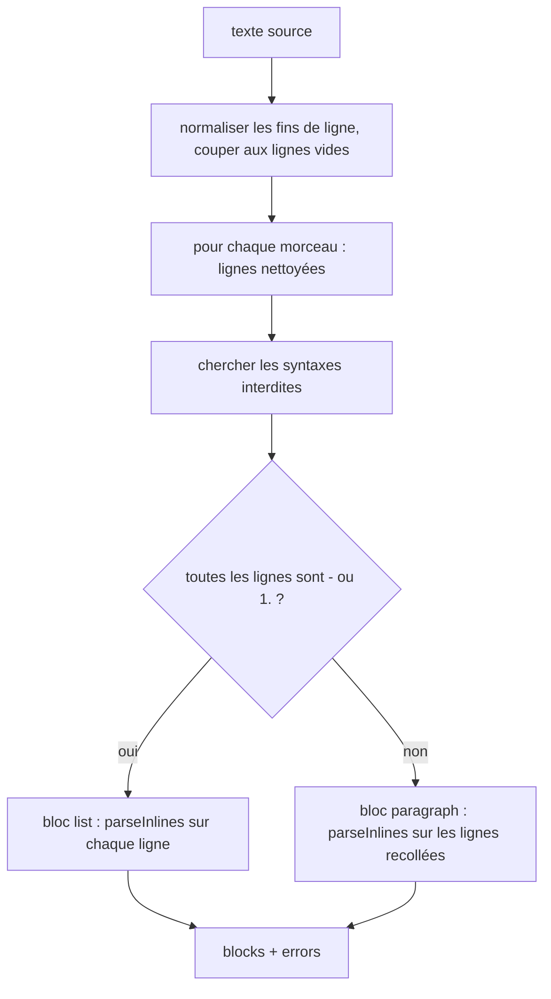

# Les calculs (`domain/`)

> Retour au [README](README.md). Fichiers expliqués :
> [`richText.ts`](../../../../packages/shared/src/lessons/domain/richText.ts),
> [`articles.ts`](../../../../packages/shared/src/lessons/domain/articles.ts),
> [`vocabularyLesson.ts`](../../../../packages/shared/src/lessons/domain/vocabularyLesson.ts),
> [`vocabularyAnswers.ts`](../../../../packages/shared/src/lessons/domain/vocabularyAnswers.ts),
> [`functionsLesson.ts`](../../../../packages/shared/src/lessons/domain/functionsLesson.ts),
> [`readingLesson.ts`](../../../../packages/shared/src/lessons/domain/readingLesson.ts),
> [`lessonCopy.ts`](../../../../packages/shared/src/lessons/domain/lessonCopy.ts).

`domain/` contient des **fonctions pures** : elles prennent des données, renvoient un résultat, ne touchent ni au disque ni à la base.
Elles ne vérifient rien elles-mêmes : les validateurs et le kit d'auteur s'en servent.

**Idée clé** : les durées ne sont **jamais choisies** par l'auteur. Elles sont **calculées** par ces fonctions,
et le validateur recalcule pour comparer, **à la seconde près**. Le kit d'auteur ([`times.ts`](../../../../apps/api/scripts/lessons/times.ts)) utilise les **mêmes** fonctions pour écrire les durées.
Comme les deux côtés appellent le même code, ils ne peuvent pas être en désaccord.

---

## 1. `richText.ts` : le Markdown simple

Les longs textes (introduction d'un groupe de vocabulaire, explication de grammaire) sont écrits dans un **Markdown très réduit**.

**Permis** : paragraphes (séparés par une ligne vide), listes `- ` et `1. `, `**gras**`, `` `forme` `` (un mot dans la langue apprise).
**Interdit** : titres `#`, citations `>`, tableaux `|`, blocs de code, listes `*`/`+`, HTML, liens, images, `*italique*`, `_italique_`, le texte `\n` tapé en toutes lettres, et un balisage **dans** un autre.

**Pourquoi si strict ?** Le texte est affiché par notre propre composant React ([`rich-text.tsx`](../../../../apps/web/components/lesson/rich-text.tsx)), sans `dangerouslySetInnerHTML`.
Moins de syntaxe = moins de surprises, pas de HTML injecté, et on peut **comparer** les trois langues.

### Les types

```ts
type Inline = { kind: 'text' | 'strong' | 'learning'; text: string };
type Block  = { kind: 'paragraph'; inlines: Inline[] }
            | { kind: 'list'; ordered: boolean; items: Inline[][] };
```

### `parseRichText(source) → { blocks, errors }`

Étapes :

1. Les fins de ligne Windows (`\r\n`) deviennent `\n` ; on coupe le texte à chaque **ligne vide** → des morceaux.
2. Pour chaque morceau, on enlève les espaces au bord des lignes, on jette les lignes vides.
3. On cherche les syntaxes interdites, ligne par ligne (`FORBIDDEN_LINE`, `FORBIDDEN_INLINE`).
4. Si **toutes** les lignes commencent par `- ` → liste à puces ; toutes par `1. ` (1 ou 2 chiffres) → liste numérotée.
5. Sinon → paragraphe (les lignes sont recollées avec un espace). Si une ligne de liste traîne dans un paragraphe → erreur « il manque une ligne vide ».
6. Chaque ligne passe dans `parseInlines`, qui lit **de gauche à droite** :
   - `**` → cherche le `**` fermant → morceau `strong` ;
   - `` ` `` → cherche le `` ` `` fermant → morceau `learning` ;
   - `*` seul ou `_` en début de mot → erreur ;
   - sinon : texte jusqu'au prochain `*` ou `` ` ``. Deux textes de suite sont **fusionnés**.
   - Un `**` ou `` ` `` non fermé → erreur, et la fin de la ligne est abandonnée.

Elle **renvoie** les erreurs au lieu de lancer une exception : le validateur peut toutes les lister.

Exemple (tiré de [`richText.test.ts`](../../../../packages/shared/src/lessons/domain/richText.test.ts)) :

```
Entrée :
  Learn **these** forms:
  
  - `je suis` – I am
  - `tu es` – you are
  
  1. first
  2. second
  
  A line
  break joins.

Sortie :
  errors = []
  blocks[0] = paragraph [text "Learn ", strong "these", text " forms:"]
  blocks[1] = list (ordered false) [[learning "je suis", text " – I am"], [learning "tu es", text " – you are"]]
  blocks[2] = list (ordered true)  [[text "first"], [text "second"]]
  blocks[3] = paragraph [text "A line break joins."]
```

Exemples d'erreurs :

| Entrée | Erreur |
|---|---|
| `# Heading` | `block 1: headings are not allowed` |
| `See [this](http://x.y)` | `block 1: links or images not allowed` |
| `**unclosed` | `block 1: unclosed or empty **bold**` |
| `*italic*` | `only **bold** and `form` markup is allowed (found "*")` |
| `Text\n- item` | `separate a list from surrounding text with a blank line` |



### `richTextShape(blocks) → string`

Le **squelette** du texte : `p` pour un paragraphe, `ul:N` ou `ol:N` pour une liste de N lignes, séparés par `|`.
Exemple ci-dessus → `"p|ul:2|ol:2|p"`. Le validateur exige le **même** squelette en en, fr et de.

### `learningForms(blocks) → string[]`

Toutes les formes entre backticks, dans l'ordre. Exemple ci-dessus → `["je suis", "tu es"]`.
Elles sont dans la langue apprise : elles doivent être **les mêmes** dans les trois versions.

---

## 2. `articles.ts` : les articles par langue

| Fonction / constante | Entrée → sortie | Exemple |
|---|---|---|
| `hasGender(lang)` | langue → booléen | `fr` → `true`, `de` → `true`, `en` → `false` |
| `nounGenders(lang)` | langue → genres possibles | `fr` → `['masculine', 'feminine']`, `de` → `+ 'neuter'`, `en` → `[]` |
| `TEACHING_ARTICLES` | table | `fr` : `un`/`une`, pluriel `des` ; `de` : `der`/`die`/`das`, pluriel `die` ; `en` : `null` |
| `STRIPPED_ARTICLES` | table | articles qu'un `term` ou une réponse de trou ne doit **pas** avoir au début |
| `teachingArticle(lang, form)` | forme → l'article d'enseignement au début, ou `undefined` | `('de', 'der Tisch')` → `'der'` ; `('de', 'Tisch')` → `undefined` |
| `startsWithArticle(lang, text)` | texte → commence par un article ? | `('fr', "l'école")` → `true` ; `('en', 'the book')` → `true` |
| `isArticle(lang, text)` | texte → est-ce un article seul ? | `('fr', 'un')` → `true` |

Détail : `lower()` met en minuscules et remplace les apostrophes typographiques `’` par `'`, pour que `l’école` soit reconnu comme `l'école`.
Pour un article qui finit par `'` (`l'`), pas besoin d'espace après ; pour les autres, on cherche `"article "` avec un espace
(sinon `"une"` serait vu au début de `"unicorne"`).

---

## 3. `vocabularyLesson.ts` : fabriquer la leçon de vocabulaire

### `VOCABULARY_TIMING`

Les durées fixes, en secondes :

| Clé | Valeur | Clé | Valeur |
|---|---|---|---|
| `introductionBase` | 20 | `introductionPerWord` | 3 |
| `flashcardsPerWord` | 10 | `matchingPerWord` | 10 |
| `matchingGroupSize` | 6 (paires max par page) | `genderBase` / `genderPerWord` | 20 / 5 |
| `gapPage` | 20 | `listeningPage` | 15 |
| `examPageSize` | 6 | `translationPerWord` / `translationLimitPerWord` | 15 / 20 |
| `dictationPerWord` / `dictationLimitPerWord` | 20 / 30 | | |

### `chunk(list, size) → list[][]`

Coupe une liste en **le moins de pages possible**, de taille ≤ `size`, **les plus égales possible**.

```
chunk([1..7], 6)  → [[1,2,3,4], [5,6,7]]     (4 + 3, jamais 6 + 1)
chunk([1..12], 6) → [[1..6], [7..12]]
```

Calcul : `pages = ceil(n / size)`, puis la page `i` va de `round(i × n / pages)` à `round((i+1) × n / pages)`.
Le `<T>` (générique) veut dire : marche pour une liste de n'importe quoi.

### `matchingPages(brief) → string[][]`

Tous les ids des mots, dans l'ordre des groupes, coupés par `chunk(..., 6)`.
Utilisé par le constructeur **et** par le validateur (pour vérifier que deux mots d'une même page n'ont pas la même traduction).

### `vocabularyLesson(brief) → VocabularyContent`

La « recette » est toujours la même :

| Étape (`id`) | `stage` | Pages | Durée d'une page | Construit depuis |
|---|---|---|---|---|
| `introduction` | introduction | une par groupe | `20 + 3 × mots` | `groups[].introduction` |
| `flashcards` | flashcards | une par groupe | `10 × mots` | `groups[].targetIds` |
| `matching` | matching | `matchingPages` | `10 × mots` | `matchingLabel`, `explanation` |
| `overview` (si noms genrés) | overview | une | `20 + 5 × noms` | `genderExplanation` |
| `practice` | practice | une par mot | 20 | `targets[].gap` |
| `listening` | **practice** | une par mot | 15 | `listeningOptionTargetIds` |
| `exam` | exam | traductions puis dictées, 6 mots max par page, par groupe | `15 × mots` / `20 × mots` ; compte à rebours `20 × mots` / `30 × mots` | `examPrompt`, `examForms` |

La question d'examen d'un mot = son `examPrompt`, sinon sa **1re traduction** dans chaque langue.
Les réponses acceptées viennent de `vocabularyExamAnswers` (section 4).

Exemple réel : `fr-classroom-objects`, 12 mots en 2 groupes de 6, tous noms genrés.

```
introduction : 2 × (20 + 3×6)  =  76 s
flashcards   : 2 × (10×6)      = 120 s
matching     : 2 pages de 6 → 2 × 60 = 120 s
overview     : 20 + 5×12       =  80 s
practice     : 12 × 20         = 240 s
listening    : 12 × 15         = 180 s
exam         : traductions 2 × (15×6) = 180 s ; dictées 2 × (20×6) = 240 s
total        = 1236 s → round(1236 / 60) = 21 min
```

Et le fichier réel dit bien `"estimatedMinutes": 21`.

**Attention** : la fonction suppose un brief **valide**. Elle utilise `targets.get(id)!` ; le `!` dit à TypeScript « ce n'est jamais `undefined` », **sans vérifier**.
C'est pourquoi `checkVocabularyBrief` ne l'appelle **que s'il n'y a aucun problème**.

### `vocabularyMinutes(steps) → number`

Somme des durées de toutes les pages, divisée par 60, arrondie, au moins 1.

---

## 4. `vocabularyAnswers.ts` : les réponses acceptées à l'examen

### `vocabularyExamAnswers(target, lang, prompt?) → string[]`

Renvoie les `examForms`, **plus** les `genderVariants` si la question **ne dit pas** quel genre on veut.

- La question est « précise » (*hinted*) si, **dans toutes** les langues de traduction, elle diffère de la 1re traduction du mot.
- Pas de `prompt` (cas de la **dictée**, il n'y a pas de question à lire) = précise aussi : seulement les `examForms`.
- `new Set` enlève les doublons.

Exemple (du commentaire du code) : `examForms ["un serveur"]`, `genderVariants ["une serveuse"]`, 1re traduction `"waiter"`.

| Question posée | Réponses acceptées |
|---|---|
| `"waiter"` (= 1re traduction, ne précise pas) | `["un serveur", "une serveuse"]` |
| `"waiter (masculine singular form)"` (son `examPrompt`) | `["un serveur"]` |
| dictée (pas de question) | `["un serveur"]` |

---

## 5. `functionsLesson.ts` : durées des leçons « fonctions »

### `functionsPageEstimate(items, exam) → secondes`

Somme des durées des items de la page, avec `FUNCTIONS_PAGE_RULES` :

| Item | Durée |
|---|---|
| `function_flashcards` | `12 s × expressions` ou `10 s × mots` |
| `function_dialogue` | `20 + 12 × lignes` |
| `function_gender_select` | `20 + 5 × noms` |
| `function_matching` | `12 s × paires d'expressions` ou `10 s × paires de mots` |
| `function_word_order` | 25 à l'entraînement, **30** à l'examen (`exam = true`) |
| `function_dialogue_gap_choice` | 15 |
| `function_listening_choice` | 30 |
| `function_translation_exam` | 15 |
| `function_dialogue_gap_typing` | `8 × lignes + 20 × lignes avec trou` |

Exemples : 4 cartes d'expressions = 48 s ; un dialogue de 10 lignes = `20 + 120 = 140 s`.

### `functionsTimeLimit(estimate) → secondes`

`Math.round(estimate × 1.5)` : 100 s → 150 s. Arrondi **à la seconde** (différent de la lecture).

### `expressionDisplay(e) → string`

`openEnd: true` → ajoute `" …"` : `"Je voudrais"` → `"Je voudrais …"`. Sinon le texte tel quel.

### `functionsTerms(brief) → Map<id, { display, translations, kind }>`

Toutes les expressions et tous les mots par id, avec leur texte d'affichage (expression via `expressionDisplay`, mot via `teachingForm`).
Utilisé par le lecteur (`player/`) pour les cartes et les associations.

---

## 6. `readingLesson.ts` : mots et durées des lectures

### Constantes

- `READING_PAGE_RULES` : `keywordCardS 10`, `keywordPairS 10`, `skimQuestionS 20`, `detailQuestionS 30`, `orderPieceS 15`, `examQuestionS 20`, `timeLimitFactor 1.5`, `roundS 5`.
- `READING_SKIM_WPM` : vitesse de lecture en mots par minute : A1 75, A2 90, B1 110, B2 130, C1 150, C2 170.

### Les fonctions

| Fonction | Entrée → sortie | Exemple |
|---|---|---|
| `countWords(text)` | texte → nombre de mots (morceaux entre espaces qui contiennent une lettre ou un chiffre) | `"l'heure"` = 1, `"18h30"` = 1, `"€"` = 0 |
| `highlightRanges(text, words)` | où sont les mots, **en mots entiers**, sans chevauchement | `("Entrée libre. Entrées : 5 €", ["Entrée"])` → `[{ at: 0, word: "Entrée" }]` (pas celui dans « Entrées ») |
| `documentWords(doc)` | document → mots du titre + méta + paragraphes | |
| `readingSkimSeconds(doc, level)` | temps de lecture au niveau, arrondi **au 5 supérieur**, au moins 15 s | 60 mots en A1 : 48 s → 50 s |
| `readingPageEstimate(items, documents, level, exam)` | page → secondes | voir dessous |
| `readingMinutes(estimates)` | liste de secondes → minutes arrondies, min 1 | |
| `readingTimeLimit(estimate)` | `1.5 × estimate`, arrondi **au 5 supérieur** | 100 → 150 ; 101 → 155 ; 159 → 240 |

`\p{L}` = n'importe quelle lettre (accents compris), `\p{N}` = n'importe quel chiffre ; il faut le drapeau `u` sur la regex.

Dans `highlightRanges`, quand deux mots se chevauchent : celui qui commence **en premier** gagne ; à égalité, le **plus long**.

`readingPageEstimate` : un document compte selon sa vue :
- `skim` : son `skimSeconds` ;
- `exam` : son temps de lecture au niveau ;
- `open` : **0** (le temps des questions inclut la lecture).
Questions : 30 s en détail, 20 s à l'examen.

Exemple réel (`fr-reading-a-magazine-portrait`, B1) : page d'examen estimée à 159 s → compte à rebours `ceil(238.5 / 5) × 5 = 240 s`.

---

## 7. `lessonCopy.ts` : les textes fixes

Les noms d'étapes (« Flashcards ») et les consignes (« Match each word with its translation. ») sont **les mêmes** dans toutes les leçons d'un type.
Personne ne les réécrit : le code les met. Chaque texte existe en `{ en, fr, de }`.

| Export | Contenu | Lu par |
|---|---|---|
| `L(en, fr, de)` | raccourci pour écrire `{ en, fr, de }` | interne |
| `COPY` | paires `[nom d'étape, consigne]` du vocabulaire, + explication, feedback, examen de grammaire | `vocabularyLesson`, `player/` |
| `EXERCISE_INSTRUCTIONS` | consigne de chacun des 7 exercices de grammaire | aucun code pour l'instant (le commentaire dit : prévu pour le kit d'auteur) |
| `FUNCTIONS_COPY` | textes des leçons « fonctions » | aucun code pour l'instant (idem) |
| `READING_COPY` | une paire par stade de lecture | aucun code pour l'instant (idem) |

Remarque : les fichiers de contenu réels contiennent déjà ces textes (par ex. « Connect each pronoun with its partner. » dans
`fr-er-verbs-present`), mais je n'ai trouvé aucun code du dépôt qui les y copie depuis `lessonCopy.ts`, et aucun validateur ne vérifie
qu'une consigne égale ces textes. Point à vérifier si on te pose la question.
| `examInstruction(lang)` | consigne d'examen qui **nomme la langue du cours**, avec « with its article for nouns » seulement si `hasGender(lang)` | `vocabularyLesson` |
| `dictationInstruction(lang)` | pareil pour la dictée | `vocabularyLesson` |

```
examInstruction('de').en → "Translate each word into German, with its article for nouns."
examInstruction('en').en → "Translate each word into English."
examInstruction('en').de → "Übersetze jedes Wort ins Englische."
```

`COPY.matching[0]` → `{ en: 'Matching', fr: 'Association', de: 'Zuordnen' }`.
