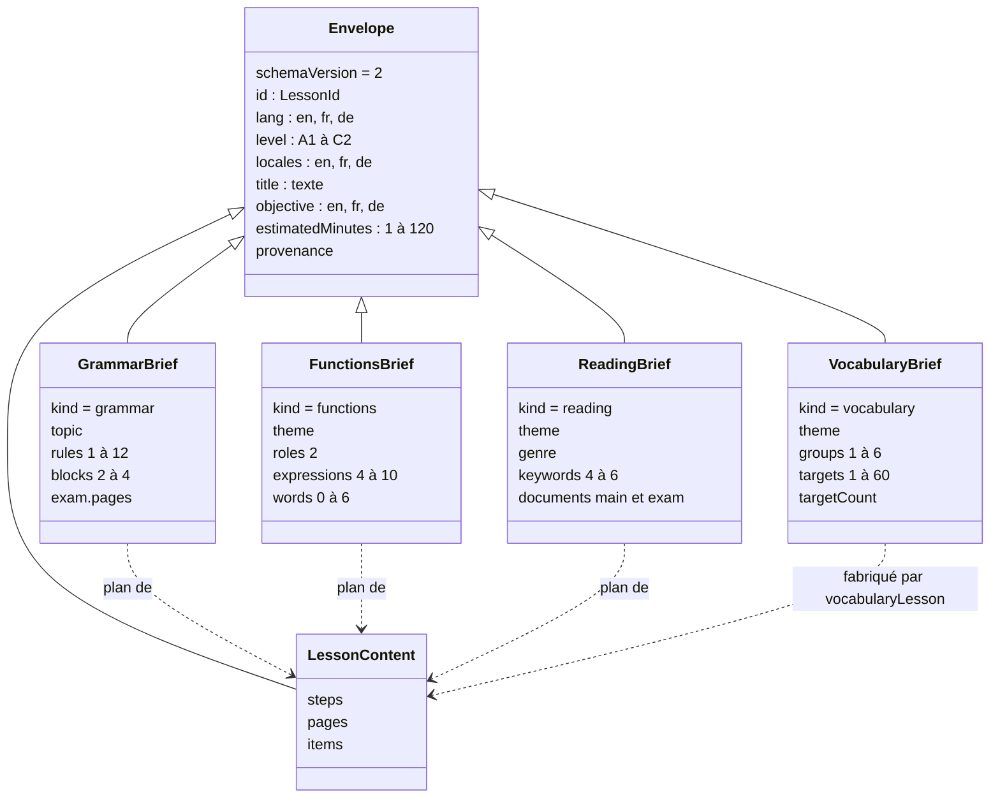

# Les schémas Zod (`schemas/`)

> Retour au [README](README.md). Fichiers expliqués :
> [`artifactCommon.ts`](../../../../packages/shared/src/lessons/schemas/artifactCommon.ts),
> [`artifacts.ts`](../../../../packages/shared/src/lessons/schemas/artifacts.ts),
> [`vocabulary.ts`](../../../../packages/shared/src/lessons/schemas/vocabulary.ts),
> [`grammar.ts`](../../../../packages/shared/src/lessons/schemas/grammar.ts),
> [`functions.ts`](../../../../packages/shared/src/lessons/schemas/functions.ts),
> [`reading.ts`](../../../../packages/shared/src/lessons/schemas/reading.ts).

## 0. D'abord, c'est quoi Zod ?

**Zod** est une bibliothèque TypeScript. Elle sert à décrire **la forme attendue** d'une donnée,
puis à **vérifier** une vraie donnée contre cette forme, **pendant l'exécution**.

Pourquoi en a-t-on besoin ? TypeScript vérifie les types **à la compilation** seulement.
Un fichier JSON lu sur le disque arrive en `unknown` : TypeScript ne sait rien de lui.
Zod fait le contrôle à l'exécution, et **en plus** il donne le type TypeScript gratuitement (`z.infer<...>`).

**Analogie.** Un schéma, c'est le **gabarit** d'une boîte aux lettres : « une fente de 32 cm, pas plus ».
On présente la lettre ; si elle passe, elle est bonne pour la forme. Mais le gabarit ne lit pas la lettre.
Lire la lettre (vérifier le sens), c'est le rôle de `validation/`.

Les briques Zod utilisées ici :

| Brique | Sens en français simple |
|---|---|
| `z.string().trim().min(1).max(300)` | un texte ; on enlève les espaces au bord ; puis 1 à 300 caractères |
| `z.number().int().min(5).max(3600)` | un nombre entier entre 5 et 3600 |
| `z.literal(2)` | exactement la valeur `2`, rien d'autre |
| `z.enum([...])` | une valeur parmi une liste fixe |
| `z.array(X).min(1).max(6)` / `.length(4)` | une liste de X, de 1 à 6 éléments / exactement 4 |
| `.nullable()` | la valeur peut être `null` (mais le champ doit **exister**) |
| `.optional()` | le champ peut **manquer** |
| `z.strictObject({...})` | un objet avec ces champs, et **aucun champ en plus** (c'est l'équivalent de `.strict()`) |
| `z.tuple([a, b, c])` | une liste de taille fixe, chaque case avec son propre type |
| `z.discriminatedUnion('type', [...])` | « un objet parmi plusieurs formes ; le champ `type` dit laquelle » |
| `z.iso.datetime()` | une date ISO, par ex. `2026-11-01T18:27:16.433Z` |

### Pourquoi `strictObject` partout ?

Un objet normal de Zod **ignore** les champs inconnus. Un objet strict les **refuse**.
Si un auteur (ou un modèle) écrit `"anwserExplanation"` avec une faute, un objet normal l'ignorerait,
et le vrai champ manquerait sans bruit. Ici, le schéma dit : « champ inconnu ».
Le test [`validation/artifacts.test.ts`](../../../../packages/shared/src/lessons/validation/artifacts.test.ts)
vérifie par exemple qu'un ancien champ `nativeLanguage` est refusé.

### Et `superRefine` / `refine` ?

**Il n'y en a aucun dans `lessons/`.** C'est un choix.
`refine` permet d'ajouter une règle « maison » dans un schéma (comparer deux champs, par exemple).
Ici, **toutes** les règles qui comparent des champs, ou qui comparent le fichier avec son plan,
sont rangées à part, dans [`validation/`](validation.md). Le commentaire en tête de `artifactCommon.ts` le dit :
« These schemas check the shape of a file only ».

Avantages :

- les schémas restent lisibles (on y voit juste la forme) ;
- les vérifications de sens peuvent **supposer** que la forme est bonne (pas besoin de tester `undefined` partout) ;
- on peut **collecter tous les problèmes** avec la classe `Issues`, avec des messages clairs.

(Le seul `refine` lié aux leçons est hors du dossier : `LessonTitleSchema` dans
[`packages/shared/src/schemas/lesson.ts`](../../../../packages/shared/src/schemas/lesson.ts),
que `validateLesson` réutilise pour le titre et le résumé.)

### Pourquoi beaucoup de schémas sont des **fonctions** `(lang) => schema` ?

Les traductions dépendent de la langue du cours. Un cours de **français** traduit en `{ en, de }`,
un cours d'**allemand** en `{ en, fr }`, un cours d'**anglais** en `{ fr, de }`.
Les clés de l'objet changent : le schéma doit donc être **construit** pour une langue donnée.
D'où `vocabularyBriefSchema('fr')`, `grammarContentSchema('de')`, etc.

---

## 1. `artifactCommon.ts` : les briques communes

C'est la **boîte à outils**. Les quatre types de leçon construisent leurs schémas avec ces pièces.

### 1.1 Les constantes

| Nom | Valeur | Pourquoi |
|---|---|---|
| `ARTIFACT_SCHEMA_VERSION` | `2` | version du format. Un fichier avec un autre numéro est refusé. On l'augmente quand le format change. |
| `TEXT_LIMITS` | `{ label: 120, short: 300, long: 1200, learning: 300 }` | longueur max d'un titre court, d'un texte d'aide, d'une longue explication, d'un texte dans la langue apprise |

### 1.2 Les textes

| Schéma | Règle | Exemple |
|---|---|---|
| `boundedText(max)` (privé) | `string().trim().min(1).max(max)` | base de tous les textes |
| `SupportTextSchema` | 1 à 300 caractères, **une** langue (celle de l'apprenant) | `"book"` |
| `LearningTextSchema` | 1 à 300 caractères, dans la **langue apprise** | `"un livre"` |
| `localizedText(max)` | objet strict `{ en, fr, de }`, chaque texte 1 à `max` | voir dessous |
| `LocalizedTextSchema` | `localizedText(300)` : objectif, consigne, correction | |
| `LocalizedLabelSchema` | `localizedText(120)` : un petit titre | |
| `LocalizedLongTextSchema` | `localizedText(1200)` : une longue explication | |

**Attention au `trim()`.** Il ne fait pas que vérifier : il **modifie** la valeur (il enlève les espaces).
C'est pour ça que `validateLesson` renvoie les fichiers **parsés**, et que le seed stocke ceux-là, pas le JSON brut.
Le test `returns the parsed files, with their texts trimmed` de
[`validateLesson.test.ts`](../../../../packages/shared/src/lessons/validateLesson.test.ts) le vérifie :
`"  Lire un SMS  "` devient `"Lire un SMS"`.

Un texte localisé, exemple réel :

```json
"objective": {
  "en": "Name twelve classroom objects with their article: un livre, une table, un tableau…",
  "fr": "Nommer douze objets de la classe avec leur article : un livre, une table, un tableau…",
  "de": "Zwölf Gegenstände im Klassenzimmer mit Artikel benennen: un livre, une table, un tableau…"
}
```

S'il manque `de`, le schéma refuse (objet strict avec trois clés obligatoires).

### 1.3 Les traductions (dépendent de la langue du cours)

| Schéma | Forme | Règle |
|---|---|---|
| `nativeLocales(lang)` | fonction | toutes les locales **sauf** `lang` : `'fr'` → `['en', 'de']` |
| `TranslationVariantsSchema` | `string[]` | 1 à 6 traductions ; la **première** est montrée, les autres sont aussi acceptées |
| `nativeTranslationsSchema(lang)` | `{ en: [...], de: [...] }` pour `fr` | objet strict, une liste par langue maternelle |
| `nativeTextSchema(lang)` | `{ en: "...", de: "..." }` pour `fr` | une phrase par langue maternelle |

`nativeMap` (privé) construit l'objet avec `Object.fromEntries`. Le `as Record<Locale, T>` sert juste à TypeScript ;
c'est Zod qui garantit que **seules** les bonnes clés existent. Donc un cours de français avec une traduction `fr`
est **refusé** (testé dans `requires native translations for every mother tongue except the learning language`).

```json
"translations": { "en": ["book"], "de": ["Buch"] }
```

### 1.4 Ids, durées, réponses

| Schéma | Règle | Pourquoi |
|---|---|---|
| `NestedIdSchema` | regex `^[a-z0-9][a-z0-9-]{0,47}$` | l'id d'une **partie** dans un fichier (mot, règle, page…). Minuscules, chiffres, tirets, 48 max. D'autres parties s'y réfèrent. |
| `DurationSecondsSchema` | entier 5 à 3600 | durée estimée d'une page (pas montrée à l'apprenant) |
| `TimeLimitSecondsSchema` | entier 5 à 900 | compte à rebours d'une page d'examen (max 15 min) |
| `AcceptedAnswersSchema` | `{ answers: [1 à 8 textes] }` | les bonnes réponses quand l'apprenant **tape** ; la tolérance (accent manquant…) est décidée ailleurs, à la notation |

Ne pas confondre `NestedIdSchema` (id **interne**, chiffres permis) et `LessonIdSchema`
(id **de la leçon**, dans `schemas/lesson.ts`, de la forme `fr-classroom-objects`, sans chiffres, 64 max).

### 1.5 `ProvenanceSchema` : d'où vient le fichier

| Champ | Type | Règle | Pourquoi |
|---|---|---|---|
| `generator` | texte | 1 à 80 | l'outil qui a écrit le fichier (`"ft lessons:author"`) |
| `model` | texte | 1 à 80 | le modèle (`"sonnet"`) |
| `promptVersion` | texte | 1 à 40 | version du prompt (`"author-2"`) |
| `generatedAt` | date ISO | `z.iso.datetime()` | quand |
| `inputHashes.outline` | texte | ≥ 16 caractères | empreinte SHA-256 de l'entrée d'outline utilisée |
| `inputHashes.brief` | texte, **optionnel** | ≥ 16 | seulement dans un **contenu** : empreinte du brief utilisé |

**Analogie** : c'est l'étiquette « fabriqué le… à partir de la recette n°… ».
Si la recette change, l'empreinte ne correspond plus : le fichier est **périmé** (`stale`, voir [validation.md](validation.md)).

### 1.6 `envelopeShape` : l'enveloppe des 9 champs

Ce n'est **pas** un schéma, c'est un **objet JavaScript simple**.
Chaque type l'**étale** dans son propre schéma avec `...envelopeShape`, puis ajoute `kind` et `topic` ou `theme`.

| Champ | Type | Règle | Pourquoi |
|---|---|---|---|
| `schemaVersion` | littéral | `2` | refuse les vieux formats |
| `id` | `LessonIdSchema` | `<lang>-<mots>` | nom du fichier et clé primaire en base |
| `lang` | `LanguageSchema` | `en`, `fr` ou `de` | langue du cours |
| `level` | `LevelSchema` | `A1` à `C2` | niveau CECRL |
| `locales` | tuple | exactement `["en", "fr", "de"]` | contrat : l'aide existe dans les 3 langues |
| `title` | `LearningTextSchema` | 1 à 300 (80 pour la base, voir `validateLesson`) | titre dans la langue du cours |
| `objective` | `LocalizedTextSchema` | `{ en, fr, de }` | l'objectif ; sa version `lang` devient le **résumé** en base |
| `estimatedMinutes` | entier | 1 à 120 | **pas choisi** : doit égaler la somme des pages (vérifié ailleurs) |
| `provenance` | `ProvenanceSchema` | | voir au-dessus |

### 1.7 `ScoringPolicySchema`

```json
"scoring": { "practiceWeight": 35, "examWeight": 65, "orthographyCredit": 0.5 }
```

Trois **littéraux** : l'entraînement compte pour 35 %, l'examen pour 65 %, une faute d'accent ou de majuscule rapporte un demi-point.
C'est **la même** politique pour toutes les leçons. Elle est écrite dans chaque brief pour qu'un relecteur la voie.
Aucun code de ce dossier ne calcule de score (c'est le rôle du lecteur, `player/`).

---

## 2. `artifacts.ts` : l'aiguillage

**Analogie** : un standard téléphonique. On lui donne le type et la langue, il passe le bon schéma.

| Export | Rôle |
|---|---|
| `SUPPORTED_ARTIFACT_KINDS` | `['vocabulary', 'grammar', 'functions', 'reading']` |
| `isSupportedKind(kind)` | `true` si le type a des schémas. Signature `kind is SupportedKind` : après le `if`, TypeScript sait que `kind` est un des 4. Protège contre un futur type ajouté sans schéma. |
| `briefSchema(kind, lang)` | renvoie le schéma du brief : `briefSchema('grammar', 'fr')` → `grammarBriefSchema('fr')` |
| `contentSchema(kind, lang)` | pareil pour le contenu ; pour le vocabulaire, décrit la leçon **fabriquée** (pas de fichier) |
| `hasContentFile(kind)` | `kind !== 'vocabulary'` |
| `Brief`, `LessonContent` | types « union » : un brief (ou contenu) de n'importe quel type. Après `if (brief.kind === 'grammar')`, TypeScript sait que c'est un `GrammarBrief`. |

Grâce à cet aiguillage, `validateBrief` et `validateContent` n'ont **pas besoin** de connaître les 4 types pour l'étape « forme ».

---

## 3. `vocabulary.ts` : la leçon de vocabulaire

Une leçon de vocabulaire = **un seul fichier**, le brief. Le code fabrique les pages.

### 3.1 Listes fixes

| Nom | Valeurs | Remarque |
|---|---|---|
| `WORD_CLASSES` | `noun, verb, adjective, adverb, pronoun, numeral, letter, preposition, conjunction, interjection, phrase, other` | aussi utilisé par les fonctions |
| `GENDERS` / `GenderSchema` | `masculine, feminine, neuter` | `neuter` sert à l'allemand (`das Buch`) |
| `VOCABULARY_STAGES` | `introduction, flashcards, matching, overview, practice, exam` | les 6 stades ; `overview` = l'exercice de genre |
| `TARGET_EXERCISE_FIELDS` | | gardé du prototype, **lu par aucun code** |

### 3.2 `vocabularyTargetSchema(lang)` : un mot

| Champ | Type | Règle | Pourquoi |
|---|---|---|---|
| `id` | id interne | regex | les autres champs pointent vers lui |
| `term` | texte appris | | le mot **seul**, sans article : `livre` |
| `translations` | traductions | `{ en: [...], de: [...] }` | sens du mot |
| `wordClass` | enum | `WORD_CLASSES` | nom, verbe… |
| `genders` | liste de genres | 0 à 3 | les genres qu'accepte un nom ; vide pour un non-nom |
| `number` | `singular` / `plural` / `null` | nullable | nombre d'un nom ; `null` sinon |
| `teachingForm` | texte appris | | la forme **montrée**, avec article pour un nom : `un livre` |
| `examForms` | 1 à 4 textes | | toutes les réponses acceptées à l'examen : `["un livre"]` |
| `articleException` | texte localisé ou `null` | | pourquoi un nom n'a pas d'article (un pays…) |
| `genderVariants` | 0 à 4 textes | | l'autre genre/nombre : `espagnole` pour `espagnol` |
| `pronunciation` | texte | | en alphabet phonétique : `/œ̃ livʁ/` |
| `difficulty` | enum | `core` / `demanding` | pour le relecteur |
| `context` | `{ sentence, translation }` | | une phrase d'exemple et sa traduction |
| `ambiguityNote` | localisé ou `null` | | avertissement si le mot prête à confusion |
| `explanation` | localisé | | texte de correction (association, écoute, traduction, dictée) |
| `genderExplanation` | localisé ou `null` | | **noms seulement** : correction de l'exercice de genre |
| `matchingLabel` | traduction ou `null` | | un libellé plus clair si deux mots d'un groupe se traduisent pareil |
| `examPrompt` | traduction ou `null` | | la question d'examen si la 1re traduction est ambiguë |
| `gap` | objet | voir dessous | la phrase à trou |
| `gap.before` / `gap.after` | texte | ≤ 200 | ce qui est avant / après le trou |
| `gap.accepted` | réponses | 1 à 8 | **sans** article |
| `gap.referenceTargetIds` | 4 ids | `.length(4)` | 4 mots de la leçon montrés en indice, dont celui-ci |
| `gap.explanation` | localisé | | correction |
| `listeningOptionTargetIds` | 4 ids | `.length(4)` | les 4 choix de l'exercice d'écoute |

Ce que le schéma **ne** vérifie **pas** (c'est `validation/vocabulary.ts`) : seuls les noms ont un genre,
l'article correspond au genre, les ids pointent vers de vrais mots, etc.

Exemple réel raccourci (`fr-classroom-objects`) :

```json
{
  "id": "livre", "term": "livre",
  "translations": { "en": ["book"], "de": ["Buch"] },
  "wordClass": "noun", "genders": ["masculine"], "number": "singular",
  "teachingForm": "un livre", "examForms": ["un livre"],
  "articleException": null, "genderVariants": [],
  "pronunciation": "/œ̃ livʁ/", "difficulty": "core",
  "context": { "sentence": "Je lis un livre.", "translation": { "en": "I am reading a book.", "de": "Ich lese ein Buch." } },
  "ambiguityNote": null,
  "explanation": { "en": "Livre is masculine, so its indefinite article is un.", "fr": "…", "de": "…" },
  "genderExplanation": { "en": "Livre is masculine, so its indefinite article is un.", "fr": "…", "de": "…" },
  "matchingLabel": null,
  "examPrompt": { "en": "a book", "de": "ein Buch" },
  "gap": {
    "before": "Je lis un ", "after": ".",
    "accepted": { "answers": ["livre"] },
    "referenceTargetIds": ["livre", "chaise", "porte", "gomme"],
    "explanation": { "en": "You read a book; you cannot read a chair, a door or an eraser.", "fr": "…", "de": "…" }
  },
  "listeningOptionTargetIds": ["livre", "cahier", "sac", "table"]
}
```

### 3.3 `vocabularyGroupSchema` : un groupe de mots

| Champ | Type | Règle | Pourquoi |
|---|---|---|---|
| `id` | id | | |
| `label` | label localisé | ≤ 120 | titre du groupe |
| `targetIds` | ids | 1 à 16 | les mots du groupe |
| `introduction` | long texte localisé | ≤ 1200 | en **Markdown simple** (voir `parseRichText` dans [domain.md](domain.md)) |

```json
{
  "id": "materiel",
  "label": { "en": "School supplies", "fr": "Le matériel", "de": "Schulmaterial" },
  "targetIds": ["livre", "cahier", "stylo", "crayon", "gomme", "regle"],
  "introduction": { "en": "Here are **six school supplies** you use every day:\n\n- `un livre`\n- `un cahier`…", "fr": "…", "de": "…" }
}
```

### 3.4 `vocabularyBriefSchema(lang)` : le fichier entier

`...envelopeShape` + :

| Champ | Type | Règle | Pourquoi |
|---|---|---|---|
| `kind` | littéral | `"vocabulary"` | |
| `theme` | `ThemeSchema` | 14 thèmes | ex. `education` |
| `coverageNotes` | long localisé | | pour le relecteur |
| `targetCount` | entier | 1 à 60 | doit égaler le nombre de mots (vérifié ailleurs) |
| `countRationale` | localisé | | pour le relecteur |
| `difficultyBalance` | localisé | | pour le relecteur |
| `prerequisites` | localisés | 0 à 4 | pour le relecteur |
| `groups` | groupes | 1 à 6 | |
| `targets` | mots | 1 à 60 | |
| `scoring` | politique | 35/65/0.5 | |

### 3.5 `vocabularyContentSchema(lang)` : la leçon **fabriquée**

Personne n'écrit ce fichier. Ce schéma décrit ce que `vocabularyLesson()` **doit renvoyer**. Les tests le vérifient.

- `steps` : 6 ou 7 étapes (`.min(6).max(7)`). Pourquoi 7 pour 6 stades ? Le stade `practice` a **deux** étapes
  (les trous, puis l'écoute). Une leçon sans nom genré n'a pas d'étape de genre : 6 étapes.
- Chaque étape : `id`, `stage` (un des 6 stades), `role` (`introduction` / `exercise` / `overview` / `exam`), `label`, `pages` (1 à 60).
- Chaque page : `pageId`, `estimatedDurationS`, `timeLimitS` (nullable : seulement l'examen), `instructions`, `items` (1 à 12).
- Un item est une `discriminatedUnion` sur `type`, 8 formes :
  `vocabulary_introduction`, `vocabulary_flashcards`, `vocabulary_matching` (2 à 12 paires),
  `vocabulary_gender_select`, `vocabulary_typed_gap`, `vocabulary_listening_choice`,
  `vocabulary_translation_exam`, `vocabulary_listening_dictation`.
- `unit = { answerExplanation }` est étalé (`...unit`) dans chaque exercice corrigé.

**`discriminatedUnion`, en image** : une boîte de rangement avec une étiquette `type` sur chaque objet.
Zod lit l'étiquette d'abord, puis vérifie l'objet avec la bonne forme. C'est plus rapide et les erreurs sont plus claires qu'une union simple.

---

## 4. `grammar.ts` : la leçon de grammaire

Deux fichiers. Le brief planifie **règles → blocs → exercices → examen**. Le contenu écrit chaque item.

### 4.1 Constantes

| Nom | Valeur | Sens |
|---|---|---|
| `GRAMMAR_EXERCISE_TYPES` | 7 types | `grammar_person_matching`, `grammar_pronoun_form_match`, `grammar_pronoun_form_typing`, `grammar_gap_choice`, `grammar_gap_typing`, `grammar_word_order`, `grammar_error_spotter` |
| `PRONOUN_FORM_TYPES` | 3 premiers | exercices « une forme par personne » (je suis, tu es…) |
| `PRONOUN_FORM_TOPICS` | `pronouns`, `verbs_morphology`, `verb_usage` | les seuls topics où ces exercices ont du sens |
| `PERSON_MATCHING_TOPICS` | `fr`/`de` : `pronouns`, `verbs_morphology` ; `en` : `pronouns` | topics qui **doivent** avoir un `grammar_person_matching`. Pas l'anglais `verbs_morphology` : le verbe anglais change à peine (I play, you play). |
| `PERSON_MATCHING_EXEMPT` | `fr-imperative-mood`, `de-imperative-du-ihr`, `de-imperative-sie` | l'impératif a trop peu de personnes pour un tableau |
| `PERSONS` | `1sg, 2sg, 3sg, 1pl, 2pl, 3pl` | les 6 personnes, dans l'ordre |
| `GRAMMAR_LENGTH` | voir dessous | longueur minimale |
| `GRAMMAR_EXAM_TYPES` | `gap_typing`, `pronoun_form_typing`, `word_order` | à l'examen, l'apprenant **produit** la réponse, pas de QCM |

`GRAMMAR_LENGTH` :

| Clé | Valeur | Sens |
|---|---|---|
| `minPracticeUnits` | 22 | au moins 22 réponses notées à l'entraînement |
| `minExamUnits` | 10 | au moins 10 à l'examen |
| `examPages` | `[2, 4]` | 2 à 4 pages d'examen |
| `exercisesPerBlock` | `[2, 4]` | 2 à 4 exercices par bloc |
| `secondsPerUnit` | `[6, 40]` | durée d'une page ÷ nombre de réponses |
| `explanationSeconds` | `[45, 240]` | une page d'explication dure 45 à 240 s |

Une « unité notée » = une réponse corrigée : un item, ou une **ligne** pour un item à lignes (un tableau de 6 personnes = 6 unités).
Seul `exercisesPerBlock[1]` (le max 4) est dans le schéma. Le reste est vérifié par `grammarLength.ts`.

### 4.2 `grammarBriefSchema(lang)`

| Champ | Type | Règle | Pourquoi |
|---|---|---|---|
| `kind` | littéral | `"grammar"` | |
| `topic` | `TopicSchema` | 13 topics | ex. `verbs_morphology` |
| `scopeBoundaries` | localisé | | ce que la leçon couvre ou non (relecteur) |
| `prerequisites` | localisés | 0 à 4 | relecteur |
| `rules` | `{ id, summary }` | 1 à 12 | les règles enseignées ; tout y fait référence par id |
| `blocks` | blocs | **2 à 4** | les blocs d'enseignement |
| `blocks[].title` | label | | |
| `blocks[].ruleIds` | ids | ≥ 1 | règles enseignées dans ce bloc |
| `blocks[].explanationPlan` | long localisé | | ce que la page d'explication doit dire |
| `blocks[].explanationDurationS` | durée | 5 à 3600 | |
| `blocks[].examples` | `{ text, translation }` | 1 à 8 | |
| `blocks[].pitfalls` | localisés | 0 à 4 | erreurs fréquentes |
| `blocks[].exercises` | `{ id, type, itemCount, ruleIds, estimatedDurationS }` | 1 à 4 | le plan de chaque exercice |
| `newVerbs` | `{ infinitive, translations }` | 0 à 12 | verbes pas encore vus |
| `feedbackPlaceholder` | `{ estimatedDurationS }` | | page fixe avant l'examen |
| `exam.pages` | `{ pageId, type, itemCount, ruleIds, estimatedDurationS, timeLimitS }` | 1 à 20 | `type` limité à `GRAMMAR_EXAM_TYPES` |
| `scoring` | politique | | |

Exemple réel raccourci (`fr-er-verbs-present`) :

```json
{
  "kind": "grammar", "topic": "verbs_morphology",
  "rules": [{ "id": "rule-er-endings", "summary": { "en": "Regular -er verbs take the endings -e, -es, -e, -ons, -ez, -ent…", "fr": "…", "de": "…" } }],
  "blocks": [{
    "id": "block-endings", "ruleIds": ["rule-er-endings"], "explanationDurationS": 120,
    "exercises": [
      { "id": "ex-b1-match",  "type": "grammar_person_matching", "itemCount": 1, "ruleIds": ["rule-er-endings"], "estimatedDurationS": 60 },
      { "id": "ex-b1-choice", "type": "grammar_gap_choice",      "itemCount": 4, "ruleIds": ["rule-er-endings"], "estimatedDurationS": 40 }
    ]
  }],
  "exam": { "pages": [{ "pageId": "exam-forms", "type": "grammar_pronoun_form_typing", "itemCount": 2,
                        "ruleIds": ["rule-er-endings", "rule-elision"], "estimatedDurationS": 90, "timeLimitS": 150 }] }
}
```

### 4.3 `grammarItemSchema(lang)` : les 9 sortes d'item

| `type` | Champs principaux | Rôle |
|---|---|---|
| `grammar_explanation` | `heading`, `text` (Markdown simple), `formTable` (0 à 12 lignes `subject/form/example`), `examples` | l'explication d'un bloc ; rien à répondre |
| `production_feedback_placeholder` | `itemId` | la page fixe avant l'examen |
| `grammar_person_matching` | `mode` (`translation`/`forms`), `rows` (3 à 6 : `person`, `pronoun`, `native`, `answer`) | relier chaque personne à sa réponse |
| `grammar_pronoun_form_match` | `tokens` (2 à 12), `rows` (`pronoun`, `validForms`) | glisser la bonne forme |
| `grammar_pronoun_form_typing` | `rows` (`pronoun`, `accepted`) | taper la bonne forme |
| `grammar_gap_choice` | `before`, `after`, `choices` (exactement 4), `answerChoiceId`, `hint` | choisir le mot manquant |
| `grammar_gap_typing` | `before`, `after`, `accepted`, `hint` | taper le mot manquant |
| `grammar_word_order` | `tokens` (2 à 16), `acceptedOrders` (1 à 4 ordres) | remettre dans l'ordre |
| `grammar_error_spotter` | `tokens`, `faultyTokenId`, `correction { mode, accepted, choices }` | trouver le mot faux puis le corriger |

- `scored = { ruleIds, answerExplanation }` est étalé dans les items à réponse unique.
- `TokenSchema = { tokenId, text }` : chaque mot a son propre id, donc le **même** mot peut apparaître deux fois.
- En mode `translation`, une ligne a `native` et `pronoun: null` ; en mode `forms`, l'inverse. **Le schéma accepte les deux**
  (tout est `nullable`) ; c'est le validateur qui impose la cohérence.

Exemple réel (une ligne d'un `grammar_person_matching` en mode `forms`) :

```json
{ "person": "1sg", "pronoun": "je", "native": null, "answer": "parle",
  "answerExplanation": { "en": "With je, the ending is -e: je parle.", "fr": "…", "de": "…" } }
```

### 4.4 `grammarContentSchema(lang)`

- `steps` : **6 à 20**. Chaque étape : `id`, `role` (`explanation`/`exercise`/`feedback`/`exam`), `blockId` (nullable : `null` pour feedback et examen), `label`, `pages` (1 à 20).
- Page : `pageId`, `estimatedDurationS`, `timeLimitS` (nullable), `instructions`, `items` (1 à 12).

Exemple réel : les 11 étapes de `fr-er-verbs-present` :

```
block-endings-explanation  explanation  block-endings
ex-b1-match                exercise     block-endings
ex-b1-choice               exercise     block-endings
ex-b1-typing               exercise     block-endings
block-sound-explanation    explanation  block-sound
ex-b2-forms … ex-b2-order  exercise     block-sound   (4 étapes)
feedback                   feedback     null
exam                       exam         null          (3 pages)
```

---

## 5. `functions.ts` : la leçon « fonctions »

« Que dire dans une situation » (saluer, commander…). Brief = situation, 2 rôles, expressions, quelques mots.

### 5.1 Constantes

| Nom | Contenu |
|---|---|
| `FUNCTIONS_LIMITS` | `expressions [4, 10]`, `words [0, 6]`, `dialogueLines [8, 14]`, `examReplies [4, 8]`, `examGaps [3, 10]`, `distractors [0, 3]` |
| `FUNCTIONS_PAGE_RULES` | les secondes par carte, ligne, paire… (ex. `expressionCardS: 12`, `dialogueBaseS: 20`, `dialogueLineS: 12`, `matchingPageSize: 6`, `replyPageSize: 4`, `timeLimitFactor: 1.5`) |
| `FUNCTIONS_STAGES` | `flashcards, dialogue, matching, gender, dialogue_gaps, word_order, listening, exam` ; `gender` seulement s'il y a des noms : 7 ou 8 étapes |

### 5.2 Le brief

| Schéma | Champs | Règles |
|---|---|---|
| `functionsExpressionSchema(lang)` | `id`, `text` (sans « … »), `openEnd` (booléen), `translations`, `explanation`, `example { text, translation }` | `openEnd: true` = début de phrase, affiché `Je voudrais …` |
| `functionsWordSchema(lang)` | `id`, `term`, `teachingForm`, `translations`, `wordClass`, `genders` (0 à 3), `explanation`, `example` | une version réduite d'un mot de vocabulaire |
| `functionsRoleSchema(lang)` | `id`, `label` (langue apprise), `translation` | une des 2 personnes qui parlent |
| `functionsBriefSchema(lang)` | enveloppe + `kind: "functions"`, `theme`, `situation`, `coverageNotes`, `prerequisites` (0 à 4), `roles` (**exactement 2**), `expressions` (4 à 10), `words` (0 à 6), `scoring` | |

Exemple réel (`fr-greetings-and-goodbyes`) :

```json
{
  "roles": [
    { "id": "marc", "label": "Marc", "translation": { "en": "Marc", "de": "Marc" } },
    { "id": "lea",  "label": "Léa",  "translation": { "en": "Léa",  "de": "Léa" } }
  ],
  "expressions": [{
    "id": "bonjour", "text": "Bonjour", "openEnd": false,
    "translations": { "en": ["Hello", "Good morning"], "de": ["Guten Tag", "Guten Morgen"] },
    "explanation": { "en": "The standard greeting from the morning until the evening, polite with everyone.", "fr": "…", "de": "…" },
    "example": { "text": "Bonjour, madame.", "translation": { "en": "Hello, madam.", "de": "Guten Tag." } }
  }],
  "words": []
}
```

### 5.3 Le contenu : 9 sortes d'item

| `type` | Rôle |
|---|---|
| `function_flashcards` | cartes ; `side` = `expressions` ou `words`, `ids` |
| `function_dialogue` | le dialogue modèle, 8 à 14 lignes (`lineId`, `roleId`, `text`, `translation`, `note`, `expressionIds`) |
| `function_gender_select` | choisir le genre de chaque nom |
| `function_matching` | associer traduction ↔ expression ou mot ; 2 à 6 paires |
| `function_word_order` | remettre les mots dans l'ordre ; `context` et `roleId` à `null` à l'entraînement ; à l'examen, avec contexte et 0 à 3 mots pièges (`distractorTokenIds`) |
| `function_listening_choice` | entendre une réplique, choisir parmi 4 réponses |
| `function_dialogue_gap_choice` | une réplique à trou ; choisir parmi 4 expressions (`choiceExpressionIds`, exactement 4) |
| `function_translation_exam` | examen : lire la traduction d'un mot, taper le mot avec son article |
| `function_dialogue_gap_typing` | examen, dernière page : un nouveau dialogue avec des trous à taper |

`functionsContentSchema(lang)` : enveloppe + `kind`, `theme`, `steps` (7 à 8 ; `stage`, `role` = `presentation`/`exercise`/`exam`, `pages` 1 à 20).
Une page a 1 à 6 items (la limite réutilise `FUNCTIONS_LIMITS.words[1]`, qui vaut aussi 6).

Réel (`fr-greetings-and-goodbyes`, pas de mots, donc pas d'étape `gender`) :
`flashcards, dialogue, matching, dialogue_gaps, word_order, listening, exam` = 7 étapes.

---

## 6. `reading.ts` : la leçon de lecture

Apprendre 4 à 6 mots clés, puis lire un document réel (SMS, article…), puis un examen sur un **nouveau** document.

### 6.1 Constantes

| Nom | Contenu |
|---|---|
| `READING_GENRES` | 21 genres : `text_message`, `email`, `menu`, `article`, `poem`, `other`… |
| `READING_WORDS` | nombre de mots par niveau, ex. A1 `main [40, 80]`, `exam [20, 40]` ; C2 `main [550, 700]`, `exam [275, 350]` |
| `READING_LIMITS` | `keywords [4, 6]`, `detailQuestions [3, 4]`, `examQuestions 5`, `options [3, 4]`, `paragraphs [1, 12]`, `orderPieces [3, 6]`, `skimSeconds [15, 300]` |
| `READING_STAGES` | `flashcards, matching, skim, detail, structure, exam` (6, une page chacune) |
| `SKIM_FOCUS` | `genre, author, purpose` : sur quoi porte la question de survol |
| `READING_QUESTION_TYPES` | `reading_choice`, `reading_true_false` |
| `TRUE_FALSE_LABELS` | `Vrai/Faux`, `Richtig/Falsch`, `True/False` ; lu par aucun code du dossier |

**Règle importante** : les documents, questions et choix restent dans la **langue apprise**.
Les traduire donnerait les réponses. Seules les consignes et les corrections sont en `{ en, fr, de }`.

### 6.2 Le brief

| Champ | Règle | Pourquoi |
|---|---|---|
| `kind: "reading"`, `theme`, `genre` | | |
| `situation`, `readerTask` | localisés | qui écrit à qui ; ce que l'apprenant doit trouver |
| `keywords` | 4 à 6 `{ id, term, translations, explanation }` | les mots clés |
| `documents.main` / `documents.exam` | `{ targetWords (10 à 1000), contents }` | le plan de chaque document |
| `skim.focus` | `SKIM_FOCUS` | |
| `detailQuestions` | 3 à 4 `{ id, type, focus }` | |
| `exam.types` | 1 à 2 types | les types autorisés à l'examen |
| `scoring` | | |

Réel (`fr-reading-a-magazine-portrait`, B1, genre `article`) :

```json
{
  "keywords": [{ "id": "reconversion", "term": "une reconversion",
                 "translations": { "en": ["career change"], "de": ["Berufswechsel", "Neuanfang im Beruf"] },
                 "explanation": { "en": "A complete change of profession, often as an adult…", "fr": "…", "de": "…" } }],
  "documents": { "main": { "targetWords": 230, "contents": { "…": "…" } }, "exam": { "targetWords": 105, "contents": { "…": "…" } } },
  "skim": { "focus": "purpose" },
  "detailQuestions": [{ "id": "q-why", "type": "reading_choice", "focus": { "…": "…" } }],
  "exam": { "types": ["reading_choice", "reading_true_false"] }
}
```

(230 est bien dans B1 `main [150, 250]`, 105 dans B1 `exam [75, 125]`.)

### 6.3 Le contenu

- `ReadingDocumentSchema` : `documentId` (`main`/`exam`), `title` (nullable), `meta` (0 à 4 petites lignes : expéditeur, date…),
  `paragraphs` (1 à 12, chacun ≤ 1200), `highlights` (0 à 24 `{ keywordId, text }`, vide pour l'examen).
- `readingItemSchema` : 7 sortes : `reading_flashcards`, `reading_keyword_matching`, `reading_document` (`view` = `skim`/`open`/`exam`, `skimSeconds` nullable),
  `reading_skim_choice`, `reading_choice`, `reading_true_false`, `reading_order`.
  **Ce n'est pas une fonction de `lang`** : aucun item n'a de traduction.
- Page : 1 à 6 items (le document + 5 questions à l'examen).
- `readingContentSchema(_lang)` : enveloppe + `kind`, `theme`, `genre`, `documents` (exactement 2), `steps` (exactement 6, une page chacune).
  Le `_` dans `_lang` veut dire « paramètre non utilisé » : il est là pour que les 4 types s'appellent pareil.

Réel (`fr-reading-a-magazine-portrait`) :

```
flashcards : reading_flashcards                                   50 s
matching   : reading_keyword_matching                             50 s
skim       : reading_document(skim, 130 s) + reading_skim_choice 150 s
detail     : reading_document(open) + 4 questions                120 s
structure  : reading_document(open) + reading_order               60 s
exam       : reading_document(exam) + 5 questions                159 s, compte à rebours 240 s
```

---

## 7. Résumé visuel des types (diagramme de classes)



(« hérite » est une image : en vrai, c'est l'étalement `...envelopeShape`, pas une classe.)
