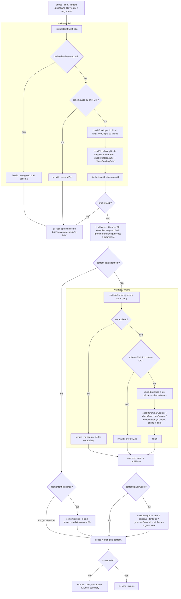

# Les validateurs (`validation/` et `validateLesson.ts`)

> Retour au [README](README.md). Fichiers expliqués :
> [`validateLesson.ts`](../../../../packages/shared/src/lessons/validateLesson.ts),
> [`validation/artifacts.ts`](../../../../packages/shared/src/lessons/validation/artifacts.ts),
> [`validation/issues.ts`](../../../../packages/shared/src/lessons/validation/issues.ts),
> [`validation/common.ts`](../../../../packages/shared/src/lessons/validation/common.ts),
> [`validation/vocabulary.ts`](../../../../packages/shared/src/lessons/validation/vocabulary.ts),
> [`validation/grammar.ts`](../../../../packages/shared/src/lessons/validation/grammar.ts),
> [`validation/grammarLength.ts`](../../../../packages/shared/src/lessons/validation/grammarLength.ts),
> [`validation/functions.ts`](../../../../packages/shared/src/lessons/validation/functions.ts),
> [`validation/reading.ts`](../../../../packages/shared/src/lessons/validation/reading.ts).

## 0. L'idée en une phrase

Le schéma vérifie la **forme** (« il y a bien un champ `ruleIds`, c'est une liste de textes »).
Le validateur vérifie le **sens** (« chaque `ruleId` désigne une règle qui existe »).

**Analogie.** Un contrôle de copie d'examen en deux temps :
1. **le schéma** = la secrétaire vérifie que la copie a un nom, des pages numérotées, rien d'illisible. Si la copie est illisible, elle la rend tout de suite.
2. **les vérifications** = le professeur lit et note **toutes** les fautes, pas seulement la première, pour que l'élève corrige tout en une fois.

---

## 1. `issues.ts` : comment on note les problèmes

Un problème = un **`Issue`** :

```ts
interface Issue { path: string; message: string; }
// { path: 'targets.3.examForms', message: '"livre" must include the indefinite article…' }
```

Le `path` est le **chemin** du champ dans le fichier : `targets.3.examForms` = le champ `examForms` du **4e** mot (on compte depuis 0).
Parfois un chemin nomme une étape par son stade (`steps.flashcards`) quand c'est plus facile à retrouver.

La classe **`Issues`** est un petit carnet qu'on remplit :

| Méthode | Ce qu'elle fait |
|---|---|
| `add(path, message)` | ajoute un problème |
| `check(ok, path, message)` | ajoute le problème **si `ok` est faux**, et **renvoie `ok`** |
| `unique(values, path, what)` | ajoute un problème par valeur vue deux fois : `duplicate target ID t2` |

Le fait que `check` renvoie `ok` permet d'enchaîner : « si cette vérification passe, alors fais les suivantes ».

```ts
if (issues.check(answer !== undefined, path, 'answerOptionId must be one of the options') && answer)
  // ici, on sait que la réponse existe
```

**Pourquoi ne pas lancer une exception ?** Une exception s'arrête au premier problème.
Ici, l'auteur (souvent un modèle de langue dans le kit d'auteur) reçoit **toute la liste** et corrige tout en un seul passage.

---

## 2. `common.ts` : les petits outils partagés

| Fonction | Entrée → sortie | Exemple |
|---|---|---|
| `sum(xs)` | liste de nombres → somme | `sum([60, 40]) = 100` |
| `sameSet(a, b)` | deux listes → mêmes valeurs, autant de fois, ordre libre ? | `sameSet(['a','b'], ['b','a']) = true` |
| `checkMinutes(min, sec, issues)` | ajoute un problème si `min ≠ max(1, round(sec / 60))` | 500 s → 8 min attendu |
| `CHARACTER_ONLY` | regex | détecte `"written with an é"` |
| `checkMarkNamed(text, path, issues)` | refuse une explication anglaise qui montre la lettre sans **nommer** l'accent | `"written with an é"` refusé ; il faut `"accent aigu"` |
| `checkExplanations(items, path, issues)` | `checkMarkNamed` sur chaque `answerExplanation` | |
| `checkRichText(text, path, issues)` | vérifie un long texte Markdown dans les 3 langues | voir dessous |

`sameSet` utilise `'\u0000'` comme séparateur pour le `join` : un caractère qui n'apparaît jamais dans un id,
ainsi `['a,b']` et `['a', 'b']` ne se confondent pas.

### `checkRichText` en détail

Pour un texte `{ en, fr, de }` en Markdown simple :

1. Chaque version passe dans `parseRichText` ; chaque erreur devient un problème (`… (restricted Markdown)`).
2. On compare chaque version à la **première** :
   - même **structure** (`richTextShape`, ex. `p|ul:6`) ;
   - mêmes **formes** entre backticks (`learningForms`, ex. `` `un livre` ``), car elles sont dans la langue apprise et ne se traduisent pas.

```
en: "These nouns are **masculine**: `un livre`."
de: "Diese Nomen sind **maskulin**: `un livre`."   ✓ même structure, même forme
de: "Diese Nomen sind **maskulin**: `ein Buch`."   ✗ learning-language forms differ from en
```

---

## 3. `artifacts.ts` : `validateBrief` et `validateContent`

### 3.1 Les types

| Type | Sens |
|---|---|
| `ArtifactStatus` | `'valid'` (aucun problème), `'invalid'` (au moins un), `'stale'` (aucun problème, mais écrit à partir d'une ancienne version du plan) |
| `ValidationResult<T>` | `{ status, value?, issues, staleReasons }` ; `value` = le fichier parsé, s'il a passé son schéma |
| `OutlineContext` | `{ entry, lang, level, outlineHash? }` : où la leçon doit se ranger |
| `ContentContext` | `OutlineContext` + `brief` (déjà validé) + `briefHash?` |

### 3.2 `validateBrief(data, ctx)`, dans l'ordre

1. `isSupportedKind(ctx.entry.kind)` ? Sinon : `"<kind> lessons have no agreed brief schema yet"`.
   (Le type vient de l'**entrée d'outline**, pas du fichier : on choisit le schéma selon ce qui est **prévu**.)
2. `briefSchema(kind, lang).safeParse(data)`. Si ça échoue : **on s'arrête**, statut `invalid`,
   chaque erreur Zod devient un `Issue` (son chemin est joint par des points).
3. `checkEnvelope` : `id`, `kind`, `lang`, `level` et `topic` (grammaire) ou `theme` (les autres) doivent **égaler l'outline**.
4. Les vérifications du type : `checkVocabularyBrief`, `checkGrammarBrief`, `checkReadingBrief` ou `checkFunctionsBrief`.
5. Périmé ? Si `ctx.outlineHash` est donné et différent de `provenance.inputHashes.outline` : raison `stale`.
6. `finish` : s'il y a des problèmes → `invalid` ; sinon `stale` ou `valid`.

### 3.3 `validateContent(data, ctx)`, dans l'ordre

1. Type supporté ? Sinon problème.
2. Type `vocabulary` ? → **refusé** : `"vocabulary lessons have no content file: the brief is the whole lesson"`.
3. `contentSchema(kind, lang).safeParse(data)`. Échec → on s'arrête.
4. `checkEnvelope` (comme pour le brief).
5. **Pour tous les types** :
   - ids d'étapes uniques, ids de pages uniques, ids d'items uniques (sur toute la leçon) ;
   - `checkMinutes` : `estimatedMinutes` = somme des `estimatedDurationS` de toutes les pages, en minutes arrondies.
6. Vérifications du type, **en comparant au brief** : `checkGrammarContent`, `checkFunctionsContent` ou `checkReadingContent`.
7. Périmé ? `outlineHash` et `briefHash` comparés à `provenance.inputHashes`.
8. `finish`.

Important : **le même carnet `issues`** est passé à toutes les étapes 4 à 6.
Donc une vérification de type qui dit « je m'arrête s'il y a déjà des problèmes » voit aussi les problèmes d'enveloppe (c'est le cas de la lecture, voir §7).

---

## 4. `validateLesson.ts` : le chef d'orchestre

C'est **la** fonction qu'appellent le seed, le kit d'auteur et les tests de l'API.

```ts
validateLesson(brief: unknown, content: unknown, ctx: OutlineContext): LessonValidation
// LessonValidation =
//   { ok: true, brief, content (null pour le vocabulaire), title, summary }
// | { ok: false, issues }
```

Ce qu'elle ajoute par-dessus `validateBrief` et `validateContent` :

- **les fichiers** : un fichier contenu est obligatoire pour tout sauf le vocabulaire ;
- **les règles de longueur de grammaire** (`grammarLength.ts`), que les deux validateurs laissent de côté exprès ;
- **ce que la base stocke** : le `title` du brief doit passer `LessonTitleSchema` (une ligne, ≤ 80), l'`objective[lang]` doit passer
  `LessonSummarySchema` (une ligne, ≤ 200). Seule la version dans la **langue du cours** est limitée à 200 ;
  les autres gardent la limite du schéma (300) ;
- **la cohérence brief ↔ contenu** : le contenu répète le `title` et l'`objective` du brief **mot pour mot**.

### 4.1 Comment les problèmes sont agrégés

- `inFile('brief', issues)` ajoute `brief.` devant chaque chemin ; `inFile('content', …)` ajoute `content.`.
  Un chemin vide devient juste `brief` ou `content`.
- **Si le brief est `invalid`** : on renvoie **seulement** ses problèmes. Sans brief valide, impossible de vérifier le contenu contre lui.
- Sinon on calcule deux listes, `briefIssues` (titre, résumé, longueur grammaire) et `contentIssues`, puis :
  `issues = [...brief…, ...content…]` → **le brief d'abord**.
- Un brief `stale` n'est **pas** bloquant : seul `status === 'invalid'` arrête (le seed ne passe d'ailleurs pas de hash).

### 4.2 Le chemin complet



### 4.3 Exemples réels de sorties (tirés de `validateLesson.test.ts`)

```
content: a functions lesson needs its content file, content/lessons/fr-ordering-at-a-cafe.json
brief.title: Too big: expected string to have <=80 characters
brief.title: must not contain line breaks or invisible characters
brief.objective.fr: Too big: expected string to have <=200 characters
content.title: must equal the brief's title
content.objective: must equal the brief's objective
content.steps.0.pages.0.estimatedDurationS: must be 40 s by FUNCTIONS_PAGE_RULES
brief.id: must equal the outline ID fr-asking-the-way
```

---

## 5. Vocabulaire : `checkVocabularyBrief`

C'est **la seule** vérification d'une leçon de vocabulaire (pas de fichier contenu). Elle regarde trois choses.

**a) Les listes**
- ids des mots uniques, ids des groupes uniques ;
- `targetCount` = nombre de mots ;
- chaque mot est dans **exactement un** groupe (`sameSet` des `targetIds` de tous les groupes et des ids des mots).

**b) Les formes de chaque mot** (`checkForms`)
- **Nom** :
  - langue à genre (fr, de) : au moins un genre, et seulement des genres de la langue (`fr` : masculin/féminin ; `de` : + neutre) ;
  - anglais : **aucun** genre (`en nouns have no gender`) ;
  - un nombre (`number` non nul) ;
  - fr / de sans `articleException` : `examForms`, `teachingForm` et `genderVariants` **commencent par le bon article** (`articleIssue`) ;
  - fr / de **avec** `articleException` : les `examForms` ne doivent **pas** avoir d'article (sinon l'exception est inutile) ;
  - anglais : `articleException` doit être `null` ;
  - `term` sans article (`"un livre"` refusé comme `term`).
- **Non-nom** : pas de genre, pas de nombre, pas d'`articleException`.
- **Tous** : `teachingForm` ∈ `examForms`, ou = `examForms.join(', ')` (cas de l'adjectif `"espagnol, espagnole"`).
  Idée : « ce qu'on montre est ce qu'on examine ».

**c) Les textes d'exercice** (`checkExerciseTexts`)
- `genderExplanation` présent **si et seulement si** nom avec genre ;
- `gap.referenceTargetIds` : 4 ids **distincts**, dont le mot lui-même, tous connus ;
- réponses du trou **sans article** (sauf `"un"` pour un nombre, `numeral`) ;
- **une seule** des 4 références peut remplir le trou (aucune réponse n'égale le `term` d'un autre mot) ;
- `listeningOptionTargetIds` : 4 distincts, dont le mot, tous connus ;
- explications : nommer l'accent (`checkMarkNamed`) ;
- `examPrompt` : si le mot a des `genderVariants` et un `examPrompt`, celui-ci doit **différer** de la 1re traduction dans **toutes** les langues
  (sinon la question ne dit pas quel genre on veut).
- `checkRichText` sur l'introduction de chaque groupe.
- `checkMatchingLabels` : sur chaque page d'association (calculée par `matchingPages`), deux mots ne montrent pas la même traduction.

**d) La durée** : **seulement si aucun problème jusque-là**, on fabrique la leçon avec `vocabularyLesson(b)` et on vérifie `estimatedMinutes`.
Pourquoi « seulement si » ? `vocabularyLesson` suppose un brief propre (il utilise `!` sur les ids) : sur un brief cassé, il planterait.

---

## 6. Grammaire : `checkGrammarBrief`, `checkGrammarContent`, `grammarLength.ts`

### 6.1 Le brief

- ids uniques : règles, blocs, exercices, pages d'examen ;
- chaque bloc cite des règles **connues** ; chaque exercice pratique des règles **de son bloc**
  (exception : un `grammar_person_matching` peut **réviser** une règle d'un bloc **précédent**) ;
- chaque règle est **enseignée** au moins une fois (`rule X is never taught`) ;
- `checkPronounFormTopic` : les 3 exercices « par personne » seulement pour `pronouns`, `verbs_morphology`, `verb_usage` ;
- si le topic est dans `PERSON_MATCHING_TOPICS[lang]` et la leçon pas exemptée : au moins un `grammar_person_matching` ;
- `newVerbs` : infinitifs uniques ;
- examen : règles connues, et **chaque règle examinée** (`the exam does not cover rule X`) ;
- `estimatedMinutes` = somme (explications + exercices + feedback + pages d'examen).

### 6.2 Le contenu suit le brief, étape par étape

`plannedSteps(brief)` fabrique la liste **attendue** des étapes :

```
pour chaque bloc : 1 étape explanation, puis 1 étape exercise par exercice prévu
puis : feedback, puis exam
```

1. Même **nombre** d'étapes que prévu, sinon on **arrête** (comparer case par case n'aurait pas de sens).
2. Pour chaque étape (`checkStep`) : bon `role` et bon `blockId` ;
   - `explanation` : que des `grammar_explanation`, avec des règles du bloc ;
   - `feedback` : exactement un `production_feedback_placeholder` ;
   - `exercise` : que des items du `type` prévu, exactement `itemCount` items, un tableau `person_matching` par page,
     et `checkRuleCoverage` (les items couvrent **exactement** les règles prévues : ni plus, ni moins).
3. Pages d'examen (`checkExamPage`) : la page est dans le plan, même `timeLimitS`, même type, même nombre d'items, règles couvertes.
   Les autres pages : `timeLimitS` doit être `null`.
4. Chaque item (`checkGrammarItem`) :
   - règles connues, `tokenId` uniques ;
   - `grammar_explanation` : `checkRichText` ;
   - `grammar_gap_choice` : ids et textes des choix uniques, la réponse est un des choix, **pas d'indice entre parenthèses** dans la phrase (il va dans `hint`) ;
   - `grammar_gap_typing` à l'examen : `hint` doit être `null` ;
   - `grammar_pronoun_form_match` : chaque ligne a au moins un token avec une forme valide ;
   - `grammar_word_order` : chaque ordre accepté utilise **chaque token une fois** ;
   - `grammar_person_matching` (`checkPersonMatching`) : personnes dans l'ordre (`1sg,2sg,3sg`, `1pl,2pl,3pl` ou les 6), mode cohérent,
     invites uniques ; **exception anglaise** : `you are` peut apparaître en 2sg et 2pl ;
   - `grammar_error_spotter` : le token fautif existe, la correction est différente du token fautif, mode `select` = 2 à 4 choix dont une bonne réponse, mode `type` = aucun choix.
5. Les pages d'examen = celles du plan (`sameSet`).
6. **Examen « frais »** (`checkFreshExam`) : aucune phrase d'examen ne répète un exemple ou une phrase d'entraînement.
   Les phrases sont comparées **réponse remplie**, en minuscules, sans ponctuation (`comparable`).

### 6.3 Les règles de longueur (`grammarLength.ts`)

Pourquoi à part ? Une leçon courte reste **correcte**. Mais on ne veut pas qu'elle arrive en base.
Donc `validateBrief`/`validateContent` ne les appellent pas ; **`validateLesson` les ajoute**.
Le test `rejects the short … grammar fixture by the length rules` montre le piège : les fixtures courtes passent les validateurs seuls, mais pas `validateLesson`.

| Fonction | Vérifie |
|---|---|
| `grammarBriefLengthIssues(b)` | ≥ 2 exercices par bloc ; 2 à 4 pages d'examen ; ≥ 22 unités prévues à l'entraînement, ≥ 10 à l'examen. Le brief n'a que `itemCount` : un exercice à lignes (`pronoun`/`person` dans le nom du type) compte **3 unités par item** (estimation). |
| `grammarContentLengthIssues(c)` | ≥ 22 / ≥ 10 unités **réellement comptées** (`unitCount` : nombre de lignes, 0 pour explication et feedback, sinon 1) ; page d'explication 45 à 240 s ; autre page : 6 à 40 s par unité |

---

## 7. Fonctions : `checkFunctionsBrief`, `checkFunctionsContent`

Outil clé : `plain(s)` met une phrase sous une forme comparable (minuscules, apostrophes normalisées, espaces normalisés, ponctuation finale enlevée).
`contains(text, part)` compare avec `plain`.

### 7.1 Le brief

- ids uniques **ensemble** (expressions + mots + rôles) ; textes d'expressions, formes de mots, libellés de rôles uniques ;
- une expression ne finit pas par `...` ou `…` (on met `openEnd: true`) ;
- l'exemple de chaque expression **contient** l'expression ; l'exemple de chaque mot contient le mot ;
- les mots suivent les règles du vocabulaire (genre, article dans `teachingForm`, `term` sans article) ;
- les 1res traductions sont uniques par langue (elles deviennent les étiquettes d'association).

### 7.2 Le contenu

`checkFunctionsContent` construit un petit objet `Lesson` (les ids du brief, des raccourcis `pages(stage)`, `items(stage)`, `only(...)`, `role(...)`, `expression(...)`),
puis :

1. `checkStages` : une étape par stade, dans l'ordre de `FUNCTIONS_STAGES`, `gender` seulement s'il y a des noms genrés, bon `role`.
   **Si ça échoue, on s'arrête** : impossible de chercher « la page de l'étape matching » si elle n'est pas à sa place.
2. `checkFlashcards` : une page avec tous les mots (s'il y en a), puis une page avec toutes les expressions.
3. `checkGender` : une page avec tous les noms, dans l'ordre du brief.
4. `checkModelDialogue` : un seul dialogue, rôles qui **alternent**, chaque ligne contient les expressions qu'elle cite, **toutes** les expressions utilisées.
5. `checkMatching` : expressions en pages équilibrées de 6 max (`chunk`), puis les mots sur leur page.
6. `checkWordOrders`, `checkDialogueGaps`, `checkListening` : **un item par page, un item par expression** ; rôles corrects ; 4 choix distincts incluant la réponse ; la bonne réponse contient l'expression.
7. `checkExam` : (page de traduction de tous les mots si mots) → pages de réponses (4 à 8 `word_order`, pages équilibrées de 4 max) → **une** page de dialogue à trous (3 à 10 trous).
   Chaque expression est examinée ; aucune phrase d'examen n'a été vue avant (`practiceSentences`) ; la traduction d'une ligne ne donne pas la réponse.
8. `checkPageTimes` : `estimatedDurationS` = `functionsPageEstimate(...)` **à la seconde près** ; `timeLimitS` = `round(estimation × 1.5)` à l'examen, `null` ailleurs.

---

## 8. Lecture : `checkReadingBrief`, `checkReadingContent`

### 8.1 Le brief

- ids et termes des mots clés uniques ; 1res traductions uniques par langue ;
- `targetWords` du document principal et de l'examen dans la fourchette du niveau (`READING_WORDS`) ;
- ids des questions de détail uniques ; types d'examen uniques.

### 8.2 Le contenu

1. `checkDocuments` : même `genre` que le brief ; un document `main` et un `exam` ; **vrai** nombre de mots dans la fourchette (`documentWords`) ;
   les surlignages existent dans le texte comme **mots entiers** (`highlightRanges`) ; chaque mot clé est surligné dans `main` ; aucun surlignage dans `exam`.
2. `checkSteps` : les 6 stades dans l'ordre, bon rôle ; les pages `skim`, `detail`, `structure`, `exam` montrent **un** document, **en premier**, dans la bonne vue (`VIEWS`) ; seule la vue `skim` a `skimSeconds`.
3. **Si un problème existe déjà, on s'arrête** (y compris un problème d'enveloppe ou de minutes, car le carnet est partagé).
4. `checkKeywordPages`, `checkSkim` (même `focus` que le brief), `checkDetail` (mêmes questions, même ordre, mêmes types), `checkStructure` (chaque ordre utilise chaque morceau une fois).
5. `checkExam` : 5 questions des types prévus ; **aucune** question ne répète une question de survol ou de détail ; le document d'examen ne recopie aucun paragraphe du principal.
6. `checkPageTimes` : durée = `readingPageEstimate(...)` ; compte à rebours = `1.5 × durée`, **arrondi au multiple de 5 supérieur** (`readingTimeLimit`).
7. `estimatedMinutes` du contenu = celui du brief.

---

## 9. Différences FR / DE / EN (PR #162)

Le prototype ne connaissait que le français. La PR #162 a rendu les règles dépendantes de la langue.
Presque tout passe par [`domain/articles.ts`](../../../../packages/shared/src/lessons/domain/articles.ts) et deux tables de `schemas/grammar.ts`.

| Règle | FR | DE | EN |
|---|---|---|---|
| Langues de traduction (`nativeLocales`) | `en`, `de` | `en`, `fr` | `fr`, `de` |
| Les noms ont un genre (`hasGender`) | oui | oui | **non** : `genders` doit être vide |
| Genres permis (`nounGenders`) | masculin, féminin | masculin, féminin, **neutre** | aucun |
| Article d'enseignement (`TEACHING_ARTICLES`) | indéfini `un` / `une` / `des` | défini `der` / `die` / `das`, pluriel `die` | **aucun** (`null`) |
| `articleException` | permis (pays, expression figée) | permis (ex. `Deutschland`) | doit être `null` |
| Articles interdits au début d'un `term` ou d'une réponse de trou (`STRIPPED_ARTICLES`) | `le, la, l', les, un, une, des` | `der, die, das, den, dem, des, ein, eine, einen, einem, einer, eines` | `a, an, the` |
| `person_matching` obligatoire pour | `pronouns`, `verbs_morphology` | `pronouns`, `verbs_morphology` | `pronouns` seulement |
| Leçons exemptées | `fr-imperative-mood` | `de-imperative-du-ihr`, `de-imperative-sie` | aucune |
| 2sg et 2pl identiques permis | non | non | **oui** (`you are`) |
| Étape « genre » en vocabulaire | si noms | si noms | jamais (aucun nom genré) |
| Consigne d'examen (`examInstruction`) | « … into French, with its article for nouns. » | « … into German, with its article for nouns. » | « … into English. » |

Exemples tirés des tests (`German and English courses` dans
[`validation/artifacts.test.ts`](../../../../packages/shared/src/lessons/validation/artifacts.test.ts)) :

```
de, "Tisch" en teachingForm   → "Tisch" must include the definite article der/die/das
de, "die Tisch"               → "die Tisch" uses "die" but a singular masculine noun takes der
de, réponse de trou "den Tisch" → typed-gap answer "den Tisch" must be article-free
fr, genre neuter              → fr nouns are masculine or feminine
en, nom avec un genre         → en nouns have no gender
```

Pourquoi l'article **indéfini** en français et **défini** en allemand ?
Le code le décide dans `TEACHING_ARTICLES`. Le commentaire de `articles.ts` renvoie à une décision `D39` pour le français,
mais cette décision n'est documentée nulle part ailleurs dans le dépôt.
Explication pédagogique possible (à dire comme **ton** raisonnement, elle n'est pas écrite dans le code) :
en français `le/la` devient `l'` devant une voyelle (`l'école`) et cache le genre, alors que `un/une` le montre toujours ;
en allemand, `der/die/das` montre directement les trois genres.

---

## 10. Les tests associés

| Fichier | Ce qu'il couvre |
|---|---|
| [`validateLesson.test.ts`](../../../../packages/shared/src/lessons/validateLesson.test.ts) | échantillons complets acceptés ; vocabulaire sans contenu ; contenu manquant ; règles de longueur ; titre 80 / résumé 200 ; brief d'abord ; textes nettoyés ; mauvaise entrée d'outline |
| [`validation/artifacts.test.ts`](../../../../packages/shared/src/lessons/validation/artifacts.test.ts) | vocabulaire et grammaire en détail, contrat multilingue, allemand et anglais, `stale` |
| [`validation/functions.test.ts`](../../../../packages/shared/src/lessons/validation/functions.test.ts) | fonctions : échantillon accepté, cas d'erreur, durées |
| [`validation/reading.test.ts`](../../../../packages/shared/src/lessons/validation/reading.test.ts) | lecture : échantillon, durées, compte des mots, surlignages en mots entiers, leçon max par niveau ≤ 15 min |
| [`domain/richText.test.ts`](../../../../packages/shared/src/lessons/domain/richText.test.ts) | Markdown simple : accepté et refusé |

Les tests lisent des fixtures dans `packages/shared/test/fixtures/` :
`samples/` (leçons complètes) et `content/` (leçons courtes, qui échouent exprès aux règles de longueur).
On **modifie** un fichier valide dans le test (on casse un champ) et on vérifie le message attendu.
