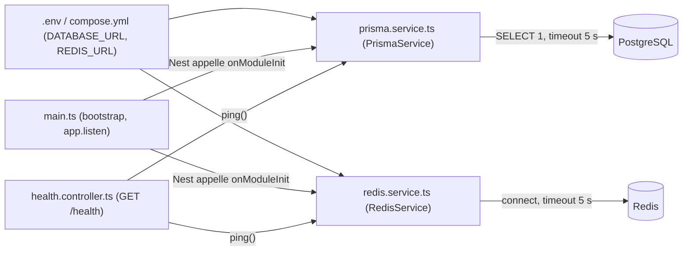
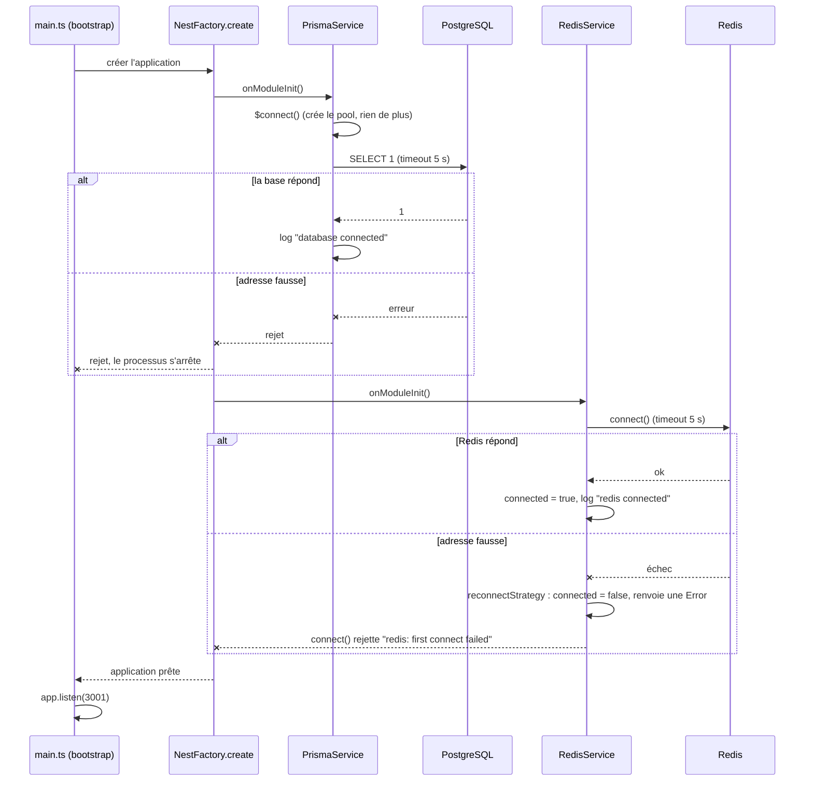
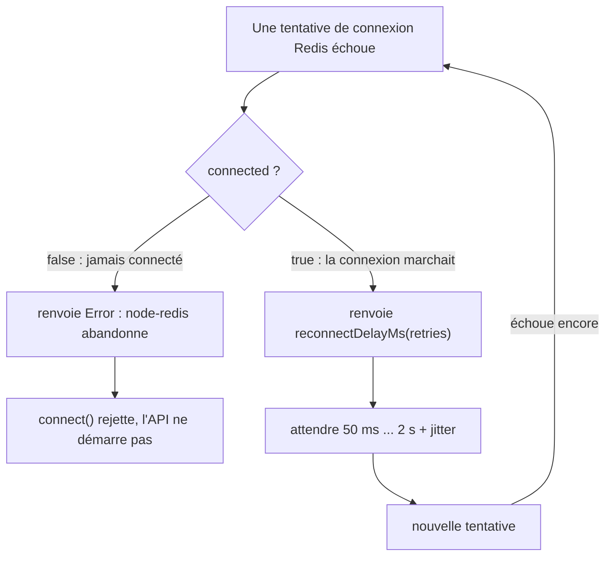

# Démarrage : refuser une mauvaise `DATABASE_URL` ou `REDIS_URL`

> PR concernée : **#222** (issue #221). Ce qui est à moi : le `SELECT 1` au démarrage et le délai de connexion dans `prisma.service.ts`, la stratégie de reconnexion dans `redis.service.ts`, les tests qui vont avec, et le nouveau commentaire de `health.controller.ts`.
> **Pas à moi** : `PrismaService`, `RedisService` et la route `/health` eux-mêmes. VictorBro les a écrits dans #3 (couche de persistance). Ma PR change seulement leur façon de démarrer.

## 1. À quoi ça sert

L'API a besoin de deux services pour marcher : **PostgreSQL** (la base de données) et **Redis** (les sessions, la présence, l'état du placement, les limites de la discussion). Elle trouve leur adresse dans deux variables d'environnement : `DATABASE_URL` et `REDIS_URL`.

Le but : **si une de ces adresses est fausse, l'API doit s'arrêter tout de suite au démarrage**, avec un message clair. Elle ne doit pas démarrer « à moitié » et échouer plus tard, sur la première requête d'un utilisateur.

Avant #222, ce n'était pas le cas, pour deux raisons différentes :

| Service | Ce qui se passait avec une mauvaise adresse | Pourquoi |
|---|---|---|
| PostgreSQL | L'API écrivait `database connected` et se mettait à écouter. La première vraie requête échouait. | Avec l'adaptateur `pg`, `$connect()` crée seulement un *pool* de connexions. Un pool n'ouvre aucune connexion avant sa première requête. Donc rien n'était vraiment testé. |
| Redis | L'API restait bloquée pour toujours, sans écouter et sans s'arrêter. | Le délai de 5 s arrêtait **une** tentative, mais la stratégie par défaut de `node-redis` réessaie sans fin. `connect()` ne finissait jamais. |

**Ma solution** :

- PostgreSQL : faire une vraie requête (`SELECT 1`) au démarrage, et limiter chaque nouvelle connexion à 5 s.
- Redis : une stratégie de reconnexion qui **abandonne si la première connexion échoue**, mais qui **continue de réessayer** si une connexion qui marchait se coupe plus tard.

### L'idée en une image

Avant d'ouvrir un magasin, on vérifie que le téléphone marche : on **appelle vraiment** le fournisseur.

- Avant #222, côté PostgreSQL, on regardait seulement que le téléphone était branché. Il pouvait être branché sur un mauvais numéro.
- Côté Redis, on rappelait le mauvais numéro **en boucle**, et le magasin n'ouvrait jamais.
- Maintenant : un vrai appel au démarrage. S'il échoue, on n'ouvre pas, et on dit pourquoi. Si la ligne coupe **plus tard**, en pleine journée, on rappelle jusqu'à ce que ça revienne.

### Mots techniques

| Mot | Explication simple |
|---|---|
| **Variable d'environnement** | Une valeur donnée au programme de l'extérieur (par Docker Compose, par le `.env`). Ici `DATABASE_URL` et `REDIS_URL`. |
| **`onModuleInit`** | Une méthode que NestJS appelle sur chaque service pendant le démarrage, avant que l'API écoute. Si elle lance une erreur, le démarrage échoue. |
| **Pool de connexions** | Un groupe de connexions ouvertes à l'avance et réutilisées. `pg.Pool` les ouvre seulement quand une requête en a besoin. |
| **Adaptateur (`PrismaPg`)** | Le morceau qui relie Prisma au pilote PostgreSQL `node-postgres` (`pg`). Notre client Prisma n'a pas de moteur à lui, l'adaptateur est obligatoire. |
| **Aller-retour (round-trip)** | Envoyer une requête et attendre la réponse. `SELECT 1` est la plus petite requête possible : elle prouve que la base répond. |
| **Délai de connexion (timeout)** | Le temps maximum qu'on attend pour ouvrir une connexion. Sans lui, un hôte qui ne répond pas fait attendre très longtemps. |
| **Stratégie de reconnexion** | Une fonction que `node-redis` appelle après chaque échec. Elle renvoie un **nombre** (attendre ce nombre de millisecondes puis réessayer) ou une **`Error`** (abandonner). |
| **Backoff exponentiel** | Attendre de plus en plus longtemps entre deux essais : 50 ms, 100 ms, 200 ms… jusqu'à un maximum. |
| **Jitter** | Un petit délai au hasard ajouté au backoff, pour que plusieurs clients ne réessaient pas tous au même moment. |
| **Healthcheck** | Une commande que Docker lance régulièrement pour savoir si un conteneur va bien. |

## 2. Les fichiers

| Fichier | Rôle | Auteur |
|---|---|---|
| [prisma.service.ts](../../../../apps/api/src/prisma/prisma.service.ts) | `PrismaService` : le seul client Prisma de l'API. #222 ajoute `DATABASE_CONNECT_TIMEOUT_MS` et le `SELECT 1` dans `onModuleInit`. | VictorBro (#3), démarrage : moi (#222) |
| [prisma.service.spec.ts](../../../../apps/api/src/prisma/prisma.service.spec.ts) | Tests de `PrismaService`. #222 ajoute : la requête part bien au démarrage, et le démarrage échoue sur un port fermé. | VictorBro (#3), moi (#222) |
| [redis.service.ts](../../../../apps/api/src/redis/redis.service.ts) | `RedisService` : la seule connexion Redis. #222 ajoute `REDIS_CONNECT_TIMEOUT_MS`, `reconnectDelayMs`, le drapeau `connected` et `reconnectStrategy`. | VictorBro (#3), moi (#195 et #222) |
| [redis.service.spec.ts](../../../../apps/api/src/redis/redis.service.spec.ts) | Tests de `RedisService`. #222 ajoute : échec sur un port fermé, abandon avant / reconnexion après la première connexion, bornes du backoff. | VictorBro (#3), moi (#222) |
| [health.controller.ts](../../../../apps/api/src/health/health.controller.ts) | La route `GET /health`. #222 change seulement le commentaire qui explique pourquoi elle répond toujours 200. | VictorBro (#3), commentaire : moi (#222) |
| [main.ts](../../../../apps/api/src/main.ts) | `bootstrap()` : `NestFactory.create`, puis `app.listen`. Pas modifié, mais c'est là que l'erreur remonte. | VictorBro |
| [compose.yml](../../../../compose.yml) | L'`api` attend que `db` et `redis` soient `service_healthy`. C'est ce qui rend la règle « premier échec = mauvaise adresse » juste. | équipe |

### Diagramme des fichiers et dépendances



## 3. Le code, morceau par morceau

> Les extraits sont raccourcis : `// ...` marque ce qui est coupé, et les commentaires en français sont des explications ajoutées ici. Le code exact est dans le fichier lié.

### 3.1 PostgreSQL : une vraie requête au démarrage

```ts
/** Per new connection. Postgres on the compose network answers in milliseconds. */
export const DATABASE_CONNECT_TIMEOUT_MS = 5_000;

// ...
    super({
      adapter: new PrismaPg({
        connectionString: requireDatabaseUrl(),
        connectionTimeoutMillis: DATABASE_CONNECT_TIMEOUT_MS,
      }),
    });
```

- `requireDatabaseUrl()` existait déjà (VictorBro) : si `DATABASE_URL` est vide, l'API s'arrête avec `DATABASE_URL is unset: the api cannot start. See .env.example.`
- `connectionTimeoutMillis` est nouveau. Par défaut, `node-postgres` attend **sans limite** une connexion. Un hôte qui ne répond pas du tout (les paquets se perdent) ferait donc attendre le démarrage jusqu'à ce que le système abandonne. Avec 5 s, l'erreur arrive vite.

```ts
  async onModuleInit(): Promise<void> {
    await this.$connect();
    await this.$queryRaw`SELECT 1`;
    this.logger.log('database connected');
  }
```

- `$connect()` seul ne prouve rien : avec l'adaptateur `pg`, il construit le pool et c'est tout.
- `$queryRaw\`SELECT 1\`` est l'aller-retour qui ouvre vraiment une connexion. Si l'adresse est fausse, cette ligne lance une erreur.
- L'erreur sort de `onModuleInit`, donc de `NestFactory.create` dans `main.ts`. `bootstrap()` est appelée avec `void bootstrap()`, donc la promesse rejetée n'est attrapée par personne. Node arrête alors le processus avec une erreur. L'API ne passe jamais par `app.listen`.
- Le log `database connected` est maintenant **vrai** : il n'est écrit qu'après une réponse de la base.

### 3.2 Redis : abandonner avant la première connexion, réessayer après

```ts
/** Per connection attempt. Redis on the compose network answers in milliseconds. */
export const REDIS_CONNECT_TIMEOUT_MS = 5_000;

export function reconnectDelayMs(retries: number): number {
  return Math.min(2 ** retries * 50, 2_000) + Math.floor(Math.random() * 200);
}
```

- `reconnectDelayMs` recopie le comportement par défaut de `node-redis`, parce qu'une stratégie à nous **remplace** celle par défaut. Délai : `2^retries × 50 ms` (50, 100, 200, 400…), plafonné à 2 000 ms, plus 0 à 199 ms de jitter.

```ts
  /** Set once the first connect succeeds. Before it, a failure is a bad setup. */
  private connected = false;

  // ...
      socket: {
        connectTimeout: REDIS_CONNECT_TIMEOUT_MS,
        reconnectStrategy: (retries, cause) =>
          this.connected
            ? reconnectDelayMs(retries)
            : new Error(`redis: first connect failed: ${cause.message}`),
      },
```

- `connectTimeout` (5 s) borne **une** tentative.
- `reconnectStrategy` décide quoi faire après un échec :
  - `connected` est `false` : on n'a encore jamais réussi. On renvoie une `Error`, donc `node-redis` abandonne et `connect()` rejette avec `redis: first connect failed: ...`.
  - `connected` est `true` : la connexion marchait et s'est coupée. C'est une panne, pas une mauvaise config. On renvoie un délai, et le client réessaie.

```ts
  async onModuleInit(): Promise<void> {
    await this.client.connect();
    this.connected = true;
    this.logger.log('redis connected');
  }
```

- `connected` passe à `true` seulement **après** la première connexion réussie.

**Pourquoi « premier échec = mauvaise adresse » est juste** : dans [compose.yml](../../../../compose.yml), l'`api` a `depends_on` avec `condition: service_healthy` pour `db` et `redis`. Compose ne démarre donc l'API que quand Redis répond déjà à son healthcheck. Si la première connexion échoue quand même, c'est que l'adresse ne pointe pas au bon endroit.

### 3.3 Le commentaire de `/health`

La route `GET /health` répond **toujours 200**, même quand une dépendance est en panne : le verdict est dans le corps de la réponse. L'ancien commentaire disait qu'un code non-2xx ferait redémarrer le conteneur par Docker. C'est faux : **Docker ne redémarre jamais un conteneur « unhealthy »**. Le nouveau commentaire donne la vraie raison : un non-2xx marquerait seulement l'API comme malade pendant une panne de la base, et ferait échouer `docker compose up --wait`, alors que ce n'est pas la faute de l'API. Une mauvaise adresse, elle, arrête déjà l'API au démarrage.

## 4. Le chemin d'exécution



### La décision de `reconnectStrategy`



## 5. Un exemple concret pas à pas

Quelqu'un met `REDIS_URL=redis://redis:6380` dans son `.env` (mauvais port, Redis écoute sur 6379).

1. `docker compose up` démarre `db` et `redis`, attend qu'ils soient `healthy`, puis démarre `api`.
2. Nest construit `RedisService` : `requireRedisUrl()` trouve bien une valeur, donc pas d'erreur ici.
3. `PrismaService.onModuleInit()` : `SELECT 1` répond, log `database connected`.
4. `RedisService.onModuleInit()` appelle `connect()`. Le port 6380 refuse la connexion.
5. `node-redis` appelle `reconnectStrategy(0, cause)`. `connected` vaut `false`, donc elle renvoie `Error('redis: first connect failed: ...')` avec le message de la cause (le refus de connexion).
6. `connect()` rejette. Le listener `'error'` écrit l'échec dans les logs (`redis: ...`).
7. Le rejet remonte jusqu'à `bootstrap()`. Node s'arrête. Le conteneur `api` sort en erreur, et les logs disent exactement quoi chercher.

Avant #222, l'étape 5 renvoyait un délai, puis encore un, sans fin : l'API restait bloquée avant `app.listen`, sans aucun message utile.

## 6. Les tests

| Fichier | Test ajouté par #222 | Ce qu'il vérifie |
|---|---|---|
| [prisma.service.spec.ts](../../../../apps/api/src/prisma/prisma.service.spec.ts) | `reaches the database during bootstrap rather than on the first query` | `onModuleInit` appelle bien `$queryRaw` une fois. |
| | `fails the start when DATABASE_URL points at nothing` | **Sans mock** : un vrai pool vers un port fermé. `onModuleInit()` doit rejeter. |
| [redis.service.spec.ts](../../../../apps/api/src/redis/redis.service.spec.ts) | `fails the start when REDIS_URL points at nothing` | **Sans mock** : un vrai client vers un port fermé. `onModuleInit()` doit rejeter avec `first connect failed`. |
| | `gives up before the first connect, then keeps reconnecting after it` | La stratégie renvoie une `Error` avant `onModuleInit`, puis un nombre après. |
| | `backs off from 50 ms up to 2 s, with under 200 ms of jitter` | `reconnectDelayMs(0)` est entre 50 et 249, `reconnectDelayMs(20)` entre 2 000 et 2 199. |

Le « port fermé » vient de `closedPort()` : on ouvre un serveur TCP sur le port `0` (le système choisit un port libre), on note le port, puis on ferme le serveur. Plus rien n'écoute dessus, donc toute connexion est refusée.

Lancer les tests :

```sh
pnpm --filter @ft/api exec vitest run src/prisma/prisma.service.spec.ts src/redis/redis.service.spec.ts   # ces deux fichiers (18 tests)
make test                                                    # tous les tests unitaires du repo
```

## 7. Les concepts à savoir expliquer

- **Cycle de vie NestJS** : `onModuleInit` est appelé pendant `NestFactory.create`, avant `app.listen`. Une erreur à cet endroit empêche l'API d'écouter.
- **Promesse non attrapée** : `void bootstrap()` ne gère pas le rejet. Depuis Node 15, une promesse rejetée sans `catch` arrête le processus. C'est ce qu'on veut ici.
- **Pool de connexions paresseux** : créer un pool ne prouve pas que la base est joignable. Seule une requête le prouve.
- **Refus contre silence** : un port fermé **refuse** tout de suite. Un hôte qui laisse tomber les paquets ne répond **jamais**. C'est pour ce deuxième cas qu'il faut un délai.
- **Échouer tôt (fail fast)** : une erreur de configuration doit casser le démarrage, pas la première requête d'un utilisateur.
- **Backoff exponentiel avec jitter** : pourquoi on attend de plus en plus, et pourquoi on ajoute du hasard.
- **Healthcheck Docker et `depends_on: service_healthy`** : Compose attend les dépendances, mais Docker ne redémarre pas un conteneur malade.

## 8. Questions possibles à l'oral

1. **Pourquoi `$connect()` ne suffit pas ?**
   Avec l'adaptateur `pg`, il crée seulement un `pg.Pool`. Le pool n'ouvre une connexion qu'à la première requête. `SELECT 1` est cette première requête.

2. **Pourquoi `SELECT 1` et pas une vraie requête sur une table ?**
   C'est la requête la plus simple : elle ne dépend d'aucune table ni d'aucune migration. Elle teste seulement que la base répond.

3. **Que se passe-t-il exactement quand le `SELECT 1` échoue ?**
   `onModuleInit` rejette, donc `NestFactory.create` rejette, donc `bootstrap()` rejette. Personne n'attrape cette promesse, donc Node arrête le processus. `app.listen` n'est jamais appelé.

4. **Pourquoi un délai de 5 s sur PostgreSQL ?**
   Par défaut, `node-postgres` attend sans limite. Si l'hôte laisse tomber les paquets au lieu de refuser, le démarrage resterait bloqué longtemps. Sur le réseau Compose, la base répond en quelques millisecondes : 5 s laisse beaucoup de marge.

5. **Pourquoi ne pas simplement abandonner Redis à chaque échec ?**
   Parce qu'après le démarrage, une coupure est une panne passagère (Redis redémarre, le réseau saute). Là, il faut se reconnecter tout seul. On abandonne seulement si on n'a **jamais** réussi.

6. **Comment sait-on qu'un premier échec est une mauvaise adresse et pas Redis qui démarre lentement ?**
   Compose démarre l'API seulement quand Redis est `service_healthy`. Donc au moment du premier `connect()`, Redis répond déjà. Si on n'arrive pas à le joindre, l'adresse est fausse.

7. **Pourquoi recopier le backoff par défaut dans `reconnectDelayMs` ?**
   Dès qu'on donne une `reconnectStrategy`, elle remplace celle de `node-redis`. Pour garder le même comportement après la première connexion, il faut le réécrire nous-mêmes.

8. **À quoi sert le jitter ?**
   Si plusieurs clients perdent Redis au même moment, sans jitter ils réessaient tous au même instant et le surchargent. Le hasard les étale.

9. **Pourquoi `/health` répond toujours 200, même si la base est en panne ?**
   Le healthcheck de l'image demande seulement « l'API répond-elle ? ». Docker ne redémarre pas un conteneur malade, donc un 503 ne réparerait rien. Il marquerait juste l'API malade pendant une panne de la base et ferait échouer `docker compose up --wait`. L'état de la base et de Redis est dans le corps de la réponse.

10. **Pourquoi les tests utilisent-ils un vrai port fermé au lieu d'un mock ?**
    Le bug venait justement du comportement réel des bibliothèques (`pg.Pool` paresseux, stratégie de `node-redis` qui réessaie sans fin). Un mock aurait caché ce comportement. Avec un vrai port fermé, le test aurait échoué avant #222.
