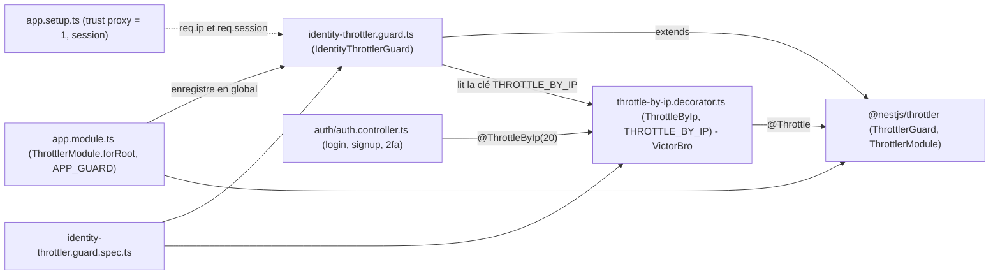
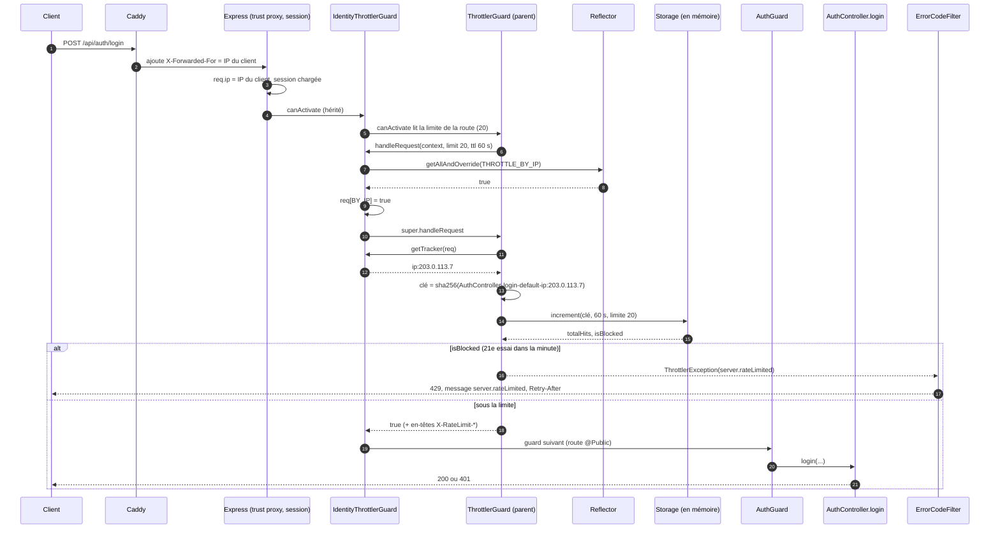
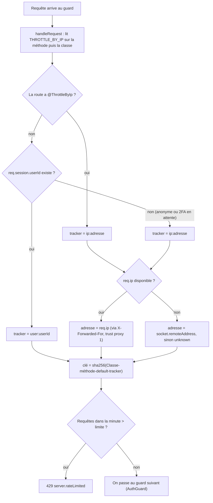

# Rate limiting : `IdentityThrottlerGuard`

> PR concernée : **#20**. Fichiers à moi : `identity-throttler.guard.ts` et son test. VictorBro les a retouchés dans sa PR #21 (commit `e276814`) : le guard lit maintenant sa métadonnée `THROTTLE_BY_IP` au lieu de « la route fixe sa propre limite ».
> **Pas à moi** : [throttle-by-ip.decorator.ts](../../../../apps/api/src/throttler/throttle-by-ip.decorator.ts) (`@ThrottleByIp`), écrit par VictorBro dans sa PR #21, fusionnée dans ma #20. C'est pour ça qu'il apparaît à mon nom dans Git.
> Vue d'ensemble de la requête : [../lessons-api/request-lifecycle.md](../lessons-api/request-lifecycle.md).

## 1. À quoi ça sert

Le **rate limiting** (limitation de débit) empêche un même appelant d'envoyer trop de requêtes. Chez nous : **100 requêtes par minute et par route** pour un appelant, et moins sur les routes sensibles (login : 20, inscription : 20). Ce sont les valeurs par défaut de [rate-limits.ts](../../../../apps/api/src/throttler/rate-limits.ts) ; le `.env` peut les changer (`RATE_LIMIT_PER_MINUTE`, `LOGIN_LIMIT_PER_MINUTE`, `SIGNUP_LIMIT_PER_MINUTE`).

La vraie question est : **qui est « un appelant » ?**

- Le guard standard de `@nestjs/throttler` compte par **adresse IP** (`req.ip`).
- Mais chez nous, **personne n'arrive avec sa vraie IP** : Caddy (le reverse proxy) transmet le trafic du navigateur, et Next.js appelle l'API depuis le conteneur `web` à chaque rendu serveur. Tout arrive avec une adresse de conteneur.
- Résultat avant #20 : toute la plateforme partageait **un seul compteur**. Le 101ᵉ visiteur de la minute était refusé, même s'il n'avait rien fait.

**Ma solution** : `IdentityThrottlerGuard` compte par **identité** :

| Situation | Clé (le « tracker ») |
|---|---|
| Utilisateur connecté | `user:<userId>` |
| Visiteur anonyme | `ip:<adresse du client transmise par Caddy>` |
| Route marquée `@ThrottleByIp` (login, 2FA…) | `ip:<adresse>`, **même si connecté** |

### Mots techniques

| Mot | Explication simple |
|---|---|
| **Guard** | Un vigile Nest. Sa méthode `canActivate` renvoie `true` (on passe) ou lance une exception (on bloque). |
| **Guard global** | Un guard appliqué à **toutes** les routes. Ici via `{ provide: APP_GUARD, useClass: IdentityThrottlerGuard }` dans [app.module.ts](../../../../apps/api/src/app.module.ts). |
| **Tracker** | La chaîne qui dit « à qui appartient ce compteur ». Le guard standard utilise `req.ip`. |
| **ttl** (time to live) | La fenêtre de temps : 60 000 ms = 1 minute. |
| **limit** | Le nombre maximum de requêtes dans la fenêtre. |
| **Storage** | Là où les compteurs sont gardés. Ici le stockage par défaut de `@nestjs/throttler` (en mémoire du processus). |
| **Reflector** | Un outil Nest pour lire les **métadonnées** posées par les décorateurs (ex. « cette route a `@ThrottleByIp` »). |
| **Décorateur** | Une annotation `@Quelquechose` au-dessus d'une classe ou méthode. Elle attache des informations que Nest lit ensuite. |
| **`trust proxy`** | Réglage Express. Avec la valeur `1`, Express fait confiance à **un** proxy (Caddy) et lit l'IP du client dans `X-Forwarded-For`. |
| **Héritage / `override`** | `IdentityThrottlerGuard extends ThrottlerGuard` : on reprend tout le guard standard et on remplace seulement deux méthodes. |

## 2. Les fichiers

| Fichier | Rôle | Auteur |
|---|---|---|
| [identity-throttler.guard.ts](../../../../apps/api/src/throttler/identity-throttler.guard.ts) | Le guard. Remplace `getTracker` (qui compter) et `handleRequest` (lire `@ThrottleByIp`). | moi (#20), retouché par VictorBro (#21) |
| [identity-throttler.guard.spec.ts](../../../../apps/api/src/throttler/identity-throttler.guard.spec.ts) | Tests unitaires : 5 sur `getTracker`, 7 sur `canActivate`, avec de vrais décorateurs et un vrai `Reflector`. | moi (#20), retouché par VictorBro (#21) |
| [throttle-by-ip.decorator.ts](../../../../apps/api/src/throttler/throttle-by-ip.decorator.ts) | `@ThrottleByIp(limit, ttl)` : pose une limite **et** la métadonnée `throttle:by-ip`. | VictorBro (#21) |
| [throttler-storage.spec.ts](../../../../apps/api/src/throttler/throttler-storage.spec.ts) | Test du stockage des compteurs. | bastian-schnitzler (#192) |
| [rate-limits.ts](../../../../apps/api/src/throttler/rate-limits.ts) | `RATE_LIMITS` : `perAccount` (100), `signup` (20), `login` (20), lus une fois dans le `.env` au démarrage. Une valeur qui n'est pas un entier positif arrête l'API. | VictorBro (#198) |
| [app.module.ts](../../../../apps/api/src/app.module.ts) | `ThrottlerModule.forRoot({ throttlers: [{ ttl: 60_000, limit: RATE_LIMITS.perAccount }], errorMessage: 'server.rateLimited' })` + enregistrement global du guard. | équipe (#20, #126, #198) |
| [app.setup.ts](../../../../apps/api/src/app.setup.ts) | `set('trust proxy', 1)` : sans ça, `req.ip` serait l'adresse de Caddy. | équipe |
| [auth.controller.ts](../../../../apps/api/src/auth/auth.controller.ts) | Utilise `@ThrottleByIp` : `signup` (`RATE_LIMITS.signup`, 20), et `RATE_LIMITS.login` (20) sur `login`, `2fa/verify`, `2fa/enable` et `DELETE 2fa`. | équipe |

### Diagramme des fichiers et dépendances



## 3. Le code, morceau par morceau

### 3.1 `getTracker` : qui compte-t-on ?

```ts
protected override async getTracker(req: Request): Promise<string> {
  // Checked before the session: a route guarding a secret must count every
  // attempt from one machine against one budget, whoever is signed in.
  if ((req as TrackedRequest)[BY_IP] === true) {
    return `ip:${this.clientAddress(req)}`;
  }

  // saveUninitialized is false, so an anonymous visitor carries no session.
  const userId = req.session?.userId;
  return userId === undefined ? `ip:${this.clientAddress(req)}` : `user:${userId}`;
}
```

- **Route `@ThrottleByIp`** → par IP, même si l'utilisateur est connecté.
- Sinon, **connecté** → `user:<id>`. **Anonyme** → `ip:<adresse>`.
- Une session de login à moitié finie (2FA en attente, `pendingUserId` mais pas de `userId`) compte comme **anonyme** (un test le vérifie).
- **Pourquoi l'id du compte et pas l'id de session ?** À la connexion, `regenerate()` crée une nouvelle session pour le même utilisateur. Avec l'id de session, il suffirait de se reconnecter pour remettre son compteur à zéro.

### 3.2 `clientAddress` : quelle IP ?

```ts
return req.ip ?? req.socket.remoteAddress ?? 'unknown';
```

Avec `trust proxy = 1`, Express ignore un saut de proxy et prend l'adresse la plus à droite de `X-Forwarded-For` : celle que Caddy a notée. Ce header peut être falsifié en général, mais ici Caddy est **la seule entrée** et le réécrit. Si rien n'est disponible : `'unknown'` (on a toujours une clé).

### 3.3 `handleRequest` : lire `@ThrottleByIp`

```ts
protected override async handleRequest(request: ThrottlerRequest): Promise<boolean> {
  const { context } = request;

  // Assigned on every pass rather than only when true. handleRequest runs
  // once per configured throttler, and a flag that is only ever set would
  // leak from one throttler to the next within a single request.
  (this.getRequestResponse(context).req as TrackedRequest)[BY_IP] =
    this.reflector.getAllAndOverride<boolean>(THROTTLE_BY_IP, [
      context.getHandler(),
      context.getClass(),
    ]) ?? false;

  return super.handleRequest(request);
}
```

**Le problème** : `getTracker(req)` reçoit seulement la requête. Il ne sait pas quelle route est appelée, donc il ne peut pas lire le décorateur. **La solution** : `handleRequest` a le `context` (la route). Il lit la métadonnée avec le `Reflector`, la **range sur la requête** sous une clé `Symbol`, puis appelle le guard standard, qui appellera `getTracker`.

- **Pourquoi un `Symbol` ?** Une clé unique, qui ne peut pas entrer en collision avec un champ qu'Express met sur `req`.
- **Pourquoi assigner à chaque passage (`?? false`) et pas seulement quand c'est vrai ?** `handleRequest` est appelé une fois par throttler configuré. Un drapeau posé seulement à `true` pourrait « fuir » d'un throttler au suivant dans la même requête.

### 3.4 La clé finale et la limite

Le `ThrottlerGuard` standard fait le reste :

1. Il lit la limite de la route (`@Throttle` / `@ThrottleByIp`) ou prend la limite globale (100).
2. `generateKey(context, tracker, 'default')` = `sha256("<Classe>-<méthode>-default-<tracker>")`. **La route fait partie de la clé** : le quota est **par route**.
3. `storage.increment(clé, ttl, limit, …)` → nombre de requêtes et `isBlocked`.
4. Bloqué → en-tête `Retry-After` puis `ThrottlerException` (429). Sinon → en-têtes `X-RateLimit-Limit`, `X-RateLimit-Remaining`, `X-RateLimit-Reset`, et on passe.

Le message du 429 est `server.rateLimited` (option `errorMessage` dans `app.module.ts`), un code de `ERROR_CODES` : voir [../error-codes/README.md](../error-codes/README.md).

## 4. Diagrammes

### 4.1 Séquence : `POST /api/auth/login` (route `@ThrottleByIp(20)`)



### 4.2 Décision : quel tracker ?



## 5. Que se passe-t-il concrètement ?

**Scénario A — deux utilisateurs derrière la même adresse.** Alice et Bob sont connectés. Toutes leurs requêtes arrivent depuis le conteneur Next.js `172.18.0.5`.

1. Alice appelle `GET /api/courses/fr/today`. Pas de `@ThrottleByIp`. `userId = u1` → tracker `user:u1`.
2. Bob appelle la même route. Tracker `user:u2`.
3. Clés différentes → deux compteurs. Si Alice fait 100 requêtes, Bob n'est pas bloqué. Avant #20, les deux auraient eu la clé `172.18.0.5` et partagé les 100 requêtes.

**Scénario B — un attaquant avec plusieurs comptes.** Il essaie de deviner un code 2FA sur `POST /api/auth/2fa/enable` (`@ThrottleByIp(20)`), avec 10 comptes.

1. Par compte, il aurait 20 × 10 = 200 essais par minute.
2. Mais la route a `@ThrottleByIp` : la clé est `ip:<son adresse>`, quel que soit le compte.
3. Au 21ᵉ essai de la minute depuis sa machine → `429 server.rateLimited`.

**Scénario C — une route qui fixe seulement une limite.** `friends.controller.ts` utilise `@Throttle({ default: { limit: 10, ttl: 60_000 } })`, **sans** `@ThrottleByIp`. Le comptage reste **par compte** (limite 10). Choisir l'IP doit être explicite, pour ne pas mettre tous les utilisateurs d'un même réseau (NAT) dans un seul compteur.

## 6. Les tests (`identity-throttler.guard.spec.ts`)

Ils utilisent de **vrais** décorateurs (`@ThrottleByIp`, `@Throttle`) sur une classe `RouteFixture` et un **vrai** `Reflector`. Un faux `Reflector` répondrait n'importe quoi et ne détecterait pas une clé de métadonnée mal écrite. Seul le `storage` est simulé (`vi.fn()`), pour lire la **clé** qu'on lui demande d'incrémenter.

| Test | Prouve |
|---|---|
| connecté → `user:u1` | on ne compte pas l'IP du conteneur |
| deux utilisateurs, même IP → clés différentes | pas de compteur partagé |
| sans session → `ip:203.0.113.7` | repli sur l'adresse |
| session sans `userId` → par IP | une 2FA en attente n'est pas encore un compte |
| pas d'adresse → `ip:unknown` | toujours une clé |
| `canActivate`, route normale → clé de `user:u1` | le tracker est bien branché |
| `canActivate`, anonyme → clé de l'IP | idem |
| deux utilisateurs, même route → deux clés | idem, sur la vraie clé |
| route `@ThrottleByIp`, connecté → clé de l'IP | **la régression importante** (sinon 5 devient 5 × N comptes) |
| route `@ThrottleByIp` → limite 5 | la limite de la route est gardée |
| route `@Throttle` seul → par compte | choisir l'IP est explicite |
| route sans décorateur → limite 100 | la limite globale s'applique |

Les tests e2e de [error-codes.e2e-spec.ts](../../../../apps/api/test/error-codes.e2e-spec.ts) vérifient aussi le vrai 429 : 21ᵉ login et 21ᵉ inscription dans la minute depuis la même adresse.

## 7. Questions possibles à l'oral

**Q : Pourquoi ne pas garder le guard par défaut (par IP) ?**

R : Toutes les requêtes arrivent depuis Caddy ou le conteneur Next.js. Par IP, toute la plateforme partageait un seul compteur de 100 par minute.

**Q : Pourquoi l'id utilisateur et pas l'id de session ?**

R : À la connexion, la session est régénérée. Avec l'id de session, se reconnecter remettrait le compteur à zéro.

**Q : Pourquoi certaines routes restent par IP ?**

R : Elles vérifient un secret (mot de passe, code 2FA). Un attaquant peut créer plusieurs comptes ; par compte, une limite de 20 deviendrait 20 × N. Par IP, c'est 20 pour sa machine.

**Q : Pourquoi `handleRequest` en plus de `getTracker` ?**

R : `getTracker` ne reçoit que la requête, pas la route. `handleRequest` a le contexte : il lit le décorateur avec le `Reflector` et pose un drapeau sur la requête pour `getTracker`.

**Q : L'IP peut être falsifiée avec `X-Forwarded-For`, non ?**

R : En général oui. Ici, `trust proxy = 1` fait confiance à un seul saut, et Caddy est la seule entrée : il réécrit ce header. On lit donc l'adresse que Caddy a vue.

**Q : La limite est globale ou par route ?**

R : Par route : la clé contient le nom de la classe et de la méthode. 100 requêtes par minute sur chaque route, pour chaque appelant.

**Q : Que voit l'utilisateur quand il est bloqué ?**

R : Un 429 avec `message: "server.rateLimited"`. Le front affiche « Trop de tentatives. Nouvel essai possible dans une minute ».

**Q : Qui a écrit `@ThrottleByIp` ?**

R : VictorBro, dans sa PR #21 fusionnée dans ma #20. Moi, j'ai écrit le guard et ses tests ; dans la même PR #21, VictorBro les a adaptés pour que le guard lise sa métadonnée `THROTTLE_BY_IP`.

**Q : Le throttler passe avant ou après l'authentification ?**

R : Avant (il est déclaré dans `AppModule`, scanné en premier par Nest ; `AuthGuard` est dans `AuthModule`). Un anonyme qui inonde est donc compté sur son IP. *(Déduit de l'ordre d'enregistrement de Nest, pas testé explicitement.)*

**Q : Où sont stockés les compteurs ?**

R : Dans le stockage par défaut de `@nestjs/throttler`, en mémoire du processus API (aucun `storage` n'est passé à `ThrottlerModule.forRoot`). Avec plusieurs instances de l'API, chacune aurait ses propres compteurs.
