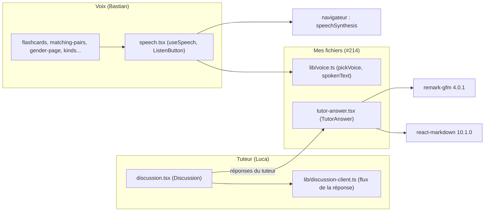
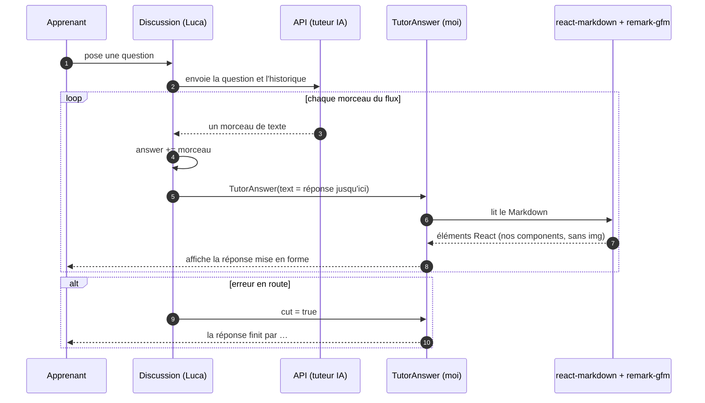
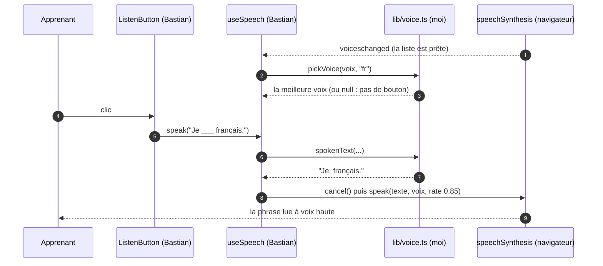
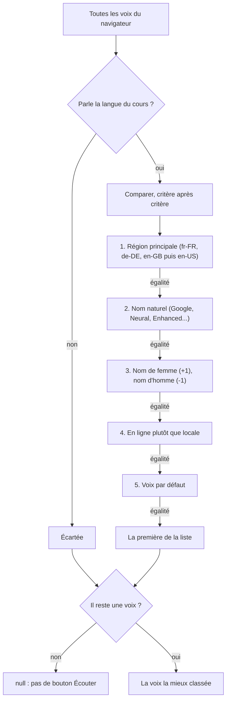
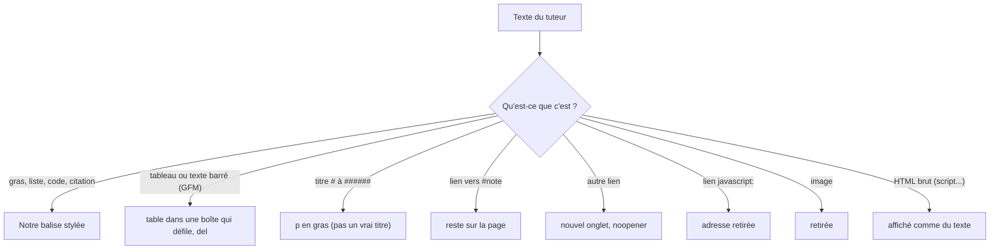

# Le tuteur en Markdown et la voix « Écouter » : `tutor-answer.tsx` et `lib/voice.ts`

> PR concernée : **#214** « fix(web): #213 render the tutor's Markdown and pick a natural Listen voice » (squash `6c67ad2`). Les 3 commits d'origine (`refs/pr/214`) sont à mon nom (VYAntares).
> **À moi** (créés dans #214) : [tutor-answer.tsx](../../../../apps/web/components/lesson/tutor-answer.tsx), [tutor-answer.test.tsx](../../../../apps/web/components/lesson/tutor-answer.test.tsx), [lib/voice.ts](../../../../apps/web/lib/voice.ts), [lib/voice.test.ts](../../../../apps/web/lib/voice.test.ts), et les deux dépendances `react-markdown` et `remark-gfm` dans [apps/web/package.json](../../../../apps/web/package.json).
> **Pas à moi, retouché par moi** : [discussion.tsx](../../../../apps/web/components/lesson/discussion.tsx), la fenêtre du tuteur de **Luca** (luca-mattei, #201 pour le flux de réponse, #205 pour la fenêtre) ; [speech.tsx](../../../../apps/web/components/lesson/speech.tsx), la lecture à voix haute de **Bastian** (bastian-schnitzler, #197). J'y ai changé une quinzaine de lignes chacun.
> Le lecteur de leçon en entier (en anglais) : [docs/web/07-lesson-player.md](../../../web/07-lesson-player.md). Ma leçon de lecture : [../reading-lesson/README.md](../reading-lesson/README.md).

## 1. À quoi ça sert

L'issue #213 avait deux problèmes, tous les deux dans le lecteur de leçon.

**Problème 1 : le tuteur affichait des étoiles et des dièses.** Pendant une leçon, l'apprenant peut poser des questions à un tuteur (une IA, par exemple Gemini). Le tuteur répond en **Markdown** : `**gras**`, `### titre`, `* liste`. La fenêtre de Luca affichait ce texte tel quel. L'apprenant voyait donc les `*` et les `#`.

**Ma solution** : `TutorAnswer` transforme ce Markdown en vrai HTML (gras, listes, tableaux…). Le texte vient d'une IA, donc on ne lui fait pas confiance : pas de HTML brut, pas d'images, pas de liens `javascript:`.

**Problème 2 : la voix « Écouter » sonnait comme un robot.** Les boutons haut-parleur lisent un mot à voix haute avec la voix du navigateur. Le code prenait **la première voix** de la langue. Souvent, c'était une voix robotique. Et elle lisait aussi les `___` des textes à trous, et les `*`.

**Ma solution** : `pickVoice` **classe** les voix et prend la meilleure. `spokenText` nettoie le texte avant de le lire. Et la voix parle un peu plus lentement (0,85).

### Mots techniques

| Mot | Explication simple |
|---|---|
| **Markdown** | Une façon d'écrire du texte mis en forme avec des signes simples : `**gras**`, `# titre`, `* élément de liste`. |
| **GFM** (GitHub Flavored Markdown) | Une version de Markdown avec en plus les tableaux (`| a | b |`), le texte barré (`~~mot~~`) et les notes de bas de page. |
| **`react-markdown`** | Une bibliothèque qui lit du Markdown et renvoie des composants React. |
| **`remark-gfm`** | Un « plugin » (module en plus) de `react-markdown` qui ajoute GFM. |
| **XSS** | Une attaque : glisser du code (`<script>…`) dans une page pour qu'il tourne chez la victime. |
| **Client component** | Un composant qui tourne aussi dans le navigateur. `discussion.tsx` en est un (`'use client'`), donc `TutorAnswer`, qu'il utilise, aussi. |
| **`speechSynthesis`** | L'outil de **synthèse vocale** du navigateur : il lit un texte à voix haute. `getVoices()` donne la liste des voix installées. |
| **Voix « naturelle »** | Une voix de bonne qualité, souvent faite par réseau de neurones (« Neural », « Natural », « Enhanced »…). Le contraire d'une voix robotique. |
| **Voix locale / en ligne** | Locale : installée sur l'appareil (`localService: true`). En ligne : calculée par un serveur (Google, Microsoft) ; souvent plus naturelle. |
| **Hook** | Une fonction React en `use…` qui donne un pouvoir au composant. Ici `useSyncExternalStore` : suivre une valeur qui vit **hors de React** (la liste des voix). |
| **Expression régulière (regex)** | Un motif pour chercher du texte. `/\b(google|natural)\b/i` = le mot « google » ou « natural », majuscules ou non. |

## 2. Les fichiers

| Fichier | Rôle | Auteur |
|---|---|---|
| [tutor-answer.tsx](../../../../apps/web/components/lesson/tutor-answer.tsx) | `TutorAnswer` : affiche une réponse du tuteur en Markdown, de façon sûre | moi (#214) |
| [tutor-answer.test.tsx](../../../../apps/web/components/lesson/tutor-answer.test.tsx) | 6 tests : Markdown, tableaux, liens, HTML brut, images, réponse coupée | moi (#214) |
| [lib/voice.ts](../../../../apps/web/lib/voice.ts) | `pickVoice` (choisir la voix), `spokenText` (nettoyer le texte), `SPEECH_RATE` (0,85) | moi (#214) |
| [lib/voice.test.ts](../../../../apps/web/lib/voice.test.ts) | 19 tests sur le choix de voix et le nettoyage | moi (#214) |
| [discussion.tsx](../../../../apps/web/components/lesson/discussion.tsx) | La fenêtre du tuteur. J'ai remplacé `{turn.text}` par `<TutorAnswer>` pour les réponses du tuteur. | Luca (#205), retouché par moi |
| [speech.tsx](../../../../apps/web/components/lesson/speech.tsx) | `useSpeech`, `ListenButton`, `stopSpeech`. J'ai branché `pickVoice`, `spokenText` et `SPEECH_RATE`. | Bastian (#197), retouché par moi |
| [apps/web/package.json](../../../../apps/web/package.json) | Ajout de `react-markdown` `10.1.0` et `remark-gfm` `4.0.1`, versions exactes | moi (#214) |

### Diagramme des fichiers et dépendances



## 3. Le code, morceau par morceau

> Les extraits sont raccourcis : `// ...` marque ce qui est coupé, et les commentaires en français sont des explications ajoutées ici. Le code exact est dans le fichier lié.

### 3.1 Où le tuteur affiche sa réponse (`discussion.tsx`, Luca)

**En mots simples.** La fenêtre de Luca affiche la conversation : les messages de l'apprenant, puis les réponses du tuteur. La réponse arrive **petit à petit** (en flux), et chaque nouveau morceau est ajouté au texte. Mon changement : les messages de l'apprenant restent du texte simple, ceux du tuteur passent par `TutorAnswer`.

```tsx
{turn.role === 'user' ? (
  turn.text
) : (
  <TutorAnswer text={turn.text} cut={n === cut} />
)}
```

`cut` est vrai quand la réponse a été coupée par une erreur (par exemple le réseau). J'ai aussi retiré `whitespace-pre-wrap` pour le tuteur : ce style garde les retours à la ligne du texte. Avec le Markdown, les paragraphes viennent déjà du Markdown, donc chaque ligne aurait été doublée.

**Pourquoi seulement le tuteur ?** L'apprenant tape du texte normal. S'il écrit `2 * 3 * 4`, il veut voir les étoiles.

### 3.2 Afficher du Markdown sans danger (`TutorAnswer`)

**En mots simples.** `react-markdown` lit le texte Markdown et fabrique des éléments React. On lui donne trois choses :

1. le plugin `remarkGfm`, pour les tableaux et le texte barré ;
2. une liste `components` : pour chaque balise, notre propre version stylée ;
3. une interdiction : pas d'images.

```tsx
<Markdown
  remarkPlugins={[remarkGfm]}
  components={components}
  disallowedElements={['img']}
  unwrapDisallowed
>
  {text}
</Markdown>
```

**Pourquoi c'est sûr ?** Le texte vient d'une IA. Une IA peut écrire n'importe quoi, même du `<script>`. Trois protections :

- **Pas de HTML brut.** Sans le plugin `rehype-raw` (qu'on n'a pas mis), `react-markdown` affiche une balise HTML comme du **texte**. `<script>` s'affiche en lettres, il ne tourne jamais.
- **Pas de lien `javascript:`.** Par défaut, `react-markdown` retire ces liens (son option `urlTransform`).
- **Pas d'images.** Une image se chargerait depuis n'importe quelle adresse choisie par l'IA. On la retire.

**Pourquoi `react-markdown` et pas notre petit Markdown maison ?** Nos leçons ont déjà un mini-Markdown (`RichText`). Mais il ne connaît que les paragraphes, les listes, le gras et les formes. Une IA écrit aussi des titres, des tableaux, du code… Une vraie bibliothèque les gère.

### 3.3 Nos versions des balises (`components`)

**En mots simples.** Pour chaque balise, on dit comment la dessiner. Quelques exemples :

```tsx
const components: Components = {
  strong: ({ children }) => <strong className="font-semibold text-slate-100">{children}</strong>,
  // Un tableau large défile seul sur téléphone, pas toute la page.
  table: ({ children }) => (
    <div className="overflow-x-auto">
      <table className="border-collapse text-left">{children}</table>
    </div>
  ),
  // Un titre de réponse est un petit titre, pas un titre de page.
  h1: ({ children }) => <p className={`${heading} text-lg`}>{children}</p>,
  // ...
};
```

Deux choix à connaître :

- **Les titres deviennent des `<p>` en gras.** La page a déjà ses vrais titres (`<h1>`, `<h2>`). Un `# Titre` du tuteur ne doit pas casser le plan de la page (important pour un lecteur d'écran).
- **Les liens.** Un lien normal s'ouvre dans un nouvel onglet, avec `rel="noopener noreferrer nofollow"` (l'autre site ne peut pas contrôler notre onglet). Un lien de note de bas de page (`#…`) reste sur la page.

### 3.4 La réponse coupée

**En mots simples.** Si la réponse s'arrête à cause d'une erreur, on veut qu'elle ait l'air coupée. On ajoute « … » à la fin du **dernier bloc**, pas sur une ligne à part. C'est fait en CSS :

```tsx
cut ? "[&>:last-child]:after:content-['…']" : ''
```

Cela veut dire : « après le dernier enfant, écris … ».

### 3.5 Choisir la voix (`pickVoice`)

**En mots simples.** Le navigateur donne une liste de voix. On garde celles de la bonne langue. Puis on les **classe** selon 5 critères, dans cet ordre :

1. **La bonne région** : `fr-FR` pour le français, `de-DE` pour l'allemand, `en-GB` puis `en-US` pour l'anglais.
2. **Une voix naturelle** : son nom contient « Google », « Natural », « Neural », « Enhanced », « Premium » ou « Online ».
3. **Une voix de femme** : on la reconnaît à son nom (« Amélie », « Anna », « Kate », « Female »…). Un nom d'homme compte en moins.
4. **Une voix en ligne** plutôt que locale.
5. **La voix par défaut** du système.

C'est comme classer des élèves : d'abord par note de maths ; à égalité, par note de français ; etc. Le premier critère où deux voix diffèrent décide.

```ts
function rank(voice: VoiceInfo, lang: Language): number[] {
  // ...
  return [
    region === -1 ? 0 : regions.length - region,               // 1. région
    NATURAL.test(voice.name) ? 1 : 0,                          // 2. naturelle
    FEMALE.test(voice.name) ? 1 : MALE.test(voice.name) ? -1 : 0, // 3. femme
    voice.localService ? 0 : 1,                                // 4. en ligne
    voice.default ? 1 : 0,                                     // 5. par défaut
  ];
}
```

`pickVoice` parcourt les voix et garde la meilleure. À égalité parfaite, il garde la première de la liste. S'il n'y a aucune voix de la langue, il renvoie `null`.

**Pourquoi le genre se lit dans le nom ?** L'API du navigateur ne dit rien du genre d'une voix. Le nom est la seule information.

**Pourquoi « naturelle » passe avant « femme » ?** Une voix d'homme de bonne qualité sonne mieux qu'une voix de femme robotique. Un test le vérifie : « Markus (Premium) » gagne contre « Anna ».

### 3.6 Nettoyer le texte avant de le lire (`spokenText`)

**En mots simples.** Une voix lit tout ce qu'elle voit. Elle dirait « tiret bas tiret bas » pour un trou, ou « étoile ». Donc avant de lire :

- un trou (`___`) devient une petite pause (une virgule) ;
- `tu / vous` devient `tu, vous` ;
- les signes de Markdown (`* # _ ~ |`…) sont retirés.

```ts
export function spokenText(text: string): string {
  return text
    .replace(/_{2,}|…{2,}|\.{4,}/g, ', ')     // un trou → une pause
    .replace(/\s*\/\s*/g, ', ')                // a / b → a, b
    .replace(/[_*#`~|<>{}[\]\\^=+]/g, ' ')     // les signes partent
    // ... puis on range les espaces et les virgules
}

export const SPEECH_RATE = 0.85; // plus lent que 1 : on entend chaque son
```

### 3.7 Le branchement dans `speech.tsx` (Bastian)

**En mots simples.** Bastian avait déjà écrit `useSpeech` : il trouve une voix et renvoie une fonction « parle ». Il utilise `useSyncExternalStore` : React écoute l'événement `voiceschanged` du navigateur. C'est utile car Chrome remplit la liste des voix **en retard**. Sur le serveur, il n'y a pas de voix : la valeur est `null`, et le bouton Écouter n'est pas affiché.

Mon changement tient en trois points :

```tsx
function voiceFor(lang: Language): SpeechSynthesisVoice | null {
  const voices = synth()?.getVoices() ?? [];
  return pickVoice(voices, lang);            // avant : la première voix de la langue
}
// ...
const said = spokenText(text);               // le texte nettoyé
if (!s || !voice || !said) return;           // rien à dire : on ne parle pas
// ...
utterance.rate = SPEECH_RATE;                // 0,85
```

Tous les boutons Écouter (cartes, tableau des paires, page des genres…) passent par `useSpeech`. Ils profitent donc tous du changement, sans être modifiés.

## 4. Le chemin d'exécution

### 4.1 Séquence : une réponse du tuteur



### 4.2 Séquence : un clic sur Écouter



### 4.3 Décision : quelle voix gagne ?



### 4.4 Décision : que devient chaque morceau de Markdown ?



## 5. Un exemple concret pas à pas

### 5.1 Une réponse du tuteur

Le tuteur répond (exemple du test) :

```text
### Your mistakes

You wrote **je suis allé** but *elle*:

* the participle agrees
* with the subject
```

1. `react-markdown` lit le texte. `### Your mistakes` est un titre de niveau 3.
2. Notre `h3` le dessine en `<p class="font-semibold text-slate-100">Your mistakes</p>`.
3. `**je suis allé**` devient `<strong class="font-semibold text-slate-100">je suis allé</strong>`.
4. `*elle*` devient `<em class="italic">elle</em>`.
5. Les deux `*` en début de ligne deviennent une liste `<ul>` à puces.
6. Résultat : plus aucun `*` ni `#` à l'écran.

Si le tuteur écrit `<script>alert(1)</script>`, l'apprenant voit ce texte en lettres. Rien ne s'exécute.

### 5.2 Le choix d'une voix

Disons que le navigateur propose ces voix pour une leçon de français :

| Voix | `lang` | Locale ? | Classement `[région, naturelle, femme, en ligne, défaut]` |
|---|---|---|---|
| Amélie | `fr-CA` | oui | `[0, 0, 1, 0, 0]` |
| Thomas | `fr-FR` | oui | `[1, 0, -1, 0, 0]` |
| Google français | `fr-FR` | non (en ligne) | `[1, 1, 0, 1, 0]` |

1. Critère 1 (région) : Thomas et Google français ont `1` (`fr-FR`). Amélie a `0` (`fr-CA`) : elle perd.
2. Critère 2 (naturelle) : « Google » est dans le nom → `1`. Thomas a `0`.
3. **Google français gagne.** On n'a pas besoin des critères suivants.

Puis l'apprenant clique Écouter sur « Je ___ français. ». `spokenText` donne « Je, français. ». La voix le lit à la vitesse 0,85.

## 6. Les tests

| Fichier | Ce qu'il vérifie |
|---|---|
| [tutor-answer.test.tsx](../../../../apps/web/components/lesson/tutor-answer.test.tsx) (6 tests) | Le Markdown est rendu (gras, italique, listes, titre), sans `*` ni `#` qui restent. Les tableaux et le texte barré (GFM). Un lien normal s'ouvre dans un nouvel onglet, une note reste sur la page. Le HTML brut reste du texte. Pas d'image, pas de `javascript:`. La réponse coupée finit par « … ». |
| [lib/voice.test.ts](../../../../apps/web/lib/voice.test.ts) (19 tests) | `pickVoice` : `null` sans voix de la langue ; la région principale d'abord ; `en-GB` avant `en-US` ; une autre région si besoin ; `fr`, `fr-FR`, `fr_FR` acceptés ; naturelle avant basique ; femme parmi les naturelles ; naturelle d'homme avant basique de femme ; en ligne puis défaut ; sinon la première. `spokenText` : phrase normale inchangée, trou → pause, Markdown retiré, `/` → virgule, texte vide si rien à dire. |

Les tests de composants utilisent `renderToStaticMarkup` : ils transforment le composant en HTML, sans navigateur. C'est suffisant ici, car `TutorAnswer` n'a ni état ni effet. `pickVoice` est testé avec de fausses voix (un simple objet `lang`, `name`, `localService`, `default`) : pas besoin d'un vrai navigateur.

Commandes, depuis la racine :

```bash
pnpm --filter @ft/web test   # tous les tests de apps/web
make test                    # tous les tests unitaires du dépôt
```

Pour lancer seulement les miens : `cd apps/web && pnpm exec vitest run lib/voice.test.ts components/lesson/tutor-answer.test.tsx`.

## 7. Les concepts à savoir expliquer

1. **Ne pas faire confiance au texte d'une IA.** On l'affiche comme des données, jamais comme du code : pas de HTML brut, pas d'images, pas de `javascript:`.
2. **Markdown → React, pas Markdown → HTML brut.** `react-markdown` crée des éléments React. React échappe le texte. On n'utilise jamais `dangerouslySetInnerHTML`.
3. **Un plugin pour GFM.** Sans `remark-gfm`, un tableau restait du texte brut.
4. **Garder le plan de la page.** Les titres du tuteur deviennent des paragraphes en gras.
5. **Classer plutôt que filtrer.** On compare les voix sur une liste de critères, dans l'ordre. On a toujours une voix si la langue en a une.
6. **Deviner avec ce qu'on a.** Le navigateur ne donne pas le genre : on le lit dans le nom.
7. **Un seul point de passage.** Tous les boutons Écouter passent par `useSpeech` : un changement à un endroit, effet partout.
8. **Le texte écrit n'est pas le texte dit.** On nettoie les signes avant de lire.
9. **Versions exactes des dépendances** (`10.1.0`, pas `^10.1.0`) : tout le monde installe la même chose.

## 8. Questions possibles à l'oral

**Q : Pourquoi afficher le Markdown du tuteur ?**

R : Une vraie IA répond en Markdown. Sans ça, l'apprenant voyait des `**` et des `###` au lieu du gras et des titres.

**Q : Afficher du texte d'une IA, ce n'est pas dangereux (XSS) ?**

R : On s'en protège. `react-markdown` sans `rehype-raw` affiche le HTML comme du texte. Il retire les liens `javascript:`. Et on interdit les images. Un test vérifie qu'un `<script>` reste du texte.

**Q : Pourquoi `react-markdown` et pas `marked` + `dangerouslySetInnerHTML` ?**

R : `marked` produit une chaîne HTML. Il faudrait l'injecter telle quelle, et donc la nettoyer nous-mêmes. `react-markdown` produit des éléments React : le texte est toujours échappé, et on choisit nous-mêmes chaque balise.  *(Comparaison générale, la PR ne parle pas de `marked`.)*

**Q : Pourquoi pas votre mini-Markdown `RichText` des leçons ?**

R : Il ne connaît que paragraphes, listes, gras et formes. Une IA écrit aussi des titres, des tableaux, du code, du barré.

**Q : Pourquoi interdire les images ?**

R : Une image se charge depuis l'adresse choisie par l'IA. Ce serait une requête vers n'importe quel site, depuis le navigateur de l'apprenant.

**Q : Pourquoi les messages de l'apprenant restent du texte simple ?**

R : Il tape du texte normal. S'il écrit des étoiles, il veut les voir.

**Q : Comment choisis-tu la voix ?**

R : On garde les voix de la langue, puis on les classe : bonne région, voix naturelle, voix de femme, en ligne, par défaut. Le premier critère où deux voix diffèrent décide.

**Q : Comment sais-tu qu'une voix est féminine ?**

R : Par son nom, avec une liste de prénoms et de mots (« Female », « Amélie », « Anna »…). Le navigateur ne donne pas cette information.

**Q : Pourquoi « naturelle » passe avant « femme » ?**

R : Une bonne voix d'homme sonne mieux qu'une voix de femme robotique. Le but premier est une voix agréable à écouter.

**Q : Et s'il n'y a aucune voix pour la langue ?**

R : `pickVoice` renvoie `null`. Le bouton Écouter n'est pas affiché, et la leçon continue normalement.

**Q : Pourquoi ralentir à 0,85 ?**

R : L'apprenant découvre la langue. Un peu plus lent, il entend mieux chaque son.

**Q : Qu'as-tu changé chez Luca et chez Bastian ?**

R : Chez Luca : les réponses du tuteur passent par `TutorAnswer`, et j'ai retiré `whitespace-pre-wrap` pour elles. Chez Bastian : `voiceFor` appelle `pickVoice`, et `speak` nettoie le texte et règle la vitesse. Le reste de leurs fichiers est à eux.
