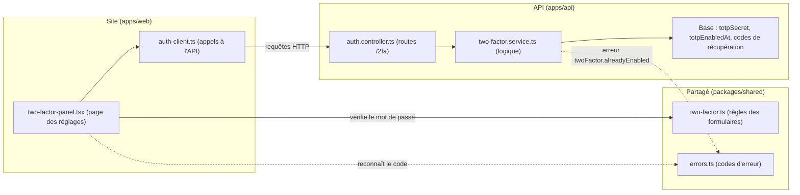
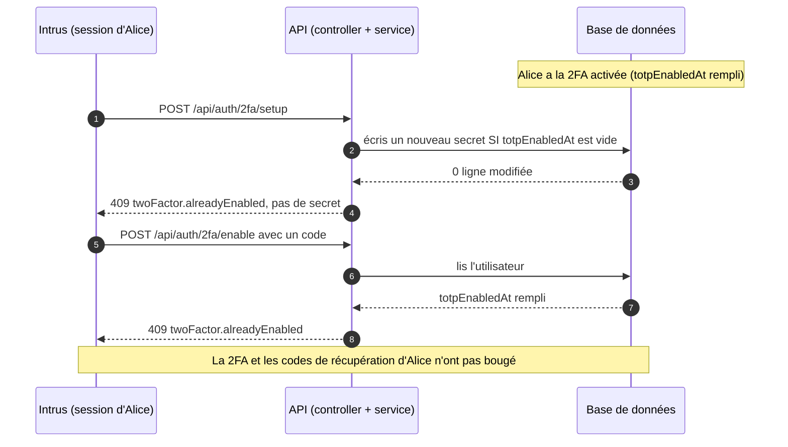
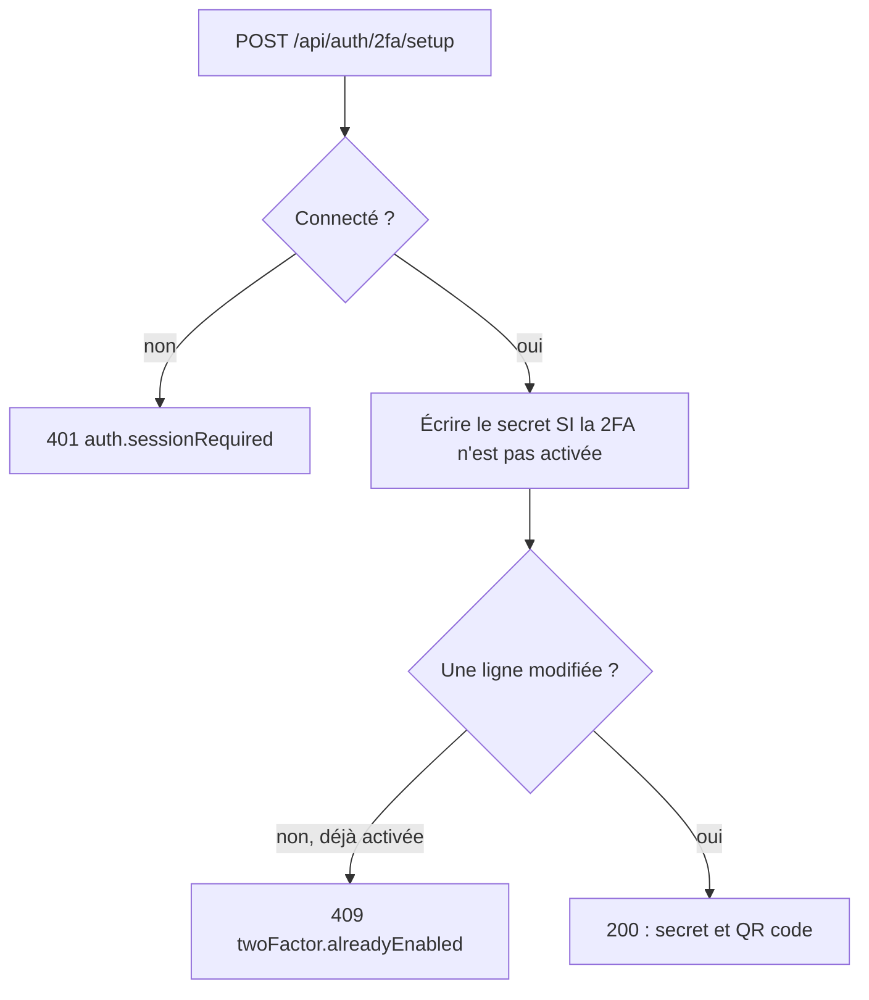
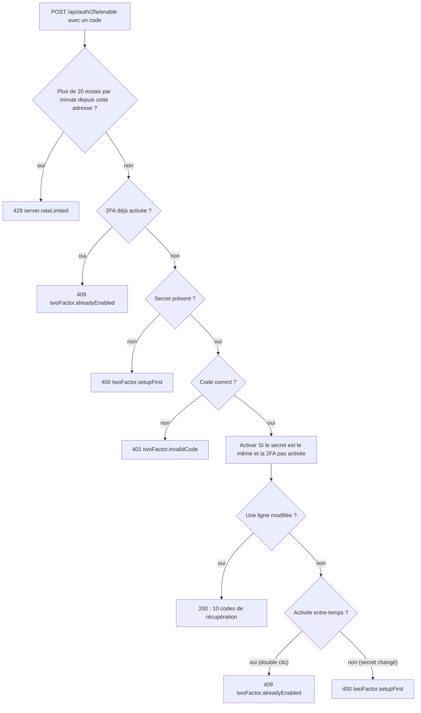
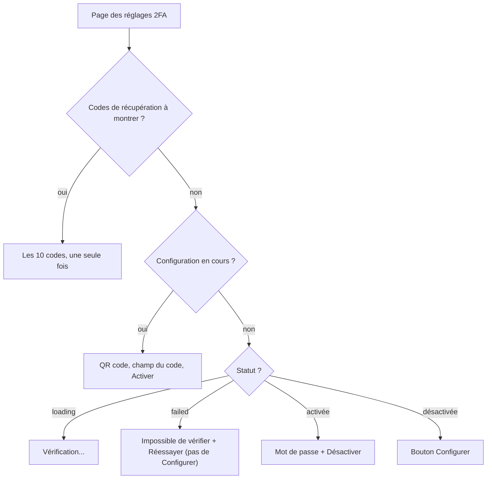
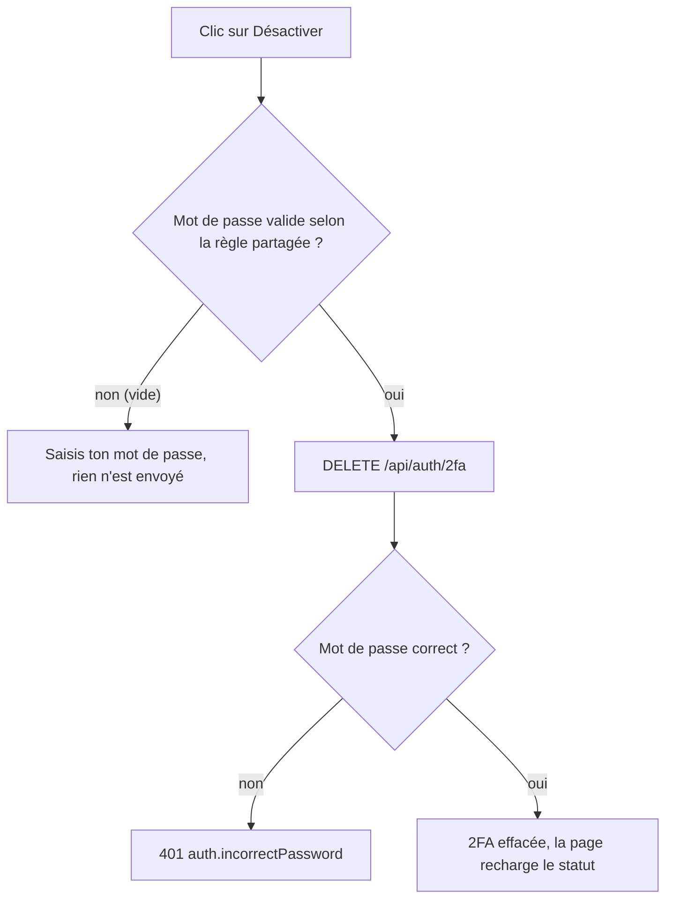

# 2FA : les garde-fous

> PR concernées : **#218** (« fix(web): #217 check the 2FA turn-off password in the browser », squash `5cb61e7`) et **#219** (« fix: #216 refuse 2FA setup and enable while 2FA is on », squash `46834f9`). Tous les commits de ces deux PR sont à moi (`VYAntares`).
> **Mes changements** : les vérifications « 2FA déjà activée » dans [two-factor.service.ts](../../../../apps/api/src/auth/two-factor.service.ts) et leurs tests unitaires ; deux lignes de documentation dans [auth.controller.ts](../../../../apps/api/src/auth/auth.controller.ts) ; le code d'erreur `twoFactor.alreadyEnabled` dans [errors.ts](../../../../packages/shared/src/schemas/errors.ts) et ses traductions ; trois tests dans [two-factor.e2e-spec.ts](../../../../apps/api/test/two-factor.e2e-spec.ts) ; les états « chargement » et « échec » et la vérification du mot de passe dans [two-factor-panel.tsx](../../../../apps/web/app/[locale]/(main)/settings/2fa/two-factor-panel.tsx) ; deux tests dans [e2e/tests/auth.spec.ts](../../../../e2e/tests/auth.spec.ts).
> **Pas à moi** : la 2FA elle-même. **Victor** l'a construite dans sa PR **#5** : les codes de l'appli, le QR code, les codes de récupération, la connexion en deux étapes, ces fichiers et leurs premiers tests. `auth.controller.ts` a aussi été retouché par Luca, Bastian et Anaïs. `errors.ts` a été créé par Luca (#26). Moi, je n'ai écrit que les **correctifs** décrits ici.
> Le module 2FA en entier : [docs/modules/two-factor-auth.md](../../../../docs/modules/two-factor-auth.md). Les codes d'erreur : [../error-codes/README.md](../error-codes/README.md). La limite d'essais par adresse IP : [../throttler/README.md](../throttler/README.md).

## 1. À quoi ça sert

### 1.1 D'abord, comment marche la 2FA (le travail de Victor)

La **2FA** (authentification à deux facteurs) ajoute une deuxième preuve au mot de passe. Cette preuve est un code à 6 chiffres. Une appli sur le téléphone (Google Authenticator, par exemple) affiche ce code. Il change toutes les 30 secondes.

Comment le serveur connaît le bon code ? Au départ, le serveur et l'appli partagent un **secret** (une longue suite de lettres). Ensuite, chacun calcule le code avec ce secret et l'heure. Ils trouvent le même résultat. C'est le **TOTP**.

La 2FA vit en quatre étapes :

1. **Configurer** (`POST /api/auth/2fa/setup`). Le serveur crée un secret et le range. Il renvoie un QR code. L'utilisateur le scanne avec son appli. À ce moment, la 2FA **n'est pas encore demandée** à la connexion.
2. **Activer** (`POST /api/auth/2fa/enable`). L'utilisateur tape un code de l'appli. S'il est bon, ça prouve que l'appli est bien configurée. La 2FA devient obligatoire. Le serveur donne **10 codes de récupération** (pour le jour où on perd son téléphone). On ne les voit qu'une fois.
3. **Se connecter**. Mot de passe d'abord. Puis un code de l'appli, ou un code de récupération.
4. **Désactiver** (`DELETE /api/auth/2fa`). Le **mot de passe** est redemandé. Puis le secret et les codes de récupération sont effacés.

En base, deux champs de l'utilisateur comptent :

- `totpSecret` : le secret (vide si pas de 2FA).
- `totpEnabledAt` : la date d'activation. Vide = la 2FA n'est pas activée.

**La règle importante :** retirer la 2FA doit coûter le mot de passe. Une session ouverte seule (un ordinateur laissé allumé) ne doit pas suffire.

### 1.2 Le bug #216 (le grave)

**Ce qui se passait.** L'étape « Configurer » ne demande qu'une session. Et elle **remettait la date d'activation à vide**. Donc cliquer « Configurer » sur un compte déjà protégé **désactivait la 2FA**, sans mot de passe.

Imaginons quelqu'un devant l'ordinateur d'Alice, resté connecté :

1. Il lance « Configurer » : la 2FA d'Alice est coupée.
2. Il scanne le nouveau QR avec **son** téléphone et lance « Activer ».
3. La 2FA est maintenant liée à **son** téléphone. Et l'activation remplace les codes de récupération d'Alice.
4. Alice ne peut plus se connecter. Elle est enfermée dehors de son propre compte.

**Deuxième partie, dans la page des réglages.** Pendant le chargement du statut, la page affichait « 2FA désactivée » et le bouton « Configurer ». Pareil si le chargement échouait. Sur un compte protégé, un clic sur ce bouton faisait le point 1 ci-dessus.

**Mes correctifs (#219) :**

- **Configurer** est refusé si la 2FA est déjà activée. Réponse : erreur 409 `twoFactor.alreadyEnabled`.
- **Activer** est refusé aussi si la 2FA est déjà activée. Les codes de récupération ne peuvent plus être remplacés avec une session seule.
- **L'activation n'allume que le secret qu'on vient de vérifier.** Si deux demandes se croisent, rien d'inattendu n'est activé.
- **La page des réglages** affiche « Vérification… » pendant le chargement, et « Impossible de vérifier » + « Réessayer » en cas d'échec. Jamais « Configurer » tant qu'on ne sait pas.

**Pour changer de téléphone**, le chemin est maintenant : désactiver (avec le mot de passe), puis configurer et activer de nouveau.

### 1.3 Le bug #217 (le petit)

Le formulaire « Désactiver » envoyait le mot de passe sans le vérifier, même vide. C'était le seul formulaire de la 2FA vérifié seulement par le serveur.

**Mon correctif (#218).** Le navigateur vérifie le mot de passe **avec la même règle que le serveur**, avant d'envoyer. Mot de passe vide : le message « Saisis ton mot de passe » s'affiche, et rien n'est envoyé.

### Mots techniques

| Mot | Explication simple |
|---|---|
| **TOTP** | Un code à usage unique calculé avec un secret partagé et l'heure. Ici : 6 chiffres, nouveau toutes les 30 secondes. Le code d'avant et celui d'après sont aussi acceptés, pour ne pas rater un code tapé pile au changement. |
| **Secret** | Une suite aléatoire de lettres et de chiffres, partagée entre le serveur et l'appli. C'est elle qui est dans le QR code. |
| **Codes de récupération** | 10 codes de secours, chacun utilisable une seule fois. Le serveur ne garde qu'une empreinte (un **hachage**) de chacun, pas le code lui-même. |
| **Session** | Le « bracelet » que le serveur donne après la connexion. Le navigateur le montre à chaque requête (dans un cookie). |
| **Code HTTP 409** (Conflict) | « Ta demande ne va pas avec l'état actuel. » Ici : « la 2FA est déjà activée ». |
| **Condition de course** | Deux demandes arrivent presque en même temps. Le résultat dépend de celle qui passe en premier. Comme deux personnes qui prennent la dernière place d'un bus. |
| **Vérifier puis agir** (TOCTOU) | Le piège classique : on vérifie, puis on agit, et entre les deux quelqu'un a changé la situation. |
| **Prisma** | La bibliothèque qui parle à la base de données. |
| **Zod / schéma** | Une liste de règles pour un formulaire (« le mot de passe ne doit pas être vide »). Le même schéma sert au navigateur et au serveur. |

## 2. Les fichiers

| Fichier | Rôle | Auteur |
|---|---|---|
| [two-factor.service.ts](../../../../apps/api/src/auth/two-factor.service.ts) | Toute la logique de la 2FA côté serveur. | Victor (#5), Luca ; **moi** : les garde-fous dans `beginEnrolment`, `confirmEnrolment` et `enable` (#219) |
| [two-factor.service.spec.ts](../../../../apps/api/src/auth/two-factor.service.spec.ts) | Tests unitaires du service, avec une fausse base. | Victor (#5) ; **moi** : les tests des garde-fous (#219) |
| [auth.controller.ts](../../../../apps/api/src/auth/auth.controller.ts) | Les routes `/api/auth/2fa/...`. | Victor, Luca, Bastian, Anaïs ; **moi** : deux lignes de documentation (#219) |
| [two-factor.e2e-spec.ts](../../../../apps/api/test/two-factor.e2e-spec.ts) | Tests de l'API avec une vraie base. | Victor (#5) ; **moi** : 3 tests (#219) |
| [errors.ts](../../../../packages/shared/src/schemas/errors.ts) | La liste des codes d'erreur, partagée entre l'API et le site. | Luca (#26), équipe ; **moi** : `twoFactor.alreadyEnabled` (#219) |
| [two-factor.ts](../../../../packages/shared/src/schemas/two-factor.ts) | Les règles des formulaires 2FA (dont `DisableTwoFactorSchema`). | Victor, Luca (pas modifié par moi) |
| [two-factor-panel.tsx](../../../../apps/web/app/[locale]/(main)/settings/2fa/two-factor-panel.tsx) | La page des réglages 2FA. | Victor (#5), Luca, Bastian ; **moi** : vérification du mot de passe (#218), états chargement / échec et réaction au 409 (#219) |
| [auth-client.ts](../../../../apps/web/lib/auth-client.ts) | Les appels du navigateur vers l'API. | Victor (pas modifié par moi) |
| `apps/web/messages/en.json`, `fr.json`, `de.json` | Les nouveaux textes (erreur « déjà activée », « Vérification… », « Réessayer »). | équipe ; **moi** (#219) |
| [e2e/tests/auth.spec.ts](../../../../e2e/tests/auth.spec.ts) | Tests dans un vrai navigateur. | Victor, Luca, Anaïs, Bastian ; **moi** : 2 tests (#218, #219) |

### Diagramme des fichiers et dépendances



## 3. Le code, morceau par morceau

> Les extraits sont raccourcis : `// ...` marque ce qui est coupé, et les commentaires en français sont des explications ajoutées ici. Le code exact est dans le fichier lié.

### 3.1 Configurer : refuser si la 2FA est déjà activée

**En mots simples.** Avant, le serveur écrivait le nouveau secret **et** vidait la date d'activation. Maintenant, il écrit le nouveau secret **seulement si** la date d'activation est vide. Et il ne touche plus jamais à cette date ici.

La base répond combien de lignes elle a modifiées. Zéro ligne = la 2FA était activée. Alors on répond 409, sans donner de secret.

```ts
async beginEnrolment(userId: string, email: string) {
  const secret = new OTPAuth.Secret({ size: 20 }).base32;
  const { count } = await this.prisma.user.updateMany({
    where: { id: userId, totpEnabledAt: null },
    data: { totpSecret: secret },
  });
  if (count === 0) {
    throw new ConflictException('twoFactor.alreadyEnabled');
  }
  // ... fabrique le QR code et le renvoie
}
```

**Pourquoi la condition est dans la requête elle-même ?** On aurait pu lire d'abord (« la 2FA est-elle activée ? »), puis écrire. Mais entre la lecture et l'écriture, une autre demande peut activer la 2FA. Ici, la base vérifie et écrit **d'un seul coup**. Personne ne peut se glisser entre les deux.

(`updateMany` au lieu de `update` : avec Prisma, c'est la façon d'écrire « modifie si cette condition est vraie » et de savoir combien de lignes ont changé.)

### 3.2 Activer : refuser si la 2FA est déjà activée

**En mots simples.** On lit l'utilisateur. On vérifie dans cet ordre :

1. Déjà activée ? → 409. (Même avec un bon code : sinon, on remplacerait les codes de récupération du propriétaire.)
2. Pas encore configurée ? → 400 `twoFactor.setupFirst`.
3. Mauvais code ? → 401 `twoFactor.invalidCode`.

Si tout va bien, on active, puis on crée les codes de récupération.

```ts
async confirmEnrolment(userId: string, code: string): Promise<string[]> {
  const user = await this.prisma.user.findUnique({
    where: { id: userId },
    select: { email: true, totpSecret: true, totpEnabledAt: true },
  });
  if (user?.totpEnabledAt != null) {
    throw new ConflictException('twoFactor.alreadyEnabled');
  }
  if (user?.totpSecret == null) {
    throw new BadRequestException('twoFactor.setupFirst');
  }
  if (!this.verifyCode(user.totpSecret, user.email, code)) {
    throw new UnauthorizedException('twoFactor.invalidCode');
  }

  await this.enable(userId, user.totpSecret);
  return this.issueRecoveryCodes(userId);
}
```

J'ai ajouté le premier `if`, et je passe à `enable` **le secret qui a servi à vérifier le code**.

### 3.3 L'activation n'allume que le secret vérifié

**En mots simples.** Ici aussi on lit, puis on écrit. Entre les deux, deux choses peuvent arriver :

- **Un autre onglet relance « Configurer ».** Il range un nouveau secret. Si on activait quand même, la 2FA serait liée à un secret que l'utilisateur n'a jamais scanné. Il serait bloqué.
- **L'utilisateur clique deux fois sur « Activer ».** Deux demandes partent. La première active. La seconde ne doit pas créer un deuxième jeu de codes, qui effacerait le premier déjà affiché.

La solution : n'écrire **que si** le secret est encore celui qu'on a vérifié **et** que la 2FA n'est pas déjà activée. Si zéro ligne change, on relit juste pour choisir le bon message d'erreur.

```ts
private async enable(userId: string, checkedSecret: string): Promise<void> {
  const { count } = await this.prisma.user.updateMany({
    where: { id: userId, totpSecret: checkedSecret, totpEnabledAt: null },
    data: { totpEnabledAt: new Date() },
  });
  if (count > 0) {
    return;
  }
  const now = await this.prisma.user.findUnique({ /* ... lit totpEnabledAt */ });
  throw now?.totpEnabledAt != null
    ? new ConflictException('twoFactor.alreadyEnabled')
    : new BadRequestException('twoFactor.setupFirst');
}
```

- Double clic → la 2FA est activée par l'autre demande → 409.
- Secret changé → la 2FA n'est pas activée → 400 « configure d'abord ».

Dans les deux cas, l'erreur part **avant** la création des codes de récupération. J'ai aussi rendu cette fonction **privée** : seul le service peut l'appeler.

### 3.4 Le nouveau code d'erreur

**En mots simples.** L'API n'envoie pas de phrase, elle envoie un code. Le site le traduit dans la langue de l'utilisateur. J'ai ajouté le code à la liste partagée, et sa traduction en anglais, français et allemand.

```ts
  'twoFactor.invalidCode',
  /** Setup or enable on an account whose 2FA is on: turn it off first, with the password. */
  'twoFactor.alreadyEnabled',
```

En français : « L'authentification à deux facteurs est déjà activée. Pour changer d'application, désactive-la d'abord. »

Dans le controller, j'ai seulement ajouté la documentation de la réponse 409 (`@ApiConflictResponse`) sur `2fa/setup` et `2fa/enable`.

### 3.5 La page des réglages : « je ne sais pas » n'est pas « désactivée »

**En mots simples.** Avant, la page avait un seul « vide » pour trois situations : « je charge », « le chargement a échoué » et, par accident, « désactivée ». Dans les trois cas, elle montrait « Configurer ».

Maintenant, le statut a trois formes bien séparées : le vrai statut, `'loading'` (je charge), `'failed'` (échec). La page vérifie d'abord les deux derniers cas.

```tsx
type Status = TwoFactorStatus | 'loading' | 'failed';
// ...
const [status, setStatus] = useState<Status>('loading');
// ...
if (status === 'loading') {
  return <p role="status">{t('loading')}</p>;
}
if (status === 'failed') {
  // ... message d'erreur et bouton Réessayer
}
if (status.enabled) {
  // ... formulaire Désactiver
}
// ... sinon : "désactivée" et bouton Configurer
```

**Et si le serveur répond 409 ?** Par exemple, la 2FA a été activée dans un autre onglet. La page ferme le formulaire de configuration et recharge le vrai statut.

```tsx
async function staleOnConflict(result: ApiResult<unknown>) {
  if (!result.ok && result.code === 'twoFactor.alreadyEnabled') {
    setSetup(null);
    setStatus(await loadStatus());
  }
}
```

### 3.6 #218 : vérifier le mot de passe avant de l'envoyer

**En mots simples.** Avant d'envoyer, on passe le mot de passe dans la même règle que le serveur (`DisableTwoFactorSchema` : pas vide, 128 caractères au plus). Si la règle n'est pas respectée, on affiche le message traduit et on s'arrête là. Le formulaire « Activer » faisait déjà pareil avec le code.

```tsx
const parsed = DisableTwoFactorSchema.safeParse({ password });
if (!parsed.success) {
  setError(errorMessage(parsed.error.issues[0].message));
  return;
}
const result = await disableTwoFactor(parsed.data.password);
```

Le serveur vérifie toujours de son côté : on ne fait jamais confiance au navigateur. Le navigateur évite juste une requête inutile, et répond tout de suite.

## 4. Le chemin d'exécution

### 4.1 L'attaque de #216, aujourd'hui



Avant #219 : l'étape « setup » vidait `totpEnabledAt` (2FA coupée), puis « enable » activait le secret de l'intrus et remplaçait les codes d'Alice.

### 4.2 Configurer (POST /2fa/setup)



### 4.3 Activer (POST /2fa/enable)



### 4.4 Ce qu'affiche la page des réglages



### 4.5 Le formulaire « Désactiver » (#218)



## 5. Un exemple concret pas à pas

**Alice** a activé sa 2FA le 20 novembre. Elle a 10 codes de récupération. Elle quitte un ordinateur partagé sans se déconnecter.

1. Quelqu'un ouvre `/fr/settings/2fa`. La page affiche d'abord « Vérification de l'authentification à deux facteurs… ». Pas de bouton « Configurer ».
2. Le statut arrive : 2FA activée, 10 codes restants. La page montre le champ mot de passe et « Désactiver ».
3. Il clique « Désactiver » sans mot de passe. La page affiche « Saisis ton mot de passe ». Rien n'est envoyé (#218).
4. Il essaie l'API directement : `POST /api/auth/2fa/setup`. La base ne modifie rien, car la 2FA est activée. Réponse : **409** `twoFactor.alreadyEnabled`. Le secret d'Alice n'a pas changé.
5. Il essaie `POST /api/auth/2fa/enable` avec un code. Réponse : **409**. Les codes de récupération d'Alice sont intacts.
6. Le lendemain, Alice se connecte normalement, avec son mot de passe puis le code de son appli.

**Bob change de téléphone.**

1. Il tape son mot de passe et clique « Désactiver ». La 2FA est effacée.
2. Il clique « Configurer ». La 2FA n'est pas activée, donc le nouveau secret est écrit. Il reçoit un QR code.
3. Il scanne avec son nouveau téléphone, tape le code, clique « Activer ». Le secret est bien celui qu'il a scanné. La 2FA est activée, il reçoit 10 nouveaux codes.

**Bob double-clique sur « Activer ».** Les deux demandes vérifient le code. La première active la 2FA et crée les codes. La seconde ne modifie rien (la 2FA est déjà activée) : elle reçoit un 409. Un seul jeu de codes existe.

## 6. Les tests

### 6.1 Tests unitaires : [two-factor.service.spec.ts](../../../../apps/api/src/auth/two-factor.service.spec.ts)

La base est remplacée par une **fausse base** : on choisit ce qu'elle répond (par exemple « 0 ligne modifiée »). Ça permet de jouer les courses, difficiles à provoquer pour de vrai.

| Test | Ce qu'il prouve |
|---|---|
| `stores a secret without enabling anything` | Configurer écrit le secret **seulement si** la 2FA n'est pas activée, et ne touche pas à la date. |
| `refuses setup once 2FA is on, and returns no secret (#216)` | 0 ligne modifiée → erreur 409. |
| `refuses to confirm once 2FA is on, and keeps the recovery codes (#216)` | Même avec un vrai code : 409, et les codes de récupération ne sont pas touchés. |
| `enables the secret the code was checked against, and issues recovery codes` | L'activation vise le secret vérifié ; 10 codes différents sont créés. |
| `turns nothing on when another setup replaced the secret after the check` | Secret changé entre-temps → 400, pas de nouveaux codes. |
| `issues one set of codes when two confirmations race` | Double activation → 409 pour la seconde, pas de deuxième jeu de codes. |

### 6.2 Tests de l'API : [two-factor.e2e-spec.ts](../../../../apps/api/test/two-factor.e2e-spec.ts)

Toute l'API démarre, avec une vraie base de données. Mes trois tests :

| Test | Ce qu'il prouve |
|---|---|
| `refuses setup while 2FA is on, and the factor stays on` | 409, pas de secret renvoyé, la 2FA est toujours activée, l'ancienne appli marche encore. |
| `refuses enable while 2FA is on, and the recovery codes still work` | 409, pas de nouveaux codes, un ancien code de récupération marche encore. |
| `sets up a new authenticator once 2FA was turned off` | Après la désactivation avec le mot de passe : on peut configurer et activer une nouvelle appli. |

### 6.3 Tests dans le navigateur : [e2e/tests/auth.spec.ts](../../../../e2e/tests/auth.spec.ts)

| Test | Ce qu'il prouve |
|---|---|
| `checks the turn-off password in the browser before sending it` (#218) | Avec la 2FA activée, « Désactiver » sans mot de passe affiche « Enter your password », et **aucune** requête n'est envoyée. |
| `offers no setup when the 2FA status cannot be read` (#219) | Le test fait échouer le chargement du statut : la page affiche l'erreur et **aucun** bouton « Configurer ». Après « Réessayer », le vrai statut s'affiche. |

### 6.4 Commandes

```bash
# Tests unitaires (pas besoin de base de données)
pnpm --filter @ft/api exec vitest run src/auth/two-factor.service.spec.ts
make test                                   # tous les tests unitaires

# Tests de l'API : il faut Postgres et Redis
make stores-up
pnpm --filter @ft/api exec prisma migrate deploy
pnpm --filter @ft/api run test:e2e

# Tests dans le navigateur
make test-e2e                               # démarre l'application puis lance Playwright
pnpm --filter @ft/e2e run test:e2e tests/auth.spec.ts   # un seul fichier, application déjà lancée
```

## 7. Les concepts à savoir expliquer

- **Le TOTP** : un secret partagé plus l'heure donnent le même code des deux côtés.
- **Les étapes de la 2FA** : configurer (pas encore obligatoire), activer (un code prouve que l'appli marche), se connecter en deux temps, désactiver (avec le mot de passe).
- **Pourquoi « pas encore obligatoire » après configurer** : un QR mal scanné ne doit pas bloquer le compte.
- **La règle de sécurité** : retirer ou remplacer la 2FA coûte le mot de passe, pas seulement une session.
- **Vérifier et écrire d'un seul coup** : la condition dans la requête, puis on regarde combien de lignes ont changé. Personne ne peut se glisser entre les deux.
- **« Écris seulement si rien n'a changé »** : l'activation vise le secret exact qu'on a vérifié.
- **Les codes HTTP** : 409 (contredit l'état), 400 (étape manquante), 401 (mauvais code ou mot de passe), 429 (trop d'essais).
- **« Je ne sais pas » n'est pas « non »** : des états clairs « chargement » et « échec ».
- **La même règle des deux côtés** : le navigateur pour le confort, le serveur pour la sécurité.

## 8. Questions possibles à l'oral

**Q : Qui a fait la 2FA ?**

R : Victor, dans la PR #5. Moi, j'ai corrigé deux bugs : #216 (configurer et activer acceptés alors que la 2FA est activée) et #217 (mot de passe de désactivation pas vérifié dans le navigateur).

**Q : Quel était le risque de #216 ?**

R : « Configurer » ne demande qu'une session, et il coupait la 2FA. Quelqu'un devant un ordinateur resté connecté pouvait couper la 2FA, mettre son propre téléphone, et remplacer les codes de récupération. Le vrai propriétaire était bloqué dehors.

**Q : Pourquoi la condition dans la requête, et pas un `if` après une lecture ?**

R : Entre la lecture et l'écriture, une autre demande peut changer l'état. Dans la requête, la base vérifie et écrit d'un seul coup.

**Q : Pourquoi 409 et pas 403 ?**

R : L'utilisateur a le droit de gérer sa 2FA. Le problème n'est pas un droit, c'est l'état : elle est déjà activée. C'est le sens de 409. Le message dit quoi faire : la désactiver d'abord.

**Q : Pourquoi `enable` reçoit le secret vérifié ?**

R : Un autre onglet peut ranger un nouveau secret juste après la vérification. Sans ça, on activerait un secret que l'utilisateur n'a pas scanné.

**Q : Et un double clic sur « Activer » ?**

R : La première demande active. La seconde ne modifie rien et reçoit un 409, avant de créer des codes. Il n'y a qu'un seul jeu de codes.

**Q : Comment change-t-on de téléphone maintenant ?**

R : On désactive avec le mot de passe, puis on configure et on active de nouveau. Un test vérifie ce chemin.

**Q : Pourquoi corriger aussi la page, si l'API refuse déjà ?**

R : Afficher « désactivée » alors qu'on ne sait pas, c'est faux. Avant le correctif de l'API, ce bouton coupait vraiment la 2FA. Maintenant, la page ne propose « Configurer » que si elle sait que la 2FA est désactivée.

**Q : Si le navigateur vérifie le mot de passe, faut-il encore vérifier sur le serveur ?**

R : Oui. On peut contourner le navigateur (avec curl, par exemple). Le serveur applique la même règle. Le navigateur évite juste une requête inutile.

**Q : Pourquoi la même règle des deux côtés ?**

R : Elle est dans le paquet partagé. Les deux côtés ont exactement les mêmes règles et les mêmes codes d'erreur. Ils ne peuvent pas être en désaccord.

**Q : Un intrus peut-il deviner des codes sur « Activer » ?**

R : La route est limitée à 20 essais par minute par adresse IP (`LOGIN_LIMIT_PER_MINUTE`), puis 429. Et si la 2FA est activée, elle répond 409 sans même regarder le code.

**Q : Comment as-tu testé les courses ?**

R : Avec une fausse base. Je lui fais répondre « 0 ligne modifiée », puis soit « pas activée » (secret changé), soit « activée » (double clic). Je vérifie l'erreur, et qu'aucun code de récupération n'est créé.
