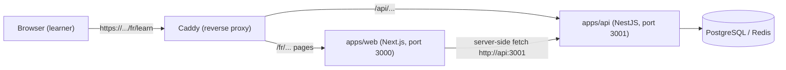
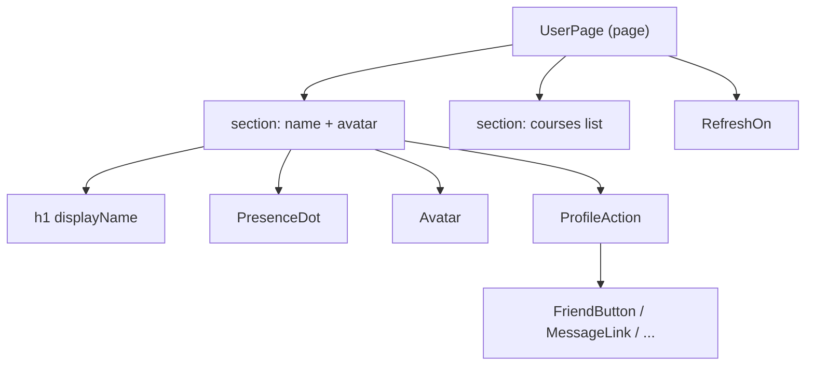
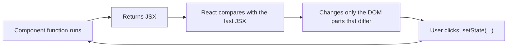
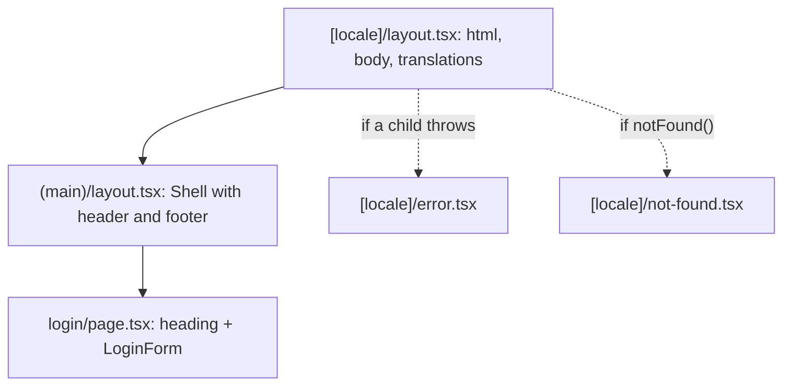
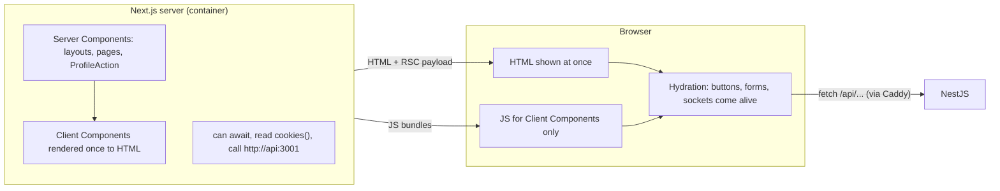
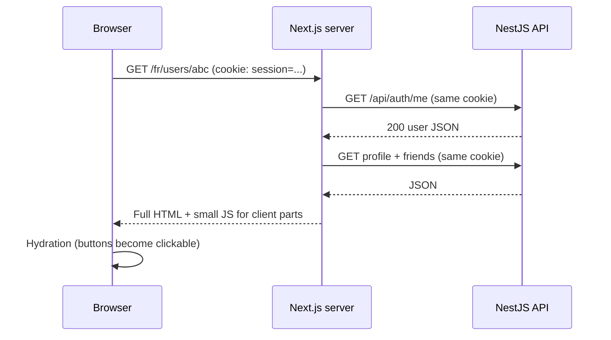
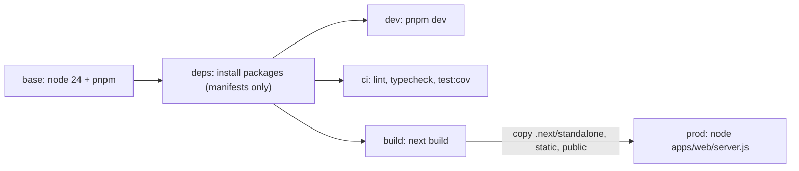

# Chapter 1 — React and Next.js from zero

In this chapter:

- What a frontend is, and what HTML, CSS and JavaScript do in the browser
- React: JSX, components, props, state, effects, and every other hook the app uses
- Rendering, lists and keys, events and forms
- Next.js: the App Router, Server Components and Client Components, server-side rendering, data on the server, navigation
- Tailwind CSS and TypeScript in React
- A map of the `apps/web` folder, and every config file in it

No React knowledge is needed. Each idea comes with a small example taken from the real code of `apps/web`.

---

## 1. What a frontend is

The app has two programs that talk to each other:

- The **backend** (`apps/api`, NestJS) keeps the data: users, courses, lessons, messages. It answers HTTP requests with JSON.
- The **frontend** (`apps/web`, Next.js) is what the learner sees: the pages, the buttons, the forms. It asks the backend for data and turns it into screens.

A restaurant is a good picture. The kitchen (the API) cooks. The dining room (the web app) is where guests sit, read the menu and order. The waiter carries orders between them. The dining room never cooks: the `description` in [package.json](../../apps/web/package.json) says it plainly: *"Next.js frontend: presentation and SSR only, all domain logic lives in @ft/api"*.



Caddy is the front door. It sends `/api/...` requests to NestJS and everything else to Next.js. Next.js itself also calls the API, from the server, over the internal Docker network (see [lib/api.ts](../../apps/web/lib/api.ts), `DEFAULT_API_INTERNAL_URL = 'http://api:3001'`).

### HTML, CSS and JavaScript in the browser

A browser only understands three languages:

| Language | Job | House analogy |
| --- | --- | --- |
| HTML | The structure: headings, paragraphs, buttons, forms | The walls and rooms |
| CSS | The look: colours, sizes, spacing, layout | The paint and furniture |
| JavaScript (JS) | The behaviour: react to a click, fetch data, change the page | The electricity and plumbing |

The browser reads the HTML and builds the **DOM** (Document Object Model): a tree of objects, one per HTML element. JavaScript can change the DOM, and the browser repaints the screen. Doing this by hand (`document.createElement`, `element.textContent = ...`) gets messy very fast in a big app. React solves that.

---

## 2. What React is

React is a JavaScript library for building user interfaces from **components**. You describe *what* the screen should look like for the current data, and React works out *how* to change the DOM to match.

Think of LEGO. Each component is a brick. Small bricks (a button, an avatar) snap together into bigger bricks (a form, a header), and those snap together into a whole page. You build each brick once and reuse it everywhere.



This is the real tree of the user profile page, [users/[id]/page.tsx](<../../apps/web/app/[locale]/(main)/users/[id]/page.tsx>).

### JSX

A component is a function that returns **JSX**. JSX looks like HTML, but it lives inside JavaScript. A build tool turns it into plain function calls. Here is the 404 page, [not-found.tsx](<../../apps/web/app/[locale]/not-found.tsx>):

```tsx
export default function LocaleNotFound() {
  const t = useTranslations('NotFoundPage');

  return (
    <Shell brand={<Wordmark />} footer={<LegalFooter />}>
      <div className="flex flex-col items-center gap-4 py-24 text-center">
        <h1 className="text-3xl font-semibold tracking-tight">{t('heading')}</h1>
        <p className="max-w-md text-slate-400">{t('intro')}</p>
        <Link
          href="/"
          className="mt-2 rounded-full bg-indigo-700 px-6 py-2 text-sm font-semibold text-white transition-colors hover:bg-indigo-800"
        >
          {t('goHome')}
        </Link>
      </div>
    </Shell>
  );
}
```

JSX rules to know:

- Lowercase tags (`div`, `h1`, `p`) are real HTML elements. Capitalised tags (`Shell`, `Link`) are components.
- `{ ... }` opens a "JavaScript window": `{t('heading')}` puts the result of a function call into the page.
- HTML `class` is written `className` (because `class` is a reserved word in JS), and `for` is written `htmlFor`.
- A component returns one root element. To return several without a wrapper, use a **fragment** `<>...</>` (you will see it in `ProfileAction` in the user page).
- Returning `null` means "draw nothing". [time-zone-sync.tsx](../../apps/web/components/time-zone-sync.tsx) returns `null`: it only does work, it shows nothing.
- Conditions use normal JS: `cond ? <A /> : <B />` or `cond ? <A /> : null`.

### Components and props

**Props** (properties) are the inputs of a component, like the arguments of a function. A parent passes them as attributes, and the child receives them as one object. They are read-only for the child.

The best example is [components/shell.tsx](../../apps/web/components/shell.tsx), the frame every page renders in:

```tsx
export interface ShellProps {
  /** Left of the account nav: the wordmark, leading home or into the app. */
  brand: ReactNode;
  /** Right of it. Omitted where there is no session to report. */
  nav?: ReactNode;
  // ...
  fill?: boolean;
  footer: ReactNode;
  children: ReactNode;
}

export function Shell({ brand, nav, fill = false, footer, children }: ShellProps) {
  return (
    <div className={`flex min-h-dvh flex-col ${fill ? 'lg:h-dvh' : ''}`}>
      <header className="border-b border-slate-800">
```

And a parent using it, [(main)/layout.tsx](<../../apps/web/app/[locale]/(main)/layout.tsx>):

```tsx
export default function MainLayout({ children }: { children: ReactNode }) {
  return (
    <Shell brand={<Wordmark />} nav={<HeaderNav />} footer={<LegalFooter />}>
      {children}
    </Shell>
  );
}
```

Things to notice:

- A prop can be a string, a number, a function, or even other JSX (`brand={<Wordmark />}`). `ReactNode` is the TypeScript type for "anything React can draw".
- `children` is a special prop: whatever you put *between* the opening and closing tags.
- `fill = false` is a default value. `nav?` means the prop is optional.
- The interface `ShellProps` is how TypeScript types props (more in section 5).

### State with `useState`

Props come from the parent. **State** is the component's own memory: a value that can change over time, like "is the button busy?". When state changes, React draws the component again with the new value.

A **hook** is a function whose name starts with `use`. Hooks let a component plug into React features (memory, side effects...). `useState` is the first one. From [log-out-button.tsx](../../apps/web/components/log-out-button.tsx):

```tsx
export function LogOutButton() {
  const router = useRouter();
  const t = useTranslations('LogOutButton');
  const [pending, setPending] = useState(false);

  async function onClick() {
    setPending(true);
    try {
      await logOut();
      closeSocket();
      // Home rather than the current page, which may well have needed the
      // session that just ended.
      router.replace('/');
      router.refresh();
    } finally {
      setPending(false);
    }
  }

  return (
    <button type="button" onClick={() => void onClick()} disabled={pending} className={MENU_ROW}>
      <MenuIcon name="signOut" />
      {pending ? t('signingOut') : t('signOut')}
    </button>
  );
}
```

`useState(false)` returns a pair: the current value (`pending`) and a setter (`setPending`). Calling `setPending(true)` does not change `pending` in place. It asks React to run `LogOutButton()` again, and in that new run `pending` is `true`, so the button shows "Signing out..." and is disabled.

Rules of hooks (checked by ESLint, see section 7): call hooks only at the top level of a component or of another hook, never inside an `if` or a loop. The comment in [refresh-on.tsx](../../apps/web/components/refresh-on.tsx) shows the app respecting this: *"One component per event: a hook cannot run in a loop."*

### Rendering and re-rendering

"Render" means React calls your component function to get its JSX. It happens:

1. The first time the component appears (it **mounts**).
2. Each time its state changes.
3. Each time its parent re-renders (and so passes props again).



React keeps a light copy of the last result and compares the new one with it. It only touches the DOM where something really changed. That is why you can write "draw everything from the current data" and still get a fast page.

`reactStrictMode: true` in [next.config.ts](../../apps/web/next.config.ts) makes React, in development only, render components and run effects twice on purpose to find bugs where code is not safe to run again.

### Effects with `useEffect`

Rendering must be "pure": compute JSX from props and state, nothing else. Work that touches the outside world (timers, network calls, browser APIs, sockets) goes in an **effect**. `useEffect(fn, deps)` runs `fn` *after* React has drawn the screen, and runs it again only when a value in the `deps` list changes.

[time-zone-sync.tsx](../../apps/web/components/time-zone-sync.tsx) reads the browser's time zone and saves it if it differs from the stored one:

```tsx
  useEffect(() => {
    // Older browsers may not resolve a zone: there is nothing to send then.
    const timeZone = Intl.DateTimeFormat().resolvedOptions().timeZone;
    if (!timeZone || timeZone === storedTimeZone || inFlight.current || rejected.current) {
      return;
    }

    inFlight.current = true;
    // A failure needs no message: the next page tries again, unless it was a 400.
    void updateProfile({ timeZone }).then((result) => {
      inFlight.current = false;
      if (result.ok) {
        router.refresh();
      } else if (result.status === 400) {
        rejected.current = true;
      }
    });
  }, [storedTimeZone, router, pathname]);
```

The time zone only exists in the browser, so this cannot run during server rendering: an effect is the right place. The deps `[storedTimeZone, router, pathname]` mean "run again when one of these changes", so it retries after each page change.

An effect can return a **cleanup** function. React calls it before the next run and when the component disappears (**unmounts**). [exam-timer.tsx](<../../apps/web/app/[locale]/(dashboard)/learn/[lang]/lessons/[id]/play/exam-timer.tsx>) starts a timer and stops it in the cleanup:

```tsx
  useEffect(() => {
    if (ranOut) return;
    const interval = setInterval(() => {
      const now = Math.max(0, Math.ceil((deadline - Date.now()) / 1000));
      setSeconds(now);
      if (now === 0) {
        clearInterval(interval);
        zero();
      }
    }, 250);
    return () => clearInterval(interval);
  }, [deadline, ranOut]);
```

### The other hooks used in the app

A search of `apps/web` (`app`, `components`, `lib`) finds these hooks. Each line says what it is for and gives one real place where it is used.

| Hook | From | What it does | Real example |
| --- | --- | --- | --- |
| `useState` | react | Component memory that triggers a re-render | `pending` in [log-out-button.tsx](../../apps/web/components/log-out-button.tsx) |
| `useEffect` | react | Run side effects after render, with cleanup | [time-zone-sync.tsx](../../apps/web/components/time-zone-sync.tsx) |
| `useRef` | react | Memory that does **not** trigger a re-render; also holds a DOM element | `inFlight`, `rejected` in time-zone-sync; `wasAway` in [refresh-on.tsx](../../apps/web/components/refresh-on.tsx) |
| `useId` | react | A unique id, the same on server and browser | label/input pair in [form.tsx](../../apps/web/components/form.tsx) |
| `useMemo` | react | Remember a computed value until its deps change | `keep` in [player.tsx](<../../apps/web/app/[locale]/(dashboard)/learn/[lang]/lessons/[id]/play/player.tsx>) |
| `useCallback` | react | Remember a function until its deps change | `show` and `hold` in player.tsx |
| `useTransition` | react | Mark an update as "not urgent" and get a `pending` flag | [friend-search.tsx](<../../apps/web/app/[locale]/(main)/friends/friend-search.tsx>) |
| `useLayoutEffect` | react | Like `useEffect`, but runs before the browser paints | keeping the scroll position in [chat-thread.tsx](<../../apps/web/app/[locale]/(messages)/chat/chat-thread.tsx>) |
| `useSyncExternalStore` | react | Read a value that lives outside React and re-render when it changes | socket status, unread counts in [tab-socket.ts](../../apps/web/components/tab-socket.ts) |
| `useEffectEvent` | react | A function an effect can call that always sees the latest props, without being a dep | `zero` in exam-timer.tsx |
| `useRouter` | next-intl (through `@/i18n/navigation`) | Move to another page or refresh the server data from code | `router.replace('/')` in log-out-button.tsx |
| `usePathname` | next-intl (through `@/i18n/navigation`) | The current URL path (without the locale) | trigger in time-zone-sync.tsx |
| `useSearchParams` | next/navigation | Read the `?a=b` part of the URL | [live-form.tsx](<../../apps/web/app/[locale]/(dashboard)/learn/[lang]/lessons/live-form.tsx>) |
| `useTranslations` | next-intl | Get the `t()` function for one part of the text catalogue | almost every component |
| `useLocale` | next-intl | The current language (`en`, `fr`, `de`) | [language-switcher.tsx](../../apps/web/components/language-switcher.tsx) |
| `useFormatter` | next-intl | Format dates and numbers in the current language | message times in [chat-thread.tsx](<../../apps/web/app/[locale]/(messages)/chat/chat-thread.tsx>) |

`useActionState`, `useOptimistic`, `useFormStatus` and `use()` are **not** used in this app.

The app also writes its own hooks (a custom hook is just a function starting with `use` that calls other hooks): `useServerEvent`, `useSocketStatus`, `useUnreadTotal`, `useFriendOnline` in [tab-socket.ts](../../apps/web/components/tab-socket.ts), `useErrorMessage` in [lib/error-message.ts](../../apps/web/lib/error-message.ts), and the one in [lib/use-course-save.ts](../../apps/web/lib/use-course-save.ts). Chapter 3 and chapter 4 explain them.

A few more words on the less common ones:

**`useRef`** is a box with a `.current` field. Changing `.current` does not re-render. In [refresh-on.tsx](../../apps/web/components/refresh-on.tsx) it remembers "was the socket away before?" between renders:

```tsx
  const seen = useRef(false);
  const wasAway = useRef(false);

  // Once, however many events: one refresh per reconnect.
  useEffect(() => {
    if (status === 'connected' && wasAway.current) router.refresh();
    if (status === 'connected') seen.current = true;
    wasAway.current = seen.current && status !== 'connected';
  }, [status, router]);
```

It can also point at a DOM element: `const form = useRef<HTMLFormElement>(null)` in live-form.tsx, then `<form ref={form}>`.

**`useSyncExternalStore(subscribe, getSnapshot, getServerSnapshot)`** connects React to a store that is not React state. Here the store is filled by the socket connection, which lives once per browser tab:

```tsx
export function useSocketStatus(): SocketStatus {
  return useSyncExternalStore(
    subscribe,
    () => status,
    () => 'closed',
  );
}
```

The third function is the value used on the server, where there is no socket: `'closed'`.

**`useEffectEvent`** solves a small problem. In exam-timer.tsx the effect must call `onZero`, a prop. If `onZero` were in the deps, the timer would restart each time the parent passes a new function. `const zero = useEffectEvent(onZero)` gives a stable function that always calls the latest `onZero`.

**`useTransition`** returns `[pending, startTransition]`. Work started inside `startTransition` (here a navigation) is "not urgent", so the page stays responsive, and `pending` is `true` until it is done.

### Lists and keys

To draw a list, use the array method `.map()` to turn each item into JSX. Each item needs a `key` prop: a value unique among its siblings and stable over time. From the user page:

```tsx
          <ul className="divide-y divide-slate-800">
            {profile.courses.map((course) => (
              <li key={course.lang} className="flex flex-wrap items-baseline gap-x-3 py-3">
                <span className="font-medium">{languageName(course.lang)}</span>
                <span className="text-sm text-slate-300">{course.level ?? t('noLevel')}</span>
```

The key is like a name tag. When the list changes, React uses the tags to know which `<li>` is which, so it can move, add or remove the right one instead of redrawing all. Use an id from the data (`course.lang`, a user id), not the array index, when the order can change.

A key can also be used on purpose to *reset* a component: a new key means "this is a different component, start fresh". The login form does this (comment: *"Distinct key from the password form"* in [login-form.tsx](<../../apps/web/app/[locale]/(main)/login/login-form.tsx>)).

### Events

You pass a function to an event prop: `onClick`, `onSubmit`, `onChange`, `onKeyDown`... React calls it with an **event** object. Pass the function, do not call it: `onClick={reset}`, not `onClick={reset()}`. From [error.tsx](<../../apps/web/app/[locale]/error.tsx>):

```tsx
          <button
            type="button"
            onClick={reset}
            className="rounded-full bg-indigo-700 px-6 py-2 font-semibold text-white transition-colors hover:bg-indigo-800"
          >
            {t('tryAgain')}
          </button>
```

### Forms

A browser `<form>`, when submitted, normally reloads the page. The app stops that with `event.preventDefault()` and handles the data in JavaScript. The fields are read with `FormData`, the browser's standard way to read a form's values by their `name`. From [friend-search.tsx](<../../apps/web/app/[locale]/(main)/friends/friend-search.tsx>):

```tsx
  function submit(event: FormEvent<HTMLFormElement>) {
    event.preventDefault();
    const q = new FormData(event.currentTarget).get('q');
    // ...
    const parsed = UserSearchQuerySchema.safeParse({ q });
    if (!parsed.success) {
      setError(errorMessage(parsed.error.issues[0].message));
      return;
    }
    setError(null);
    startTransition(() => router.replace({ pathname: '/friends', query: { q: parsed.data.q } }));
  }

  return (
    <form role="search" onSubmit={submit} className="flex flex-col gap-3">
      <Field
        label={t('searchLabel')}
        type="search"
        name="q"
        defaultValue={query}
        autoComplete="off"
      />
      <FormError message={error} />
      <SubmitButton pending={pending}>{t('search')}</SubmitButton>
    </form>
  );
```

The pattern used by the free-text forms of the app (login, signup, profile, search...):

1. `preventDefault()`, read `FormData`.
2. Validate with the **same Zod schema the API uses** (from `@ft/shared`), so obvious mistakes never leave the page. The pickers (course, level, goal) skip this step: they only offer valid values, and the API validates what they send.
3. Call the API from the browser (functions in `lib/*-client.ts`) or change the URL.
4. Show errors with `FormError`, show "working" with `SubmitButton pending`.

The inputs are **uncontrolled**: they keep their own value and the code reads it on submit (`defaultValue` sets the first value). A **controlled** input would be `value={state}` plus `onChange={...}` to update the state on every key press.

The shared form pieces live in [components/form.tsx](../../apps/web/components/form.tsx): `Field` (a label tied to an input with `useId`, for screen readers), `FormError` (`role="alert"` so the error is announced), `SubmitButton`, and button class strings.

---

## 3. What Next.js adds to React

React alone only draws components. A real website also needs: URLs and pages, a server that sends the first HTML, data loading, a build for production, images, metadata (`<title>`), error pages. **Next.js** is a framework around React that gives all of this. If React is the LEGO bricks, Next.js is the box with the instruction book, the base plate and the storage trays.

| Need | Plain React | Next.js |
| --- | --- | --- |
| Map URLs to pages | You add a router library | Folders in `app/` are URLs |
| First HTML from the server | No (blank page until JS loads) | Yes, server-side rendering |
| Read cookies / call the API before sending the page | No | Server Components |
| Error and 404 pages | You build them | `error.tsx`, `not-found.tsx` |
| Production build and server | You configure it | `next build`, `next start` |

The app uses Next.js **16** with the **App Router** (the `app/` folder).

### The App Router: folders are URLs

Each folder inside `app/` is a piece of the URL. A folder becomes a visible page only if it has a `page.tsx` file.

```
app/
├── global-error.tsx            last-resort error page
├── globals.css                 global styles (Tailwind)
├── lesson.css                  lesson player styles (imported by globals.css)
├── icon.svg                    the favicon (Next picks it up by name)
├── healthz/route.ts            GET /healthz  (a route handler, no page)
├── healthz/api/route.ts        GET /healthz/api
├── healthz/upstream/route.ts   GET /healthz/upstream
└── [locale]/                   /en, /fr, /de   (dynamic segment)
    ├── layout.tsx              <html> and <body> for every page
    ├── error.tsx               error page for everything inside
    ├── not-found.tsx           404 page
    ├── [...rest]/page.tsx      catch-all: any unknown path -> 404
    ├── (main)/                 route group: not in the URL
    │   ├── layout.tsx
    │   ├── page.tsx            /fr
    │   ├── login/page.tsx      /fr/login
    │   └── users/[id]/page.tsx /fr/users/abc123
    ├── (dashboard)/
    │   └── learn/[lang]/lessons/[id]/play/page.tsx   /fr/learn/de/lessons/x/play
    └── (messages)/chat/page.tsx                      /fr/chat
```

Special file names Next.js knows:

| File | Role | In this app |
| --- | --- | --- |
| `page.tsx` | The content of one URL | Many, e.g. [login/page.tsx](<../../apps/web/app/[locale]/(main)/login/page.tsx>) |
| `layout.tsx` | A frame around all pages below it. It stays on screen when you move between those pages | [[locale]/layout.tsx](<../../apps/web/app/[locale]/layout.tsx>), plus one per route group |
| `error.tsx` | Shown when something below throws. Must be a Client Component. Gets `reset()` to try again | [[locale]/error.tsx](<../../apps/web/app/[locale]/error.tsx>) |
| `global-error.tsx` | Shown when the root layout itself throws. Has its own `<html>` | [global-error.tsx](../../apps/web/app/global-error.tsx) |
| `not-found.tsx` | Shown when code calls `notFound()` | [[locale]/not-found.tsx](<../../apps/web/app/[locale]/not-found.tsx>) |
| `loading.tsx` | Shown while a page loads | **Not used** in this app |
| `route.ts` | An HTTP endpoint (GET, POST...) instead of a page | [healthz/route.ts](../../apps/web/app/healthz/route.ts) |

Layouts nest like Russian dolls. For `/fr/login` Next.js builds:



Folder name patterns:

- **Route group `(name)`**: the parentheses mean "this folder is not part of the URL". It only groups pages so they can share a layout. `(main)`, `(dashboard)` and `(messages)` each have their own `layout.tsx` with a different header and footer, but `/fr/login` has no `main` in it.
- **Dynamic segment `[name]`**: matches any one piece of the URL and gives it to the page as a param. `[locale]` matches `fr`, `[id]` matches a user id, `[lang]` matches a course language.
- **Catch-all `[...name]`**: matches one or more pieces. [[...rest]/page.tsx](<../../apps/web/app/[locale]/[...rest]/page.tsx>) catches every unknown path and calls `notFound()`, so the visitor sees the translated 404 instead of Next's built-in English one:

```tsx
export default function CatchAllPage() {
  notFound();
}
```

A page reads its params as a **Promise** (Next.js 15+), so it `await`s them. From the user page:

```tsx
export default async function UserPage({ params }: { params: Promise<{ id: string }> }) {
  // First, so an anonymous visitor gets /login and not a 404.
  const me = await requireUser();

  const { id } = await params;
  // The API would answer 400, which reads as an outage rather than a wrong address.
  if (!UserIdSchema.safeParse(id).success) {
    notFound();
  }
```

A page or layout can also export:

- `generateMetadata()` or `metadata`: the `<title>` and description. The login page uses `generateMetadata` so the browser tab title is translated.
- `generateStaticParams()`: the list of param values to build ahead of time. The root layout returns the three locales.
- `export const dynamic = 'force-dynamic'`: "always render on each request, never cache". Used on pages whose content depends on who is asking, and on the health routes.
- `viewport`: the mobile viewport settings (root layout).

Chapter 2 walks through every file of `app/` in detail.

### Server Components and Client Components

This is the most important idea of modern Next.js. Every component runs in one of two places:

- A **Server Component** runs only on the server (the Next.js container). It can be `async`, can `await` data, can read cookies and secret environment variables. Its code is **never** sent to the browser. It cannot use state, effects or event handlers, because there is no browser there and no user to click.
- A **Client Component** is marked with `'use client'` at the top of its file. It is rendered once on the server too (to make the first HTML), and then its code is sent to the browser, where it becomes interactive: state, effects, `onClick`, browser APIs.

**By default, every component is a Server Component.** You add `'use client'` only where you need interactivity. 57 files in the app have it (forms, buttons, the socket, the lesson player). Pages and layouts are mostly Server Components.

Analogy: a Server Component is a photo printed at the shop and handed to you. A Client Component is a small machine handed to you with its instruction manual (the JavaScript), so it can still move in your hands.



**Hydration** is the step where React in the browser takes the HTML the server sent and attaches event handlers and state to it, so it becomes interactive. The server HTML and the first browser render must match. The root layout uses `suppressHydrationWarning` on `<html>` only, because browser extensions add attributes there (see the comment in [[locale]/layout.tsx](<../../apps/web/app/[locale]/layout.tsx>)).

How the two kinds mix, with the user page as example:

- `UserPage` is a Server Component (`async`, no `'use client'`). It calls `requireUser()`, `loadProfile(id)` and `requireFriends()` on the server.
- It renders `PresenceDot` and `FriendButton`, which are Client Components (they must change without a reload). It passes them plain data as props: `userId`, `online`.
- Props passed from server to client must be **serialisable** (strings, numbers, plain objects, arrays, JSX). You cannot pass a function from a Server Component to a Client Component.
- A Client Component cannot import a Server Component, but it can receive one as `children` or another JSX prop. That is why [shell.tsx](../../apps/web/components/shell.tsx) takes `nav` as a prop instead of rendering the session nav itself: the comment says it keeps the Shell usable from the error boundary, which is a Client Component.

How to tell which is which when reading a file:

| Clue | Server | Client |
| --- | --- | --- |
| `'use client'` at top | no | yes |
| `async function` component | yes | no |
| `getTranslations` (from `next-intl/server`) | yes | no |
| `useTranslations` | yes (non-async) or client | yes |
| `useState`, `useEffect`, `onClick` | no | yes |
| `cookies()`, `headers()` | yes | no |

Note: a component without `'use client'` that is *imported by* a Client Component file also runs in the browser. `'use client'` marks a border: everything imported below it goes to the browser.

### Server-side rendering (SSR) and why

**SSR** means the server runs the components and sends ready HTML. The other way (plain React) sends an empty page plus JavaScript, and the browser builds the page itself.

Why this app renders on the server:

- **Speed of the first view**: the learner sees content at once, before JavaScript loads.
- **Session check before showing anything**: the server reads the session cookie, asks the API "who is this?", and redirects to `/login` before a single protected byte is sent.
- **Search engines and screen readers** get real HTML.
- **Less JavaScript in the browser**: Server Components send no code.



### Data fetching on the server, with cookies

A Server Component can simply `await` a function that calls the API. The trick is that the API needs the visitor's **session cookie**, but the call comes from the Next.js server, not from the browser. So the server copies the cookie from the incoming request into its own request. This is done in one place, [lib/api.ts](../../apps/web/lib/api.ts):

```ts
export async function fetchWithRequestHeaderAndIP<R>(
  fetcher: (options: FetchSessionOptions) => Promise<R>,
): Promise<R> {
  const store = await cookies();
  const cookie = store
    .getAll()
    .map(({ name, value }) => `${name}=${value}`)
    .join('; ');

  // ...
  const forwardedFor = (await headers()).get('x-forwarded-for');

  return fetcher({
    baseUrl: process.env.API_INTERNAL_URL,
    cookie,
    forwardedFor: forwardedFor ?? undefined,
  });
}
```

`cookies()` and `headers()` come from `next/headers` and only work on the server, during a request. The fetch itself uses `cache: 'no-store'` so no visitor's data is ever cached for another.

Then [lib/session.ts](../../apps/web/lib/session.ts) wraps it for pages:

```ts
export const loadSession = cache(async function loadSession(): Promise<SessionResult> {
  return fetchWithRequestHeaderAndIP(fetchSession);
});
```

`cache` (from React) remembers the result for the duration of **one** server render, so the layout and the page can both ask for the session and the API is called only once. `requireUser()` then redirects to `/login` on a 401, and **throws** (showing `error.tsx`) if the API is down, so an outage never looks like a logout. Chapter 4 covers this layer in detail.

Two ways the app talks to the API:

| From | How | Files |
| --- | --- | --- |
| Server Components (reading for a page) | `http://api:3001`, cookie copied by hand | `lib/api.ts`, `lib/session.ts`, `lib/friends.ts`, ... |
| Client Components (forms, buttons) | `fetch('/api/...')` from the browser, through Caddy; the browser sends the cookie itself | `lib/api-client.ts`, `lib/*-client.ts` |

### Server actions: not used

Next.js has **server actions** (functions marked `'use server'` that a form can call directly on the server). This app has **none**. The reason is written at the top of [lib/auth-client.ts](../../apps/web/lib/auth-client.ts): *"These run in the page rather than through a server action because the session cookie is set by the API's response, and Caddy serves both origins as one, so the browser's own request carries and receives it with nothing to relay."*

### Route handlers

A `route.ts` file answers HTTP directly, without React. [healthz/route.ts](../../apps/web/app/healthz/route.ts) is the Docker health check:

```ts
export const dynamic = 'force-dynamic';

export function GET() {
  return NextResponse.json({ status: 'ok', service: 'web' });
}
```

### Navigation: `Link` and the router

- `<Link href="/friends">` is a smarter `<a>`. Next.js loads the new page in the background and swaps only what changed: the layouts stay on screen, nothing reloads.
- `useRouter()` does the same from code: `router.push(url)` (adds to history), `router.replace(url)` (replaces the current history entry), `router.refresh()` (asks the server to render the current page again with fresh data, keeping client state).
- `redirect(url)` and `notFound()` (from `next/navigation`) are for Server Components: they stop the render and send the visitor elsewhere. The app calls `redirect('/login')` with no locale: the browser then asks for `/login`, and `proxy.ts` adds the locale back (chapter 2).

The app does **not** import `Link`, `useRouter` and `usePathname` from `next` directly. It uses locale-aware copies from [i18n/navigation.ts](../../apps/web/i18n/navigation.ts), so `href="/friends"` becomes `/fr/friends` by itself:

```ts
import { createNavigation } from 'next-intl/navigation';
import { routing } from './routing';

// Lightweight wrappers around Next.js' navigation
// APIs that consider the routing configuration
export const { Link, redirect, usePathname, useRouter, getPathname } = createNavigation(routing);
```

`router.refresh()` is used a lot: after login, after logout, after a socket event ([refresh-on.tsx](../../apps/web/components/refresh-on.tsx)). It is how the client says "the data changed, give me a new server render".

---

## 4. Tailwind CSS

Tailwind is a CSS framework of tiny ready-made classes. Each class does one thing: `p-4` adds padding, `text-sm` makes small text, `bg-slate-950` paints a dark background, `flex` turns on flexbox. You build the look by stacking classes in `className`, instead of writing a separate CSS file.

Analogy: instead of mixing your own paint for each wall, you have a box of labelled stickers ("red", "big margin", "rounded") and you stick several on each element.

Reading a real class list from [not-found.tsx](<../../apps/web/app/[locale]/not-found.tsx>):

```
mt-2 rounded-full bg-indigo-700 px-6 py-2 text-sm font-semibold text-white transition-colors hover:bg-indigo-800
```

| Class | Meaning |
| --- | --- |
| `mt-2` | margin-top 0.5rem |
| `rounded-full` | fully rounded corners (a pill) |
| `bg-indigo-700` | indigo background |
| `px-6 py-2` | horizontal / vertical padding |
| `text-sm font-semibold text-white` | small, semi-bold, white text |
| `hover:bg-indigo-800` | darker background **when hovered** |

Prefixes are conditions: `hover:`, `focus-visible:`, `disabled:`, and screen sizes `sm:`, `lg:` (from that width up) or `max-sm:` (below it). The user page uses `max-sm:flex-col-reverse` to stack the name under the avatar on phones.

The app uses **Tailwind 4**, which is configured in CSS, not in a `tailwind.config.js` (there is none). The setup is in [app/globals.css](../../apps/web/app/globals.css):

```css
@import 'tailwindcss';
@import './lesson.css';

/* Tailwind 4 resolves `dark:` through prefers-color-scheme unless told
   otherwise. The layouts put `dark` on <html> to pin the app to one palette,
   so the variant has to follow that class or the two disagree: body stays
   dark while every `dark:` utility switches off on a light OS. */
@custom-variant dark (&:where(.dark, .dark *));

/* Tailwind 4 is CSS-first: there is no tailwind.config.js. Source detection is
   declared explicitly so class scanning does not depend on the working
   directory the build happens to run from inside the container. */
@source '.';

@source '../components';

/* @ft/ui is source only: its classes are scanned from there. */
@source '../../../packages/ui/src';
```

- `@import 'tailwindcss'` brings in Tailwind.
- `@source` lists the folders Tailwind scans for class names. Only classes it finds there end up in the final CSS.
- `@custom-variant dark` makes `dark:` follow the `dark` class on `<html>` (the app is always dark).
- `@theme { ... }` (further down) adds custom animations for the lesson player.

Tailwind runs as a **PostCSS** plugin (PostCSS is a tool that transforms CSS during the build), see [postcss.config.mjs](#postcssconfigmjs) below. Chapter 2 covers `globals.css` and `lesson.css` in full.

---

## 5. TypeScript in React

All files are `.ts` / `.tsx` (TypeScript, `.tsx` = TypeScript with JSX). TypeScript checks types before the code runs. In React, the main use is **typing props**. Three styles appear in the app:

Inline type, for small components ([unread-badge.tsx](../../apps/web/components/unread-badge.tsx)):

```tsx
export function UnreadBadge({ count }: { count: number | undefined }) {
```

A named `interface`, when the props are many or documented (`ShellProps` in shell.tsx, shown above).

Extending HTML attributes, so a component accepts every normal `<input>` prop plus its own ([form.tsx](../../apps/web/components/form.tsx)):

```tsx
type FieldProps = InputHTMLAttributes<HTMLInputElement> & {
  label: string;
  hint?: string;
};

export function Field({ label, hint, ...input }: FieldProps) {
```

`...input` collects all the other props (`name`, `type`, `defaultValue`...) and `{...input}` passes them on to the real `<input>`.

Other common types:

- `ReactNode`: anything drawable (for `children`).
- `FormEvent<HTMLFormElement>`, `KeyboardEvent`: event objects.
- `useState<string | null>(null)`: state that is a string or null.
- `useRef<HTMLFormElement>(null)`: a ref to a form element.
- `Promise<{ id: string }>`: the `params` of a dynamic page.
- `Metadata`, `Viewport`, `NextConfig`: types from `next`.

Data types shared with the API (`PublicUser`, `SessionUser`, `Language`...) and Zod schemas come from `@ft/shared`, so the web and the API agree on the shape of every JSON.

---

## 6. Folder map of `apps/web`

```
apps/web/
├── app/                 Routes: pages, layouts, error pages, CSS (chapter 2, 5-8)
├── components/          Shared React components (chapter 3)
│   └── lesson/          The lesson player pieces (chapter 7)
├── lib/                 Plain TypeScript: API calls, session, helpers, + *.test.ts (chapter 4)
│   └── legal-content/   Privacy and terms texts, kept out of the catalogue
├── i18n/                next-intl setup: routing.ts, request.ts, navigation.ts (chapter 2)
├── messages/            Translation catalogues: en.json, fr.json, de.json (chapter 2)
├── public/              Static files served as-is: logo.webp, robots.txt
├── coverage/            Generated test coverage report (not source)
├── proxy.ts             Next.js middleware: locale prefix + course cookie (chapter 2)
├── package.json         Scripts and dependencies
├── next.config.ts       Next.js settings
├── tsconfig.json        TypeScript settings
├── postcss.config.mjs   Tailwind via PostCSS
├── eslint.config.mjs    Lint rules
├── vitest.config.mts    Test runner settings
├── next-env.d.ts        Next.js type references (generated)
├── Dockerfile           Container build stages
├── .dockerignore        Reference copy of the ignore rules
└── Dockerfile.dockerignore   The ignore rules Docker really uses
```

Generated folders you can ignore: `.next/` (build output and dev cache), `.turbo/` (Turborepo cache), `node_modules/`, `tsconfig.tsbuildinfo` (TypeScript's incremental cache).

| Folder | What goes there | Rule of thumb |
| --- | --- | --- |
| `app/` | One folder per URL piece; files next to a `page.tsx` that are only used by that page (e.g. `login-form.tsx`) | "Where is the page for this URL?" |
| `components/` | Components used by several pages | "Is it reused?" |
| `lib/` | Logic without JSX, easy to unit test | "Can I test it without a browser?" |
| `i18n/`, `messages/` | Languages | "Is it about translation?" |
| `public/` | Files the browser fetches by URL, e.g. `/logo.webp` | "Does it need a fixed URL?" |

**`public/`**: everything here is served at the site root. `logo.webp` is the logo (pre-sized, because the image optimiser is off, see next.config). [robots.txt](../../apps/web/public/robots.txt) tells search engines to skip `/healthz` and `/grafana`:

```
User-agent: *
Allow: /
Disallow: /healthz
Disallow: /grafana
```

**`coverage/`**: written by `pnpm test:cov` (`lcov.info` and an HTML report in `lcov-report/`). It is output, not source, and is ignored by Docker. Chapter 9 explains it.

---

## 7. Config files

### package.json

[package.json](../../apps/web/package.json) names the package `@ft/web` (a workspace in the pnpm monorepo).

Scripts (run with `pnpm <name>` inside `apps/web`):

| Script | Command | What it does |
| --- | --- | --- |
| `dev` | `next dev -H 0.0.0.0 -p 3000` | Development server with hot reload. `0.0.0.0` so it is reachable from outside the container |
| `build` | `next build` | Production build into `.next/` |
| `start` | `next start -H 0.0.0.0 -p 3000` | Run a production build (the Docker image uses `server.js` instead) |
| `lint` | `eslint .` | Check code style and React rules |
| `format:check` | `prettier --check . --ignore-path ../../.prettierignore` | Check formatting, with the repo-wide ignore list |
| `typecheck` | `next typegen && tsc --noEmit` | Generate Next's route types, then type-check without writing files |
| `test` | `vitest run` | Run unit tests once |
| `test:cov` | `vitest run --coverage` | Same, with a coverage report |

Dependencies (shipped to production):

| Package | Why |
| --- | --- |
| `next` 16 | The framework |
| `react`, `react-dom` 19 | React itself; `react-dom` draws it into the browser DOM |
| `next-intl` | Translations and locale-aware routing |
| `@ft/shared` | Types and Zod schemas shared with the API |
| `@ft/ui` | Small shared UI package (TypeScript source, e.g. `ProgressBar`) |
| `react-markdown`, `remark-gfm` | Render the AI tutor's Markdown answers (GFM = GitHub-flavoured Markdown: tables, lists...) |
| `socket.io-client` | Real-time connection to the API (chat, presence, live updates) |
| `zod` | Validate data (forms and API answers) |

Dev dependencies (tools only): `typescript`, `@types/*` (types for Node and React), `eslint` + `@ft/eslint-config`, `prettier`, `tailwindcss` + `@tailwindcss/postcss`, `vitest` + `@vitest/coverage-v8` + `vite`, `@ft/tsconfig`.

### next.config.ts

[next.config.ts](../../apps/web/next.config.ts) holds the Next.js settings:

```ts
const nextConfig: NextConfig = {
  // The prod Docker stage ships .next/standalone and nothing else.
  output: 'standalone',
  // pnpm workspace: tracing has to start at the repo root, or the symlinked
  // dependencies never make it into the standalone bundle.
  outputFileTracingRoot: workspaceRoot,
  turbopack: {
    root: workspaceRoot,
  },
  allowedDevOrigins: ['ft-transcendence.test', 'localhost'],
  // @ft/ui ships TypeScript source, not a build, so Next compiles it.
  transpilePackages: ['@ft/ui'],
  reactStrictMode: true,
  poweredByHeader: false,
  images: { unoptimized: true },
  agentRules: false,
};

export default withNextIntl(nextConfig);
```

| Setting | Meaning |
| --- | --- |
| `output: 'standalone'` | The build makes a self-contained `server.js` with only the files it needs, for a small Docker image |
| `outputFileTracingRoot`, `turbopack.root` | Start from the repo root (two folders up), so pnpm's linked packages are found |
| `allowedDevOrigins` | Host names allowed to load the dev server's assets |
| `transpilePackages: ['@ft/ui']` | Compile `@ft/ui` from source |
| `reactStrictMode` | Extra dev checks (double render) |
| `poweredByHeader: false` | Do not send the `X-Powered-By: Next.js` header |
| `images: { unoptimized: true }` | No image resizing server; the comment explains a stuck resize once hung every page with the logo |
| `agentRules: false` | Stop `next dev` from editing `AGENTS.md` |
| `withNextIntl(...)` | Wraps the config so next-intl can find `i18n/request.ts` |

### tsconfig.json

[tsconfig.json](../../apps/web/tsconfig.json) extends the shared `@ft/tsconfig/nextjs.json` (which sets `jsx: "preserve"` so Next compiles JSX itself, `moduleResolution: "bundler"`, `noEmit`, the `next` plugin, and DOM types). It adds:

- `paths: { "@/*": ["./*"] }`: the `@/` alias. `import { Field } from '@/components/form'` means `apps/web/components/form`, from any folder depth.
- `include`: all `.ts`, `.mts`, `.tsx` files, `next-env.d.ts`, and `.next/types/**/*.ts` (the typed-route files Next generates; the comment explains why `.next` is not excluded).

### postcss.config.mjs

[postcss.config.mjs](../../apps/web/postcss.config.mjs) has one plugin, Tailwind 4's PostCSS integration:

```js
/** Tailwind 4 ships its PostCSS integration as a separate package. */
const config = {
  plugins: {
    '@tailwindcss/postcss': {},
  },
};
```

### eslint.config.mjs

[eslint.config.mjs](../../apps/web/eslint.config.mjs) is two lines: it re-exports the shared config `@ft/eslint-config/next` ([packages/eslint-config/next.js](../../packages/eslint-config/next.js)). That shared config adds the Next.js "core web vitals" rules and the React hooks rules: `rules-of-hooks` (error: no hooks in `if` or loops) and `exhaustive-deps` (warning: an effect's deps list must name every value it uses). It ignores `.next/` and `next-env.d.ts`.

### vitest.config.mts

[vitest.config.mts](../../apps/web/vitest.config.mts) sets up Vitest, the test runner. In short: tests run in a Node environment (no browser DOM; components are tested with `renderToStaticMarkup`), test files are `lib/**/*.test.ts` and `components/**/*.test.tsx`, the `@` alias is copied from tsconfig, JSX is compiled for tests, and coverage measures `lib/` only, with a minimum of 60% lines and functions. Chapter 9 covers testing.

### next-env.d.ts

[next-env.d.ts](../../apps/web/next-env.d.ts) is generated by Next.js. It loads Next's global types (for example so `import logo from './x.webp'` type-checks) and the generated route types. Do not edit it; the file says so itself.

### Dockerfile

[Dockerfile](../../apps/web/Dockerfile) builds the web container. Its build context is the **repository root** (`docker build -f apps/web/Dockerfile --target prod .`), because pnpm needs the lockfile and every workspace manifest. It has several **stages** (a stage is one step of the build, which can reuse an earlier one):



| Stage | Purpose |
| --- | --- |
| `base` | Node 24 slim image, pnpm installed, telemetry off |
| `deps` | Copies only `package.json` files and the lockfile, then `pnpm install`. Editing a component does not redo this slow step |
| `dev` | Development server (source is mounted over it) |
| `ci` | Builds `@ft/shared`, then runs `lint`, `typecheck`, `test:cov` |
| `build` | Builds `@ft/web` and its workspace dependencies, with a cache for `.next/cache` |
| `prod` | A fresh Node image with only the standalone output, `static/` and `public/`. npm/corepack removed, runs as user `node` under `tini` (a tiny init process that handles signals). A `HEALTHCHECK` calls `/healthz` every 30 s |

### .dockerignore and Dockerfile.dockerignore

Both list what Docker must not copy into the build (`node_modules`, `.next`, `coverage`, `.env`, `.git`, `docs`...). Only one is really used:

- [Dockerfile.dockerignore](../../apps/web/Dockerfile.dockerignore) is the one that applies: BuildKit reads `<dockerfile name>.dockerignore` next to the Dockerfile first. It is required: without `**/node_modules`, the `COPY . .` in the `ci` and `build` stages would overwrite the freshly installed packages with the host's.
- [.dockerignore](../../apps/web/.dockerignore) is a reference copy with the same rules, for people reading the folder. Docker never reads it, because the context is the repo root. The two must stay in sync.

---

## Key ideas to remember

- A **component** is a function that returns JSX; **props** come in from the parent, **state** (`useState`) is the component's own memory, and changing state re-renders it.
- **Effects** (`useEffect`) are for work outside React (timers, browser APIs, network), run after render, and can clean up. Hooks are only called at the top level.
- Lists use `.map()` with a stable `key`; events take a function (`onClick={fn}`); forms use `preventDefault()`, `FormData` and the shared Zod schemas.
- In the **App Router**, folders are URLs: `page.tsx` is a page, `layout.tsx` wraps pages, `(group)` is not in the URL, `[x]` is a param, `[...x]` catches the rest.
- Components are **Server Components by default**. `'use client'` is needed for state, effects and events. Server code can `await`, read cookies and call the API; its code never reaches the browser.
- Pages are **rendered on the server** with the visitor's cookie copied into the API call (`lib/api.ts`), then **hydrated** in the browser. Forms call the API from the browser. There are no server actions.
- Use `Link` and `useRouter` from `@/i18n/navigation` so URLs keep their locale. Server code uses `redirect` from `next/navigation`, and `proxy.ts` adds the locale. `router.refresh()` asks for a fresh server render.
- Styling is **Tailwind 4**, configured in `app/globals.css` (no `tailwind.config.js`).
- `output: 'standalone'` plus the multi-stage `Dockerfile` give a small production image that runs `node apps/web/server.js`.

---

Previous: none · Next: [02-routing-layouts-i18n.md](02-routing-layouts-i18n.md) · [Back to index](README.md)
