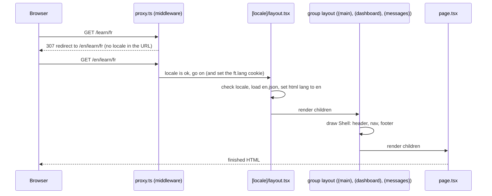
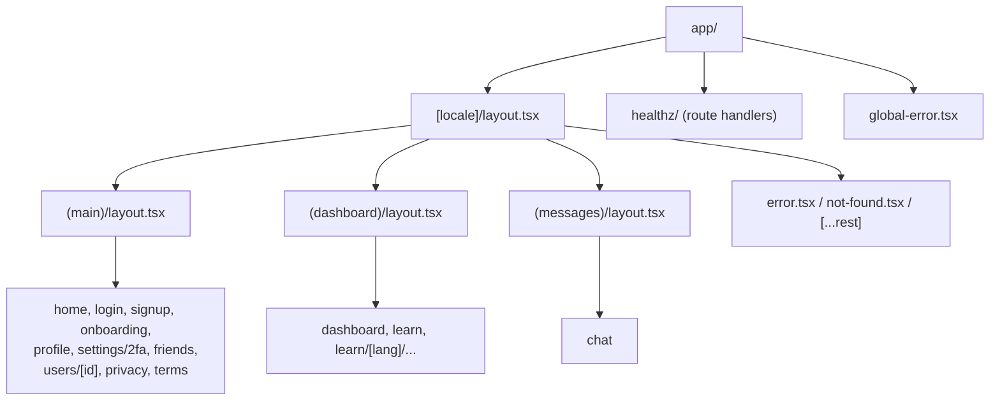
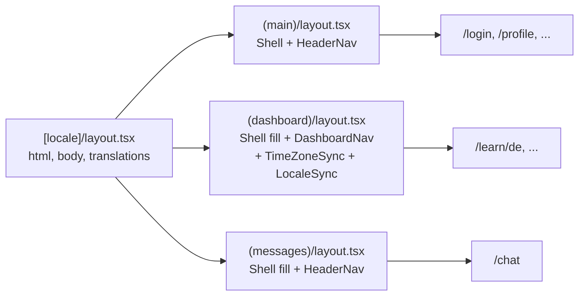
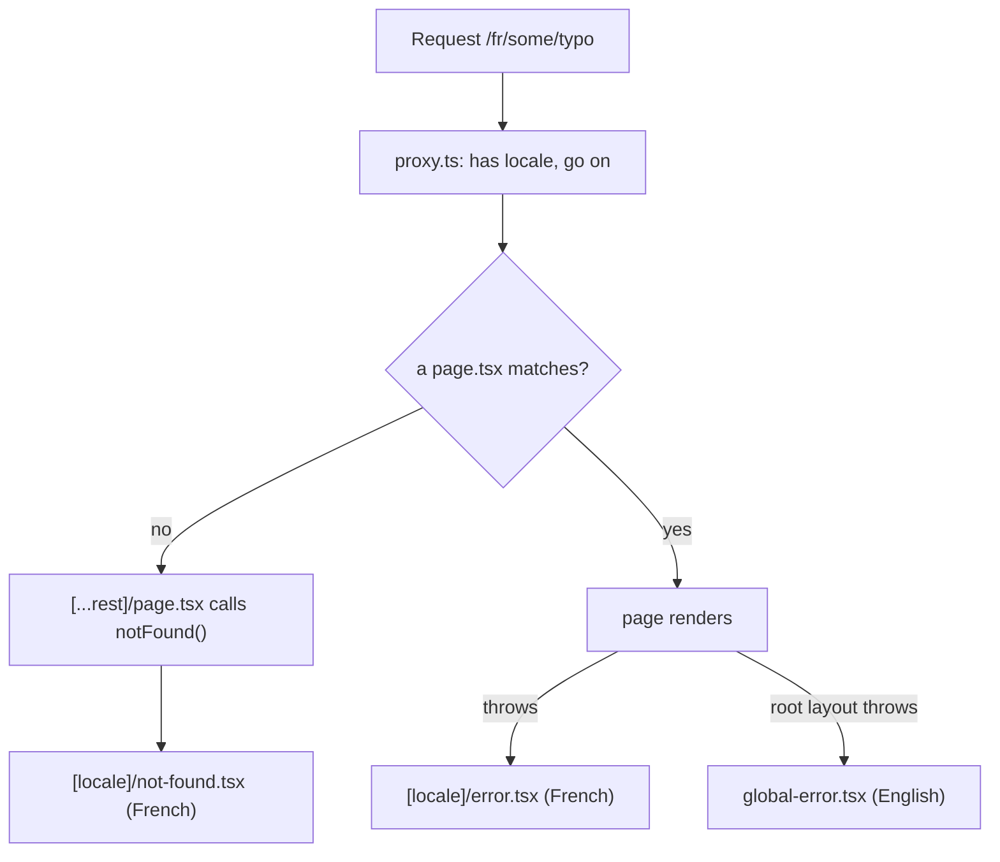
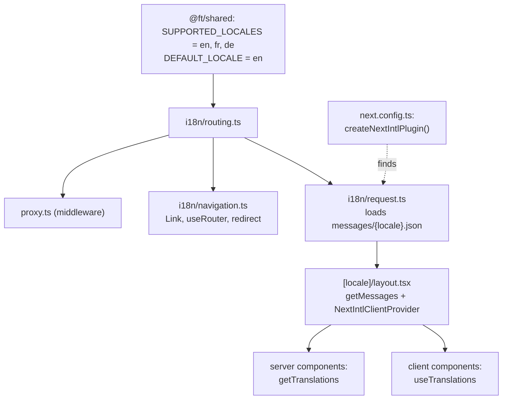
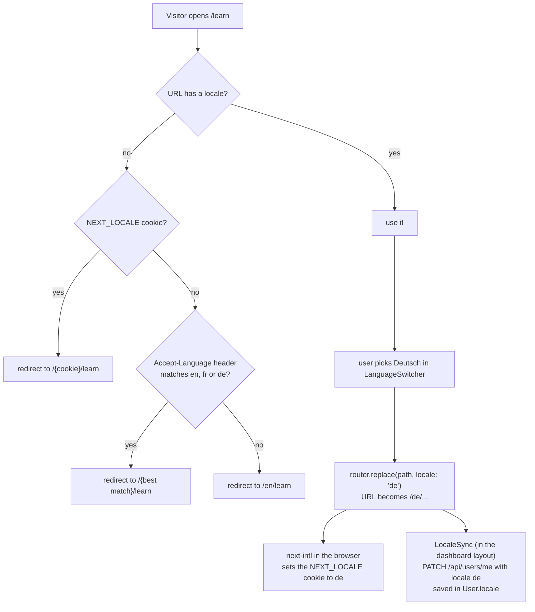

# Chapter 2 — Routing, layouts and languages

In this chapter:

- What happens, step by step, when the browser asks for a page
- What `proxy.ts` does before any page runs
- The full list of URLs and the file that draws each one
- Layouts, route groups, and why there are three groups
- The error pages, the 404 page and the health-check routes
- The CSS files and the tab icon
- How the app speaks three languages (English, French, German) with `next-intl`

---

## 1. The big picture: the life of a page request

Think of a hotel. A guest (the browser) arrives at the door. The doorman (`proxy.ts`) checks
which language the guest speaks and sends them to the right floor (`/en`, `/fr`, `/de`).
On that floor, the building itself (the `[locale]` layout) gives the walls and the lights.
Then a wing of the floor (a route group layout) adds its own furniture: a header and a footer.
Finally the room (the `page.tsx`) is what the guest came for.



The important words:

- **Route**: a URL the app answers, like `/en/login`.
- **Middleware**: code that runs on the server *before* Next.js picks the page. It can redirect,
  rewrite or add cookies. In Next.js 16 the file is called `proxy.ts` (older versions called it
  `middleware.ts`).
- **Layout**: a component that wraps every page below it in the folder tree. It stays on the
  screen when you move between pages that share it.
- **Page**: the `page.tsx` file that draws one URL.

Every user-facing URL in this app starts with a language: `/en/...`, `/fr/...` or `/de/...`.

---

## 2. `proxy.ts`: the doorman

File: [proxy.ts](../../apps/web/proxy.ts)

```ts
import createMiddleware from 'next-intl/middleware';
import type { NextRequest } from 'next/server';

import { routing } from '@/i18n/routing';
import { COURSE_COOKIE, courseHomeLang } from '@/lib/course-path';

const intl = createMiddleware(routing);

/**
 * next-intl's middleware, plus the cookie /learn reads to know which course to
 * open. Written here because a server component cannot set one during a render.
 */
export default function proxy(request: NextRequest) {
  const response = intl(request);
  const lang = courseHomeLang(request.nextUrl.pathname);

  if (lang !== null) {
    response.cookies.set(COURSE_COOKIE, lang, {
      path: '/',
      httpOnly: true,
      sameSite: 'lax',
      maxAge: 60 * 60 * 24 * 365,
    });
  }

  return response;
}
```

Line by line:

| Line | What it does |
| --- | --- |
| `createMiddleware(routing)` | Builds the language middleware of `next-intl` from our routing settings (see section 7). This is done once, when the file loads. |
| `const response = intl(request)` | Runs the `next-intl` middleware. If the URL has no locale (`/login`), it chooses one and **redirects** to `/en/login` (or `/fr/login`...). If the URL already has one, it lets the request go on. It also adds `Link: <...>; hreflang="fr"` headers, so search engines find the other language versions. |
| `courseHomeLang(pathname)` | From [lib/course-path.ts](../../apps/web/lib/course-path.ts). Returns `"de"` for `/en/learn/de` (a course home page) and `null` for anything else, also for deeper pages like `/en/learn/de/lessons`. |
| `response.cookies.set(COURSE_COOKIE, ...)` | Saves the cookie `ft.lang` = the course the learner just opened. It lasts one year (`maxAge` in seconds). `httpOnly` means browser JavaScript cannot read it. |
| `return response` | Sends the (maybe changed) response on. |

**Why set the cookie here?** The comment says it: *"a server component cannot set one during a
render"*. The page `/learn` (without a language) reads this cookie to open the last course
again. Only middleware, route handlers and server actions may write cookies, so the middleware
does it.

**Why only the exact course home?** The comment in `course-path.ts` explains: Next.js
*prefetches* links (it loads them early in the background). A course page shows links to
`/learn/de/lessons/...`. With a looser match, a link the learner only *saw* would change the
cookie.

The second part is the `config`:

```ts
export const config = {
  // Match all pathnames except for
  // - … if they start with `/api`, `/trpc`, `/_next` or `/_vercel`
  // - … the ones containing a dot (e.g. `favicon.ico`)
  // Exclude /healthz: it's a machine health-check endpoint (used by Docker and
  // e2e smoke tests), not a user-facing page. It has no locale-prefixed version,
  // so letting the middleware redirect it would 404 and mark the container unhealthy.
  matcher: '/((?!api|trpc|_next|_vercel|healthz|.*\\..*).*)',
};
```

`matcher` is a regular expression that says *which* URLs go through the middleware. The
`(?!...)` part means "not starting with". So these skip the doorman:

- `/api/...` — goes to the NestJS API, not to Next.js.
- `/_next/...` — Next.js's own JavaScript and CSS files.
- anything with a dot, like `/icon.svg` — static files.
- `/healthz...` — the health checks (section 5). They have no language version, so a redirect
  to `/en/healthz` would answer 404 and Docker would think the container is sick.

---

## 3. The route tree

In the App Router, **folders are URLs**. Some folder names are special:

| Folder name | Meaning | Example |
| --- | --- | --- |
| `[locale]` | A **dynamic segment**: matches any value, and the page gets it as `params.locale`. | `/fr/...` gives `locale = "fr"` |
| `[lang]`, `[id]` | Same idea. | `/en/learn/de` gives `lang = "de"` |
| `[...rest]` | A **catch-all**: matches one or more segments of any kind. | `/en/a/b/c` |
| `(main)` | A **route group**: the name in brackets is *not* in the URL. It only groups files so they can share a layout. | `(main)/login` is `/en/login` |

```
apps/web/app/
├── global-error.tsx          last-chance error page (English only)
├── globals.css               global styles (Tailwind)
├── lesson.css                lesson player styles
├── icon.svg                  the tab icon
├── healthz/
│   ├── route.ts              GET /healthz
│   ├── api/route.ts          GET /healthz/api
│   └── upstream/route.ts     GET /healthz/upstream
└── [locale]/
    ├── layout.tsx            root layout: <html>, translations
    ├── error.tsx             translated error page
    ├── not-found.tsx         translated 404 page
    ├── [...rest]/page.tsx    any unknown URL -> 404
    ├── (main)/               layout.tsx + home, login, signup, profile, friends...
    ├── (dashboard)/          layout.tsx + dashboard, learn/...
    └── (messages)/           layout.tsx + chat
```



### Every URL and its page

`/{locale}` stands for `/en`, `/fr` or `/de`. Paths are under `apps/web/app/[locale]/`.

| URL | File | Group | Note |
| --- | --- | --- | --- |
| `/{locale}` | [(main)/page.tsx](<../../apps/web/app/[locale]/(main)/page.tsx>) | (main) | Home (landing page) |
| `/{locale}/login` | [(main)/login/page.tsx](<../../apps/web/app/[locale]/(main)/login/page.tsx>) | (main) | Log in |
| `/{locale}/signup` | [(main)/signup/page.tsx](<../../apps/web/app/[locale]/(main)/signup/page.tsx>) | (main) | Create an account |
| `/{locale}/onboarding` | [(main)/onboarding/page.tsx](<../../apps/web/app/[locale]/(main)/onboarding/page.tsx>) | (main) | Choose a course and level |
| `/{locale}/profile` | [(main)/profile/page.tsx](<../../apps/web/app/[locale]/(main)/profile/page.tsx>) | (main) | My profile (signed in) |
| `/{locale}/profile/edit` | [(main)/profile/edit/page.tsx](<../../apps/web/app/[locale]/(main)/profile/edit/page.tsx>) | (main) | Edit name and avatar |
| `/{locale}/settings/2fa` | [(main)/settings/2fa/page.tsx](<../../apps/web/app/[locale]/(main)/settings/2fa/page.tsx>) | (main) | Two-factor login settings |
| `/{locale}/friends` | [(main)/friends/page.tsx](<../../apps/web/app/[locale]/(main)/friends/page.tsx>) | (main) | Friends and requests |
| `/{locale}/users/{id}` | [(main)/users/[id]/page.tsx](<../../apps/web/app/[locale]/(main)/users/[id]/page.tsx>) | (main) | Another user's profile |
| `/{locale}/privacy` | [(main)/privacy/page.tsx](<../../apps/web/app/[locale]/(main)/privacy/page.tsx>) | (main) | Privacy policy |
| `/{locale}/terms` | [(main)/terms/page.tsx](<../../apps/web/app/[locale]/(main)/terms/page.tsx>) | (main) | Terms of service |
| `/{locale}/dashboard` | [(dashboard)/dashboard/page.tsx](<../../apps/web/app/[locale]/(dashboard)/dashboard/page.tsx>) | (dashboard) | Only redirects to `/learn` |
| `/{locale}/learn` | [(dashboard)/learn/page.tsx](<../../apps/web/app/[locale]/(dashboard)/learn/page.tsx>) | (dashboard) | Redirects to the last course (reads the `ft.lang` cookie) |
| `/{locale}/learn/{lang}` | [(dashboard)/learn/[lang]/page.tsx](<../../apps/web/app/[locale]/(dashboard)/learn/[lang]/page.tsx>) | (dashboard) | Course home |
| `/{locale}/learn/{lang}/achievements` | [.../achievements/page.tsx](<../../apps/web/app/[locale]/(dashboard)/learn/[lang]/achievements/page.tsx>) | (dashboard) | Achievements |
| `/{locale}/learn/{lang}/placement` | [.../placement/page.tsx](<../../apps/web/app/[locale]/(dashboard)/learn/[lang]/placement/page.tsx>) | (dashboard) | Placement exam |
| `/{locale}/learn/{lang}/lessons` | [.../lessons/page.tsx](<../../apps/web/app/[locale]/(dashboard)/learn/[lang]/lessons/page.tsx>) | (dashboard) | Lesson list and search |
| `/{locale}/learn/{lang}/lessons/{id}` | [.../lessons/[id]/page.tsx](<../../apps/web/app/[locale]/(dashboard)/learn/[lang]/lessons/[id]/page.tsx>) | (dashboard) | One lesson's start page |
| `/{locale}/learn/{lang}/lessons/{id}/play` | [.../lessons/[id]/play/page.tsx](<../../apps/web/app/[locale]/(dashboard)/learn/[lang]/lessons/[id]/play/page.tsx>) | (dashboard) | Lesson player |
| `/{locale}/learn/{lang}/lessons/{id}/results` | [.../lessons/[id]/results/page.tsx](<../../apps/web/app/[locale]/(dashboard)/learn/[lang]/lessons/[id]/results/page.tsx>) | (dashboard) | Lesson results |
| `/{locale}/chat` | [(messages)/chat/page.tsx](<../../apps/web/app/[locale]/(messages)/chat/page.tsx>) | (messages) | Messages |
| `/{locale}/anything-else` | [[...rest]/page.tsx](<../../apps/web/app/[locale]/[...rest]/page.tsx>) | none | Shows the 404 page |

Non-page routes (no language, no layout):

| URL | File | Answer |
| --- | --- | --- |
| `/healthz` | [healthz/route.ts](../../apps/web/app/healthz/route.ts) | `{"status":"ok","service":"web"}` |
| `/healthz/api` | [healthz/api/route.ts](../../apps/web/app/healthz/api/route.ts) | `{"api":"up"}` or `{"api":"down"}`, always 200 |
| `/healthz/upstream` | [healthz/upstream/route.ts](../../apps/web/app/healthz/upstream/route.ts) | 200, or 503 when the API cannot be reached |
| `/icon.svg` | [icon.svg](../../apps/web/app/icon.svg) | The tab icon |

The other `.tsx` files inside these folders (like `login-form.tsx`) are not routes. Only
`page.tsx`, `layout.tsx`, `route.ts` and a few other special names have a meaning for Next.js.
The rest are normal components that sit next to the page that uses them. Chapters 5 to 8 explain
them.

---

## 4. Layouts

### 4.1 `app/[locale]/layout.tsx`: the root layout

File: [app/[locale]/layout.tsx](<../../apps/web/app/[locale]/layout.tsx>)

This is the **root layout**: the outermost one, which draws `<html>` and `<body>`. Usually a
Next.js app has it at `app/layout.tsx`. Here it is *inside* `[locale]`, on purpose. The comment
says why: *"`<html lang>` must name the language actually rendered, and only a layout behind the
[locale] segment can read it as a plain param."* `lang="fr"` matters for screen readers and
search engines.

It exports four things:

**`viewport`** — tells phones to use the device width (no zoomed-out desktop page).

**`generateStaticParams()`** — returns `[{locale:'en'},{locale:'fr'},{locale:'de'}]`. It tells
Next.js which values `[locale]` can have, so it can prepare them at build time.

**`generateMetadata()`** — gives the page `<title>` and description, translated:

```tsx
  const { locale } = await params;
  const t = await getTranslations({ locale, namespace: 'Layout' });

  // A proper noun, so the three catalogues carry the same string. It still
  // comes from a catalogue: the module is graded on no user-facing text being
  // hardcoded, not on every string differing between languages.
  const productName = t('productName');

  return {
    title: {
      default: productName,
      template: `%s | ${productName}`,
    },
    description: t('description'),
    applicationName: productName,
  };
```

`template` means: when a page sets its own title, like `"Log in"`, the tab shows
`"Log in | ft_transcendence"`. The product name is the same in all three files, but it still
comes from a translation file, because the project rules say no user-facing text may be
written directly in the code.

**The layout component** itself:

```tsx
  const { locale } = await params;

  // A URL like /es/login matches this segment before anything else can reject
  // it. Without this the render would continue with an unknown locale and
  // next-intl would answer every key with its own path.
  if (!hasLocale(routing.locales, locale)) {
    notFound();
  }

  setRequestLocale(locale);
  const messages = await getMessages();

  return (
    // Extensions like Dark Reader stamp attributes on <html> before React
    // hydrates, which otherwise logs a mismatch an evaluator would read as a
    // console gate failure. This covers that one element, not its children, so
    // a real mismatch anywhere inside still reports.
    <html lang={locale} suppressHydrationWarning className="dark">
      <body className="bg-slate-950 font-sans text-slate-100 antialiased">
        <NextIntlClientProvider locale={locale} messages={messages}>
          {children}
        </NextIntlClientProvider>
      </body>
    </html>
  );
```

Step by step:

1. `params` is a Promise in Next.js 16, so we `await` it.
2. `hasLocale` checks the value. `/es/login` would match `[locale]` with `"es"`. That language is
   not supported, so `notFound()` shows the 404.
3. `setRequestLocale(locale)` tells `next-intl` the language for this render.
4. `getMessages()` loads the whole translation file (see `i18n/request.ts` below).
5. `NextIntlClientProvider` makes the translations available to **client components** in the
   browser (server components read them directly). Because the whole file goes to the browser,
   the long legal texts are kept out of it (they live in `lib/legal-content`).
6. `className="dark"` fixes the app to a dark palette. `suppressHydrationWarning` hides one
   known warning: browser extensions like Dark Reader add attributes to `<html>` before React
   starts, and React would complain. It covers only this one element.
7. It also imports `../globals.css` — so every page has the styles.

### 4.2 Route groups: why three layouts?

The site has three kinds of screens, and they need a slightly different frame:

| Group | Pages | Logo links to | Right side of header | `fill` | Extra |
| --- | --- | --- | --- | --- | --- |
| `(main)` | home, account, friends, legal | `/` | `HeaderNav` | no | — |
| `(dashboard)` | dashboard, learn, lessons | `/learn` | `DashboardNav` (with course switcher) | yes | `TimeZoneSync`, `LocaleSync`, course-menu slot |
| `(messages)` | chat | `/learn` | `HeaderNav` | yes | — |

`fill` means "pin the frame to the screen height" (from large screens). Then the page's panes
scroll inside, and the header and footer stay in place. A document page (like the terms) does
not want that: it is long and you scroll down to the footer.

Without route groups, we could only have one layout per folder level, and all these pages sit
at the same level (`/en/login`, `/en/learn`, `/en/chat`). A group is a folder with a name in
brackets: it adds a layout but **not** a URL part.



All three use the same `Shell` component and the same `LegalFooter`. `HeaderNav` and `DashboardNav` show
the language switcher and the account links. For a signed-in user they fold all of it into
`HeaderMenu`: one menu button, on every screen size, with the unread count on it. A visitor
sees the items in one row instead. Chapter 3 explains them.

**[(main)/layout.tsx](<../../apps/web/app/[locale]/(main)/layout.tsx>)** — the marketing and
account frame:

```tsx
export default function MainLayout({ children }: { children: ReactNode }) {
  return (
    <Shell brand={<Wordmark />} nav={<HeaderNav />} footer={<LegalFooter />}>
      {children}
    </Shell>
  );
}
```

**[(messages)/layout.tsx](<../../apps/web/app/[locale]/(messages)/layout.tsx>)** — the same, but
with `fill` and the logo going to `/learn`. The comment explains why it has no course switcher:
no course is open here, and the switcher costs an API call on every render. The chat page
re-renders often (on every friend event), so that cost would add up.

**[(dashboard)/layout.tsx](<../../apps/web/app/[locale]/(dashboard)/layout.tsx>)** — the course
frame:

```tsx
export default async function DashboardLayout({ children }: { children: ReactNode }) {
  // Only reads the session: the pages decide what a signed-out visitor gets.
  const user = await currentUser();

  return (
    <>
      {user ? <TimeZoneSync storedTimeZone={user.timeZone} /> : null}
      {user ? <LocaleSync storedLocale={user.locale} /> : null}
      <Shell
        brand={
          <>
            <Wordmark href="/learn" />
            {/* The course page puts its My course button here, below lg. */}
            <div id={COURSE_MENU_SLOT} className="contents" />
          </>
        }
        nav={<DashboardNav />}
        fill
        footer={<LegalFooter />}
      >
        {children}
      </Shell>
    </>
  );
}
```

- `currentUser()` (from `lib/session.ts`, chapter 4) returns the signed-in user or `null`.
  The layout does not redirect: each page decides.
- `TimeZoneSync` and `LocaleSync` render nothing. They save the browser's time zone and the
  interface language in the user's profile (chapter 3).
- The empty `<div id="course-menu-slot">` is a hole in the header. On small screens, the course
  page puts its "My course" button there with a React *portal* (a way to draw a component in
  another place of the page). `className="contents"` makes the div invisible to the layout.

---

## 5. Error pages, 404 and route handlers

Next.js uses special file names for errors:

| File | When it shows | Translated? |
| --- | --- | --- |
| `[locale]/error.tsx` | A page under `[locale]` throws an error while rendering | Yes |
| `[locale]/not-found.tsx` | A page calls `notFound()` | Yes |
| `[locale]/[...rest]/page.tsx` | No route matches the URL; it calls `notFound()` | (shows the one above) |
| `global-error.tsx` | The root layout itself throws | No, English |



### `[locale]/error.tsx`

File: [error.tsx](<../../apps/web/app/[locale]/error.tsx>)

An error file must be a **client component** (`'use client'`), because it gets a `reset`
function that re-tries the render in the browser.

```tsx
export default function LocaleErrorBoundary({ reset }: { error: Error; reset: () => void }) {
  const t = useTranslations('ErrorPage');

  return (
    <Shell brand={<Wordmark />} footer={<LegalFooter />}>
      ...
          <button type="button" onClick={reset} ...>
            {t('tryAgain')}
          </button>
          <Link href="/" ...>
            {t('goHome')}
          </Link>
      ...
    </Shell>
  );
}
```

The comment tells when this shows most often: `requireUser()` throws when the API cannot be
reached. That is on purpose: a slow or restarting API must not look like a logout, so the session
cookie stays and the user can just "Try again". There is no account nav here (`nav` is not
passed), because the session lookup is exactly what failed.

### `[locale]/not-found.tsx` and `[...rest]/page.tsx`

Files: [not-found.tsx](<../../apps/web/app/[locale]/not-found.tsx>),
[[...rest]/page.tsx](<../../apps/web/app/[locale]/[...rest]/page.tsx>)

`not-found.tsx` draws the translated 404, with a "Go home" link and the legal footer. It has no
account nav: reading cookies would make every 404 a dynamic (non-cached) render.

But Next.js only uses this file when a page *calls* `notFound()`. A URL that matches nothing
would fall to the default Next.js 404, which sits above `[locale]`, so it is in English and has
no legal links. The catch-all fixes that:

```tsx
export default function CatchAllPage() {
  notFound();
}
```

`[...rest]` matches every URL under `/{locale}/` that no other route takes. Since `proxy.ts`
first adds a locale to every URL, all unknown addresses end up here, and then on the translated
404.

### `global-error.tsx`

File: [global-error.tsx](../../apps/web/app/global-error.tsx)

This is the only error page above `[locale]`. It catches errors in the root layout — the layout
that loads the translations. So it cannot use translations (that would fail a second time), and
it cannot use `Shell` (which reads translations). It is in English, and it draws its own
`<html>` and `<body>`, because it *replaces* the whole document. It imports `globals.css` itself
for the same reason.

### `healthz/*`: route handlers

A **route handler** is a `route.ts` file. Instead of a React page, it exports functions named
after HTTP methods (`GET`, `POST`...) and returns a raw response, often JSON. It is like a tiny
API inside the web app.

```ts
// app/healthz/route.ts
export const dynamic = 'force-dynamic';

export function GET() {
  return NextResponse.json({ status: 'ok', service: 'web' });
}
```

`dynamic = 'force-dynamic'` means "run this on every request", never answer from a copy made at
build time. A health check must tell the truth *now*.

| Route | Who calls it | Why |
| --- | --- | --- |
| [/healthz](../../apps/web/app/healthz/route.ts) | Docker `HEALTHCHECK` | "Is the web server alive?" Not under `/api`, because Caddy sends `/api` to NestJS. |
| [/healthz/api](../../apps/web/app/healthz/api/route.ts) | The tab socket, before each retry (chapter 3) | Asks the API with `pingApi`. Always 200 with `{api:'up'}` or `{api:'down'}`, because the browser logs every 5xx answer as a console error. |
| [/healthz/upstream](../../apps/web/app/healthz/upstream/route.ts) | Prometheus and the blackbox alert | Same ping, but answers **503** when the API is unreachable, so monitoring sees it. |

The `upstream` comment explains why it exists: normal pages show a signed-out view when the API
is down, on purpose. So a wrong `API_INTERNAL_URL` would still render valid pages and nothing
would fail. This route makes that problem visible. It is not a session lookup, because a caller
who hit their own rate limit would then see a healthy API as "down".

---

## 6. CSS and the icon

### `globals.css`

File: [globals.css](../../apps/web/app/globals.css)

Imported once by the root layout (and by `global-error.tsx`). It uses **Tailwind CSS 4**: you
write small class names like `px-4 text-slate-100` in the JSX, and Tailwind builds the CSS for
the classes it finds.

```css
@import 'tailwindcss';
@import './lesson.css';

/* Tailwind 4 resolves `dark:` through prefers-color-scheme unless told
   otherwise. The layouts put `dark` on <html> to pin the app to one palette,
   so the variant has to follow that class or the two disagree: body stays
   dark while every `dark:` utility switches off on a light OS. */
@custom-variant dark (&:where(.dark, .dark *));

/* Tailwind 4 is CSS-first: there is no tailwind.config.js. Source detection is
   declared explicitly so class scanning does not depend on the working
   directory the build happens to run from inside the container. */
@source '.';

@source '../components';

/* @ft/ui is source only: its classes are scanned from there. */
@source '../../../packages/ui/src';
```

- `@import 'tailwindcss'` loads Tailwind. Tailwind 4 has no `tailwind.config.js`: the settings
  live in CSS.
- `@custom-variant dark` makes `dark:` classes follow the `dark` class on `<html>`, not the
  operating system setting. Without it, a user with a light OS would get a dark body but light
  `dark:` utilities.
- `@source` lists the folders Tailwind scans for class names: `app/`, `components/` and the
  shared `packages/ui/src`. It is explicit so the build does not depend on the folder it runs in.
- `@theme { ... }` adds two animations for the lesson player (`animate-lesson-slide`,
  `animate-lesson-flash`). A `prefers-reduced-motion` rule makes them almost instant for users
  who ask the OS for less motion.
- `@layer base` sets `color-scheme: dark` (so form controls and scrollbars are dark too),
  smooth scrolling and nicer text.
- `@layer utilities` adds the rocket animations of the onboarding page (`animate-liftoff`,
  `animate-launch`, `animate-twinkle`).

### `lesson.css`

File: [lesson.css](../../apps/web/app/lesson.css)

About 1,200 lines of plain CSS for the lesson pages, imported by `globals.css`. The first line
says it follows the prototype mockups. It uses normal class names (`.lesson-view`, `.lesson-layout`,
`.lesson-sidebar`, `.lesson-timeline`, `.lesson-task`, `.lesson-results-banner`...) because the
lesson screens have a precise grid that is easier to write as CSS. A few rules use `:has()` to
widen the shell only when a lesson is on screen:

```css
main:has(.lesson-view) {
  max-width: 1320px;
}
```

It also hides the reading question while the text is open (`data-skim="reading"`). Chapter 7
explains the lesson player.

### `icon.svg`

File: [icon.svg](../../apps/web/app/icon.svg)

A file named `icon.svg` in `app/` is picked up by Next.js as the tab icon (favicon) of every
page; Next adds the `<link rel="icon">` tag itself. It is a blue rounded square with three white
lines.

---

## 7. Internationalization (i18n)

**Internationalization** means building the app so it can show its text in several languages.
People write it **i18n**: "i", then 18 letters, then "n". A **locale** is a language code like
`en`, `fr` or `de`. A **message catalogue** is a file with every text of the app, in one
language.

Analogy: the code is a theatre play, and each catalogue is a translation of the script. The
actors (components) do not know the words by heart; they read the line with the right number
(`HomePage.headline`) from the script of the evening's language.

The app uses the library **next-intl**. Its pieces:



### `i18n/routing.ts`

File: [routing.ts](../../apps/web/i18n/routing.ts)

```ts
export const routing = defineRouting({
  // A list of all locales that are supported
  locales: SUPPORTED_LOCALES,

  // Used when no locale matches
  defaultLocale: DEFAULT_LOCALE,

  // Prefix even the default locale, so no route is ambiguous about the language
  // it renders and every href carries one.
  localePrefix: 'always',
});
```

The list of languages comes from the shared package
([packages/shared/src/schemas/locale.ts](../../packages/shared/src/schemas/locale.ts)):
`['en', 'fr', 'de']`, default `'en'`. It is the one place where this list lives: the API's user
model uses it too.

`localePrefix: 'always'` means English pages are `/en/login`, not just `/login`. Every URL says
its language.

### `i18n/request.ts`

File: [request.ts](../../apps/web/i18n/request.ts)

```ts
export default getRequestConfig(async ({ requestLocale }) => {
  const requested = await requestLocale;
  const locale = hasLocale(routing.locales, requested) ? requested : routing.defaultLocale;

  return {
    locale,
    messages: (await import(`../messages/${locale}.json`)).default,
  };
});
```

`next-intl` calls this on the server for each request, to know the language and the catalogue.
The `createNextIntlPlugin()` line in `next.config.ts` is what tells `next-intl` where this file
is. The comment explains the check: `requestLocale` can be anything (or nothing). An unknown value
would reach the `import` and crash ("file not found"), so it falls back to English instead.

### `i18n/navigation.ts`

File: [navigation.ts](../../apps/web/i18n/navigation.ts)

```ts
export const { Link, redirect, usePathname, useRouter, getPathname } = createNavigation(routing);
```

These replace the Next.js versions. They add the current locale for you:
`<Link href="/login">` on a French page goes to `/fr/login`. `usePathname()` returns the path
*without* the locale (`/login`). `router.replace(pathname, { locale: 'de' })` switches
language. Components in this app import `Link`, `useRouter` and `usePathname` from
`@/i18n/navigation`, not from `next/link` or `next/navigation`. The `redirect` of this file is not
used: server code calls `redirect('/login')` from `next/navigation`, with no locale, and
`proxy.ts` adds the locale on the next request.

### `messages/en.json`, `fr.json`, `de.json`

Files: [en.json](../../apps/web/messages/en.json), [fr.json](../../apps/web/messages/fr.json),
[de.json](../../apps/web/messages/de.json)

Each file is one JSON object. The top-level keys are **namespaces**: usually one per component or
page. Inside are the keys. All three files have the same 37 namespaces and the same keys.

| Namespace | Keys | Used by |
| --- | --- | --- |
| `SessionNav` | 4 | account nav, menu button |
| `LanguageSwitcher` | 4 | language select |
| `Layout` | 2 | product name, meta description |
| `Footer` | 2 | legal footer |
| `HomePage` | 5 | landing page |
| `Languages` | 3 | language names |
| `CourseSwitcher` | 3 | course switcher |
| `Course` | 34 | course page |
| `LessonStatus` | 4 | lesson states (todo, done...) |
| `Onboarding` | 17 | onboarding page |
| `Level` | 8 | level picker |
| `MessagesPage` | 12 | chat, unread badge |
| `ErrorPage` | 4 | `error.tsx` |
| `NotFoundPage` | 4 | `not-found.tsx` |
| `LoginPage`, `LoginForm` | 1, 8 | log in |
| `SignUpPage`, `SignUpForm` | 1, 9 | sign up |
| `Form` | 1 | shared form text |
| `Errors` | 19 (18 groups + `unknown`) | API error codes as sentences |
| `LogOutButton` | 2 | sign out |
| `Connection` | 1 | "Reconnecting…" pill |
| `LegalArticle` | 1 | privacy and terms |
| `ProfilePage`, `ProfileForm` | 7, 8 | profile |
| `FriendsPage` | 24 | friends |
| `UserPage` | 4 | another user's page |
| `TwoFactorPage`, `TwoFactorPanel` | 2, 17 | 2FA settings |
| `Placement` | 30 | placement exam |
| `Lesson` | 125 | lesson player |
| `Genders` | 3 | grammar genders |
| `LessonKinds` | 4 | grammar, vocabulary... |
| `Gamification` | 42 | XP, ranks, achievements |
| `Topics` | 13 | grammar topics |
| `Themes` | 14 | vocabulary themes |
| `Lessons` | 35 | lesson list page |

A small part of `en.json`:

```json
  "NotFoundPage": {
    "title": "Page not found",
    "heading": "Page not found",
    "intro": "That address does not exist. It may have moved, or the link that brought you here may be out of date.",
    "goHome": "Go home"
  },
```

Texts can have **placeholders** in the ICU format, like
`"{count, plural, one {# unread message} other {# unread messages}}"`: the right form is
chosen from the number. They can also have **tags** for rich text, like the footer's
`"... <privacy>Privacy Policy</privacy> and <terms>Terms of Service</terms>."` (chapter 3 shows
how they become links).

The test [lib/messages.test.ts](../../apps/web/lib/messages.test.ts) checks that `fr.json` and
`de.json` have exactly the same keys as `en.json`, that no text is empty, and that every API error
code and achievement has a translation.

### How a component gets a text

In a **server component** (async), use `getTranslations` from `next-intl/server`:

```tsx
// app/[locale]/(main)/page.tsx
import { getTranslations } from 'next-intl/server';

export default async function HomePage() {
  const user = await currentUser();
  const t = await getTranslations('HomePage');
  // ... t('headline'), t('startNow') ...
```

In a **client component**, or a non-async server component, use the hook `useTranslations`:

```tsx
// app/[locale]/error.tsx  ('use client')
const t = useTranslations('ErrorPage');
// ...
<h1>{t('heading')}</h1>
```

`t('heading')` looks up `ErrorPage.heading` in the current catalogue. With a value:
`t('unread', { count })`. In the browser the texts come from `NextIntlClientProvider` in the root
layout; on the server they come from `i18n/request.ts`.

### How the locale is chosen and kept



1. **The URL wins.** `/fr/...` is French, always. Nothing reads `User.locale` to pick the
   language of a page.
2. With no locale in the URL, the `next-intl` middleware looks at its `NEXT_LOCALE` cookie (the
   last language used), then the browser's `Accept-Language` header, then the default `en`, and
   redirects. `NEXT_LOCALE` is a session cookie: it has no `maxAge`, so it ends when the browser
   closes. The middleware also sets it when a page is opened in a language that is not the
   browser's own.
3. **Changing language**: the `LanguageSwitcher` select calls
   `router.replace(pathname, { locale })`. The page reloads at the same path in the new
   language, and `next-intl` writes `NEXT_LOCALE` in the browser. `replace` (not `push`) so the
   Back button does not undo a language change.
4. **Telling the server**: [LocaleSync](../../apps/web/components/locale-sync.tsx), in the
   `(dashboard)` layout only, saves the URL's language in `User.locale` (`PATCH /api/users/me`
   with `{ locale }`) when it differs from the stored one. Only one request is sent at a time. A
   failure is retried on the next page; a `400` is not retried. The API needs it because the lesson
   tutor answers in the learner's interface language. Sign-up does not send a locale, so a new
   account starts with `en` until its first dashboard page. A change made on a `(main)` or
   `(messages)` page is saved on the next dashboard page. Chapter 3 shows the code.

---

## Key ideas to remember

- Every page URL starts with a locale (`/en`, `/fr`, `/de`); `proxy.ts` adds it when missing and
  also saves the last opened course in the `ft.lang` cookie. The URL decides the language;
  `LocaleSync` only copies it into `User.locale` for the tutor.
- Folders are URLs. `[x]` is a dynamic part, `[...x]` catches everything, `(x)` is a group that
  adds a layout but no URL part.
- The root layout lives in `[locale]/layout.tsx` so `<html lang>` is right; it loads the
  catalogue and gives it to client components.
- Three groups, three layouts: `(main)` for documents, `(dashboard)` and `(messages)` pinned to
  the screen. All use the same `Shell`.
- `error.tsx` and `not-found.tsx` are translated; `[...rest]` sends unknown URLs to that 404;
  `global-error.tsx` is the English last resort.
- `route.ts` files are small JSON endpoints: the three `/healthz` checks for Docker, the tab
  socket and monitoring.
- Styles: Tailwind 4 in `globals.css`, plain CSS for lessons in `lesson.css`.
- Translations: `getTranslations` on the server, `useTranslations` in the client, keys grouped by
  namespace in `messages/*.json`; links and the router come from `@/i18n/navigation`, server redirects from
  `next/navigation` (the middleware adds the locale).

---

Previous: [Chapter 1 — React and Next.js](01-react-and-nextjs.md) · Next: [Chapter 3 — The app shell](03-shell-components.md) · [Back to index](README.md)
