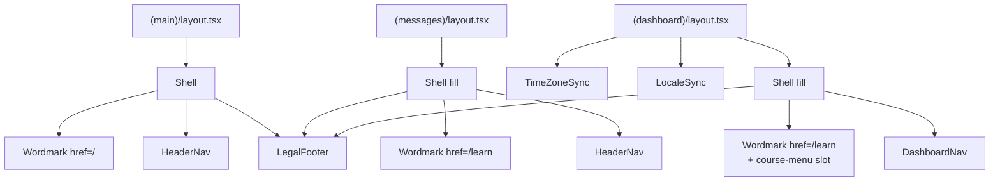
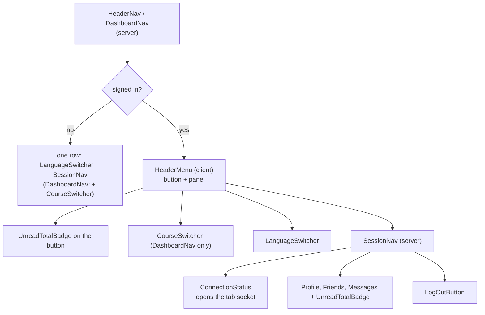
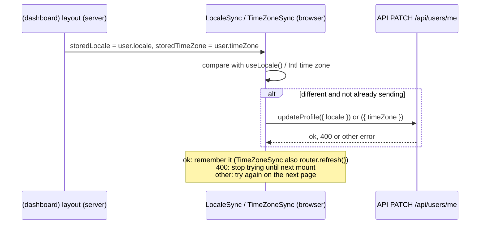
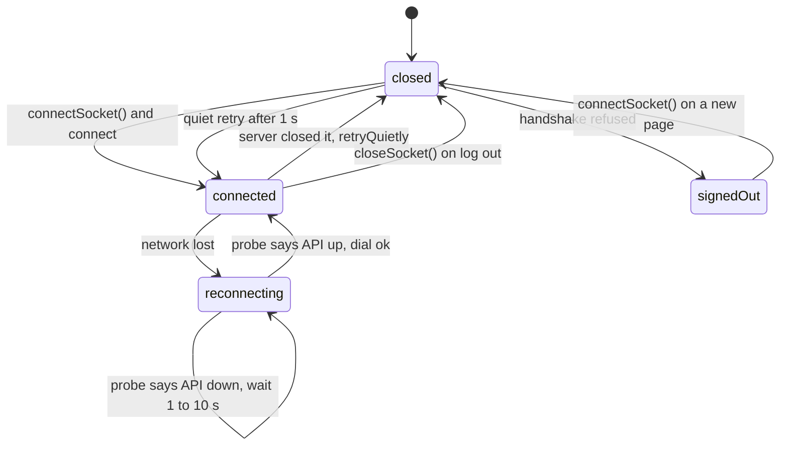
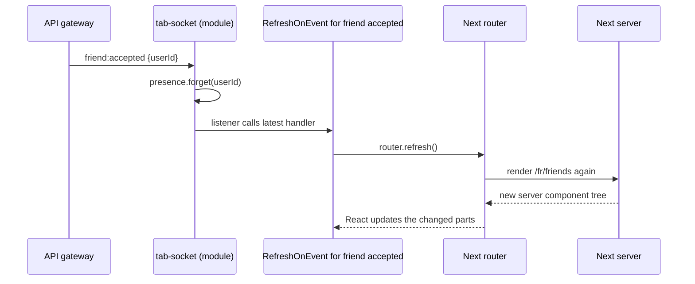

# Chapter 3 — The app shell and shared helpers

In this chapter:

- What the "shell" is: the frame (header, menu, footer) around every page
- Which layout draws which piece (a component tree)
- The header: `HeaderNav`, `DashboardNav`, `HeaderMenu`, `SessionNav` and their small parts
- Small invisible helpers: `LocaleSync`, `TimeZoneSync`, `useScrollLock`
- The live connection: **one socket per browser tab** (`tab-socket.ts`, `lib/reconnect.ts`)
- How `RefreshOn` re-renders a page when the server sends an event
- The unread badge and the "Reconnecting…" pill

---

## 1. The big picture

Think of a picture frame. You change the photo (the page) often, but the frame (the shell)
stays the same. In this app the frame is: a header with the logo on the left and a menu on the
right, the page in the middle, and a small legal footer at the bottom.

Chapter 2 showed the three group layouts. Each one builds the frame with the same `Shell`
component and gives it different pieces:



And inside the nav (the right side of the header):



Two kinds of components mix here (see chapter 1):

- **Server components** (`HeaderNav`, `DashboardNav`, `SessionNav`, `Shell`, `LegalFooter`)
  run on the server. They can read the session cookie, so the first HTML already shows the right
  menu.
- **Client components** (`'use client'`: `HeaderMenu`, `LanguageSwitcher`, `LogOutButton`,
  `ConnectionStatus`...) run in the browser. They need clicks, state or the socket.

A server component can pass a server component as `children` to a client component. That is how
`HeaderMenu` (client) holds `SessionNav` (server).

Files in this chapter are in [apps/web/components](../../apps/web/components). We follow the
order of the screen: frame, header, menu, helpers, then the socket.

---

## 2. `shell.tsx`: the frame

File: [shell.tsx](../../apps/web/components/shell.tsx) — exports `Shell`, `ShellProps` and
`Wordmark`.

The comment says the groups differ in only four ways, and all four are props: what is left of
the nav (`brand`), the footer (`footer`), whether the frame is pinned to the screen (`fill`),
and the page itself (`children`). So the header markup, the side space and the max width are
written once. The nav (`nav`) is a prop too, for another reason (see below).

```tsx
export function Shell({ brand, nav, fill = false, footer, children }: ShellProps) {
  return (
    <div className={`flex min-h-dvh flex-col ${fill ? 'lg:h-dvh' : ''}`}>
      <header className="border-b border-slate-800">
        <div
          className={`${CONTAINER} relative z-50 flex flex-wrap items-center justify-between gap-x-4 gap-y-3 py-2.5`}
        >
          {brand}
          {nav}
        </div>
      </header>

      {/*
        `min-h-0` is what makes `fill` work, from `lg` where the frame is
        pinned. A flex child defaults to min-height:auto, which refuses to
        shrink below its content, so a tall page pushes the footer off the
        screen and the panes' lg:overflow-y-auto never gets a box to scroll in.
        Setting it here means a page can size itself to the pane with h-full and
        own its own scrolling. `flex flex-col` is for the pages that fill this
        box with a single pane and centre inside it. A pane that scrolls also
        needs `relative`: an sr-only label is absolutely positioned, and with
        no positioned ancestor it escapes the pane and makes the whole page
        scroll, header and footer included.
      */}
      <main
        className={`${CONTAINER} flex-1 ${fill ? 'flex min-h-0 flex-col pt-5 pb-4' : 'py-8 sm:py-12'}`}
      >
        {children}
      </main>

      {footer}
    </div>
  );
}
```

- `min-h-dvh`: at least the screen height (`dvh` = "dynamic viewport height", correct on phones
  where the address bar comes and goes).
- `fill` adds `lg:h-dvh`: from large screens (`lg`), exactly the screen height. The page's panes
  then scroll inside. Below `lg` the panes stack and the whole page scrolls; pinning would crush
  them on a phone.
- `min-h-0` on `<main>`: a long comment explains it. A flex child cannot shrink below its content
  by default, so a tall page would push the footer off the screen and the inner panes would never
  scroll. `min-h-0` removes that limit.
- `relative z-50` on the header row: `HeaderMenu` places its panel and dark backdrop against this
  row (section 4).
- `CONTAINER` = `mx-auto w-full max-w-6xl px-4 sm:px-6`: centered, max width, side space.

**Why `nav` is a prop and not inside Shell?** `SessionNav` reads cookies. `Shell` is also used by
`error.tsx` (a client component) and by the 404 page (which must not read cookies). Those pass no
`nav`. So `Shell` itself fetches no data.

`Wordmark` is the product name as a link home:

```tsx
export function Wordmark({ href = '/' }: { href?: '/' | '/learn' }) {
  const t = useTranslations('Layout');

  return (
    // Below lg the course page's My course button takes its place.
    <Link
      href={href}
      className="text-base font-semibold tracking-tight text-slate-100 max-lg:[:root:has([data-course-menu-button])_&]:hidden"
    >
      {t('productName')}
    </Link>
  );
}
```

"Home" is `/` for the marketing pages and `/learn` inside the app, so a signed-in learner is not
sent back to the landing page. The long class means: on small screens, *if the page contains a
`[data-course-menu-button]`*, hide the wordmark. The course page puts that button in the
course-menu slot (see `lib/course-menu-slot.ts` below), so the button takes the logo's place.

### `lib/course-menu-slot.ts`

File: [course-menu-slot.ts](../../apps/web/lib/course-menu-slot.ts)

```ts
export const COURSE_MENU_SLOT = 'course-menu-slot';
```

Only one string: the `id` of the empty `<div>` the `(dashboard)` layout puts in the header. The
course menu (`learn/[lang]/course-menu.tsx`, chapter 6) finds it with
`document.getElementById(COURSE_MENU_SLOT)` and draws its button there with `createPortal`.
**Why its own file?** A constant exported from a `'use client'` file reaches a server component
as a "client reference", not as the string. The layout is a server component, so the constant
lives in a plain module both can import.

---

## 3. The header nav: `HeaderNav` and `DashboardNav`

### `header-nav.tsx`

File: [header-nav.tsx](../../apps/web/components/header-nav.tsx) — used by `(main)` and
`(messages)`.

```tsx
export async function HeaderNav() {
  const user = await currentUser();
  const items = (
    <>
      <LanguageSwitcher />
      <SessionNav />
    </>
  );

  return user === null ? (
    <div className="flex min-w-0 flex-wrap items-center gap-x-4 gap-y-2">{items}</div>
  ) : (
    <HeaderMenu>{items}</HeaderMenu>
  );
}
```

A server component. Same items in both cases, different wrapping:

- **Visitor** (not signed in): language select, "Sign in", "Create account" in one row. Folding
  them into a menu would hide "Sign in".
- **Signed in**: everything goes into the `HeaderMenu` (one button that opens a panel).

`currentUser()` is cached per render (React `cache`, chapter 4), so the layout, this nav and
`SessionNav` share one session lookup.

### `dashboard-nav.tsx`

File: [dashboard-nav.tsx](../../apps/web/components/dashboard-nav.tsx) — used by `(dashboard)`.

```tsx
export async function DashboardNav() {
  const [user, result] = await Promise.all([currentUser(), loadCourses()]);
  const courses = result.status === 'ok' ? result.data.courses : [];
  const items = (
    <>
      {courses.length > 0 ? <CourseSwitcher courses={courses} /> : null}
      <LanguageSwitcher />
      <SessionNav />
    </>
  );
  ...
```

`HeaderNav` plus the `CourseSwitcher` (the list of the learner's courses; chapter 6). It is a
separate component because in `(main)` it would load courses for anonymous visitors, and in
`(messages)` no course is open. `Promise.all` runs the two requests at the same time.

---

## 4. `header-menu.tsx`: the menu button and panel

File: [header-menu.tsx](../../apps/web/components/header-menu.tsx) — a client component, exports
`HeaderMenu`.

It folds the signed-in links behind one button (a "hamburger" ☰ that becomes ✕), on every screen
size. Open, a panel appears under the header (full width on phones, a 20rem column on the right
from `sm`), and a dark backdrop covers the page.

```tsx

```

A smart trick: the state is not `true/false` but *the path where the menu was opened*. The layout
(and so this header) stays on screen when you click a link. When the path changes, `openOn` no
longer equals `pathname`, so `open` becomes `false` — the menu closes by itself, with no extra
code.

How it closes:

- **Click outside** — an effect adds a `pointerdown` listener on the document while open. If the
  click is not in the button or the panel, it closes. The cleanup function removes the listener.
- **Escape key** — `onKeyDown` closes it and gives the focus back to the button (good for
  keyboard users).
- **Click on the button** again.

```tsx
      <div
        ref={panel}
        id={panelId}
        data-header-menu
        onKeyDown={onKeyDown}
        className={`${open ? '' : 'invisible'} absolute top-full right-4 left-4 mt-2 ...`}
      >
        {children}
      </div>
```

- `aria-expanded` and `aria-controls={panelId}` on the button tell screen readers that it opens
  this panel. `useId()` makes a unique id.
- **Why `invisible` and not `display:none`?** `SessionNav` draws the fixed "Reconnecting…" pill
  *inside* this panel. With `invisible`, a child can still be shown with `visible`. For the same
  reason the panel has no `transform` or `filter`: those would change where a `fixed` child is
  placed.
- `data-header-menu` lets children change their look when they are inside the menu: Tailwind's
  `in-data-header-menu:` variant (used by `LanguageSwitcher`).
- The button shows `<UnreadTotalBadge />` in its corner, so you see new messages without opening
  the menu.
- The backdrop is `fixed inset-0 -z-10`: inside the header's `z-50` stacking context, so it dims
  the page while the wordmark and the button stay bright.

### `scroll-lock.ts`

File: [scroll-lock.ts](../../apps/web/components/scroll-lock.ts) — exports the hook
`useScrollLock(locked)`.

While a menu is open, a swipe on the dark page behind must not scroll it.

```ts
/** How many open overlays hold the lock: the two header menus may overlap a moment. */
let holders = 0;

/**
 * Stops the page from scrolling while an overlay is open, so a swipe on the
 * dimmed page behind a menu does not move it. The scrollbar's width goes to
 * padding while it is hidden, so a desktop page does not shift sideways.
 */
export function useScrollLock(locked: boolean): void {
  useEffect(() => {
    if (!locked) return;
    const root = document.documentElement;
    if (holders === 0) {
      const scrollbar = window.innerWidth - root.clientWidth;
      root.style.overflow = 'hidden';
      if (scrollbar > 0) document.body.style.paddingRight = `${scrollbar}px`;
    }
    holders += 1;
    return () => {
      holders -= 1;
      if (holders === 0) {
        root.style.overflow = '';
        document.body.style.paddingRight = '';
      }
    };
  }, [locked]);
}
```

- `overflow: hidden` on `<html>` stops scrolling.
- Hiding the scrollbar would make the page jump sideways on desktop, so its width is added as
  padding.
- `holders` counts the open overlays (the header menu and the course menu may overlap for a
  moment). Only the last one to close unlocks.

### `menu-icon.tsx`

File: [menu-icon.tsx](../../apps/web/components/menu-icon.tsx) — exports `MenuIcon` and
`MENU_ROW`.

`MenuIcon` draws one small SVG icon by name: `course`, `language`, `friends`, `messages`,
`signOut`. Each is in a 24px box, so every row's text starts at the same place. Icons are
`aria-hidden` (decorative): the row's text already says what it is.

`MENU_ROW` is a string of Tailwind classes for one menu row: full width, at least 44px high
(`min-h-11`, a comfortable size for a finger), a hover color and a focus ring. `SessionNav` and
`LogOutButton` use it, so all rows look the same.

---

## 5. `session-nav.tsx`: who is signed in

File: [session-nav.tsx](../../apps/web/components/session-nav.tsx) — a server component, exports
`SessionNav`.

The comment: a server component, so the first paint already knows who is signed in. Doing it in
the browser would show the signed-out links for a moment on every page load.

```tsx
export async function SessionNav() {
  const user = await currentUser();
  const t = await getTranslations('SessionNav');

  if (user === null) {
    return (
      <nav aria-label={t('accountNav')} className="flex items-center gap-4 text-sm">
        <Link href="/login" className="underline underline-offset-4">
          {t('signIn')}
        </Link>
        <Link href="/signup" className="underline underline-offset-4">
          {t('createAccount')}
        </Link>
      </nav>
    );
  }
```

Signed in, it returns:

1. `<ConnectionStatus />` — opens the tab's live connection (section 8).
2. A `<nav>` with: the avatar and display name (link to `/profile`, the name is cut with
   `truncate` because a 32-letter name with no space would break the row), "Friends", "Messages"
   with the `UnreadTotalBadge` at the end, a line, and `LogOutButton`.

**Why is `ConnectionStatus` here?** `SessionNav` is in every shell's header but never on an error
page or the 404. And only the signed-in branch renders it. So the socket opens exactly on
signed-in pages.

### `log-out-button.tsx`

File: [log-out-button.tsx](../../apps/web/components/log-out-button.tsx) — client component.

```tsx
  async function onClick() {
    setPending(true);
    try {
      await logOut();
      closeSocket();
      // Home rather than the current page, which may well have needed the
      // session that just ended.
      router.replace('/');
      router.refresh();
    } finally {
      setPending(false);
    }
  }
```

1. `logOut()` (from `lib/auth-client.ts`, chapter 4) asks the API to end the session.
2. `closeSocket()` closes the live connection (section 8). Otherwise its quiet retry would dial
   again from the anonymous page.
3. `router.replace('/')` goes home; `router.refresh()` re-renders the server components, so the
   header shows "Sign in".
4. `pending` shows "Signing out…" and disables the button meanwhile. `finally` resets it even if
   something fails.

---

## 6. `language-switcher.tsx`

File: [language-switcher.tsx](../../apps/web/components/language-switcher.tsx) — client
component.

```tsx
export function LanguageSwitcher() {
  const pathname = usePathname();
  const router = useRouter();
  const locale = useLocale();
  const t = useTranslations('LanguageSwitcher');

  return (
    <label className="...">
      <MenuIcon name="language" className="hidden in-data-header-menu:flex" />
      <span className="sr-only ...">{t('label')}</span>
      <select
        value={locale}
        // replace, not push: back should not undo a language change.
        onChange={(event) => router.replace(pathname, { locale: event.target.value })}
        className="..."
      >
        {SUPPORTED_LOCALES.map((option) => (
          <option key={option} value={option}>
            {t(option)}
          </option>
        ))}
      </select>
    </label>
  );
}
```

- A real `<select>`, by choice: keyboard use, screen reader support and the phone picker come
  for free.
- `usePathname()` and `useRouter()` come from `@/i18n/navigation` (chapter 2): the path is without
  the locale, and `router.replace(pathname, { locale })` opens the same page in the new language.
- The options come from `SUPPORTED_LOCALES` (`en`, `fr`, `de`), and their names from the
  catalogue (`LanguageSwitcher.en` = "English"...).
- The `in-data-header-menu:` classes: inside the menu, show the icon and the label as a full row;
  outside, the label is only for screen readers (`sr-only`) on small screens.
- The comment says nothing links to the other languages any more, but search engines still find
  them through the `hreflang` headers the middleware in `proxy.ts` sends.

---

## 7. Invisible helpers: `LocaleSync`, `TimeZoneSync`, `LegalFooter`

`LocaleSync` and `TimeZoneSync` are rendered by the `(dashboard)` layout for a signed-in user.
They **render nothing** (`return null`). They only run an effect: if the browser's value differs
from the one saved in the profile, send a `PATCH` to the API.

Only the `(dashboard)` layout renders them. So a language picked on a `(main)` or `(messages)` page
(profile, friends, chat) is saved in `User.locale` on the next `(dashboard)` page (`/learn`...).



### `time-zone-sync.tsx`

File: [time-zone-sync.tsx](../../apps/web/components/time-zone-sync.tsx)

The server needs the learner's time zone to know when "today" starts (daily goals, streaks).

```tsx
  useEffect(() => {
    // Older browsers may not resolve a zone: there is nothing to send then.
    const timeZone = Intl.DateTimeFormat().resolvedOptions().timeZone;
    if (!timeZone || timeZone === storedTimeZone || inFlight.current || rejected.current) {
      return;
    }

    inFlight.current = true;
    // A failure needs no message: the next page tries again, unless it was a 400.
    void updateProfile({ timeZone }).then((result) => {
      inFlight.current = false;
      if (result.ok) {
        router.refresh();
      } else if (result.status === 400) {
        rejected.current = true;
      }
    });
  }, [storedTimeZone, router, pathname]);
```

- `Intl.DateTimeFormat().resolvedOptions().timeZone` gives e.g. `"Europe/Paris"`. It is sent
  exactly as the browser gives it: a "cleaned" version (`Europe/Kyiv` → `Europe/Kiev`) would never
  be equal, and every page would send a new PATCH.
- `useRef` keeps values between renders *without* causing a re-render. `inFlight` stops a second
  PATCH while one is on the way. `rejected` stops retrying after a 400 (the API refused the value
  itself; the same value would come again).
- `pathname` is in the dependency list only as a **trigger**: the layout stays mounted from page
  to page, so this is how a failed PATCH gets another try on the next page.
- On success, `router.refresh()` renders the page again on the server, now with the saved zone
  (the server works out the learner's day from it).

### `locale-sync.tsx`

File: [locale-sync.tsx](../../apps/web/components/locale-sync.tsx)

The same pattern for the interface language. The API needs it because the lesson tutor answers
in it.

```tsx
  const stored = useRef(storedLocale);
  ...
  useEffect(() => {
    if (locale === stored.current || inFlight.current || rejected.current) {
      return;
    }

    inFlight.current = true;
    // A failure needs no message: the next page tries again, unless it was a 400.
    void updateProfile({ locale }).then((result) => {
      inFlight.current = false;
      if (result.ok) {
        stored.current = result.data.locale;
      } else if (result.status === 400) {
        rejected.current = true;
      }
    });
  }, [locale, pathname]);
```

Difference with `TimeZoneSync`: no `router.refresh()`, because no page shows `User.locale`. So the
layout would keep passing the old `storedLocale`. That is why the last saved value is kept in a
ref (`stored`), or every page would send the PATCH again.

### `legal-footer.tsx`

File: [legal-footer.tsx](../../apps/web/components/legal-footer.tsx)

The small footer with the Privacy and Terms links, the same in every shell.

```tsx
  const link = (href: string) => (chunks: ReactNode) => (
    <Link href={href} className="underline underline-offset-4 hover:text-slate-300">
      {chunks}
    </Link>
  );

  return (
    <footer className="shrink-0 px-6 pt-2 pb-3 text-center text-[11px] text-slate-500">
      <nav aria-label={t('legalNav')}>
        {t.rich('legalSentence', { privacy: link('/privacy'), terms: link('/terms') })}
      </nav>
    </footer>
  );
```

`t.rich` reads the text `"... <privacy>Privacy Policy</privacy> and <terms>Terms of Service</terms>."`
and replaces each tag with the function given for it: the words between the tags (`chunks`)
become the link text. **Why one sentence with tags?** Word order and articles differ by
language. Gluing pieces ("Check out our" + link + "and" + link) would force English word order on
the translators.

---

## 8. The live connection: one socket per tab

### Theory: what is a socket?

Normal HTTP is like sending letters: the browser asks, the server answers, done. The server cannot
write first. A **WebSocket** is like a phone call that stays open: both sides can talk at any
time. The app uses the library **socket.io** on top of it. The server (NestJS gateway, API
chapter 9) uses it to push events like "a friend came online", "new message", "your course
changed".

The address is `/ws`. Caddy (the web server in front) sends `/ws` to the API, not to Next.js.

The event names are shared between API and web in `@ft/shared`:

| Server event | Meaning |
| --- | --- |
| `course:updated` | A course changed; read it again |
| `friend:request`, `friend:accepted`, `friend:removed` | Friend list changed |
| `presence:update` | A friend went online or offline |
| `dm:message` | A new direct message |
| `dm:unread` | The unread counts per conversation |
| `app:error` | An error from the gateway |

### Why "one socket per tab", and why not a React provider?

File: [tab-socket.ts](../../apps/web/components/tab-socket.ts)

The usual React way would be a "SocketProvider" component near the top of the tree. The comment
explains why that does not work here: route groups remount when you move between them, and the
root layout remounts when you switch language. Each remount would close the socket and lose a
waiting retry. So the socket lives in **module scope**: plain variables at the top of the file.
A JavaScript module is loaded once per tab, so these variables live as long as the tab.

```ts
let tab: TabSocket | undefined;
let status: SocketStatus = 'closed';
let timer: ReturnType<typeof setTimeout> | undefined;
let attempt = 0;
// Bumped by every new owner of the socket, so a probe still out knows it lost.
let dial = 0;
const watchers = new Set<() => void>();
// Fed from the socket's own listeners, set up with it below, so no update is
// missed while no dot is on screen.
const presence = createPresenceMap();
// The same for the unread counts, so the account menu's badge is right on any page.
const unread = createUnreadStore();
```

| Variable | Holds |
| --- | --- |
| `tab` | The one socket.io client, made on first use |
| `status` | `'closed'`, `'connected'`, `'reconnecting'` or `'signedOut'` |
| `timer`, `attempt` | The pending retry and how many failed in a row |
| `dial` | A counter to cancel an old probe (see below) |
| `watchers` | React components that want to know when `status` changes |
| `presence` | Who is online (from [lib/presence.ts](../../apps/web/lib/presence.ts), chapter 8) |
| `unread` | Unread counts per conversation (from [lib/unread.ts](../../apps/web/lib/unread.ts), chapter 8) |

Nothing runs during the server render: the socket is only created when browser code first calls
`socket()`.

### Creating the socket

```ts
function socket(): TabSocket {
  if (tab === undefined) {
    const created: TabSocket = io({
      path: '/ws',
      // Never long-polling: an open poll keeps the e2e settle() waiting, and a
      // polled 502 is a console error.
      transports: ['websocket'],
      autoConnect: false,
      // Our own loop above instead, so nothing dials while the API is down.
      reconnection: false,
      // Firefox logs an interrupted connection when a page unloads with a
      // socket open. socket.io leaves this off.
      closeOnBeforeunload: true,
    });
    created.on('connect', () => {
      attempt = 0;
      // Every connect brings a full snapshot of the friends, and what the tab
      // heard before may be stale: a friend:removed missed while away would
      // otherwise keep an old entry above a fresh render.
      presence.clear();
      setStatus('connected');
    });
    created.on('disconnect', (reason) => follow(afterDisconnect(reason)));
    created.on('connect_error', (error) =>
      follow(afterConnectError(created.active, error.message)),
    );
    created.on(SERVER_EVENTS.PRESENCE_UPDATE, (update) => presence.apply(update));
    created.on(SERVER_EVENTS.FRIEND_REMOVED, ({ userId }) => presence.forget(userId));
    // A new friend: no presence:update comes for someone already online, so
    // the dot must start from the render RefreshOn makes on this event, which
    // carries their `online`. Forgotten, so no older entry can stand above it.
    created.on(SERVER_EVENTS.FRIEND_ACCEPTED, ({ userId }) => presence.forget(userId));
    created.on(SERVER_EVENTS.DM_UNREAD, (snapshot) => unread.apply(snapshot));
    tab = created;
  }
  return tab;
}
```

The options, with the reasons from the comments:

- `transports: ['websocket']` — never "long-polling" (the slow fallback). An open poll keeps the
  e2e tests waiting, and a polled 502 is a console error.
- `autoConnect: false` — connect only when asked.
- `reconnection: false` — socket.io's own retry is off. The file has its own loop, which first
  checks that the API is up.
- `closeOnBeforeunload: true` — close cleanly when the page unloads (Firefox logs an error
  otherwise).

The listeners: on `connect`, reset the retry counter and clear the presence map (every connect
brings a full fresh snapshot of friends). Presence and unread events go straight into their stores,
so nothing is missed even when no component is listening.

### The rules: `lib/reconnect.ts`

File: [reconnect.ts](../../apps/web/lib/reconnect.ts)

The decisions are pure functions, kept out of `tab-socket.ts` so they can be tested without a
browser.

```ts
export type SocketStatus = 'closed' | 'connected' | 'reconnecting' | 'signedOut';
export type NextStep = 'stay' | 'retryQuietly' | 'reconnect' | 'signedOut';

export const RETRY_FIRST_MS = 1_000;
export const RETRY_MAX_MS = 10_000;

/** 1, 2, 4, 8, then 10 s, each spread by a quarter so tabs do not dial in step. */
export function backoffMs(attempt: number, random: () => number = Math.random): number {
  return Math.min(RETRY_MAX_MS, RETRY_FIRST_MS * 2 ** attempt) * (0.75 + random() / 2);
}

/**
 * The server closing the socket means the session ended or was replaced: one
 * quiet retry lets the handshake tell which. We closed it: nothing to do.
 * Anything else is a lost connection.
 */
export function afterDisconnect(reason: string): NextStep {
  if (reason === 'io client disconnect') return 'stay';
  if (reason === 'io server disconnect') return 'retryQuietly';
  return 'reconnect';
}

/**
 * A refused handshake is the one sign the session is over. socket.io marks it
 * by leaving the socket inactive; a dial that failed on the way stays active.
 */
export function afterConnectError(active: boolean, message: string): NextStep {
  return !active && message === 'auth.sessionRequired' ? 'signedOut' : 'reconnect';
}
```

- **Backoff**: wait 1 s, then 2, 4, 8, then 10 s max between tries. Each wait is changed randomly
  by ±25%, so many tabs do not all retry at the same moment after an outage.
- **`afterDisconnect`**: we closed it ourselves → `stay`. The server closed it (the session
  ended or was replaced) → one `retryQuietly`, and the handshake will tell which. Anything else
  (network lost) → `reconnect`.
- **`afterConnectError`**: the server refused the handshake with `auth.sessionRequired` and
  socket.io marked the socket inactive → `signedOut`. Otherwise → `reconnect`.
- **`apiIsUp()`**: fetches `/healthz/api` (chapter 2), with `cache: 'no-store'`, and checks the
  answer with a zod schema. That route always answers 200, so the probe itself never logs a
  console error.

The test [lib/reconnect.test.ts](../../apps/web/lib/reconnect.test.ts) checks the backoff values
and spread, each disconnect reason, each connect error, and `apiIsUp` for up, down, a strange
body, a failed request, and that it never uses a cached answer.

### The retry loop

```ts
// Ends the pending retry, and the probe of one already under way.
function cancelRetry(): void {
  clearTimeout(timer);
  dial += 1;
}

// A failed WebSocket dial is a console error no code can hide, so a retry
// dials only once web says the API answers.
async function probeThenDial(): Promise<void> {
  const mine = dial;
  const up = await apiIsUp();
  // A newer dial owns the socket: dialing again would open a second server
  // socket, and a 'down' would mark a live one reconnecting.
  if (mine !== dial) return;
  if (up) {
    socket().connect();
    return;
  }
  setStatus('reconnecting');
  retryAfter(backoffMs(attempt++));
}

function retryAfter(ms: number): void {
  cancelRetry();
  timer = setTimeout(() => void probeThenDial(), ms);
}

function follow(step: NextStep): void {
  if (step === 'reconnect') {
    setStatus('reconnecting');
    retryAfter(backoffMs(attempt++));
  } else if (step === 'retryQuietly') {
    setStatus('closed');
    retryAfter(RETRY_FIRST_MS);
  } else if (step === 'signedOut') {
    // The session is over: its counts must not outlive it on this tab.
    unread.clear();
    setStatus('signedOut');
  }
}
```

**Why probe first?** A failed WebSocket dial prints a console error that no code can hide. So
before each retry, the tab asks web "is the API up?" with a normal fetch, and dials only if yes.

**What is `dial` for?** `apiIsUp()` takes time. Meanwhile another part may have started a new
connection (`connectSocket`, or a newer retry). `cancelRetry()` adds 1 to `dial`. When the old
probe comes back, `mine !== dial` tells it that it lost, so it does nothing — no second socket,
and no wrong "reconnecting".



### The public functions

| Export | Who calls it | What it does |
| --- | --- | --- |
| `connectSocket()` | `ConnectionStatus` | Dials if not connected and not already trying (`active`). Cancels a pending retry. After `signedOut`, resets to `closed` so a new sign-in in the same tab gets a socket. |
| `closeSocket()` | `LogOutButton` | Cancels retries, disconnects, clears presence and unread, status `closed`. |
| `useSocketStatus()` | `ConnectionStatus`, `RefreshOn` | Hook: the current status. |
| `useServerEvent(event, handler)` | `RefreshOn`, chat | Hook: listen to one server event while the component is on screen. |
| `useFriendOnline(id, rendered)` | presence dots (chapter 8) | Is this friend online? |
| `useUnreadCounts()`, `useUnreadTotal()`, `useUnread(id, rendered)` | badges, chat (chapter 8) | Unread counts. |
| `sendMessage(userId, text)` | chat (chapter 8) | Sends a message over the socket, through `lib/send-message.ts`. |
| `markRead(userId)` | chat thread (chapter 8) | Says "I read it", only while connected. |

**How do React components see module variables?** With `useSyncExternalStore`, a React hook made
for "a store outside React":

```ts
function subscribe(watch: () => void): () => void {
  watchers.add(watch);
  return () => watchers.delete(watch);
}

export function useSocketStatus(): SocketStatus {
  return useSyncExternalStore(
    subscribe,
    () => status,
    () => 'closed',
  );
}
```

Three arguments: how to subscribe (add a callback to `watchers`), how to read the value now, and
the value for the server render (`'closed'`). `setStatus()` changes `status` and calls every
watcher, and React re-renders the components that use the hook. The presence and unread hooks
work the same way with their own stores.

`useServerEvent` uses two effects:

```ts
  const latest = useRef(handler);
  useEffect(() => {
    latest.current = handler;
  });
  useEffect(() => {
    const current = socket();
    const listener = (payload: Payload<E>) => latest.current(payload);
    // socket.io cannot resolve its listener type for a generic event name.
    current.on(event, listener as never);
    return () => {
      current.off(event, listener as never);
    };
  }, [event]);
```

The first keeps the newest `handler` in a ref after every render. The second adds one listener
for the event, and removes it when the component leaves (the cleanup). So the listener is not
re-added on each render, but it always calls the latest handler.

---

## 9. `connection-status.tsx`: opening the socket and the pill

File: [connection-status.tsx](../../apps/web/components/connection-status.tsx)

```tsx
  const pathname = usePathname();
  // A page that mounts after a refusal was just rendered for a signed-in user:
  // only a refusal seen while mounted calls for a refresh.
  const previous = useRef(status);

  useEffect(() => connectSocket(), [pathname]);

  // The server refused this session: a guarded page then redirects to /login,
  // so a sign-out in another tab shows up here.
  useEffect(() => {
    if (status === 'signedOut' && previous.current !== 'signedOut') router.refresh();
    previous.current = status;
  }, [status, router]);

  return (
    // aria-live without role="status": announced when the pill appears, and the
    // course page keeps a single status role. Fixed, so the header never reflows.
    // `visible`, since it sits inside the header menu, which is invisible when closed.
    <div
```

1. **Opens the socket** on mount, and again on each page change (`pathname` as trigger), so a
   refused socket gets another try on the next page. `connectSocket()` does nothing if already
   connected. It **never closes** the socket on unmount: moving between route groups remounts
   `SessionNav`, and the socket must survive.
2. **Signed out elsewhere**: when the status *becomes* `signedOut` (e.g. you logged out in another
   tab), `router.refresh()` re-renders the page; a protected page then redirects to `/login`.
   `previous` makes sure only a change seen while mounted triggers it.
3. **The pill**: while `reconnecting`, a small amber "Reconnecting…" pill floats at the bottom of
   the screen. It is `fixed`, so the header does not move, and `visible`, so it shows even inside
   the closed (`invisible`) header menu. `aria-live="polite"` makes screen readers announce it.

---

## 10. `refresh-on.tsx`: re-render on server events

File: [refresh-on.tsx](../../apps/web/components/refresh-on.tsx) — exports `RefreshOn`.

Pages in this app are mostly server components: their data is read on the server. When a friend
accepts your request, the server sends `friend:accepted`, but the page HTML is old. `RefreshOn`
fixes that: on the event, it calls `router.refresh()`. That asks the server to render the current
page again and React updates only what changed. The page keeps its scroll and client state. It is
the same way a page updates after the user's own actions.

Used on these pages:

| Page | Events |
| --- | --- |
| `learn/[lang]` (course home), `learn/[lang]/achievements` | `course:updated` |
| `friends`, `users/[id]`, `chat` | `FRIEND_EVENTS` = `friend:request`, `friend:accepted`, `friend:removed` (from `lib/friends.ts`) |

```tsx
// in app/[locale]/(dashboard)/learn/[lang]/page.tsx
<RefreshOn events={[SERVER_EVENTS.COURSE_UPDATED]} />
```

```tsx
export function RefreshOn({ events }: { events: readonly ServerEventName[] }) {
  const router = useRouter();
  const status = useSocketStatus();
  const seen = useRef(false);
  const wasAway = useRef(false);

  // Once, however many events: one refresh per reconnect.
  useEffect(() => {
    if (status === 'connected' && wasAway.current) router.refresh();
    if (status === 'connected') seen.current = true;
    wasAway.current = seen.current && status !== 'connected';
  }, [status, router]);

  return events.map((event) => <RefreshOnEvent key={event} event={event} />);
}

// One component per event: a hook cannot run in a loop.
function RefreshOnEvent({ event }: { event: ServerEventName }) {
  const router = useRouter();

  useServerEvent(event, () => router.refresh());
  return null;
}
```

Two jobs:

1. **On each event, refresh.** React hooks must not be called in a loop, so it renders one small
   `RefreshOnEvent` per event name, and each one calls `useServerEvent` once.
2. **On reconnect, refresh once.** Events sent while the tab was disconnected are lost. So a
   *re*-connect counts as an event. `seen` remembers that we were connected once; `wasAway` is
   true when we were connected and then lost it. The *first* connect does not refresh: the page
   was just rendered.



---

## 11. `unread-badge.tsx`

File: [unread-badge.tsx](../../apps/web/components/unread-badge.tsx) — exports `UnreadBadge` and
`UnreadTotalBadge`.

```tsx

```

- A red circle with the count. Nothing at 0, and nothing before the tab has heard
  (`undefined`), so a "0" never flashes on first paint.
- The eye sees `badgeText(count)` (`99+` at most, from `lib/unread.ts`). A screen reader hears the
  full sentence with the exact number: `"3 unread messages"` (an ICU plural, chapter 2).
- `UnreadTotalBadge` sums all conversations from the tab socket's unread store. It appears twice:
  on the menu button and on the "Messages" row. Chapter 8 uses `UnreadBadge` per conversation.

---

## 12. About `lib/clock.ts`

File: [clock.ts](../../apps/web/lib/clock.ts)

```ts
/** m:ss, for a countdown: 45 is 0:45, 70 is 1:10. */
export function clock(seconds: number): string {
```

It turns seconds into `m:ss`. It is **not** used by the shell: only the lesson countdown
(`components/lesson/countdown.tsx`) imports it. Chapter 7 shows it in use.

---

## Key ideas to remember

- One `Shell` draws the frame for every group; the groups only change `brand`, `nav`, `footer`
  and `fill`. `Shell` fetches nothing, so error pages and the 404 can use it.
- `HeaderNav` / `DashboardNav` are server components: a visitor gets a row of links, a signed-in
  user gets the `HeaderMenu` button and panel.
- `HeaderMenu` remembers the path it was opened on, so it closes by itself after navigation;
  `useScrollLock` stops the page behind it from scrolling.
- `LocaleSync` and `TimeZoneSync` render nothing; they PATCH the profile when the browser's value
  differs, retry on the next page, and stop after a 400.
- The tab has **one socket**, kept in module variables in `tab-socket.ts`, not in a React
  provider, so navigation and language switches do not drop it.
- Retries wait 1 → 10 s with random spread, and first ask `/healthz/api`, so a down API makes no
  console errors. The rules live in `lib/reconnect.ts` and are unit tested.
- React reads the module state through `useSyncExternalStore` (`useSocketStatus`, unread and
  presence hooks).
- `ConnectionStatus` (only in the signed-in `SessionNav`) opens the socket and shows
  "Reconnecting…".
- `RefreshOn` calls `router.refresh()` on chosen server events and once after a reconnect, so
  server-rendered pages stay fresh.

---

Previous: [Chapter 2 — Routing, layouts and languages](02-routing-layouts-i18n.md) · Next: [Chapter 4 — Talking to the API](04-talking-to-the-api.md) · [Back to index](README.md)
