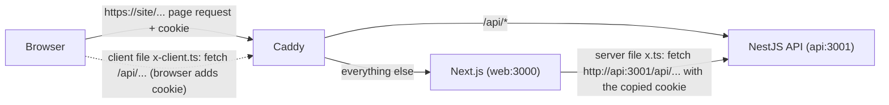
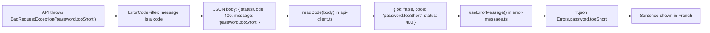
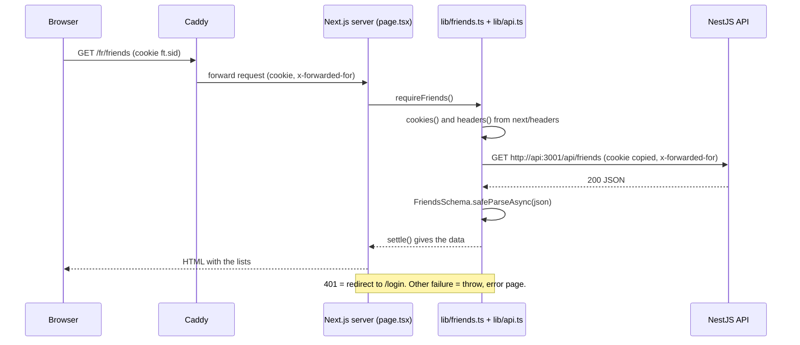
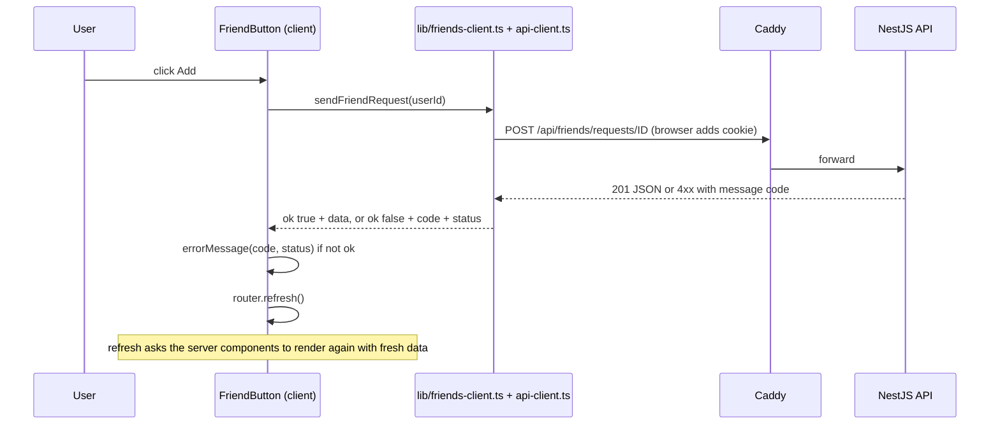

# Chapter 4 — How the web app talks to the API

In this chapter:

- What `fetch`, JSON and cookies are, and who sends the cookie: the browser or the Next.js server.
- Why `apps/web/lib/` has two kinds of files: server files (`x.ts`) and browser files (`x-client.ts`).
- How an error travels as a short code (an `ERROR_CODES` entry) and becomes a sentence in the reader's language.
- Every file of the API layer, in the order the app uses them, starting with the two base files
  [api.ts](../../apps/web/lib/api.ts) and [api-client.ts](../../apps/web/lib/api-client.ts).
- A table of every browser function with its HTTP method and API route.

---

## The big picture

### fetch and JSON

The web app (Next.js) does not own any data. Users, courses, lessons and messages all live in the
NestJS API (see the API chapters). So every page needs to **ask the API**.

The tool for asking is `fetch`. It is a function built into the browser and into Node.js. You give it
a URL and some options (method, headers, body), and it gives back a `Response`:

```ts
const response = await fetch('/api/courses', { method: 'GET' });
const data = await response.json(); // read the body as JSON
```

**JSON** is the text format the API and the web app use to send data: `{"lang":"fr","level":"A2"}`.
`response.json()` turns that text back into a JavaScript object.

But the object that comes back is "just something". TypeScript cannot know its shape. So every call in
this folder checks the answer with a **Zod schema** from `@ft/shared` (a schema is a description of the
expected shape; `schema.safeParse(x)` says "yes, it matches" or "no"). The same schema is used by the
API to build its answer, so both sides agree.

### Cookies: who sends them?

When you log in, the API answers with a `Set-Cookie` header. The cookie is called `ft.sid` (session id).
It is `httpOnly` (JavaScript in the page cannot read it) and `sameSite: 'lax'` (see
`apps/api/src/app.setup.ts`). From then on, the API knows who you are **only** if the request carries this
cookie.

Think of the cookie as a **cloakroom ticket**. You get it at the door (login), and you must show it each
time you want your coat (your data).

There are two places a request to the API can start, and they do not hold the ticket the same way:

| Where the code runs | Who makes the request | How the cookie gets there |
|---|---|---|
| **In the browser** (a client component, after a click) | the browser | The browser adds the cookie by itself. The page and the API share one address (Caddy), so it is a "same-origin" request. |
| **On the Next.js server** (a server component, while it builds the HTML) | the Next.js container | The server has **no** cookie of its own. It must copy the visitor's cookie from the incoming request and put it on its own request to the API. |

This is the reason for the two kinds of files.



Caddy (the reverse proxy, the "front door" of the site) sends every path that starts with `/api` to the
API, and every other path to Next.js (see `infra/caddy/Caddyfile`). So:

- From the **browser**, a client file just calls the short path `/api/courses`. Caddy routes it.
- From the **Next.js server**, a server file calls `http://api:3001/api/courses` directly over the
  internal Docker network. It does not go through Caddy.

### Two kinds of files in `lib/`

```
apps/web/lib/
├── api.ts                 server base: fetchJson, apiGet, apiFind, settle, pingApi
├── session.ts             server: loadSession, currentUser, requireUser
├── courses.ts             server: loadCourses, requireCourses (+ pure helpers)
├── friends.ts             server: requireFriends, searchUsers, loadProfile ...
├── conversations.ts       server: requireConversations, loadMessagePage
├── lessons.ts             server: loadToday, loadLessonPage
│
├── api-client.ts          browser base: send, clientGet/Post/Put/Patch/Delete
├── auth-client.ts         browser: signUp, logIn, logOut, 2FA, avatar ...
├── courses-client.ts      browser: startCourse, setCourseLevel
├── friends-client.ts      browser: friend requests
├── conversations-client.ts browser: older messages
├── lesson-client.ts       browser: lesson attempts (+ tab memory, drafts)
├── discussion-client.ts   browser: tutor chat, streamed answer
├── placement-client.ts    browser: placement exam
│
├── error-message.ts       browser hook: code -> translated sentence
├── use-course-save.ts     browser hook: save a course setting
├── serial-queue.ts        helper: run writes one after another
└── localized.ts           helper: pick en / fr / de text
```

| | Server file `x.ts` | Browser file `x-client.ts` |
|---|---|---|
| Runs in | Next.js server, during render | the visitor's browser |
| Used by | server components (`page.tsx`, `layout.tsx`) | client components (`'use client'`) |
| Typical job | **read** data to build the page | **write** after a click (POST, PATCH, DELETE) |
| Cookie | copied by hand from `next/headers` | added by the browser |
| Base file | [api.ts](../../apps/web/lib/api.ts) | [api-client.ts](../../apps/web/lib/api-client.ts) |
| Result type | `{ status: 'ok' \| 'signed-out' \| 'unavailable' \| 'not-found' }` | `{ ok: true, data }` or `{ ok: false, code, status }` |
| On failure | redirect to `/login` or throw (error page) | return a code, the component shows a message |

A server file imports `next/headers`, which only works on the server. A browser file must not import it.
Keeping them apart stops a client component from pulling server-only code by mistake.

### Errors as codes, not sentences

The API never sends a sentence like "Password too short". It sends a **code**: `password.tooShort`. All
codes live in one list, `ERROR_CODES`, in
[packages/shared/src/schemas/errors.ts](../../packages/shared/src/schemas/errors.ts). The file explains why:

> a string rendered by the server cannot be re-rendered in the reader's language once it has crossed the wire.

The only place a code becomes a human sentence is the `Errors` part of `apps/web/messages/{en,fr,de}.json`.



The browser layer also invents two codes of its own: `network.unreachable` (the request never got an
answer) and `server.unexpected` (the answer was not what we expected). Both are in `ERROR_CODES` too.

---

## Sequence 1: a server component loads data with the user's cookie

Example: the friends page, `app/[locale]/(main)/friends/page.tsx`, calls `requireFriends()`.



## Sequence 2: a client component calls the API after a click

Example: the "Add friend" button in `components/friend-buttons.tsx`.



After a write, the client does not patch its own copy of the data. It calls `router.refresh()`, and the
server components read again (Sequence 1). There is one source of truth: the API.

---

## The server side

### `api.ts` — the server base

[api.ts](../../apps/web/lib/api.ts) is "the only place apps/web talks to NestJS" from the server. Its top
comment says Next.js does "presentation and SSR only" (SSR = server-side rendering: building HTML on the
server), so nothing here knows business rules. It builds a URL, calls the API, and checks the answer.

**Exports:** `DEFAULT_API_INTERNAL_URL`, `SESSION_PATH`, `HEALTH_PATH`, `DEFAULT_TIMEOUT_MS`, the types
`ApiRequestOptions`, `FetchSessionOptions`, `BaseResult`, `SessionResult`, `FindResult`, `PingResult`, and
the functions `settle`, `resolveApiBaseUrl`, `buildApiUrl`, `describeFetchError`,
`fetchWithRequestHeaderAndIP`, `fetchSession`, `apiGet`, `apiFind`, `pingApi`.

#### Three answers, not two

```ts
export type BaseResult<T> =
  { status: 'ok'; data: T } | { status: 'signed-out' } | { status: 'unavailable'; reason: string };

/**
 * Three answers, not two. "signed-out" is a verdict the API delivered (401);
 * "unavailable" is the absence of a verdict, and the caller must not read it as
 * one. Collapsing them is what turned a 429 or a restart into a logout.
 */
export type SessionResult = BaseResult<SessionUser>;

/** A 404 read as an answer, nothing there, rather than as a failure. */
export type FindResult<T> = BaseResult<T> | { status: 'not-found' };
```

This is the most important idea in the file. If the API is restarting, or says "too many requests"
(429), we do **not** know if the visitor is signed in. An older version treated that as "signed out" and
sent people to the login page for no reason. Now:

- `signed-out` only for a real **401**.
- `unavailable` for everything else that went wrong (timeout, 500, 429, bad JSON).
- `not-found` only when the caller asked for it (a 404 means "this thing does not exist").

#### `settle` — turn a result into data for a page

```ts
export function settle<T>(result: BaseResult<T>, what: string): T {
  if (result.status === 'signed-out') {
    redirect('/login');
  }

  // Thrown, since a redirect would read as a logout.
  if (result.status === 'unavailable') {
    throw new Error(`Could not load the ${what}: ${result.reason}`);
  }
  return result.data;
}
```

`redirect()` from `next/navigation` stops the render and sends the browser to `/login`. Throwing an
error makes Next.js show the nearest `error.tsx` page (chapter 2). The session cookie is kept, so a
reload works when the API is back.

#### URL helpers

`resolveApiBaseUrl(raw)` reads `API_INTERNAL_URL`; if it is empty it falls back to `http://api:3001` (the
Docker Compose service name), and it removes trailing slashes. `buildApiUrl(base, path)` joins the two and
adds a missing leading `/`. `describeFetchError(error)` turns an error into a short reason, and names the
timeout case: `'the request timed out'`.

#### `fetchWithRequestHeaderAndIP` — copy the ticket

```ts
export async function fetchWithRequestHeaderAndIP<R>(
  fetcher: (options: FetchSessionOptions) => Promise<R>,
): Promise<R> {
  const store = await cookies();
  const cookie = store
    .getAll()
    .map(({ name, value }) => `${name}=${value}`)
    .join('; ');

  // Passed through unchanged rather than appended to. ...
  const forwardedFor = (await headers()).get('x-forwarded-for');

  return fetcher({
    baseUrl: process.env.API_INTERNAL_URL,
    cookie,
    forwardedFor: forwardedFor ?? undefined,
  });
}
```

`cookies()` and `headers()` come from `next/headers`. They read the **incoming** request of the visitor.
The function rebuilds a `Cookie` header (`name=value; name=value`) and also takes the visitor's IP from
`x-forwarded-for` (set by Caddy).

Why the IP? Without it, every server-side call would come from the same address (the web container), and
the API rate limiter would count **all visitors as one person**. The comment explains why the header is
passed unchanged: the API trusts one proxy and reads the right-most address, so adding the web container's
address would break it.

#### `fetchJson` — the private worker

`fetchJson(schema, apiPath, options, urlParams, notFound)` is not exported. Everything goes through it.
The main part:

```ts
    const url = new URL(buildApiUrl(baseUrl, apiPath));
    new URLSearchParams(urlParams).forEach((value, key) => url.searchParams.set(key, value));
    const response = await fetchImpl(url.toString(), {
      cache: 'no-store',
      headers: {
        accept: 'application/json',
        ...(cookie ? { cookie } : {}),
        ...(forwardedFor ? { 'x-forwarded-for': forwardedFor } : {}),
      },
      signal: AbortSignal.timeout(timeoutMs),
    });

    if (response.status === 401) {
      return { status: 'signed-out' };
    }

    if (notFound && response.status === 404) {
      return { status: 'not-found' };
    }
```

Things to notice:

- `cache: 'no-store'`: Next.js can cache `fetch` results. Here the answer is personal (it depends on the
  cookie), so it must never be cached or shared between visitors.
- `AbortSignal.timeout(timeoutMs)`: gives up after 10 seconds by default. The comment on
  `DEFAULT_TIMEOUT_MS` says 2 seconds was too short: a busy API showed error pages for requests that would
  have worked.
- A path with `?` in it is refused: query parameters must go in `urlParams`, so they are encoded properly.
- A 204 (no body) is "unavailable" here, because a read should always return data.
- Then `schema.safeParseAsync(await response.json())`. A wrong shape is "unavailable", not a crash.
- Any thrown error (network, timeout) is caught and becomes `unavailable`.

`fetchImpl` is an option so tests can pass a fake `fetch`.

#### The public readers

```ts
export async function apiGet<Schema extends z.ZodType>(
  schema: Schema,
  apiPath: string,
  urlParams: Record<string, string> = {},
): Promise<BaseResult<z.infer<Schema>>> {
  return fetchWithRequestHeaderAndIP((options) => fetchJson(schema, apiPath, options, urlParams));
}
```

- `apiGet(schema, path, params)`: read with the visitor's cookie. Gives `BaseResult`.
- `apiFind(schema, path, params)`: the same, but a 404 gives `not-found`, so the page can show "nothing
  here" instead of an error page. Used by `loadProfile`, `lib/lesson.ts` and the placement page.
- `fetchSession(options)`: `fetchJson(SessionUserSchema, '/api/auth/me', options)`. It does not read the
  request itself; [session.ts](../../apps/web/lib/session.ts) wraps it.
- `pingApi(options)`: used by `app/healthz/api` and `app/healthz/upstream` (chapter 2). It only asks "can
  the web container reach the API at all?". Any HTTP answer, even 500, counts as `ok`; only a network
  error or a 2-second timeout is `unreachable`.

Callers of `api.ts`: `session.ts`, `courses.ts`, `friends.ts`, `conversations.ts`, `lessons.ts`, and also
`lib/lesson.ts`, `lib/achievements.ts` and the placement page (covered in chapters 6 and 7).

**Test:** [api.test.ts](../../apps/web/lib/api.test.ts) checks the URL helpers, the timeout name, and that
`fetchSession`/`apiGet`/`apiFind` give `signed-out`, `not-found` and `unavailable` in the right cases.

### `session.ts` — who is the visitor?

[session.ts](../../apps/web/lib/session.ts) answers "who is signed in?" for server components.

```ts
export const loadSession = cache(async function loadSession(): Promise<SessionResult> {
  return fetchWithRequestHeaderAndIP(fetchSession);
});
```

`cache` from React **memoises** the function for one server render (memoise = remember the answer, so
the second call does not run again). The layout, the header and the page can all ask "who is this?" and
only one request goes to the API. It is per request: no visitor ever sees another visitor's answer.

Two ways to use it:

```ts
export async function currentUser(): Promise<SessionUser | null> {
  const result = await loadSession();
  return result.status === 'ok' ? result.data : null;
}
```

`currentUser()` is for pages that **everyone** can see (the home page, the header). If the API is down,
the page just shows the signed-out version. Nothing is taken away. The comment calls this "the one place
where collapsing the two failures is right".

`requireUser()` is for pages that need a user (profile, 2FA settings, chat). It redirects only on
`signed-out`, and throws on `unavailable`, exactly like `settle`.

Callers: `app/[locale]/(main)/page.tsx`, profile pages, `settings/2fa`, `chat`, `users/[id]`, the
`(dashboard)` layout, and the nav components from chapter 3 (`session-nav.tsx`, `header-nav.tsx`,
`dashboard-nav.tsx`).

**Test:** [session.test.ts](../../apps/web/lib/session.test.ts) checks that the cookies are forwarded as
one header, the IP is forwarded unchanged, `currentUser` degrades to `null`, and `requireUser` redirects
on 401 but throws when the API is unavailable.

### `courses.ts` — the learner's courses

[courses.ts](../../apps/web/lib/courses.ts) is the server half of the courses API.

```ts
/** Memoised per request: the header and the page body both ask. */
export const loadCourses = cache(async function loadCourses(): Promise<BaseResult<Courses>> {
  return apiGet(CoursesSchema, '/api/courses');
});

/** requireUser for pages that need the courses: this read answers the session question too. */
export async function requireCourses(): Promise<Courses> {
  return settle(await loadCourses(), 'courses');
}
```

`/api/courses` needs a session, so a 401 here also means "not signed in". That is why `requireCourses`
can replace `requireUser`: one request instead of two.

It also has three pure helpers (no network):

- `findCourse(courses, lang)`: the course for a language, or `null`.
- `resolveLandingLang(cookieLang, activeLang, courses)`: which course `/learn` should open. First the
  language this browser last used (a cookie), then the one the server remembers (`activeLang`, useful on a
  second device), then the first course. Each one is checked against the list, so an old value falls through.
- `landingPath(cookieLang, courses)`: the final URL: `/onboarding` if there is no course,
  `/onboarding?lang=xx` if the course has no level yet, else `/learn/xx`.

Callers: the `/learn` pages, `onboarding/page.tsx`, `dashboard-nav.tsx`, `lib/lesson.ts`.

**Test:** [courses.test.ts](../../apps/web/lib/courses.test.ts) checks `findCourse`, the landing order
(cookie, then `activeLang`, then first) and `landingPath`.

### `friends.ts` — friends, search, profiles

[friends.ts](../../apps/web/lib/friends.ts) is the server half of the friends API.

- `FRIEND_EVENTS`: the three socket events (`FRIEND_REQUEST`, `FRIEND_ACCEPTED`, `FRIEND_REMOVED`) that
  should make a friends page re-render. Pages pass it to the `RefreshOn` component (chapter 3).
- `requireFriends()`: `settle(apiGet(FriendsSchema, '/api/friends'))`. Your friends, received and sent
  requests.
- `searchUsers(q)`: `GET /api/users?q=...`. The comment says it is only called with a query that
  `UserSearchQuerySchema` already accepted, so a 400 cannot happen.
- `recentlyActive()`: `GET /api/users/recently-active`, people you could add.
- `loadProfile(id)`: memoised with `cache`, because both `generateMetadata` (the page title) and the
  page ask. It uses `apiFind`, so an unknown user is `not-found`, not an error page.
- `relationTo(lists, userId)`: pure helper. Reads your own lists and says `'friend'`, `'received'`,
  `'sent'` or `'none'`. The page uses it to pick which button to show.

```ts
export function relationTo(lists: Friends, userId: string): Relation {
  const has = (users: PublicUser[]) => users.some((user) => user.id === userId);

  if (has(lists.friends)) return 'friend';
  if (has(lists.received)) return 'received';
  if (has(lists.sent)) return 'sent';
  return 'none';
}
```

Callers: `friends/page.tsx`, `users/[id]/page.tsx`, `chat/page.tsx`.

**Test:** [friends.test.ts](../../apps/web/lib/friends.test.ts) checks `relationTo` for each case.

### `conversations.ts` — chat on first paint

[conversations.ts](../../apps/web/lib/conversations.ts) has two readers, both through `settle`:

- `requireConversations()`: `GET /api/conversations`, the list on `/chat`.
- `loadMessagePage(userId)`: `GET /api/conversations/:userId/messages`, the newest page of messages
  for the first render of a thread.

Older pages, and the catch-up after a reconnect, are loaded later in the browser by
`conversations-client.ts`. Caller: `app/[locale]/(messages)/chat/page.tsx` (chapter 8). No test file.

### `lessons.ts` — today and the lesson list

[lessons.ts](../../apps/web/lib/lessons.ts) does not use `settle`. It handles the result by hand:

```ts
export async function loadToday(lang: Language): Promise<Today | 'signed-out'> {
  const result = await apiGet(TodaySchema, `/api/courses/${lang}/today`);

  if (result.status === 'unavailable') {
    throw new Error(`Could not load today's lessons: ${result.reason}`);
  }
  return result.status === 'signed-out' ? 'signed-out' : result.data;
}
```

The course page already read the session (through `requireCourses`). So a 401 here means "the session
ended between the two reads". The function returns the string `'signed-out'` and lets the page decide
what to do, instead of redirecting from inside.

- `loadToday(lang)`: `GET /api/courses/:lang/today`.
- `loadLessonPage(lang, query)`: `GET /api/courses/:lang/lessons` with query params built by
  `lessonQueryParams` from `lib/lesson-list.ts` (it leaves out default values so links stay short).
- `lessonPath(lang, id)`: pure helper, gives `/learn/:lang/lessons/:id`.

Callers: `learn/[lang]/page.tsx`, `today.tsx`, `lessons/page.tsx`, `lesson-list.tsx`, `lib/lesson.ts`.
No test file of its own.

---

## The browser side

### `api-client.ts` — the browser base

[api-client.ts](../../apps/web/lib/api-client.ts) is the browser half. Its top comment states the rule:

> Failures carry a code, never a sentence: the component that displays them turns it into text in the
> reader's language through useErrorMessage().

**Exports:** `JSON_HEADERS`, the type `ApiResult<T>`, `readCode`, `send`, `clientGet`, `clientPost`,
`clientPut`, `clientPatch`, `clientDelete`.

```ts
export type ApiResult<T> = { ok: true; data: T } | { ok: false; code: string; status: number };
```

The browser functions never throw. The caller always gets an object and checks `result.ok`.

#### `readCode` — find the code in an error body

```ts
export function readCode(body: unknown): string | null {
  if (typeof body === 'object' && body !== null && 'message' in body) {
    const { message } = body as { message: unknown };
    if (typeof message === 'string') {
      return message;
    }
    if (Array.isArray(message) && typeof message[0] === 'string') {
      return message[0];
    }
  }
  return null;
}
```

NestJS error bodies look like `{ statusCode: 400, message: ... }`. The `message` is one code, or an array
of codes when a Zod validation failed (several fields wrong). The form already checks the same rules
before sending, so showing the first code is enough.

#### `send` — the one function that calls `fetch`

```ts
  let response: Response;
  try {
    const query = new URLSearchParams(params).toString();
    const requestPath = path + (query ? `?${query}` : '');
    const headers = new Headers({ accept: 'application/json' });
    const isFormData = typeof FormData !== 'undefined' && init.body instanceof FormData;
    if (init.body !== undefined && !isFormData) {
      headers.set('content-type', 'application/json');
    }
    new Headers(init.headers).forEach((value, key) => headers.set(key, value));
    response = await fetch(requestPath, {
      ...init,
      credentials: 'same-origin',
      headers,
    });
  } catch {
    return { ok: false, code: 'network.unreachable', status: 0 };
  }
```

- The path is relative (`/api/...`), so the browser sends it to the same site. Caddy routes it to the API.
- `credentials: 'same-origin'` tells the browser: add the cookies for this site. That is the whole
  cookie story on the browser side.
- `content-type: application/json` is set only when there is a body that is not `FormData`. For a file
  upload (`FormData`), the browser must set the header itself, because it adds a "boundary" value.
- If `fetch` throws (offline, DNS error), the result is `network.unreachable` with `status: 0`.

Then the answer is read:

```ts
  let body: unknown;
  if (response.status !== 204) {
    try {
      body = await response.json();
    } catch {
      return { ok: false, code: 'server.unexpected', status: response.status };
    }
  }
  if (!response.ok) {
    return {
      ok: false,
      code: readCode(body) ?? 'server.unexpected',
      status: response.status,
    };
  }
```

A 204 has no body, so `body` stays `undefined`. For that case callers pass `z.void()` as the schema,
which accepts `undefined`. On success, the body goes through `schema.safeParseAsync`. If it does not
match (or an async check throws), the result is `server.unexpected`.

#### The five short helpers

`clientGet(schema, path, params)`, `clientPost(schema, path, body, params)`, `clientPut`, `clientPatch`,
`clientDelete`. Each one just calls `send` with the right method. The body goes through `serializeBody`:
`undefined` stays empty, `FormData` is passed as is, anything else is `JSON.stringify`-ed.

Callers: all `*-client.ts` files, plus a few components that call it directly (for example
`goal-picker.tsx` calls `clientPatch` on `/api/courses/:lang`, and `two-factor-panel.tsx` calls
`clientGet` on `/api/auth/2fa`).

**Test:** [api-client.test.ts](../../apps/web/lib/api-client.test.ts) checks schema validation, bad JSON,
network failure as a code, 204 with a void schema, query params, JSON vs `FormData` bodies, and headers.

### `error-message.ts` — the code becomes a sentence

[error-message.ts](../../apps/web/lib/error-message.ts) is "the one place an error code becomes a
sentence". It is a React hook, so it has `'use client'`.

```ts
export function useErrorMessage(): (code: string, status?: number) => string {
  const t = useTranslations('Errors');

  return useCallback(
    (code, status = 0) => t(isErrorCode(code) ? code : 'unknown', { status }),
    [t],
  );
}
```

- `useTranslations('Errors')` (next-intl, chapter 2) gives a function `t` that reads the `Errors` section
  of the current language file.
- `isErrorCode(code)` (from `@ft/shared`) checks the code is in `ERROR_CODES`. If not, we show the
  `unknown` sentence ("Something went wrong. Please try again.") instead of English server text inside a
  French page.
- `status` is always passed, because `server.unexpected` uses it: "The server answered HTTP {status}".
- `useCallback` keeps the same function between renders, so it can be used in effect dependencies.

Usage in a component:

```ts
const errorMessage = useErrorMessage();
// ...
setError(result.ok ? null : errorMessage(result.code, result.status));
```

Callers: every form and button that writes (login, signup, profile, 2FA, onboarding, friends, chat,
placement exam, lesson player...). No test file of its own, but `lib/messages.test.ts` checks that the
`Errors` keys in each language file are exactly the `ERROR_CODES` list.

### `auth-client.ts` — sign up, log in, 2FA, profile

[auth-client.ts](../../apps/web/lib/auth-client.ts) explains why login runs in the browser and not in a
Next.js server action:

> the session cookie is set by the API's response, and Caddy serves both origins as one, so the browser's
> own request carries and receives it with nothing to relay.

If the Next.js server did the login, the API would set the cookie on the **server's** response, and Next
would have to copy it back to the browser. Doing it in the browser, the cookie lands where it belongs.

The login is the one special case. The API answers **200** with the user, or **202** with
`{ twoFactorRequired: true }` when a 2FA code is still needed:

```ts
const LoginResponseSchema = z.union([SessionUserSchema, TwoFactorRequiredSchema]);

/** The 202 branch of a login: password accepted, second factor still owed. */
export type LoginResult = ApiResult<SessionUser> | { ok: 'twoFactor' };

export async function logIn(input: unknown): Promise<LoginResult> {
  const result = await clientPost(LoginResponseSchema, '/api/auth/login', input);
  if (!result.ok) {
    return result;
  }
  return 'twoFactorRequired' in result.data ? { ok: 'twoFactor' } : { ok: true, data: result.data };
}
```

`z.union` accepts either shape. Then the function looks at the data and returns a third kind of result,
`{ ok: 'twoFactor' }`, so the login form knows to show the code field.

The other functions are one line each (see the table below). `uploadAvatar(file)` builds a `FormData`
with the field `avatar`. `removeAvatar()` goes back to the default image. Functions that get a 204 use
`z.void()`.

Callers: `login-form.tsx`, `signup-form.tsx`, `profile-form.tsx`, `two-factor-panel.tsx`, and from
chapter 3 `log-out-button.tsx`, `locale-sync.tsx`, `time-zone-sync.tsx` (these two call `updateProfile`).

**Test:** [auth-client.test.ts](../../apps/web/lib/auth-client.test.ts) checks signup, the first code of a
validation array, the fallback code, the 200 vs 202 login, network failure, and the calls that answer 204.

### `courses-client.ts` — start a course, set a level

[courses-client.ts](../../apps/web/lib/courses-client.ts):

```ts
export function startCourse(input: unknown): Promise<ApiResult<Course>> {
  return clientPost(CourseSchema, '/api/courses', input);
}

/** The endpoint the placement exam also calls: the level has one writer. */
export function setCourseLevel(lang: Language, input: unknown): Promise<ApiResult<Course>> {
  return clientPatch(CourseSchema, `/api/courses/${lang}/level`, input);
}
```

"The level has one writer": choosing a level by hand and finishing the placement exam both end at the
same API route, so the rule is in one place.

Callers: `onboarding/choose-course.tsx`, `onboarding/choose-level.tsx`, `start-level.tsx`,
`direct-level-picker.tsx`, `components/change-level.tsx`.

**Test:** [courses-client.test.ts](../../apps/web/lib/courses-client.test.ts) checks both calls, the
language in the path, errors as codes, and a response that is not a course.

### `friends-client.ts` — friend requests

[friends-client.ts](../../apps/web/lib/friends-client.ts): four writes, each one names the other user in
the path. `sendFriendRequest` returns a `FriendRequestResult` (it tells if the request became a friendship
right away, when the other person had already asked you). The three others answer 204 (`z.void()`).
`deleteFriendRequest` is used both to **decline** theirs and to **cancel** yours, because "there is at most
one request between two people".

Caller: `components/friend-buttons.tsx` (see Sequence 2). After each write it calls `router.refresh()`,
even on failure, because a failure is "nearly always the other side moving first".

**Test:** [friends-client.test.ts](../../apps/web/lib/friends-client.test.ts) checks the method and path
of each call, the 204 as success, and errors as codes.

### `conversations-client.ts` — more messages

[conversations-client.ts](../../apps/web/lib/conversations-client.ts):

```ts
/** What the thread catches up with after a connect. */
export function fetchNewestMessages(userId: string): Promise<ApiResult<MessagePage>> {
  return clientGet(MessagePageSchema, messagesPath(userId));
}

/** The page before `cursor`, a page's nextCursor. */
export function fetchEarlierMessages(
  userId: string,
  cursor: string,
): Promise<ApiResult<MessagePage>> {
  return clientGet(MessagePageSchema, messagesPath(userId), { cursor });
}
```

A **cursor** is a bookmark: the API gives one with each page (`nextCursor`), and you send it back to get
the page before. Caller: `chat/chat-thread.tsx` (chapter 8). Sending a message goes over the WebSocket,
not here.

**Test:** [conversations-client.test.ts](../../apps/web/lib/conversations-client.test.ts) checks the path
without and with the cursor, and a failure as a code.

### `lesson-client.ts` — lesson attempts, tab memory, drafts

[lesson-client.ts](../../apps/web/lib/lesson-client.ts) has three parts.

**1. The attempt routes.** An "attempt" is one run through a lesson.

- `startAttempt(lang, id, locale)`: `POST .../attempt` with `{ locale }`. Starts, resumes, or retakes.
- `readAttempt(lang, id)`: `GET .../attempt`.
- `submitPage(lang, id, index, attemptId, answers)`: `POST .../attempt/pages/:index`.

**2. The tab memory.** When you press Back or Forward, Next.js shows a page from its router cache, **as it
was first rendered**. That old page may show an old position in the lesson. So the player writes down, in a
`Map` in memory, the last attempt it saw:

```ts
const seen = new Map<string, Seen>();

const key = (lang: Language, id: string) => `${lang}/${id}`;

export function rememberAttempt(lang: Language, id: string, view: AttemptView, at = Date.now()) {
  seen.set(key(lang, id), { view, at });
}
```

- `isStale(lang, id, rendered)`: is the rendered page older than what this tab saw? Yes if the attempt
  id is different, or the position (cursor index) is behind. Then the page reads the attempt again.
- `newerAttempt(lang, id, rendered, renderedAt)`: picks the newer of the two. Attempts only move forward,
  so within one attempt the further position wins. A different attempt id means a retake: the rendered
  one wins.
- `forgetAttempt(lang, id)`: drop it, the server has a newer attempt.

`at` is kept because an exam page counts its time left from the moment the view arrived.

**3. The drafts.** What the learner typed but did not submit yet is kept in `localStorage`, so a reload
keeps it. Keys look like `ft.lesson.drafts.<lang>.<id>.<attemptId>`. `loadDrafts` also deletes the drafts
of other attempts of the same lesson, and checks every saved answer with Zod (the storage could hold
anything). `saveDrafts`, `clearDrafts`, `loadKept` and `saveKept` (small notes kept next to the drafts,
like the lines already shown of an exam dialogue) complete it. Every access is in `try/catch`: storage can
be off or full, and the page must still work.

Callers: `lessons/[id]/lesson-actions.tsx` and `lessons/[id]/play/player.tsx` (chapter 7).

**Test:** [lesson-client.test.ts](../../apps/web/lib/lesson-client.test.ts) checks the attempt routes and
codes, the tab memory (stale, forget, newer), and that drafts are kept and cleared.

### `discussion-client.ts` — a streamed answer from the tutor

[discussion-client.ts](../../apps/web/lib/discussion-client.ts) is different: it does not use `send`,
because the answer is not one JSON body. The API **streams** it with Server-Sent Events (SSE: the server
keeps the response open and writes small events one after another). The text arrives piece by piece, like
someone typing.

Why not the browser's `EventSource`? The comment says: "it only sends GET, with no body". We need a POST
with the message, so `fetch` is used and the body is read by hand. The format looks like:

```
event: delta
data: {"text":"…"}

event: done
data: {}
```

Each event ends with an empty line. Lines starting with `:` are heartbeats and are ignored.

```ts
  const reader = response.body.getReader();
  // stream: a character cut between two pieces of the body waits for the rest.
  const decoder = new TextDecoder();
  let buffer = '';
  try {
    for (;;) {
      const { value, done } = await reader.read();
      if (done) return cut;
      buffer += decoder.decode(value, { stream: true });
      // A piece of the body can end in the middle of an event: the rest waits for the next one.
      let end: number;
      while ((end = buffer.indexOf('\n\n')) >= 0) {
        const event = readEvent(buffer.slice(0, end));
        buffer = buffer.slice(end + 2);
        if (event === null) continue;
        if (event.name === 'delta') onText(String(event.data.text ?? ''));
        else if (event.name === 'done') return { ok: true };
        else if (event.name === 'error') {
          return { ok: false, code: String(event.data.code ?? 'unknown'), status: response.status };
        }
      }
    }
```

- The network gives chunks of bytes that do not match events. So we add them to `buffer` and cut at each
  `\n\n`. What is left waits for the next chunk.
- `{ stream: true }` on the decoder: a letter like `é` takes two bytes and can be split between chunks.
- `delta` gives a piece of text to `onText`. `done` ends with `{ ok: true }`. `error` gives a code.
- If the stream ends without `done`, the connection was cut: `network.unreachable`.
- `signal` is the learner's Stop button (an `AbortController`). `reader.cancel()` in `finally` closes the
  response.

If the API refuses **before** the stream starts (400, 404, 409, 429), it is a normal JSON error read with
`readCode`. A 429 also carries `retryAfter` (seconds to wait), which is passed on.

Caller: `components/lesson/discussion.tsx` (chapter 7).

**Test:** [discussion-client.test.ts](../../apps/web/lib/discussion-client.test.ts) checks the route,
pieces cut anywhere in the body, text arriving before the end, an error event, a cut stream, a 429 with
`retryAfter`, a refusal with and without JSON, and a network failure.

### `placement-client.ts` — the placement exam

[placement-client.ts](../../apps/web/lib/placement-client.ts): three calls. `startPlacement(lang)` and
`submitPlacementAnswer(questionId, choice)` both return a `PlacementState` (the next question, or the
result). `choice` can be `null` when the countdown ran out. `quitPlacement()` deletes the run (204). The
schema comes from `lib/placement-schema.ts`.

Caller: `learn/[lang]/placement/placement-exam.tsx` (chapter 6). The first state on page load is read on
the server with `apiFind(PlacementStateSchema, '/api/placement')`.

**Test:** [placement-client.test.ts](../../apps/web/lib/placement-client.test.ts) checks start and answer
bodies (including `null`), the final result, conflict and onboarding codes, bad payloads, and network
failure.

---

## Helpers

### `serial-queue.ts` — one write after another

[serial-queue.ts](../../apps/web/lib/serial-queue.ts) is tiny:

```ts
export function serialQueue() {
  let tail: Promise<unknown> = Promise.resolve();

  return function run<T>(task: () => Promise<T>): Promise<T> {
    const result = tail.then(task);
    tail = result.catch(() => undefined);
    return result;
  };
}
```

Analogy: one queue at the post office. Each new task waits until the one before is done. If the learner
clicks "goal 10" then "goal 20" very fast, the two requests reach the server in that order, so the final
value is 20. `tail` swallows errors (`catch(() => undefined)`) so one failed task does not block the
next ones, but `result` still fails for its own caller.

**Test:** [serial-queue.test.ts](../../apps/web/lib/serial-queue.test.ts) checks that a task waits for the
one before, and that a failure does not stop the next task.

### `use-course-save.ts` — save a course setting

[use-course-save.ts](../../apps/web/lib/use-course-save.ts) is a client hook used by `GoalPicker`,
`DirectLevelPicker` and `StartLevel`. It puts together everything above: the queue, the error message, and
the refresh.

```ts
  async function save(write: () => Promise<ApiResult<unknown>>): Promise<boolean> {
    inFlight.current += 1;
    setWriting(true);
    setError(null);
    try {
      const result = await run(write);
      if (!result.ok) {
        setError(errorMessage(result.code, result.status));
        return false;
      }
      setError(null);
      startRefresh(() => router.refresh());
      return true;
    } finally {
      inFlight.current -= 1;
      if (inFlight.current === 0) {
        setWriting(false);
      }
    }
  }

  return { pending: writing || refreshing, error, save };
```

- `useState(serialQueue)`: React calls `serialQueue()` once and keeps the same queue for the life of the
  component.
- `inFlight` counts writes that are still running; `writing` goes back to `false` only when all are done.
- `useTransition` gives `refreshing`, which stays `true` until `router.refresh()` has rendered the new
  page. So `pending` covers both the write and the refresh, and a button cannot send the same save twice.
- `save` returns `true` or `false`, so the caller can show the old value again when the write failed.

Example from `goal-picker.tsx`:

```ts
    const saved = await save(() =>
      clientPatch(CourseSchema, `/api/courses/${lang}`, { dailyGoal: next }),
```

No test file of its own.

### `localized.ts` — pick the right language

[localized.ts](../../apps/web/lib/localized.ts) has two pure functions for content that comes from the API
in several languages (lesson texts):

```ts
/** A text in en, fr and de, read in the interface language; English for any other. */
export function pick(text: { en: string; fr: string; de: string }, locale: string): string {
  return locale === 'fr' || locale === 'de' ? text[locale] : text.en;
}
```

`pickNative(text, locale)` is for texts that only exist in some languages: the interface language if it is
there, else the first of `en`, `fr`, `de`, else an empty string. Callers: lesson pages and most of
`components/lesson/*` (chapter 7).

**Test:** [localized.test.ts](../../apps/web/lib/localized.test.ts) checks both functions.

---

## Every browser call: method and route

All paths go through Caddy to the API. `:lang` is a course language, `:id` a lesson id, `:userId` another
user's id.

| File | Function | Method | API route | Success answer |
|---|---|---|---|---|
| auth-client.ts | `signUp` | POST | `/api/auth/signup` | `SessionUser` |
| auth-client.ts | `logIn` | POST | `/api/auth/login` | `SessionUser` (200) or `twoFactorRequired` (202) |
| auth-client.ts | `verifySecondFactor` | POST | `/api/auth/2fa/verify` | `SessionUser` |
| auth-client.ts | `logOut` | POST | `/api/auth/logout` | 204 |
| auth-client.ts | `updateProfile` | PATCH | `/api/users/me` | `SessionUser` |
| auth-client.ts | `beginTwoFactorSetup` | POST | `/api/auth/2fa/setup` | secret, otpauth URI, QR image |
| auth-client.ts | `enableTwoFactor` | POST | `/api/auth/2fa/enable` | recovery codes |
| auth-client.ts | `disableTwoFactor` | DELETE | `/api/auth/2fa` (body: password) | 204 |
| auth-client.ts | `uploadAvatar` | POST | `/api/users/me/avatar` (FormData) | `SessionUser` |
| auth-client.ts | `removeAvatar` | DELETE | `/api/users/me/avatar` | `SessionUser` |
| courses-client.ts | `startCourse` | POST | `/api/courses` | `Course` |
| courses-client.ts | `setCourseLevel` | PATCH | `/api/courses/:lang/level` | `Course` |
| friends-client.ts | `sendFriendRequest` | POST | `/api/friends/requests/:userId` | `FriendRequestResult` |
| friends-client.ts | `acceptFriendRequest` | POST | `/api/friends/requests/:userId/accept` | 204 |
| friends-client.ts | `deleteFriendRequest` | DELETE | `/api/friends/requests/:userId` | 204 |
| friends-client.ts | `removeFriend` | DELETE | `/api/friends/:userId` | 204 |
| conversations-client.ts | `fetchNewestMessages` | GET | `/api/conversations/:userId/messages` | `MessagePage` |
| conversations-client.ts | `fetchEarlierMessages` | GET | `/api/conversations/:userId/messages?cursor=...` | `MessagePage` |
| lesson-client.ts | `startAttempt` | POST | `/api/courses/:lang/lessons/:id/attempt` | `AttemptView` |
| lesson-client.ts | `readAttempt` | GET | `/api/courses/:lang/lessons/:id/attempt` | `AttemptRead` |
| lesson-client.ts | `submitPage` | POST | `/api/courses/:lang/lessons/:id/attempt/pages/:index` | `PageResult` |
| discussion-client.ts | `sendDiscussion` | POST | `/api/courses/:lang/lessons/:id/discussion` | SSE stream |
| placement-client.ts | `startPlacement` | POST | `/api/placement` | `PlacementState` |
| placement-client.ts | `submitPlacementAnswer` | POST | `/api/placement/answers` | `PlacementState` |
| placement-client.ts | `quitPlacement` | DELETE | `/api/placement` | 204 |

And the server readers, for comparison (all GET, called from `http://api:3001`):

| File | Function | API route |
|---|---|---|
| api.ts / session.ts | `fetchSession`, `loadSession` | `/api/auth/me` |
| api.ts | `pingApi` | `/api/health` |
| courses.ts | `loadCourses` | `/api/courses` |
| friends.ts | `requireFriends` | `/api/friends` |
| friends.ts | `searchUsers` | `/api/users?q=...` |
| friends.ts | `recentlyActive` | `/api/users/recently-active` |
| friends.ts | `loadProfile` | `/api/users/:id` (404 = not-found) |
| conversations.ts | `requireConversations` | `/api/conversations` |
| conversations.ts | `loadMessagePage` | `/api/conversations/:userId/messages` |
| lessons.ts | `loadToday` | `/api/courses/:lang/today` |
| lessons.ts | `loadLessonPage` | `/api/courses/:lang/lessons?...` |

---

## Key ideas to remember

- The web app owns no data. Server files (`x.ts`) **read** to build pages; browser files (`x-client.ts`)
  **write** after a click.
- The browser adds the `ft.sid` cookie by itself (`credentials: 'same-origin'`). The Next.js server must
  copy it from `next/headers` (`fetchWithRequestHeaderAndIP`), together with `x-forwarded-for` so rate
  limits count each visitor, not the web container.
- Every answer is checked with a Zod schema from `@ft/shared`. A wrong shape is a failure, never a crash.
- Server results have three outcomes: `ok`, `signed-out` (only a 401: go to `/login`) and `unavailable`
  (throw, error page, the cookie stays). Never treat "the API is down" as "the user is logged out".
- `currentUser()` is for public pages (degrade to signed-out view), `requireUser()` and `settle()` for
  private pages.
- Browser results are `{ ok: true, data }` or `{ ok: false, code, status }`. They never throw.
- Errors travel as `ERROR_CODES` codes. `useErrorMessage()` is the only place a code becomes a sentence,
  in the reader's language; unknown codes become `unknown`.
- After a write, call `router.refresh()`: the server reads the truth again.
- `serialQueue` and `useCourseSave` keep fast writes in order and stop double clicks.
- `sendDiscussion` reads a streamed (SSE) answer by hand with `fetch`, because `EventSource` cannot POST.

---

Previous: [Chapter 3 — Shell components](03-shell-components.md) · Next: [Chapter 5 — Account pages](05-account-pages.md) · [Back to index](README.md)
