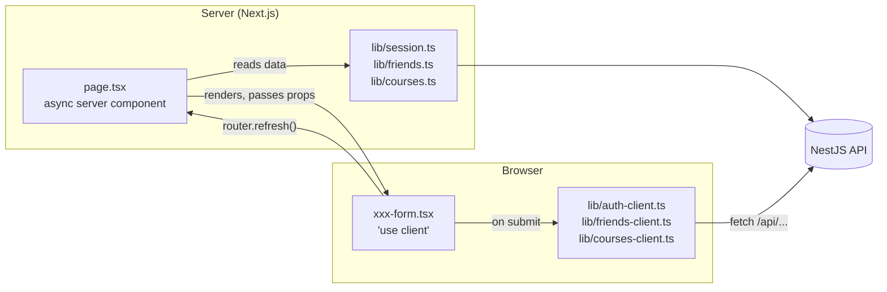
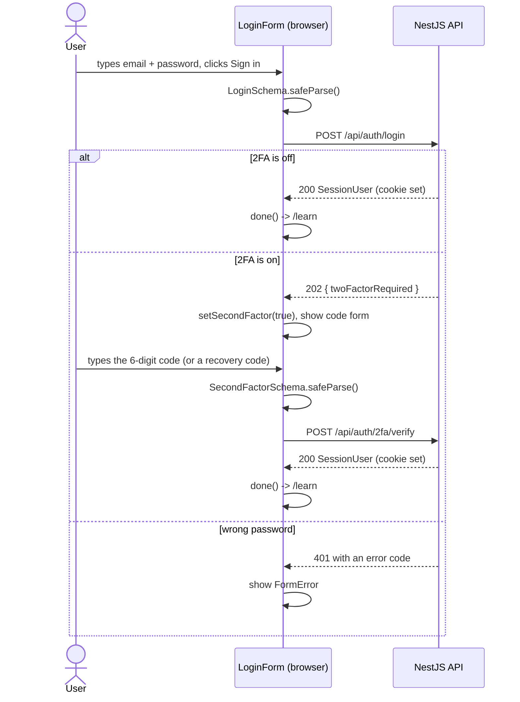
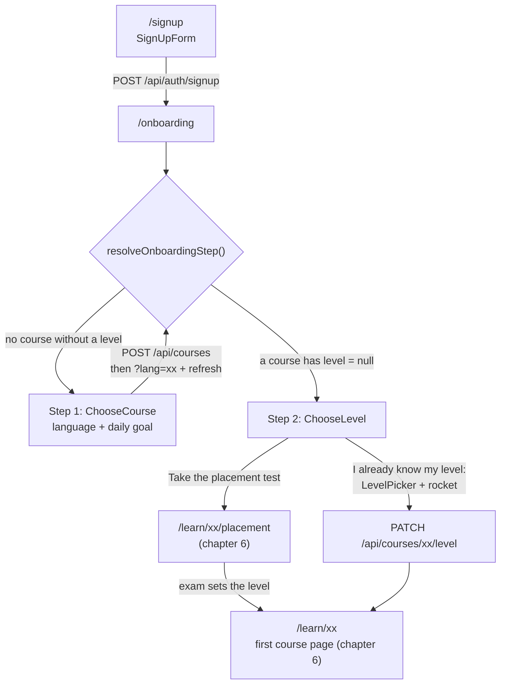
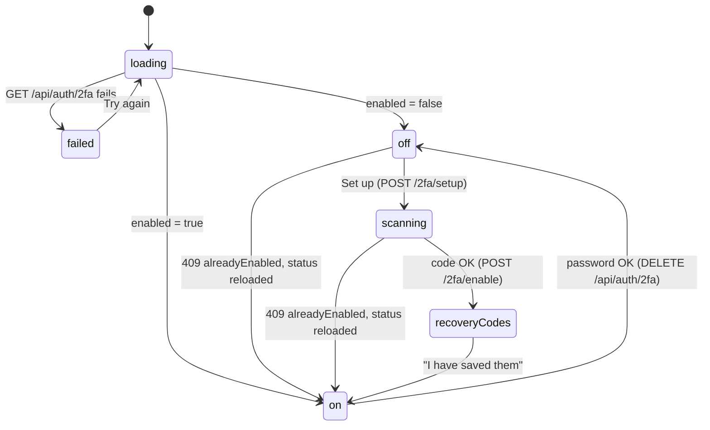
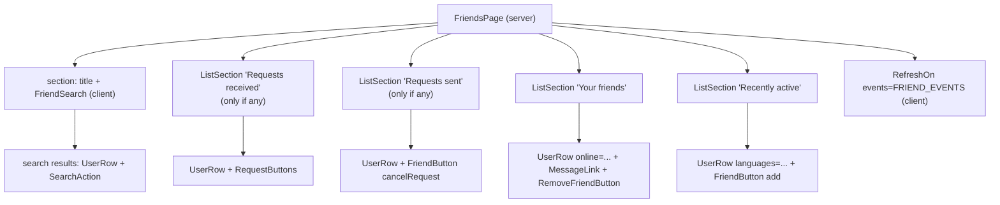

# Chapter 5 — The account and social pages

In this chapter:

- The `(main)` route group: the pages that are not about lessons. That means the home page, sign up, log in, onboarding, profile, two-factor settings, friends, other people's profiles, and the legal pages.
- For each page: its URL, whether it is a server or client component, what data it loads, what the user can do, and which API call it makes.
- The small shared components these pages are built from: form parts, avatar, flag, friend buttons, user rows, the online dot, the message link and the legal article.
- The helper files in `lib/` that hold the logic these pages need: `onboarding.ts`, `avatar.ts`, `presence.ts`, `legal.ts` and `legal-content/`.

---

## The big picture

All the pages in this chapter live in one folder:
[`apps/web/app/[locale]/(main)/`](<../../apps/web/app/[locale]/(main)/>). The `(main)` name has parentheses, so it is a **route group**: it is not part of the URL. You can read about route groups in [02-routing-layouts-i18n.md](02-routing-layouts-i18n.md). The folder groups these pages so they share one layout, the "marketing and account shell".

```
app/[locale]/(main)/
├── layout.tsx                 shell: wordmark + HeaderNav + LegalFooter
├── page.tsx                   /            home
├── login/                     /login
│   ├── page.tsx
│   └── login-form.tsx         (client)
├── signup/                    /signup
│   ├── page.tsx
│   └── signup-form.tsx        (client)
├── onboarding/                /onboarding
│   ├── page.tsx
│   ├── choose-course.tsx      (client) step 1
│   ├── choose-level.tsx       (client) step 2
│   └── rocket.tsx             the launch animation
├── profile/                   /profile
│   ├── page.tsx
│   └── edit/                  /profile/edit
│       ├── page.tsx
│       └── profile-form.tsx   (client)
├── settings/2fa/              /settings/2fa
│   ├── page.tsx
│   └── two-factor-panel.tsx   (client)
├── friends/                   /friends
│   ├── page.tsx
│   └── friend-search.tsx      (client)
├── users/[id]/page.tsx        /users/<id>
├── privacy/page.tsx           /privacy
└── terms/page.tsx             /terms
```

Every URL also starts with the language, for example `/fr/login` or `/en/friends`. That is the `[locale]` segment from chapter 2. Below, the URLs are written without it.

### One pattern for almost every page

Nearly every page here is built the same way. Think of a restaurant. The **server page** is the kitchen: it prepares the plate (reads the session, loads data from the API, translates text) and sends finished HTML. The **client form** is the waiter at your table: it lives in the browser, reacts when you type or click, and carries your order (an API call) back to the kitchen.



1. `page.tsx` is an **async server component**. It reads data with the server helpers from chapter 4 (`requireUser`, `requireFriends`, `requireCourses`, ...).
2. It renders a client component (a file that starts with `'use client'`) and passes it the data as props.
3. The client component checks the input with the **same Zod schema the API uses** (from `@ft/shared`), then calls a `*-client.ts` function.
4. After a write, it calls `router.refresh()`. This asks the server to render the page again with fresh data. So the server stays the one place that knows the truth.

Most pages also have `export const dynamic = 'force-dynamic'`. This tells Next.js: never build this page ahead of time and never cache it, because it shows data for one person.

### Summary table

| URL | Server file | Client part | Data loaded on the server | API calls from the browser |
|---|---|---|---|---|
| `/` | `page.tsx` | none | `currentUser()` | none |
| `/login` | `login/page.tsx` | `LoginForm` | none | `POST /api/auth/login`, `POST /api/auth/2fa/verify` |
| `/signup` | `signup/page.tsx` | `SignUpForm` | none | `POST /api/auth/signup` |
| `/onboarding` | `onboarding/page.tsx` | `ChooseCourse`, `ChooseLevel` | `requireCourses()` | `POST /api/courses`, `PATCH /api/courses/:lang/level` |
| `/profile` | `profile/page.tsx` | none | `requireUser()` | none |
| `/profile/edit` | `profile/edit/page.tsx` | `ProfileForm` | `requireUser()` | `PATCH /api/users/me`, `POST` / `DELETE /api/users/me/avatar` |
| `/settings/2fa` | `settings/2fa/page.tsx` | `TwoFactorPanel` | `requireUser()` | `GET /api/auth/2fa`, `POST .../2fa/setup`, `POST .../2fa/enable`, `DELETE /api/auth/2fa` |
| `/friends` | `friends/page.tsx` | `FriendSearch`, friend buttons | `requireFriends()`, `searchUsers()`, `recentlyActive()` | friend request endpoints |
| `/users/:id` | `users/[id]/page.tsx` | friend buttons, `PresenceDot` | `requireUser()`, `loadProfile()`, `requireFriends()` | friend request endpoints |
| `/privacy`, `/terms` | `privacy/page.tsx`, `terms/page.tsx` | none | none (text is in the code) | none |

---

## `layout.tsx` — the shell for this group

[layout.tsx](<../../apps/web/app/[locale]/(main)/layout.tsx>) is the layout every page in `(main)` is drawn inside. It is a server component.

```tsx
/**
 * The marketing and account shell. Not `fill`: these are documents that may run
 * past the viewport, so the footer sits after the content rather than pinned.
 */
export default function MainLayout({ children }: { children: ReactNode }) {
  return (
    <Shell brand={<Wordmark />} nav={<HeaderNav />} footer={<LegalFooter />}>
      {children}
    </Shell>
  );
}
```

It gives `Shell` three slots: the app name on the left (`Wordmark`), the header links (`HeaderNav`), and the footer with links to the legal pages (`LegalFooter`). Those components are explained in [03-shell-components.md](03-shell-components.md).

`HeaderNav` has two looks. A visitor sees one row: the language switcher, "Sign in" and "Create account". A signed-in user sees one menu button (`HeaderMenu`). It opens a panel with the language switcher, a link to `/profile` (avatar and name), "Friends", "Messages" and "Log out". The language switcher changes the URL's locale. This layout does not save it: only the `(dashboard)` layout renders `LocaleSync`, which stores it in `User.locale` (chapter 6).

The comment explains a choice. Other groups (like the dashboard) use a `fill` shell, where the page fills the screen exactly and the footer is pinned at the bottom. Here the pages are "documents" that can be longer than the screen (the privacy policy, for example), so the footer simply comes after the content.

---

## `page.tsx` — the home page (`/`)

[page.tsx](<../../apps/web/app/[locale]/(main)/page.tsx>) is an async **server component**. It shows a headline, a short intro, the logo and one big button.

```tsx
// The call to action reads from the session, so this page is never prerendered:
// a build-time snapshot would send a signed-in visitor to /signup.
export const dynamic = 'force-dynamic';

export default async function HomePage() {
  const user = await currentUser();
  const t = await getTranslations('HomePage');
  ...
          <Link
            href={user ? '/learn' : '/signup'}
            ...
          >
            {user ? t('continueLearning') : t('startNow')}
          </Link>
```

- **Data:** `currentUser()` from [lib/session.ts](../../apps/web/lib/session.ts). It returns the user or `null`. It never redirects: the home page is for everyone, so if the session check fails, the page just shows the signed-out version.
- **What the user can do:** click one button. A signed-in visitor sees "Continue learning" and goes to `/learn`. A visitor goes to `/signup`.
- **Why `force-dynamic`:** the comment says it. Without it, Next.js might build the page once at build time, when nobody is signed in. Then everyone would see the "Start now" button.

The logo uses Next's `<Image>` with `width={896}` (twice the largest size on screen, so it stays sharp on a retina screen) and `priority` (load it first, it is the main picture). The `flex-col-reverse ... lg:flex-row` classes put the logo above the text on small screens and to the right on large ones.

---

## The shared form parts — `components/form.tsx`

Before the login and signup forms, we need the small pieces they are built from. [form.tsx](../../apps/web/components/form.tsx) is a **client component** file (`'use client'`) that exports:

| Export | What it is |
|---|---|
| `Field` | a label + `<input>` + optional hint |
| `FormError` | a red error line, or nothing |
| `SubmitButton` | the main submit button, which says "Working..." while busy |
| `PRIMARY_BUTTON`, `SECONDARY_BUTTON`, `GO_BUTTON`, `WARN_BUTTON` | Tailwind class strings, for links and buttons that must look like buttons |

```tsx
export function Field({ label, hint, ...input }: FieldProps) {
  const id = useId();
  const hintId = hint ? `${id}-hint` : undefined;

  return (
    <div className="flex flex-col gap-2">
      <label htmlFor={id} className="text-sm font-medium">
        {label}
      </label>
      <input
        id={id}
        aria-describedby={hintId}
        className="..."
        {...input}
      />
      {hint ? (
        <p id={hintId} className="text-xs text-slate-400">
          {hint}
        </p>
      ) : null}
    </div>
  );
}
```

`Field` takes all the normal `<input>` props (`name`, `type`, `autoComplete`, ...) plus a `label` and a `hint`. `useId()` is a React hook that makes a unique id, so the `<label htmlFor>` points to the right input. The comment says why: screen readers announce this link, and the accessibility module needs every input to have a label. The hint is linked with `aria-describedby`, so a screen reader also reads it.

```tsx
/** role="alert" so a failed submit is announced, not just repainted. */
export function FormError({ message }: { message: string | null }) {
  if (message === null) {
    return null;
  }
  return (
    <p role="alert" className="text-sm text-red-400">
      {message}
    </p>
  );
}
```

`role="alert"` makes a screen reader read the message as soon as it appears.

```tsx
export function SubmitButton({ pending, disabled = false, children }: {...}) {
  const t = useTranslations('Form');

  return (
    <button type="submit" disabled={pending || disabled} className={PRIMARY_BUTTON}>
      {pending ? t('working') : children}
    </button>
  );
}
```

While `pending` is true, the button is disabled (no double submit) and its text changes to "Working". `disabled` alone is for a form that is not complete yet: the button cannot be clicked, but it does not say "Working".

The class constants all start from one `BUTTON` string. It sets `min-h-11` (44 px, "a thumb's width", the minimum size for a touch target) and a visible focus ring. The four variants only change colours: `PRIMARY` is filled, the others are outlined, `GO` turns green on hover, `WARN` turns red.

---

## Sign up (`/signup`)

### `signup/page.tsx`

[signup/page.tsx](<../../apps/web/app/[locale]/(main)/signup/page.tsx>) is a small **server component**. It prints a heading and renders `<SignUpForm />`. It loads no data.

```tsx
export async function generateMetadata(): Promise<Metadata> {
  const t = await getTranslations('SignUpPage');

  return { title: t('heading') };
}
```

`generateMetadata` sets the browser tab title. It is a function (not a fixed `metadata` object) so that the title can be translated into the page's language. The login page has a comment that explains this in detail.

### `signup/signup-form.tsx`

[signup-form.tsx](<../../apps/web/app/[locale]/(main)/signup/signup-form.tsx>) is a **client component**. It has four fields: email, display name, password, confirm password.

```tsx
  async function onSubmit(event: React.FormEvent<HTMLFormElement>) {
    event.preventDefault();
    setPending(true);
    const form = new FormData(event.currentTarget);

    try {
      // Identical rules to the API's, from the same schema, which is what the
      // subject means by validating on both sides. The confirmation is the one
      // rule the server does not share, so it is stripped before sending.
      const parsed = SignUpFormSchema.safeParse({
        email: form.get('email'),
        displayName: form.get('displayName'),
        password: form.get('password'),
        confirmPassword: form.get('confirmPassword'),
      });
      if (!parsed.success) {
        setError(errorMessage(parsed.error.issues[0].message));
        return;
      }

      const { confirmPassword: _confirmPassword, ...credentials } = parsed.data;
      const result = await signUp(credentials);
      if (!result.ok) {
        setError(errorMessage(result.code, result.status));
        return;
      }

      // A new account has no course yet, so /learn would only redirect here.
      router.replace('/onboarding');
      router.refresh();
    } finally {
      setPending(false);
    }
  }
```

Step by step:

1. `event.preventDefault()` stops the browser from doing a full page submit. We handle it in JavaScript.
2. `FormData` reads the values of the inputs by their `name`.
3. `SignUpFormSchema.safeParse(...)` checks the values with the shared Zod schema. `safeParse` does not throw: it returns `{ success, data }` or `{ success: false, error }`. The error message is a **code** (like `password.tooShort`), and `errorMessage()` (the function the `useErrorMessage()` hook from [lib/error-message.ts](../../apps/web/lib/error-message.ts) returns, see chapter 4) turns it into a sentence in the page's language. Only the first problem is shown.
4. The "confirm password" value is removed before sending, because the API does not know about it.
5. `signUp()` from [lib/auth-client.ts](../../apps/web/lib/auth-client.ts) sends `POST /api/auth/signup`. The API creates the user and sets the session cookie.
6. On success, go to `/onboarding`. `router.replace` (not `push`) means the Back button will not return to the signup form. `router.refresh()` makes the header re-render, now signed in.
7. `finally` always turns `pending` off, even if something threw.

The form has `noValidate`: this turns off the browser's own error bubbles, so the user sees only our translated messages.

---

## Log in (`/login`) and the 2FA step

### `login/page.tsx`

[login/page.tsx](<../../apps/web/app/[locale]/(main)/login/page.tsx>) is a **server component** like the signup page: a heading and `<LoginForm />`.

```tsx
// generateMetadata rather than a static export: the browser tab is the one piece
// of a page that keeps rendering after the locale segment is resolved, so a
// literal here would label a French page in English.
export async function generateMetadata(): Promise<Metadata> {
```

### `login/login-form.tsx`

[login-form.tsx](<../../apps/web/app/[locale]/(main)/login/login-form.tsx>) is a **client component** with **two steps** in one component. A state variable `secondFactor` says which step we are on.



The state:

```tsx
  const [secondFactor, setSecondFactor] = useState(false);
  const [error, setError] = useState<string | null>(null);
  const [pending, setPending] = useState(false);

  /** /learn reads the session on the server, which proves the cookie survived. */
  function done() {
    router.replace('/learn');
    router.refresh();
  }
```

Step 1, the password:

```tsx
  async function submitPassword(form: FormData) {
    // The same schema the API applies, so the obvious mistakes never leave the page.
    const parsed = LoginSchema.safeParse({
      email: form.get('email'),
      password: form.get('password'),
    });
    if (!parsed.success) {
      setError(errorMessage(parsed.error.issues[0].message));
      return;
    }

    const result = await logIn(parsed.data);
    if (result.ok === 'twoFactor') {
      setSecondFactor(true);
      setError(null);
      return;
    }
    if (!result.ok) {
      setError(errorMessage(result.code, result.status));
      return;
    }
    done();
  }
```

`logIn()` in `auth-client.ts` returns one of three things: success, failure, or the special value `{ ok: 'twoFactor' }` when the API says a code is still needed (status `202` with `{ twoFactorRequired: true }`). In that case the form switches to step 2.

Step 2, the code: `submitCode` does the same with `SecondFactorSchema` and `verifySecondFactor(code)`, which sends `POST /api/auth/2fa/verify`. One `onSubmit` handler picks the right function:

```tsx
      await (secondFactor ? submitCode(form) : submitPassword(form));
```

There is an important detail in the render:

```tsx
  if (secondFactor) {
    return (
      // Distinct key from the password form. Both render a <form> holding
      // <Field>, so without it React reuses the password input's DOM node for
      // the code input and the typed password reappears, in clear text.
      <form key="second-factor" onSubmit={onSubmit} className="flex flex-col gap-6" noValidate>
```

React compares the old and new tree. If both have a `<form>` with a `<Field>` in the same place, React keeps the same `<input>` in the page and only changes its props. The input would keep its value: the password, now shown as plain text in the code field. Giving each form a different `key` tells React "this is a new form", so it throws away the old inputs. The code field uses `autoComplete="one-time-code"` so phones can fill it from an SMS or an app.

After success, `done()` goes to `/learn`. That page reads the session on the server. If the cookie was not saved, it would send the user back to `/login`, so reaching `/learn` proves the login worked.

---

## Onboarding (`/onboarding`) — choose a course, then a level

After signup the user has no course. Onboarding has two steps: pick a language and a daily goal, then pick a level (or take a placement test).



The key idea: **the step is not kept in React state**. It is computed on the server from the user's courses each time the page renders. A course with `level: null` means "step 1 done, step 2 not done". So a refresh, the Back button or a placement test left in the middle all bring the user back to the right step for free.

### `lib/onboarding.ts`

[onboarding.ts](../../apps/web/lib/onboarding.ts) holds that decision as a pure function (no React, no fetch), so it is easy to test.

```ts
export type OnboardingStep =
  { step: 'chooseCourse'; preselected: Language | null } | { step: 'chooseLevel'; course: Course };

export function resolveOnboardingStep(
  courses: readonly Course[],
  wanted: Language | null = null,
): OnboardingStep {
  const course = courses.find((candidate) => candidate.lang === wanted);

  if (wanted !== null && course === undefined) {
    return { step: 'chooseCourse', preselected: wanted };
  }
  if (course?.level === null) {
    return { step: 'chooseLevel', course };
  }

  const unfinished = courses.findLast((candidate) => candidate.level === null);

  return unfinished === undefined
    ? { step: 'chooseCourse', preselected: null }
    : { step: 'chooseLevel', course: unfinished };
}
```

`wanted` comes from `?lang=` in the URL: the course the user clicked on.

| Situation | Result |
|---|---|
| `wanted` is a language the user does not study | step 1, with that language already selected |
| `wanted` is a course with no level | step 2 for that course |
| otherwise, some course has no level | step 2 for the **newest** such course (`findLast`) |
| otherwise (every course has a level) | step 1, nothing selected (adding a new language) |

The return type is a **discriminated union**: the `step` field tells TypeScript which other field exists. [onboarding.test.ts](../../apps/web/lib/onboarding.test.ts) tests each row of this table.

### `onboarding/page.tsx`

[onboarding/page.tsx](<../../apps/web/app/[locale]/(main)/onboarding/page.tsx>) is an async **server component**, `force-dynamic`.

```tsx
export default async function OnboardingPage({
  searchParams,
}: {
  searchParams: Promise<{ lang?: string | string[] }>;
}) {
  const { courses, activeLang } = await requireCourses();
  // A hand-edited ?lang= is ignored rather than an error.
  const wanted = LanguageSchema.safeParse((await searchParams).lang);
  const step = resolveOnboardingStep(courses, wanted.success ? wanted.data : null);

  return (
    <div className="mx-auto flex w-full max-w-md flex-col gap-8">
      {step.step === 'chooseCourse' ? (
        <ChooseCourse
          // Remounts when ?lang= changes, since the preselection is only a starting value.
          key={step.preselected}
          studied={courses.map((course) => course.lang)}
          activeLang={activeLang}
          preselected={step.preselected}
        />
      ) : (
        <ChooseLevel course={step.course} />
      )}
    </div>
  );
}
```

- **Data:** `requireCourses()` from [lib/courses.ts](../../apps/web/lib/courses.ts) (`GET /api/courses`). It also redirects a signed-out visitor to `/login`. It gives the list of courses and `activeLang`, the course the user used last.
- `searchParams` is a Promise in this Next.js version, so it is awaited.
- `?lang=` is checked with `LanguageSchema`. A bad value (`?lang=xyz`) is simply ignored.
- The page is also the way to **add a second language later**. The comment explains why it is not under `/learn/[lang]`: the `[lang]` is exactly what this page chooses.

The `key={step.preselected}` trick: `ChooseCourse` uses `preselected` only as the starting value of its state. If the URL changes, React would keep the old state. Changing the `key` forces React to create a fresh component.

### `onboarding/choose-course.tsx` — step 1

[choose-course.tsx](<../../apps/web/app/[locale]/(main)/onboarding/choose-course.tsx>) is a **client component**. It shows two groups of radio buttons: the language (with a flag) and the daily goal (10, 30 or 60 minutes).

```tsx
/** Typed against DailyGoal, so a value the schema drops stops compiling here. */
const DAILY_GOALS: readonly DailyGoal[] = [10, 30, 60];
...
  const available = LEARNABLE_LANGUAGES.filter((option) => !studied.includes(option));
  const locked = available.length === 0;
  // One language left means there is nothing to decide, so it starts selected.
  const [lang, setLang] = useState<Language | null>(
    preselected ?? (available.length === 1 ? available[0] : null),
  );
  const [dailyGoal, setDailyGoal] = useState<DailyGoal | null>(null);
```

- Languages the user already studies are shown but **disabled**.
- If every language is taken, `locked` is true: the page says there is no new language, and shows a link back to the active course.
- The radio `<input>`s have `className="sr-only"` (hidden on screen but still there for keyboards and screen readers). The `<label>` around them is styled with `has-checked:` and `has-disabled:` Tailwind variants, so the box changes colour when its hidden radio is checked.
- The "Next" button is disabled until both a language and a goal are chosen.

On submit:

```tsx
      const result = await startCourse({ lang, dailyGoal });

      // A studied language cannot be picked, so course.alreadyStarted only
      // reaches here when a second tab started the same one first.
      if (!result.ok) {
        setError(errorMessage(result.code, result.status));
        return;
      }

      // A stale ?lang= would keep step one open when another language was picked.
      router.replace(`/onboarding?lang=${result.data.lang}`);
      // Without this the server never re-reads, and the page stays on step one.
      router.refresh();
```

`startCourse()` from [lib/courses-client.ts](../../apps/web/lib/courses-client.ts) sends `POST /api/courses`. The course is saved **right away**, with no level. That is what makes step 2 survive a refresh. Then the page reloads with `?lang=` set to the new course, and `resolveOnboardingStep` now returns step 2.

### `onboarding/choose-level.tsx` — step 2

[choose-level.tsx](<../../apps/web/app/[locale]/(main)/onboarding/choose-level.tsx>) is a **client component**. It receives the `course` as a prop. It shows the flag, the language name and the daily goal, then two choices:

- **Take the placement test**: a plain link to `/learn/<lang>/placement`, the placement exam (chapter 6). The exam itself saves the level.
- **I already know my level**: opens the `LevelPicker` ([components/level-picker.tsx](../../apps/web/components/level-picker.tsx), covered in chapter 6). The user clicks what they have already mastered: `A0` (nothing), `A1`, ... `C2`.

The state has a subtle type:

```tsx
  const [picking, setPicking] = useState(false);
  // Three states, and the two empty-looking ones differ: undefined is nothing
  // picked yet, null is "I have mastered nothing", which is a real answer.
  const [mastered, setMastered] = useState<Level | null | undefined>(undefined);
  const [error, setError] = useState<string | null>(null);
  const [pending, setPending] = useState(false);
  const [launching, setLaunching] = useState(false);
```

On submit, the level is saved and a rocket animation plays at the same time:

```tsx
    const animated = !prefersReducedMotion();
    setLaunching(animated);

    try {
      // Run together, so the launch costs nothing on a slow network.
      const [result] = await Promise.all([
        // The course is one past what they have mastered: the column holds what
        // we teach, never what they already know.
        setCourseLevel(course.lang, { level: nextLevel(mastered) }),
        new Promise((resolve) => setTimeout(resolve, animated ? LAUNCH_MS : 0)),
      ]);

      if (!result.ok) {
        // The rocket must not fly away from a level that was never saved.
        setLaunching(false);
        setError(errorMessage(result.code, result.status));
        return;
      }

      router.replace(`/learn/${course.lang}`);
      router.refresh();
```

- `nextLevel()` from [lib/level.ts](../../apps/web/lib/level.ts) turns "mastered" into "what to teach": mastered `A2` means the course is `B1`; mastered nothing (`null`) means `A1`; `C2` stays `C2`.
- `setCourseLevel()` sends `PATCH /api/courses/<lang>/level`. The placement exam does not call this endpoint: the API saves its level itself, with the same `CoursesService.setLevel()` method. So the level still has one writer.
- `Promise.all` waits for both the API call and a 1.5 s timer. If the network is slow, the user does not wait 1.5 s **more**: the two run together. `LAUNCH_MS` (1500) matches the `launch` keyframes in `app/globals.css`.
- `prefersReducedMotion()` reads the operating system setting "reduce motion". If it is on, there is no animation at all and the timer is 0 ms.
- On success the user lands on `/learn/<lang>`, their first course page.

### `onboarding/rocket.tsx`

[rocket.tsx](<../../apps/web/app/[locale]/(main)/onboarding/rocket.tsx>) draws the rocket as an inline SVG, in the colours of the wordmark (violet to blue gradients). It has no `'use client'` and no state: it is just markup.

```tsx
export function Rocket({ className, bob = true }: { className?: string; bob?: boolean }) {
  return (
    <span className={`inline-flex items-end ${className ?? 'h-7 w-7'}`} aria-hidden>
      <svg viewBox="0 0 24 28" className="h-full w-full">
        ...
        {/* The idle bob is for the inline rocket. During a launch the whole
            element travels, and a second animation would fade it out mid-flight. */}
        <g className={bob ? 'animate-liftoff motion-reduce:animate-none' : undefined}>
```

- `aria-hidden`: decorative only. The comment at the top says the `SubmitButton` already tells screen readers that something is happening ("Working").
- `bob` adds a small up-and-down idle animation. `ChooseLevel` passes `bob={false}` because there the whole rocket flies up with `animate-launch`.
- The exhaust is two copies of the logo's four-point "sparkle" path (`SPARKLE`) with `animate-twinkle`, the second delayed by 300 ms.
- `motion-reduce:animate-none` stops the animations for users who asked for less motion.

---

## Avatars — `lib/avatar.ts` and `components/avatar.tsx`

The profile and friends pages show avatars, so let us look at them first.

[lib/avatar.ts](../../apps/web/lib/avatar.ts) has two pure functions for the **drawn fallback** (the coloured circle with a letter, shown when there is no uploaded picture). They are in `lib/` and not in the component, so the lib test suite can test them without a browser DOM.

```ts
/** Stable per name, so the same person keeps the same colour. */
export function avatarHue(name: string): number {
  let value = 0;
  for (const character of name) {
    value = (value * 31 + (character.codePointAt(0) ?? 0)) % 360;
  }
  return value;
}

export function avatarInitial(name: string): string {
  return [...name][0]?.toUpperCase() ?? '?';
}
```

- `avatarHue` is a tiny hash: the same name always gives the same number between 0 and 359, used as a colour hue.
- `avatarInitial` uses `[...name]` to split by real characters (code points). `name[0]` would cut an emoji or a Chinese character in half, because those take two "code units" in JavaScript strings.

[avatar.test.ts](../../apps/web/lib/avatar.test.ts) checks the upper case, the emoji case, the `'?'` fallback and that the hue is stable.

[components/avatar.tsx](../../apps/web/components/avatar.tsx) is a component with no `'use client'`, so it can run on the server or inside client components.

```tsx
export function Avatar({ src, name, size }: { src: string | null; name: string; size: number }) {
  if (src !== null) {
    return (
      <Image
        src={src}
        alt=""
        width={size}
        height={size}
        className="rounded-full object-cover"
        style={{ width: size, height: size }}
      />
    );
  }

  // Drawn rather than a stored image: nothing to ship and nothing to 404.
  return (
    <svg width={size} height={size} viewBox="0 0 40 40" aria-hidden className="rounded-full">
      <circle cx="20" cy="20" r="20" fill={`hsl(${avatarHue(name)} 45% 32%)`} />
      <text x="20" y="20" textAnchor="middle" dominantBaseline="central" fontSize="18" fill="#fff">
        {avatarInitial(name)}
      </text>
    </svg>
  );
}
```

`alt=""` and `aria-hidden`: the avatar is always next to the person's name, so a screen reader would only repeat the name.

---

## Your profile (`/profile`)

[profile/page.tsx](<../../apps/web/app/[locale]/(main)/profile/page.tsx>) is an async **server component**, `force-dynamic`. It has no client part.

```tsx
export default async function ProfilePage() {
  const user = await requireUser();
  const locale = await getLocale();
  const t = await getTranslations('ProfilePage');
  const joinedDate = new Date(user.createdAt).toLocaleDateString(locale);
```

- **Data:** `requireUser()` (`GET /api/auth/me` through `loadSession`, chapter 4). A signed-out visitor is redirected to `/login`.
- **Shows:** the display name, email, the date the account was made (formatted for the page's language with `toLocaleDateString(locale)`), and a 128 px avatar.
- **What the user can do:** follow two links: "Edit profile" (`/profile/edit`) and, in a "Security" section, "Two factor authentication" (`/settings/2fa`).

The `max-sm:flex-col-reverse` classes put the avatar above the name on phones.

---

## Edit profile (`/profile/edit`)

### `profile/edit/page.tsx`

[profile/edit/page.tsx](<../../apps/web/app/[locale]/(main)/profile/edit/page.tsx>) is a **server component**. It calls `requireUser()` and passes the user to `<ProfileForm user={user} />`. It also shows a "Back to profile" link and the `<h1>`.

```tsx
  // Heading here, not in ProfileForm, so the page has an h1 and the form stays a
  // form. One key feeds the link on /profile, this title and this heading.
```

### `profile/edit/profile-form.tsx`

[profile-form.tsx](<../../apps/web/app/[locale]/(main)/profile/edit/profile-form.tsx>) is a **client component** with two separate parts:

```tsx
  // The avatar saves the moment it is picked, the name only on submit, so they
  // are kept apart: inside one form the button would look like it saved both.
```

**1. The avatar.** A hidden file input inside a `<label>` (so the label text is the clickable "Upload" link). It accepts PNG, JPEG and WebP.

```tsx
  async function onAvatarChange(event: React.ChangeEvent<HTMLInputElement>) {
    const file = event.target.files?.[0];
    if (!file) {
      return;
    }
    event.target.value = '';

    if (file.size > MAX_AVATAR_BYTES) {
      setAvatarError(t('avatarTooLarge', { size: MAX_AVATAR_BYTES / 1024 ** 2 }));
      return;
    }

    setAvatarPending('upload');
    setAvatarError(null);
    try {
      const result = await uploadAvatar(file);
      if (!result.ok) {
        setAvatarError(errorMessage(result.code, result.status));
        return;
      }
      router.refresh();
    } finally {
      setAvatarPending(null);
    }
  }
```

- `event.target.value = ''` empties the input, so choosing the same file again still fires `onChange`.
- The size is checked in the browser first, with `MAX_AVATAR_BYTES` from `@ft/shared` (the same limit as the API).
- `uploadAvatar(file)` sends `POST /api/users/me/avatar` as `multipart/form-data`.
- `router.refresh()` re-renders the page on the server, so the new `user.avatarUrl` arrives and the picture changes.

A "Remove" button appears only when there is an avatar. It calls `removeAvatar()` (`DELETE /api/users/me/avatar`).

`avatarPending` is one state with three values (`'upload' | 'remove' | null`) and not two booleans. The comment says why: the label must show **which** action is running ("Uploading..." or "Removing...").

**2. The display name.** A normal form with one `Field`, checked with `UpdateProfileSchema`, saved with `updateProfile()` (`PATCH /api/users/me`). On success:

```tsx
      setError(null);
      router.push('/profile');
      // The header greets the user by name, so it has to re-render too.
      router.refresh();
```

---

## Two-factor settings (`/settings/2fa`)

Two-factor authentication (2FA) means: to log in you need your password **and** a 6-digit code from an app on your phone (like Google Authenticator). The code changes every 30 seconds. This is called TOTP (time-based one-time password).

### `settings/2fa/page.tsx`

[settings/2fa/page.tsx](<../../apps/web/app/[locale]/(main)/settings/2fa/page.tsx>) is a **server component**. It only prints a heading and an intro, and renders `<TwoFactorPanel />`.

```tsx
export default async function TwoFactorPage() {
  // requireUser first: the panel below decides what to show from the status, and
  // a signed-out visitor should land on /login rather than on an empty page.
  await requireUser();
```

### `settings/2fa/two-factor-panel.tsx`

[two-factor-panel.tsx](<../../apps/web/app/[locale]/(main)/settings/2fa/two-factor-panel.tsx>) is a **client component**. Unlike the other pages, it loads its own data in the browser, with `useEffect`:

```tsx
/**
 * Not knowing is not "off" (#216): a page that showed Set up while the status
 * loaded, or after it failed, offered setup on an account whose 2FA was on.
 */
type Status = TwoFactorStatus | 'loading' | 'failed';

async function loadStatus(): Promise<Status> {
  const response = await clientGet(TwoFactorStatusSchema, '/api/auth/2fa');
  return response.ok ? response.data : 'failed';
}
...
  useEffect(() => {
    void loadStatus().then(setStatus);
  }, []);
```

`useEffect(..., [])` runs once, after the component first appears in the browser. The comment refers to bug #216, fixed in PR #219. Before the fix, "loading" and "failed" were treated like "2FA off", so the page offered "Set up" to a user who already had 2FA on. And `POST /api/auth/2fa/setup` wrote a new secret with 2FA off: one click turned 2FA off without the password. Now the panel has separate states, and the API refuses setup and enable while 2FA is on (`409 twoFactor.alreadyEnabled`). To change the authenticator, the user turns 2FA off first, with the password.

The panel shows one screen at a time. The order of the `if` checks in the render is the priority:



| Screen | Shown when | What the user does | API call |
|---|---|---|---|
| Recovery codes | `recoveryCodes !== null` | reads and saves the codes, clicks "I have saved them" | none |
| Scan the QR code | `setup !== null` | scans the QR image (or types the secret), enters a code | `enableTwoFactor(code)` → `POST /api/auth/2fa/enable` |
| Loading | `status === 'loading'` | waits | |
| Failed | `status === 'failed'` | clicks "Try again" | `GET /api/auth/2fa` again |
| On | `status.enabled` | sees how many recovery codes remain, types the password, clicks "Turn off" | `disableTwoFactor(password)` → `DELETE /api/auth/2fa` |
| Off | otherwise | clicks "Set up" | `beginTwoFactorSetup()` → `POST /api/auth/2fa/setup` |

The recovery codes come first because, as the comment says, they are "shown once, never retrievable again". They are backup codes for a lost phone.

`setup` holds `{ secret, otpauthUri, qrDataUrl }` from the API. The QR code arrives as a `data:` URL (the image itself, encoded in the string), shown with `<Image>`.

Two small helpers handle results:

```tsx
  function fail(result: ApiResult<unknown>) {
    setError(result.ok ? null : errorMessage(result.code, result.status));
    return result.ok;
  }

  /** The page was out of date: 2FA is on (another tab). Show what is true now. */
  async function staleOnConflict(result: ApiResult<unknown>) {
    if (!result.ok && result.code === 'twoFactor.alreadyEnabled') {
      setSetup(null);
      setStatus(await loadStatus());
    }
  }
```

Despite its name, `fail()` returns `true` when the call **succeeded**; it sets or clears the error message. `staleOnConflict` runs after "Set up" and after the code: if 2FA was turned on in another tab, the API answers `409 twoFactor.alreadyEnabled`, and the panel closes the QR screen and reloads the real status.

The code and password are checked in the browser first with `EnableTwoFactorSchema` and `DisableTwoFactorSchema` (from `@ft/shared`), so an empty password is caught before any request (#217, PR #218). The API checks the password again before it turns 2FA off.

---

## The friends components

The friends page and the user page are built from a few shared components. Here they are, from the smallest.

### `lib/presence.ts` — who is online, as the tab last heard

[presence.ts](../../apps/web/lib/presence.ts) exports `createPresenceMap()`. It is a small store: a `Map` from user id to `true`/`false` (online or not), plus a list of "watchers" to call when something changes.

```ts
export function createPresenceMap(): PresenceMap {
  const online = new Map<string, boolean>();
  const watchers = new Set<() => void>();
  const changed = () => {
    for (const watch of watchers) watch();
  };

  return {
    get: (userId) => online.get(userId),
    apply(update) {
      const next = update.status === 'online';
      if (online.get(update.userId) === next) return;
      online.set(update.userId, next);
      changed();
    },
    forget(userId) {
      if (online.delete(userId)) changed();
    },
    clear() {
      if (online.size === 0) return;
      online.clear();
      changed();
    },
    subscribe(watch) {
      watchers.add(watch);
      return () => {
        watchers.delete(watch);
      };
    },
  };
}
```

Who uses it: [components/tab-socket.ts](../../apps/web/components/tab-socket.ts) (chapter 3) makes **one** map for the whole browser tab. When the WebSocket receives `presence:update`, it calls `apply`; on `friend:removed` and `friend:accepted`, `forget` (a new friend's dot then starts from the fresh server render); on sign-out or a new connection, `clear`. The map only calls watchers when a value really changes, so React does not re-render for nothing.

Why a map that lives in the tab, and not in a page? The comment says: Next.js can restore an old page from its cache when you press Back. That old page was rendered with old "online" values. The map remembers what happened while the page was away. `get()` returns `undefined` for a friend the tab has heard nothing about, and then the caller uses the value the server rendered.

[presence.test.ts](../../apps/web/lib/presence.test.ts) checks: undefined before any news, the latest status wins, watchers are called only on real changes, `forget`, `clear`, and unsubscribe.

### `components/presence-dot.tsx` — the green or grey dot

[presence-dot.tsx](../../apps/web/components/presence-dot.tsx) is a **client component**, because the dot must change without a page reload.

```tsx
export function PresenceDot({ userId, online }: { userId: string; online: boolean }) {
  const t = useTranslations('FriendsPage');
  const live = useFriendOnline(userId, online);

  return (
    // role="img" with a label: a screen reader says "Online" or "Offline"
    // instead of a colour it cannot see. The ring, the page's own background,
    // sets the dot apart from the avatar it sits on. shrink-0: an empty flex
    // item may shrink to nothing, and a long name beside it would squeeze it
    // into a thin pill.
    <span
      role="img"
      aria-label={t(live ? 'online' : 'offline')}
      className={`size-3 shrink-0 rounded-full ring-2 ring-slate-950 ${live ? 'bg-green-500' : 'bg-slate-500'}`}
    />
  );
}
```

`useFriendOnline(userId, online)` (in `tab-socket.ts`) reads the presence map with `useSyncExternalStore` and returns `heard ?? rendered`: the live value if the tab heard one, else the server's value. `role="img"` with an `aria-label` lets a screen reader say "Online" or "Offline" instead of a colour it cannot see.

`AvatarWithDot` puts an `Avatar` and, **only if `online` is given**, a `PresenceDot` in its bottom-right corner. No `online` prop means no dot. This is on purpose: only friends may see when you are online.

### `components/user-row.tsx` — one person in a list

[user-row.tsx](../../apps/web/components/user-row.tsx) has no `'use client'`; it is rendered by the server pages. It shows an avatar (maybe with a dot), the name as a link to `/users/<id>`, an optional line of languages, and then its `children` (the buttons).

```tsx
        {/* No prefetch: a list of people would cost a render each against the rate limit. */}
        <Link
          href={`/users/${user.id}`}
          prefetch={false}
          className="max-w-full self-start truncate underline underline-offset-4"
        >
          {user.displayName}
        </Link>
        {languages !== undefined && languages.length > 0 ? (
          <p className="truncate text-sm text-slate-400">
            {format.list(languages.map((lang) => t(lang)))}
          </p>
        ) : null}
```

- `prefetch={false}`: normally Next.js loads linked pages in advance. For a list of 20 people that would be 20 server renders, each one calling the API and counting against the rate limit.
- `format.list(...)` from next-intl joins names the way the language does it: "French and German" in English, "français et allemand" in French.
- The actions wrapper uses `max-sm:basis-full` (on phones the buttons get their own line under the name) and `sm:contents` (on bigger screens the wrapper "disappears" and the buttons sit in the row).

### `components/message-link.tsx`

[message-link.tsx](../../apps/web/components/message-link.tsx) is a link styled as a secondary button, to `/chat?with=<userId>` (the chat pages are in [08-chat.md](08-chat.md)). Its label is just "Message", without the name, so it is never confused with the profile link next to it. Also `prefetch={false}`, for the same reason as `UserRow`.

### `components/friend-buttons.tsx` — add, accept, decline, cancel, remove

[friend-buttons.tsx](../../apps/web/components/friend-buttons.tsx) is a **client component** file. It exports `FriendButton`, `RequestButtons` and `RemoveFriendButton`.

```tsx
type Action = 'add' | 'accept' | 'decline' | 'cancelRequest';

// A name rather than the function, since a server page renders these. The
// label is the FriendsPage key of the same name.
const ACTIONS = {
  add: { write: sendFriendRequest, style: PRIMARY_BUTTON },
  accept: { write: acceptFriendRequest, style: PRIMARY_BUTTON },
  decline: { write: deleteFriendRequest, style: SECONDARY_BUTTON },
  cancelRequest: { write: deleteFriendRequest, style: SECONDARY_BUTTON },
} satisfies Record<...>;
```

A server component cannot pass a **function** as a prop to a client component (functions cannot be sent over the network). So the server page passes a **name** like `action="add"`, and this table turns the name into the function and the style. The write functions are in [lib/friends-client.ts](../../apps/web/lib/friends-client.ts):

| Action | Function | API call |
|---|---|---|
| `add` | `sendFriendRequest` | `POST /api/friends/requests/:userId` |
| `accept` | `acceptFriendRequest` | `POST /api/friends/requests/:userId/accept` |
| `decline`, `cancelRequest` | `deleteFriendRequest` | `DELETE /api/friends/requests/:userId` |
| remove | `removeFriend` | `DELETE /api/friends/:userId` |

All buttons share one hook:

```tsx
function useFriendWrite() {
  const router = useRouter();
  const errorMessage = useErrorMessage();
  const [pending, startTransition] = useTransition();
  const [error, setError] = useState<string | null>(null);

  function run(write: () => Promise<ApiResult<unknown>>) {
    startTransition(async () => {
      const result = await write();
      // After an await, updates need their own transition to stay in this one.
      startTransition(() => {
        setError(result.ok ? null : errorMessage(result.code, result.status));
        // Offline, the refresh cannot reach the server either, and its failure
        // reloads the page over the message.
        if (result.ok || result.status !== 0) router.refresh();
      });
    });
  }
  return { pending, error, run };
}
```

`useTransition` is a React hook. `pending` stays `true` until the work in `startTransition` is finished, **including** the `router.refresh()`. So the old button stays disabled until the new page has arrived and cannot be clicked twice.

The page is refreshed **even when the call fails**. The comment above the hook says why: a failure is nearly always "the other person acted first" (for example, they cancelled the request you are accepting), and the fresh page shows the new truth. The one exception is status `0` (no network): then the refresh would fail too.

- `FriendButton` is one button for one action.
- `RequestButtons` shows Accept and Decline with **one** shared `useFriendWrite`, so you cannot click both at the same time.
- `RemoveFriendButton` asks first, in a `<dialog>`:

```tsx
      <dialog ref={dialog} aria-labelledby={questionId} className="...">
        <form method="dialog" className="flex flex-col gap-6">
          <p id={questionId} className="wrap-break-word">
            {t('removeConfirm', { name })}
          </p>
          <div className="grid grid-cols-2 gap-3">
            <button className={SECONDARY_BUTTON}>{t('cancel')}</button>
            <button type="button" onClick={remove} className="...">
              {t('remove')}
            </button>
          </div>
        </form>
      </dialog>
```

`showModal()` opens the native HTML dialog. The browser then keeps the keyboard focus inside it and closes it on Escape. `<form method="dialog">` means the Cancel button closes the dialog with no JavaScript. Cancel comes first, so it gets the focus: the safe choice is the default.

`RowError` shows an error on its own full-width line (`basis-full`) under the row.

---

## The friends page (`/friends`)

[friends/page.tsx](<../../apps/web/app/[locale]/(main)/friends/page.tsx>) is an async **server component**, `force-dynamic`.

```tsx
  // A hand-edited ?q= is ignored rather than an error; the form checks what is
  // typed. Empty means no search, since a valid query has 3 characters at least.
  const search = UserSearchQuerySchema.safeParse({ q: (await searchParams).q });
  const query = search.success ? search.data.q : '';
  const [lists, found, recent] = await Promise.all([
    requireFriends(),
    query === '' ? null : searchUsers(query),
    recentlyActive(),
  ]);
```

**Data** (all from [lib/friends.ts](../../apps/web/lib/friends.ts), loaded in parallel with `Promise.all`):

| Helper | API call | Gives |
|---|---|---|
| `requireFriends()` | `GET /api/friends` | `{ friends, received, sent }`; also redirects to `/login` when signed out |
| `searchUsers(q)` | `GET /api/users?q=...` | people whose name matches (only when there is a search) |
| `recentlyActive()` | `GET /api/users/recently-active` | people recently active that you have no link with yet, with their languages |

The page has up to five sections:



**What the user can do:** search for people, add someone, accept or decline a request, cancel a request they sent, open a chat with a friend, remove a friend, or click a name to open their profile.

Only the "Your friends" list passes `online={user.online}` to `UserRow`, so only friends get a presence dot.

`ListSection` is a small helper in the same file. It is a `<section>` named by its heading through `aria-labelledby` (so tests and screen readers find it by name). If the list is empty and an `empty` text is given, it shows that text instead.

`SearchAction` picks the right button for a search result:

```tsx
/** A search row offers only what fits, so a 409 only ever comes from a race. */
async function SearchAction({ relation, userId }: { relation: Relation; userId: string }) {
  const t = await getTranslations('FriendsPage');

  if (relation === 'none') return <FriendButton action="add" userId={userId} />;
  if (relation === 'received') return <FriendButton action="accept" userId={userId} />;
  return (
    <span className="text-sm text-slate-400">
      {t(relation === 'sent' ? 'requestSent' : 'isFriend')}
    </span>
  );
}
```

`relationTo(lists, userId)` (in `lib/friends.ts`) looks in your own three lists and returns `'friend'`, `'received'`, `'sent'` or `'none'`.

**Live updates:** `<RefreshOn events={FRIEND_EVENTS} />` ([components/refresh-on.tsx](../../apps/web/components/refresh-on.tsx), chapter 3) renders nothing. It listens on the tab's WebSocket for `friend:request`, `friend:accepted` and `friend:removed`, and calls `router.refresh()` when one arrives. So if someone sends you a request, it appears on your friends page without a reload. It also refreshes after the socket reconnects, since events sent while offline are lost.

### `friends/friend-search.tsx`

[friend-search.tsx](<../../apps/web/app/[locale]/(main)/friends/friend-search.tsx>) is a **client component**: a search field and a button.

```tsx
/** The query goes in the URL: the page renders the results, so a live refresh updates them too. */
export function FriendSearch({ query }: { query: string }) {
  ...
  function submit(event: FormEvent<HTMLFormElement>) {
    event.preventDefault();
    const q = new FormData(event.currentTarget).get('q');
    // An empty field clears the search rather than being too short.
    if (typeof q === 'string' && q.trim() === '') {
      setError(null);
      startTransition(() => router.replace('/friends'));
      return;
    }
    const parsed = UserSearchQuerySchema.safeParse({ q });
    if (!parsed.success) {
      setError(errorMessage(parsed.error.issues[0].message));
      return;
    }
    setError(null);
    startTransition(() => router.replace({ pathname: '/friends', query: { q: parsed.data.q } }));
  }
```

It does **not** call the API itself. It only changes the URL to `/friends?q=...`. The server page then reads `?q=`, calls `searchUsers`, and renders the results. Because the results are part of the server render, a `RefreshOn` refresh also updates them, and the button labels stay correct.

- An empty field clears the search instead of showing "too short".
- `useTransition` keeps the button in "Working" until the new page has arrived.
- The page renders `<FriendSearch key={query} ...>`: when the URL changes (for example, clicking the "Friends" menu link clears `?q=`), the new key resets the field to match.

---

## Someone's profile (`/users/:id`)

[users/[id]/page.tsx](<../../apps/web/app/[locale]/(main)/users/[id]/page.tsx>) is an async **server component**, `force-dynamic`. `[id]` is a **dynamic segment**: any value in the URL arrives as `params.id`.

```tsx
export default async function UserPage({ params }: { params: Promise<{ id: string }> }) {
  // First, so an anonymous visitor gets /login and not a 404.
  const me = await requireUser();

  const { id } = await params;
  // The API would answer 400, which reads as an outage rather than a wrong address.
  if (!UserIdSchema.safeParse(id).success) {
    notFound();
  }

  const [result, lists] = await Promise.all([loadProfile(id), requireFriends()]);
  if (result.status === 'signed-out') {
    redirect('/login');
  }

  if (result.status === 'unavailable') {
    throw new Error(`Could not load the profile: ${result.reason}`);
  }

  if (result.status === 'not-found') {
    notFound();
  }
```

The order of the checks matters:

1. `requireUser()` first: a signed-out visitor goes to `/login`, not to a 404 page.
2. The id is checked with `UserIdSchema`. A badly formed id shows the 404 page directly.
3. `loadProfile(id)` (`GET /api/users/:id`) and `requireFriends()` run in parallel.
4. `loadProfile` uses `apiFind` (chapter 4), which returns a status: `ok`, `signed-out`, `not-found` or `unavailable`. Each one is handled: redirect, 404 page, or error page.

`loadProfile` is wrapped in React's `cache()`. `generateMetadata` (which sets the tab title to the person's name) and the page both call it with the same id, but the API is called only once per request. The comment in `generateMetadata` explains why it does not call `notFound()` itself: it could race with the page's redirect to `/login`.

**Shows:** the name, a presence dot (only if this person is your friend), a 128 px avatar, action buttons, and a list of their courses with language, level and streak (no streak shown at 0).

```tsx
  const relation = profile.id === me.id ? 'self' : relationTo(lists, profile.id);
  // Your friends list already says who is online. Anyone not in it, you
  // included, gets no dot: only a friend may see when you are online.
  const friend = lists.friends.find((user) => user.id === profile.id);
```

`ProfileAction` (in the same file) picks the buttons from the relation:

| Relation | What is shown |
|---|---|
| `self` | "Edit profile" link |
| `none` | "Add friend" |
| `sent` | "Request sent" + "Cancel request" |
| `received` | "Request received" + "Accept" / "Decline" |
| `friend` | "Already friends" + "Message" + "Remove" |

These are the same components as on the friends page, so the API calls are the same. The page also has `<RefreshOn events={FRIEND_EVENTS} />`, so the buttons change live when the other person acts.

---

## The legal pages (`/privacy`, `/terms`)

The project subject rejects a project without a privacy policy and terms of service. So this part is built to be **testable**.

### `lib/legal.ts` — the shape of a legal document

[legal.ts](../../apps/web/lib/legal.ts):

```ts
/**
 * Legal pages are a subject rejection criterion, so their text is data rather
 * than JSX: a unit test can then assert the same length the CI gate asserts on
 * the rendered page, and the failure shows up before the browser run.
 */

export const LEGAL_MINIMUM_CHARACTERS = 1500;
```

It exports:

- `LEGAL_MINIMUM_CHARACTERS` (1500): the minimum length each document must have.
- `PRIVACY_CONTACT_EMAIL` and `LEGAL_CONTACT_EMAIL`: addresses on the reserved `.example` domain, since this academic build has no real domain. They are here once, not in each translation, so they cannot be mistyped in one language.
- The types `LegalSection` (`id`, `heading`, `paragraphs`) and `LegalDocument` (`slug`, `title`, `description`, `lastUpdated`, `intro`, `sections`). `lastUpdated` is a fixed string: computing a date at render time would differ between server and browser and break hydration (chapter 1).
- `legalDocumentText`, `legalDocumentLength`, `legalSectionIds`: helpers that join all the text, measure it, and list the section ids. The tests use them.

### `lib/legal-content/` — the text in three languages

[en.ts](../../apps/web/lib/legal-content/en.ts), [fr.ts](../../apps/web/lib/legal-content/fr.ts) and [de.ts](../../apps/web/lib/legal-content/de.ts) each export `privacyPolicy`, `termsOfService` and `legalDocuments` (a list of both). The text is plain data:

```ts
export const privacyPolicy: LegalDocument = {
  slug: 'privacy',
  title: 'Privacy Policy',
  description:
    'What ft_transcendence collects while you learn a language with it, why we collect it, what reaches Google Gemini, how long we keep it, and how to get it back or deleted.',
  lastUpdated: '2026-11-20',
  intro:
    'ft_transcendence is a language learning platform with an AI tutor. ...',
  sections: [
    {
      id: 'scope',
      heading: '1. Scope',
      paragraphs: [
```

The privacy policy has 12 sections (scope, data we collect, why, AI processing with Google Gemini, retention, sharing, cookies, your rights, security, age, changes, contact). The terms have 11 (acceptance, eligibility, acceptable use, AI content, your content, friends and messages, availability, termination, disclaimers, governing law, contact). The three files use the **same section ids**, so a link like `/fr/privacy#retention` works in every language.

[index.ts](../../apps/web/lib/legal-content/index.ts) is the registry:

```ts
const CATALOGUE: Partial<Record<Locale, LegalContent>> = { en, fr, de };

/** Locales with their own text. Drives the per-language assertions in legal.test.ts. */
export const TRANSLATED_LOCALES = Object.keys(CATALOGUE) as Locale[];

export function getLegalContent(locale: Locale): LegalContent {
  return CATALOGUE[locale] ?? en;
}
```

`getLegalContent` falls back to English for a language with no text. The comment explains: showing a 404 or an empty page would fail the subject, so real text in some language is better.

[legal.test.ts](../../apps/web/lib/legal.test.ts) checks each document: at least 1500 characters, unique section ids, no empty section, a fixed date, metadata present, and that every language keeps the English section ids.

### `components/legal-article.tsx`

[legal-article.tsx](../../apps/web/components/legal-article.tsx) is an async **server component** that draws one `LegalDocument`:

```tsx
export async function LegalArticle({ doc }: { doc: LegalDocument }) {
  const t = await getTranslations('LegalArticle');

  return (
    <article className="flex flex-col gap-10 mx-auto max-w-prose">
      <header className="flex flex-col gap-4">
        <h1 className="text-3xl font-semibold tracking-tight">{doc.title}</h1>
        <p className="max-w-prose text-base leading-relaxed text-slate-300">{doc.intro}</p>
        <p className="text-sm text-slate-400">
          {t('lastUpdated')} <time dateTime={doc.lastUpdated}>{doc.lastUpdated}</time>
        </p>
      </header>

      {doc.sections.map((section) => (
        <section key={section.id} id={section.id} className="flex scroll-mt-8 flex-col gap-3">
```

Each section gets `id={section.id}`, so `#anchor` links jump to it. `scroll-mt-8` leaves a little space above the heading after the jump.

### `privacy/page.tsx` and `terms/page.tsx`

[privacy/page.tsx](<../../apps/web/app/[locale]/(main)/privacy/page.tsx>) and [terms/page.tsx](<../../apps/web/app/[locale]/(main)/terms/page.tsx>) are the same small **server component**, one for each document:

```tsx
type Props = { params: Promise<{ locale: Locale }> };

// generateMetadata, not a static `metadata` export: the title and description
// are part of the translated document, so they cannot be known before the
// locale segment is resolved.
export async function generateMetadata({ params }: Props): Promise<Metadata> {
  const { locale } = await params;
  const { privacyPolicy } = getLegalContent(locale);

  return { title: privacyPolicy.title, description: privacyPolicy.description };
}

export default async function PrivacyPage({ params }: Props) {
  const { locale } = await params;

  return <LegalArticle doc={getLegalContent(locale).privacyPolicy} />;
}
```

They read the `locale` from the URL, pick the document, and set the tab title and the page description from it. They need no session and call no API: anyone can read them, signed in or not. They are not `force-dynamic`, because the content is the same for every visitor.

---

## `components/flag.tsx`

[flag.tsx](../../apps/web/components/flag.tsx) draws a small flag for a learnable language (`fr`, `de`, `en`) as inline SVG. Onboarding uses it for the language buttons and next to the course name.

```tsx
export function Flag({ lang, className }: { lang: Language; className?: string }) {
  return (
    <svg
      viewBox="0 0 24 16"
      width="24"
      height="16"
      aria-hidden
      // A ring, not an SVG stroke: a stroke would thicken with the flag.
      className={`shrink-0 rounded-xs ring-1 ring-white/50 ${className ?? ''}`}
    >
      {FLAGS[lang]}
    </svg>
  );
}
```

`FLAGS` is a `Record<Language, ReactNode>`: TypeScript forces a flag for every language. France and Germany are three rectangles. The UK flag is simplified (the comment says the real diagonal offset is invisible at this size). The flag is `aria-hidden` because the language name is always next to it. The thin white border is a CSS `ring`, which keeps the same width when the flag is drawn bigger (as in `ChooseLevel`, `h-13`).

---

## Key ideas to remember

- Every page in `(main)` shares one layout: wordmark, header nav (one menu button when signed in), legal footer, and a footer that comes after the content.
- The usual shape is a **server page** that loads data (`requireUser`, `requireCourses`, `requireFriends`) and a **client form** that validates with the shared Zod schema, calls a `*-client.ts` function, then calls `router.refresh()`.
- `force-dynamic` is on every page that shows one person's data, so Next.js never builds or caches it ahead of time.
- The login form has two steps in one component. The two `<form>`s have different `key`s so the password never shows up in the code field.
- Onboarding's step is **computed from the API** (`resolveOnboardingStep`), not kept in state: a course with `level: null` means "pick a level next". This survives refreshes and abandoned exams.
- The 2FA panel keeps "loading" and "failed" separate from "off" (bug #216), and shows recovery codes first because they are shown only once. The API refuses setup and enable while 2FA is on (PR #219), so only the password can turn it off.
- Friend buttons get an action **name** from the server page, refresh the page after every write (even failed ones), and stay disabled until the fresh page arrives.
- The friends search only writes `?q=` in the URL; the server page does the search, so live refreshes keep the results correct.
- Only friends see a presence dot. The dot reads a tab-wide presence map fed by the WebSocket, and falls back to the server's value.
- The legal text is data (`lib/legal-content/*`), with the same section ids in every language, an English fallback, and tests that check a 1500-character minimum.

---

Previous: [04-talking-to-the-api.md](04-talking-to-the-api.md) · Next: [06-learning-pages.md](06-learning-pages.md) · [Back to index](README.md)
