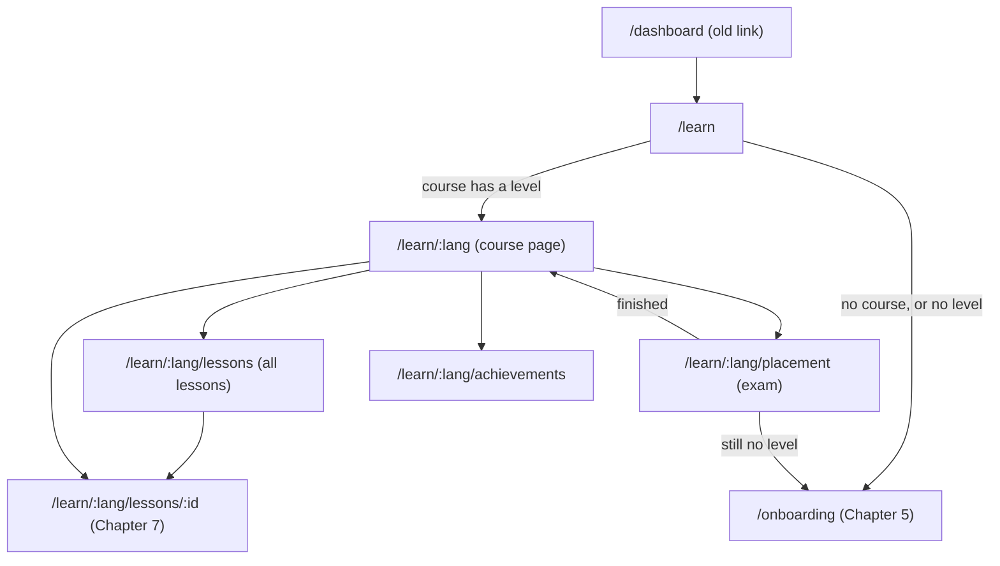
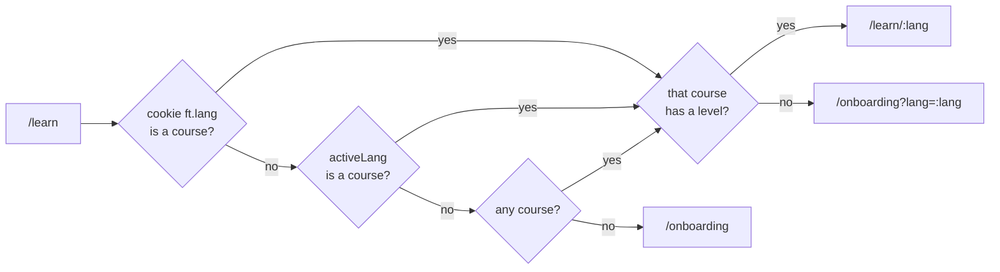
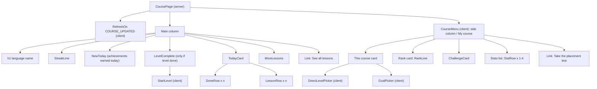
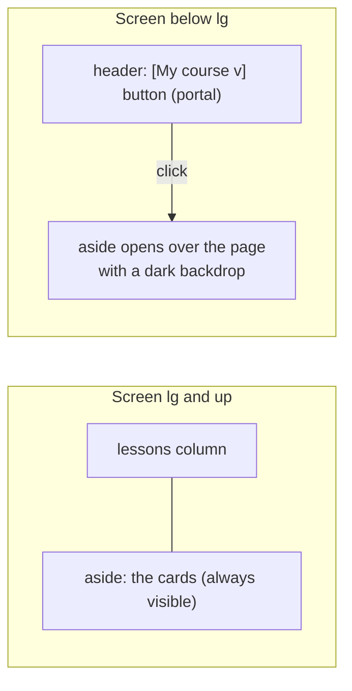
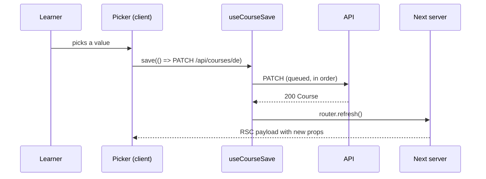
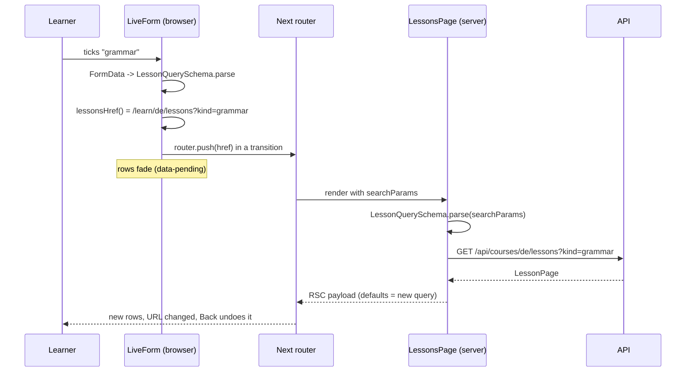
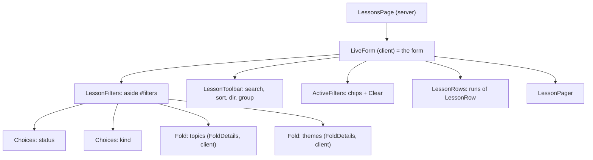
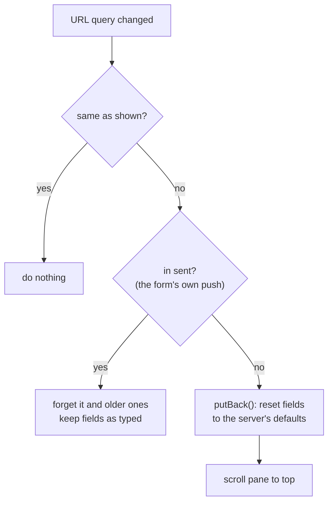
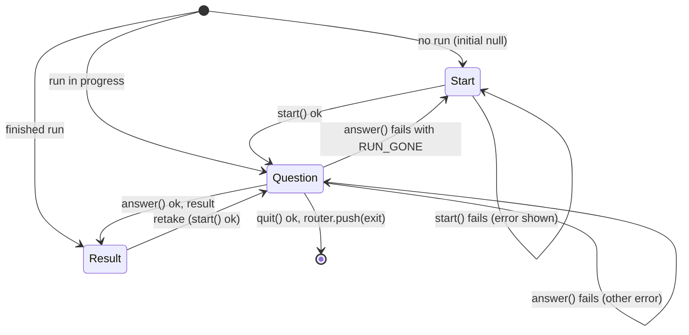

# Chapter 6 — The learning pages: dashboard, course and placement

In this chapter:

- The `(dashboard)` route group: its layout, and the old `/dashboard` and `/learn` entry pages.
- The course page `/learn/<lang>`: the Today card, the streak, the side column ("My course"), the level and goal pickers.
- The achievements page with its rules.
- The "all lessons" page: a search form whose filters live in the URL.
- The placement exam: a small state machine with three screens.
- The shared pieces they use: `CourseSwitcher`, `ChangeLevel`, `LevelPicker`, `gamification.tsx`, and the helper files in `lib/`.

The lesson player itself (`learn/[lang]/lessons/[id]/**`) is in [Chapter 7](07-lesson-player.md).

---

## 1. The big picture

Think of the course page like the front desk of a gym. When you walk in, the desk tells you
what to do **today** (your goal), shows your **streak** and your **rank**, and has a list of all
the machines (all lessons). There is also a test room (the **placement exam**) that tells you which
level you belong to.

Here are the URLs in this chapter. All of them sit under `app/[locale]/(dashboard)/`. The
`(dashboard)` folder is a **route group**: the brackets mean "this folder name is not part of the
URL" (see [Chapter 2](02-routing-layouts-i18n.md)). It only gives these pages one shared layout.

```
app/[locale]/(dashboard)/
├── layout.tsx                      the course shell (header, nav, footer)
├── dashboard/page.tsx              /dashboard        -> redirect to /learn
└── learn/
    ├── page.tsx                    /learn            -> redirect to the right course
    └── [lang]/
        ├── page.tsx                /learn/de         the course page
        ├── course-menu.tsx         side column / "My course" menu
        ├── today.tsx               Today card, streak, more lessons, level complete
        ├── direct-level-picker.tsx level select (A1..C2)
        ├── goal-picker.tsx         daily goal select (10/30/60 min)
        ├── start-level.tsx         "Start A2" button
        ├── achievements/page.tsx   /learn/de/achievements
        ├── lessons/
        │   ├── page.tsx            /learn/de/lessons  (search + filters)
        │   ├── live-form.tsx       the form that updates the URL as you type
        │   ├── lesson-list.tsx     filters, toolbar, chips, rows, pager
        │   ├── fold-details.tsx    a fold (<details>) for long filter lists
        │   └── [id]/...            the lesson player (Chapter 7)
        └── placement/
            ├── page.tsx            /learn/de/placement
            ├── placement-exam.tsx  the state machine
            ├── start-screen.tsx
            ├── question-screen.tsx
            └── result-screen.tsx
```

How a learner moves between them:



Two kinds of components appear in this chapter (see [Chapter 1](01-react-and-nextjs.md)):

| Kind | Runs where | Used here for |
| --- | --- | --- |
| **Server component** (no `'use client'`) | On the Next.js server, once per request | Pages, Today card, lesson rows, gamification cards. They read the API and send an RSC payload (HTML on the first load). |
| **Client component** (`'use client'` on top) | In the browser too | Anything that reacts to clicks or keys: pickers, the course menu, the live form, the placement exam. |

A rule you will see again and again: **the server renders the truth, the client only sends a
change and then asks the server to render again** (`router.refresh()`). So most state lives in the
database, not in React.

---

## 2. The shell: `(dashboard)/layout.tsx`

File: [layout.tsx](<../../apps/web/app/[locale]/(dashboard)/layout.tsx>)

Every page in this group is drawn inside this layout. It is a server component (it is `async`).

```tsx
export default async function DashboardLayout({ children }: { children: ReactNode }) {
  // Only reads the session: the pages decide what a signed-out visitor gets.
  const user = await currentUser();

  return (
    <>
      {user ? <TimeZoneSync storedTimeZone={user.timeZone} /> : null}
      {user ? <LocaleSync storedLocale={user.locale} /> : null}
      <Shell
        brand={
          <>
            <Wordmark href="/learn" />
            {/* The course page puts its My course button here, below lg. */}
            <div id={COURSE_MENU_SLOT} className="contents" />
          </>
        }
        nav={<DashboardNav />}
        fill
        footer={<LegalFooter />}
      >
```

What it does:

- `currentUser()` reads the session. The layout does **not** send a visitor to `/login`; each page
  does that itself (the comment says why: "the pages decide").
- `TimeZoneSync` and `LocaleSync` are small helpers from [Chapter 3](03-shell-components.md). They
  keep the user's time zone and interface language in the database in step with the browser.
- `Shell` is the page frame (Chapter 3). `fill` pins it to the screen height from the `lg`
  breakpoint (a wide screen), so each page pane scrolls on its own.
- `nav={<DashboardNav />}` is the header nav with the **course switcher** (section 9).
- The empty `<div id={COURSE_MENU_SLOT}>` is a **slot**: an empty place in the header. The course
  page later puts its "My course" button into it (section 4.5). `className="contents"` makes the
  div itself invisible to the layout, so the button inside behaves as a direct child of the header.

### `lib/course-menu-slot.ts`

File: [course-menu-slot.ts](../../apps/web/lib/course-menu-slot.ts)

```ts
/**
 * The header element the course page's My course button is portalled into.
 * Its own module: a constant exported from a 'use client' file reaches a
 * server component as a client reference, not as the string.
 */
export const COURSE_MENU_SLOT = 'course-menu-slot';
```

Only one string. Why a file of its own? The layout (server) and `course-menu.tsx` (client) both
need it. If the constant lived in the `'use client'` file, the server would not receive the string,
only a "client reference" (a pointer to client code). A plain file with no `'use client'` gives
both sides the real string.

---

## 3. The entry pages: `/dashboard` and `/learn`

### `dashboard/page.tsx`

File: [dashboard/page.tsx](<../../apps/web/app/[locale]/(dashboard)/dashboard/page.tsx>)

```tsx
/** Kept so old links and bookmarks still land somewhere. */
export default function DashboardPage() {
  redirect('/learn');
}
```

The app used to have a `/dashboard` page. Now it only redirects, so old bookmarks still work.

### `learn/page.tsx`

File: [learn/page.tsx](<../../apps/web/app/[locale]/(dashboard)/learn/page.tsx>)

```tsx
/** Reads the session, the courses and the ft.lang cookie on every request. */
export const dynamic = 'force-dynamic';

/** Where sign-in and the home links go. Renders nothing: it only picks the page. */
export default async function LearnPage() {
  const courses = await requireCourses();
  const cookieLang = (await cookies()).get(COURSE_COOKIE)?.value;

  redirect(landingPath(cookieLang, courses));
}
```

- `dynamic = 'force-dynamic'` tells Next.js: never cache this page, build it for each request
  (it depends on the user and a cookie).
- `requireCourses()` (from `lib/courses.ts`, Chapter 4) asks the API for the user's courses. If the
  user is signed out, it sends them to `/login`.
- It reads the `ft.lang` cookie: the course this browser opened last.
- `landingPath()` picks where to go. It tries, in order: the cookie, then `activeLang` (the
  server's memory, useful on a second device), then the first course. A course without a level
  goes to `/onboarding?lang=..`; no course at all goes to `/onboarding`.



### `lib/course-path.ts`

File: [course-path.ts](../../apps/web/lib/course-path.ts)

```ts
/** The course last opened here. What NEXT_LOCALE is for the interface. */
export const COURSE_COOKIE = 'ft.lang';

/** Anchored on /learn: the locale prefix is a two-letter segment too. */
export function learnPathLang(pathname: string): string | null {
  return /\/learn\/([a-z]{2})(?:\/|$)/.exec(pathname)?.[1] ?? null;
}

/**
 * The course home and nothing under it. Next prefetches the links on a course
 * page, and those sit under /learn/<lang> too, so the looser match would let a
 * link the learner merely saw record itself as the course they opened.
 */
export function courseHomeLang(pathname: string): string | null {
  return /^\/(?:[a-z]{2}\/)?learn\/([a-z]{2})\/?$/.exec(pathname)?.[1] ?? null;
}
```

Three exports:

| Export | Meaning | Used by |
| --- | --- | --- |
| `COURSE_COOKIE` | The cookie name `ft.lang`. Like `NEXT_LOCALE` stores the interface language, this stores the course language. | `learn/page.tsx`, `proxy.ts` |
| `learnPathLang(path)` | The course code in any `/learn/xx/...` URL, so `/fr/learn/de/lessons` gives `de`. The regex starts at `/learn/` because the locale (`/fr`) is also two letters. | `CourseSwitcher` |
| `courseHomeLang(path)` | Only the course home (`/learn/de` or `/fr/learn/de`), nothing below. | `proxy.ts`, which sets the cookie |

Why two regexes? `proxy.ts` (Chapter 2) writes the cookie when you open a course home. Next.js
**prefetches** links (it loads them in the background before you click). If the cookie were set for
any `/learn/de/...` URL, a link you only *saw* could change your "last course". The strict regex
stops that. The file "imports nothing": its comment says both the middleware (`proxy.ts`) and a client
component (`CourseSwitcher`) read it.

---

## 4. The course page: `learn/[lang]/page.tsx`

File: [learn/[lang]/page.tsx](<../../apps/web/app/[locale]/(dashboard)/learn/[lang]/page.tsx>)

This is the main page of the app. It is a server component. First the tree of what it draws:



### 4.1 The guards, in order

```tsx
export default async function CoursePage({ params }: { params: Promise<{ lang: string }> }) {
  // First, so an anonymous visitor gets /login and not a 404 or onboarding.
  const { courses } = await requireCourses();

  const { lang } = await params;
  const t = await getTranslations('Course');
  const languageName = await getTranslations('Languages');

  // Not a learnable language is a wrong URL, not a course still to start.
  const parsed = LanguageSchema.safeParse(lang);
  if (!parsed.success) {
    notFound();
  }

  // Only this page, not a layout: placement below it must stay reachable.
  const course = findCourse(courses, parsed.data);
  if (course === null || course.level === null) {
    redirect(`/onboarding?lang=${parsed.data}`);
  }

  // Once, after the guard: a course that cannot open never asks for its day.
  const today = await loadToday(course.lang);
  if (today === 'signed-out') {
    redirect('/login');
  }
```

A **guard** is a check at the top of a page that sends the visitor somewhere else when the page
cannot be shown. The order matters:

1. `requireCourses()` first: a signed-out visitor goes to `/login`, before any other check.
2. `LanguageSchema.safeParse(lang)`: `lang` comes from the URL, so it could be anything.
   `/learn/xx` is not a language, so it is a 404 (`notFound()`).
3. No course for this language, or a course with no level yet: go to onboarding.
   The comment says why this check is in the page and not in a layout: the placement page sits
   *under* `/learn/<lang>`, and a learner without a level must still reach it.
4. `loadToday()` reads `GET /api/courses/:lang/today` (in `lib/lessons.ts`). If the session ended
   between the two reads, the answer is `'signed-out'` and we go to `/login`.

`generateMetadata` builds the browser tab title ("German course"). Its comment explains why it
does **not** call `notFound()`: it could race the page's `/login` redirect, so the page alone
decides the 404.

### 4.2 What `today` contains

`today` follows `TodaySchema` from `packages/shared`. In short:

| Field | Meaning |
| --- | --- |
| `day` | The course day (a date like `2026-03-03`) |
| `target`, `met` | How many lessons the daily goal asks, and whether that number is reached |
| `done`, `proposed`, `extra` | Lessons finished today, proposed until the target, and more after it |
| `streak` | `current`, `best`, and `today` (does today already count?) |
| `progress` | Counts for the level: `total`, `attempted`, `passed`, `needed`, `comingSoon`, `complete` |
| `levelAfter` | The next level, or `null` after C2 |
| `xp`, `challenge`, `earnedToday` | Rank and XP, the day's challenge, achievements won today |

### 4.3 The two columns

```tsx
  const { progress } = today;
  // No ready lesson in the level: nothing to propose, so no goal to reach.
  const empty = progress.total === 0;

  return (
    <div className="flex h-full min-h-0 flex-col gap-6 lg:flex-row">
      {/* Any course's change, not only this one's: the switcher lists them all. */}
      <RefreshOn events={[SERVER_EVENTS.COURSE_UPDATED]} />
```

- `empty`: a level may have no ready lesson yet. Then the page shows only a "Lessons for this level are on their way."
  message instead of the Today card, the challenge, and the attempted and passed stats.
- `RefreshOn` (Chapter 3) listens on the socket. When the server says `COURSE_UPDATED` (for
  example the level changed in another tab), the page re-renders itself.

The main column holds the title, `StreakLine`, `NewToday`, and then, if not empty:
`LevelComplete` (only when `progress.complete`), `TodayCard`, `MoreLessons`, and a "See all N
lessons" link to `/learn/<lang>/lessons`. Note `prefetch={false}` on that link: Next.js should not
load the big list just because the link is on screen.

The second column is wrapped in `<CourseMenu>`. It holds five cards:

1. **This course**: `DirectLevelPicker` and `GoalPicker` (both are course settings, so they sit together).
2. **Rank**: `RankLine` from `gamification.tsx`.
3. **Challenge**: `ChallengeCard` (hidden when `empty`).
4. **Stats**: a list of `StatRow`s.
5. A link card to the **placement test**.

### 4.4 `StatRow` and `t.rich`

```tsx
              <StatRow icon="passed">
                {t.rich('passed', {
                  passed: progress.passed,
                  total: progress.total,
                  needed: progress.needed,
                  b: strong,
                })}
              </StatRow>
```

`t.rich` is the next-intl function for a message with tags inside. The message text in
`messages/en.json` contains `Passed <b>{passed}</b> of {total}, {needed} needed`, and `b: strong`
says "draw `<b>` with this function":

```tsx
/** A stat's number, set apart from the words around it. */
const strong = (chunks: ReactNode) => (
  <strong className="font-semibold text-slate-100 tabular-nums">{chunks}</strong>
);
```

`STAT_ICONS` maps each stat (`attempted`, `passed`, `comingSoon`, `streak`) to a colour and an SVG
path, and `StatRow` draws the icon then the text. The "coming soon" row only shows when some lessons
are not ready yet; the best streak row always shows. So the list has 1 to 4 rows.

### 4.5 `course-menu.tsx`: one column, two looks

File: [course-menu.tsx](<../../apps/web/app/[locale]/(dashboard)/learn/[lang]/course-menu.tsx>)

On a wide screen (`lg` and up) the cards are simply a column on the right. On a phone, a column
under every lesson would be very long, so the cards **fold behind a "My course" button** in the
header, and open over the page like a menu.



The button is drawn with a **portal**. A portal (`createPortal`) lets a component draw part of its
HTML in another place of the page. Here, the button is written inside `CourseMenu`, but it appears
in the header slot from section 2:

```tsx
  const [slot, setSlot] = useState<HTMLElement | null>(null);
  // Open for the page it was opened on, as the account menu: a link closes it.
  const [openOn, setOpenOn] = useState<string | null>(null);
  const open = openOn === pathname;
  useScrollLock(open);

  useEffect(() => {
    setSlot(document.getElementById(COURSE_MENU_SLOT));
  }, []);
```

- `slot` starts as `null`. Only in the browser, after the first render (`useEffect`), can we find
  the header element by its id. Until then no button is drawn.
- `openOn` stores the **path** on which the menu was opened, not just `true`. When the learner
  follows a link inside the menu, the path changes, `open` becomes `false`, and the menu closes by
  itself. No extra code needed.
- `useScrollLock(open)` (Chapter 3) stops the page behind from scrolling while the menu is open.

A second effect closes the menu on a click outside (`pointerdown` not in the button nor the panel)
or on `Escape` (and then puts the focus back on the button, for keyboard users).

The panel itself is always in the HTML. CSS classes do the rest:

```tsx
      <aside
        ref={panel}
        id={panelId}
        className={`${className} ${open ? '' : 'max-lg:hidden'} max-lg:fixed max-lg:top-16 max-lg:z-50 ...`}
      >
        {children}
      </aside>
```

`max-lg:` means "only below `lg`". So below `lg` the aside is hidden unless `open`, and when open it
is `fixed` over the page. From `lg` up none of these classes apply, and it is a normal column.

One more detail: the header's `Wordmark` (the app name, in `shell.tsx`) hides itself below `lg`
while a `[data-course-menu-button]` exists in the page (CSS `:has()`). So on a phone, the "My
course" button takes the place of the app name. Before the button mounts, the name still shows.

### 4.6 `today.tsx`: the Today card and friends

File: [today.tsx](<../../apps/web/app/[locale]/(dashboard)/learn/[lang]/today.tsx>)

All server components. Exports: `StreakLine`, `TodayCard`, `MoreLessons`, `LevelComplete`.

**`StreakLine`** picks one of three sentences:

```tsx
  if (streak.current === 0) {
    return <p className="text-slate-400">{t('streakStart')}</p>;
  }
  return (
    <p className="text-slate-400">
      {t(streak.today ? 'streakToday' : 'streakKeep', { count: streak.current })}
    </p>
  );
```

"Reach your daily goal to start a streak.", "3 day streak, today included.", or "3 day streak.
Reach your daily goal to keep it." `count` goes into an ICU plural message (`{count, plural, ...}`).

**`TodayCard`** is the daily goal:

```tsx
  const t = await getTranslations('Course');
  const [next, ...rest] = today.met ? [] : today.proposed;
```

- If the goal is met, nothing is proposed (`next` is `undefined`).
- Otherwise the first proposed lesson (`next`) gets the **primary** button ("Start"), the others
  (`rest`) a secondary one. A "Next up" badge sits above them.
- The header says "Daily goal reached" or "10 min goal: 1 of 3 lessons", with a `ProgressBar` (from the
  `@ft/ui` package) of `done.length` over `target`.
- Finished lessons are listed with `DoneRow`, then the proposals with `LessonRow`.

The comment explains a tricky case: if the learner raises the goal after meeting it, `met` becomes
false again, so the card shows the done rows over the new target and proposes the rest.

**Small helpers** inside the file:

| Helper | What it draws |
| --- | --- |
| `LessonText` | Title and summary with `lang={lang}`, so a screen reader reads them in the course language's voice. |
| `CheckIcon` | A check (passed) or a circling arrow (try again). Shape differs, not only colour, for colour-blind users. |
| `DoneRow` | A lesson finished today: score if passed, or a "Not passed yet, best 45%. Counts for today." line in amber. A level badge if the lesson is from another level. |
| `LessonRow` | Position number, text, "10 min" (`LESSON_MINUTES`), and a `Link` button. `prefetch={false}`: a row only seen is not a lesson opened. |

**`MoreLessons`** lists `today.extra` (lessons past the target) with an "Open" button, and returns
`null` when there are none.

**`LevelComplete`** shows when every ready lesson of the level was tried and enough were passed:

```tsx
      {levelAfter === null ? null : (
        <div className="flex flex-wrap items-center gap-4">
          <StartLevel lang={lang} level={levelAfter} />
          <Link
            href={`/learn/${lang}/placement`}
```

After C2 (`levelAfter === null`) it only congratulates. Otherwise it offers "Start B1" and the
placement test.

### 4.7 Saving course settings: `useCourseSave`

The three client components in the next sections (`StartLevel`, `GoalPicker`,
`DirectLevelPicker`) save with the same hook, `useCourseSave` from `lib/use-course-save.ts`
(Chapter 4). It does three things: run the write (one after another, in order), turn an error code
into a sentence, then call `router.refresh()` so the server renders the page again with the new
setting. It returns `{ pending, error, save }`, and `save()` answers `true` or `false`.



### 4.8 `start-level.tsx`

File: [start-level.tsx](<../../apps/web/app/[locale]/(dashboard)/learn/[lang]/start-level.tsx>)

```tsx
/** "Start A2" on the level complete card: the same write as the level picker. */
export function StartLevel({ lang, level }: { lang: Language; level: Level }) {
  const t = useTranslations('Course');
  const { pending, error, save } = useCourseSave();

  return (
    <div className="flex flex-col gap-2">
      <button
        type="button"
        onClick={() => save(() => setCourseLevel(lang, { level }))}
        disabled={pending}
```

One button. `setCourseLevel` (in `lib/courses-client.ts`) sends the new level to the API. While
`pending`, the button is disabled so it cannot send twice.

### 4.9 `goal-picker.tsx`: saves on change

File: [goal-picker.tsx](<../../apps/web/app/[locale]/(dashboard)/learn/[lang]/goal-picker.tsx>)

A `<select>` with the three `DAILY_GOALS` (10, 30, 60 minutes a day).

```tsx
  const [value, setValue] = useState(dailyGoal);
  const latest = useRef(0);

  useEffect(() => setValue(dailyGoal), [dailyGoal]);

  async function onChange(event: React.ChangeEvent<HTMLSelectElement>) {
    const next = Number(event.target.value) as DailyGoal;

    setValue(next);
    const pick = ++latest.current;
    const saved = await save(() =>
      clientPatch(CourseSchema, `/api/courses/${lang}`, { dailyGoal: next }),
    );
    if (!saved && pick === latest.current) {
      setValue(dailyGoal);
    }
  }
```

- The new value shows **at once** (`setValue(next)`), before the server answers. This is called an
  *optimistic update*.
- `latest` counts the picks. If a save fails, we go back to the stored goal, **but only** if no
  newer pick came after it (`pick === latest.current`). Otherwise the newer pick is what the
  learner sees.
- `useEffect(() => setValue(dailyGoal), [dailyGoal])`: when the server sends a new `dailyGoal`
  (after the refresh), the select follows it.
- The select is never disabled while saving, so the keyboard focus stays on it.

### 4.10 `direct-level-picker.tsx`: saves with a button

File: [direct-level-picker.tsx](<../../apps/web/app/[locale]/(dashboard)/learn/[lang]/direct-level-picker.tsx>)

The level select (A1 to C2). Why not save on change like the goal? The comment explains:

> On a closed select every arrow key fires `change`, so saving on change would rewrite the course
> at each level a keyboard user looks at.

So there is a "Save" button, shown only when the pick differs from the stored level:

```tsx
        {value === level ? null : (
          <button
            type="button"
            onClick={onSave}
            aria-disabled={pending}
```

After a save, a hidden `<p role="status">` says "Level saved: B1". `role="status"` makes screen
readers announce the text, because the page re-renders without moving the focus.

Note the difference with `LevelPicker` (section 9): this select names **the level the course
teaches**. `LevelPicker` asks **what the learner has mastered**. The progress in the old level is
kept; only the proposals change.

---

## 5. Gamification: `components/gamification.tsx` and `lib/achievements.ts`

File: [gamification.tsx](../../apps/web/components/gamification.tsx)

Server components with no state, "so a page without JavaScript shows it too". Exports:

| Export | Where it shows | What it draws |
| --- | --- | --- |
| `achievementTitle(code)` | helper | An achievement's title, with its numbers filled in |
| `DoneMark` | everywhere | A green check in a circle |
| `RankLine` | course page, lesson results | "Rank 3 · 397 of 600 XP", a bar, and a link to the rules |
| `ChallengeCard` | course page | The day's challenge, its XP, and "Done" when done |
| `NewToday` | course page | Chips for achievements earned today (none: nothing drawn) |
| `FinishXp` | lesson results (Chapter 7) | The XP card after a lesson |

`RankLine`'s bar starts empty at each rank:

```tsx
      <ProgressBar
        value={xp.total - xp.rankStart}
        max={xp.nextRankAt - xp.rankStart}
        label={t('rankBar')}
      />
```

`ChallengeCard`: when the challenge is a lesson kind (grammar, vocabulary, functions, reading), its
text becomes a link to the lessons of that kind, grouped by status:

```tsx
          <Link
            href={`/learn/${lang}/lessons?kind=${challenge.code}&group=status`}
```

This is a good example of "filters in the URL" (section 7): any link can open a filtered view.

`FinishXp` is used by the lesson results page; it uses `xpBreakdown()` (from `lib/xp-breakdown.ts`)
to list the XP rows (lesson, goal, challenge). Chapter 7 explains it in context.

File: [achievements.ts](../../apps/web/lib/achievements.ts)

```ts
/** The messages' params for one achievement: its target, or its level. */
export function achievementParams(code: AchievementCode): Record<string, string | number> {
  const definition = ACHIEVEMENTS.find((achievement) => achievement.code === code)!;
  return 'level' in definition
    ? { level: definition.level, share: Math.round(LEVEL_PASS_SHARE * 100) }
    : { target: definition.target, mark: LESSON_PASS_MARK };
}

/** The XP a rank opens at: 0, 100, 300, 600… (rankOf in the API inverts it). */
export function rankStartOf(rank: number): number {
  return (RANK_STEP * rank * (rank - 1)) / 2;
}
```

- `achievementParams` gives the numbers for an achievement's text. The text is in the message
  files, the numbers come from the shared constants. So the text always matches the rule the API
  applies ("Pass 10 lessons, each at 70% or more.").
- `rankStartOf` gives where a rank starts. With `RANK_STEP = 100`: rank 1 at 0, rank 2 at 100,
  rank 3 at 300, rank 4 at 600. Each step is 100 more than the last.
- `loadAchievements(lang)` reads `GET /api/courses/:lang/achievements`. An unavailable API throws
  (the error page shows), a 401 returns `'signed-out'`.
- `loadXp(lang)` reads only the `xp` from the today endpoint, for the results page. It **never
  throws**: the results page can live without the rank.
- `achievementsPath(lang)` is `/learn/<lang>/achievements`.

### `achievements/page.tsx`

File: [achievements/page.tsx](<../../apps/web/app/[locale]/(dashboard)/learn/[lang]/achievements/page.tsx>)

The same guards as the course page (courses, language, level), then one API call. Like the course
page, it has `RefreshOn` for `COURSE_UPDATED`. Then:

- A "Back to course" link to `/learn/<lang>`.
- A summary "5 of 16 earned" with a bar.
- The achievements in four groups: `lessons`, `streaks`, `challenges`, `levels`.
- A side column `HowItWorks` with every rule.

The group of an achievement is found from its definition:

```tsx
function groupOf(code: AchievementCode): Group {
  const definition = ACHIEVEMENTS.find((achievement) => achievement.code === code)!;
  if ('level' in definition) return 'levels';
  switch (definition.stat) {
    case 'bestStreak':
      return 'streaks';
    case 'challengesDone':
      return 'challenges';
    default:
      return 'lessons';
  }
}
```

The comment on `GROUPS` notes that each group is a run in the catalogue, so filtering keeps the
API's order.

`AchievementCard` draws one achievement. Earned: green, with `DoneMark` and "Earned on March 3,
2026" (`dateStyle: 'long'`). Not earned: grey, with a bar of `current / target` and a progress sentence. The date is a
**course day** (a calendar date like `2026-03-03`), not an instant. So it is formatted in UTC, and
it never moves by one day for a reader in another time zone.

`HowItWorks` lists the XP rules (`LESSON_XP`, 1 XP for each point added to your best score, `GOAL_XP`, `CHALLENGE_XP`), ranks 1 to 6 with
`rankStartOf`, the challenges, and two notes about achievements. Every number comes from shared
constants, so nothing is typed twice. `RuleRow` is one line of a `<dl>` grid (rule on the left,
amount on the right). The section has `tabIndex={0}` so Safari's keyboard can scroll it.

---

## 6. The level helpers: `lib/level.ts`

File: [level.ts](../../apps/web/lib/level.ts)

The app asks "what have you **mastered**?" and then teaches **the level above**. This file holds
that rule.

```ts
export const BEGINNER = 'A0';

/** What a learner can claim to have mastered. Null is the beginner. */
export const MASTERY_OPTIONS = [null, ...LEVELS] as const;

export function nextLevel(mastered: Level | null): Level {
  if (mastered === null) {
    return LEVELS[0];
  }
  const next = LEVELS[LEVELS.indexOf(mastered) + 1];

  return next === undefined ? mastered : next;
}

export function masteredBelow(level: Level): Level | null {
  const index = LEVELS.indexOf(level);

  return index === 0 ? null : LEVELS[index - 1];
}
```

| Mastered (pick) | A0 (`null`) | A1 | A2 | B1 | B2 | C1 | C2 |
| --- | --- | --- | --- | --- | --- | --- | --- |
| `nextLevel` (course level) | A1 | A2 | B1 | B2 | C1 | C2 | C2 |

- `A0` is not a real level and is never stored. It is how the picker says "nothing yet". It is the
  only way to get an A1 course.
- C2 maps to itself: nothing above it.
- `masteredBelow` is the inverse, used to show a stored course level as a pick. A C2 course reads
  as "C1 mastered".

Tests in `level.test.ts` check these edges (A0 to A1, C2 stays C2, A1 reads as beginner, C2 reads
as C1).

---

## 7. All lessons: search and filters in the URL

The page `/learn/<lang>/lessons` lists every lesson of the level, with a search box, filters
(status, kind, topic, theme), sort, direction, group and pages.

The big idea: **the URL is the state**. Every view is a URL like
`/learn/de/lessons?kind=grammar&status=failed&sort=score&page=2`. So Back, Refresh, sharing a link
and even a browser **without JavaScript** all work. The form is a plain HTML `GET` form; with
JavaScript, `LiveForm` makes it update the URL as you type.



Without JavaScript, the same loop happens with the "Apply" button: the browser itself submits the
`GET` form, and the URL changes the same way.

### 7.1 `lib/lesson-list.ts`

File: [lesson-list.ts](../../apps/web/lib/lesson-list.ts)

```ts
/** What a query reads as when the URL says nothing: the API's defaults. */
const DEFAULTS = LessonQuerySchema.parse({});

export function lessonQueryParams(query: LessonQuery): Record<string, string> {
  const params: Record<string, string> = {};
  for (const [key, value] of Object.entries(query)) {
    const text = Array.isArray(value) ? value.join(',') : String(value);
    const fallback = DEFAULTS[key as keyof LessonQuery];
    if (text !== (Array.isArray(fallback) ? fallback.join(',') : String(fallback))) {
      params[key] = text;
    }
  }
  return params;
}

/** The all lessons page at this query. */
export function lessonsHref(lang: string, query: LessonQuery): string {
  const search = new URLSearchParams(lessonQueryParams(query)).toString();
  return `/learn/${lang}/lessons${search === '' ? '' : `?${search}`}`;
}
```

- `LessonQuerySchema` (in `packages/shared`) is a zod schema. Each field has a `.catch()` default
  (`sort` falls back to `position`, `page` to 1, lists to empty...). So `parse({})` gives the
  defaults, and a hand-typed bad URL still gives a valid query.
- `lessonQueryParams` turns a query into URL params and **leaves defaults out**, so links stay
  short and the default view is the bare `/lessons`. Lists are joined with commas.
- `lessonsHref` builds the full link. It is used by the form, the chips and the pager.
- `groupKey(card, group)` gives the header a row sits under: its status, its kind, or its day
  (`todo` if never finished, `soon` if not ready).
- `groupRows(cards, group)` cuts the rows into **runs** of the same key, in the order the API
  sorted them. A header goes before the first row and wherever the key changes.
- `previousDay(day)` gives the day before, in UTC, to label "Yesterday".

`lesson-list.test.ts` tests each function (defaults left out, comma lists, runs, a leap day).

`lib/lessons.ts` holds `loadLessonPage(lang, query)`, which calls the API with
`lessonQueryParams(query)`, and `lessonPath(lang, id)`, the link to one lesson.

### 7.2 `lessons/page.tsx`

File: [lessons/page.tsx](<../../apps/web/app/[locale]/(dashboard)/learn/[lang]/lessons/page.tsx>)

The same three guards as the course page. Then:

```tsx
  // Every field falls back to its default, so a hand-edited URL shows the
  // default view, and the form shows what the API applies.
  const query = LessonQuerySchema.parse(await searchParams);
  const page = await loadLessonPage(course.lang, query);
  if (page === 'signed-out') {
    redirect('/login');
  }
  // The page really shown: past the end, the API gives the last one.
  const shown = { ...query, page: page.page };
```

`searchParams` is the query string of the URL. The page parses it with the shared schema, asks the
API, and uses `shown` (the page number the API really used) for the form and links.

```tsx
        <LiveForm
          lang={course.lang}
          className="group flex flex-col gap-6 lg:flex-row lg:items-start lg:gap-10"
        >
          <LessonFilters query={shown} />
          <section aria-label={t('results')} className="flex min-w-0 flex-1 flex-col gap-4">
            <LessonToolbar query={shown} total={page.total} />
            <ActiveFilters lang={course.lang} query={shown} />
            {page.total === 0 ? (
```

One form wraps both columns: filters on the side, toolbar and rows on the right. With no match,
an empty message shows; otherwise `LessonRows` and `LessonPager`. The outer div has
`data-scroll-pane`: from `lg` this div is the part that scrolls (LiveForm scrolls it back to the
top after some navigations).

The tree of this page:



### 7.3 `lessons/lesson-list.tsx`

File: [lesson-list.tsx](<../../apps/web/app/[locale]/(dashboard)/learn/[lang]/lessons/lesson-list.tsx>)

Server components that draw the form fields and the list. The fields use **default** values
(`defaultChecked`, `defaultValue`), not controlled React state: the server sets their starting
value from the query, and the browser owns them after that. This is what lets the form work
without JavaScript.

**`Choices`**: one filter as checkboxes, all with the same `name`:

```tsx
          <input
            type="checkbox"
            name={name}
            value={option.value}
            defaultChecked={checked.includes(option.value)}
            className="size-4 shrink-0 accent-slate-100"
          />
```

A GET form sends `kind=grammar&kind=reading`. The schema reads that like `kind=grammar,reading`.

**`Fold`**: topics and themes are long lists, so they sit inside a fold (`FoldDetails`, 7.5) that
starts open only when one of its boxes is checked.

**`LessonFilters`**: the filter column (`<aside id="filters">`). On a wide screen it is a sticky
column. On a phone it is a **sheet** (a panel that slides over the page from the bottom), opened by
a link to `#filters`. It uses the CSS `:target` selector: an element whose `id` matches the URL
hash (`#filters`) gets the `target:` classes. So the sheet opens **without JavaScript**:

```tsx
      className="max-lg:hidden max-lg:target:fixed max-lg:target:inset-0 max-lg:target:z-50 max-lg:target:flex ..."
```

The "Close" link is `href="#"`, which removes the hash. The "Show the lessons" button is a submit
with `formAction="?"` and `data-close-sheet`. The comment says why `"?"`: a GET form would keep the
page's `#filters` and leave the sheet open.

**`Select`** and **`LessonToolbar`**: the search box (`name="q"`, `type="search"`), a "Filters · 3"
link for phones, and three selects (sort, direction, group). The "Apply" button is inside
`<noscript>`, so it only shows when JavaScript is off. The total ("12 lessons") is in a
`role="status"` paragraph, so screen readers announce it. The `Select` comment notes it is not
keyed on its value: a new DOM node would lose the keyboard focus.

**`ActiveFilters`**: each active filter as a chip. Each chip is a plain **link** to the same view
without that filter:

```tsx
  const without = (patch: Partial<LessonQuery>) =>
    lessonsHref(lang, { ...query, ...patch, page: 1 });
```

Then a "Clear filters" link to the bare `/learn/<lang>/lessons`. Links work without JavaScript.

**`LessonRow`**: one lesson: `#position`, title and summary (with `lang`), its kind and topic or
theme, a status with a coloured dot (`STATUS_DOT`, `STATUS_TEXT`), the day and best score. A ready
lesson is one big link to the lesson page; a lesson not ready is greyed, with no link.

**`LessonRows`**: uses `groupRows()` and draws one card per run, with a header unless
`group === 'none'`. For day groups the header says "Today", "Yesterday" or a date. Its wrapper has
`group-data-pending:opacity-50`: while `LiveForm` waits for the next view, the form gets
`data-pending`, and the rows fade.

**`LessonPager`**: "1 to 20 of 45", then Previous, numbered pages and Next. Every page link keeps the
other filters (`lessonsHref(lang, { ...query, page: number })`). The current page has
`aria-current="page"`.

`dayFormatter()` formats a course day in UTC, like the achievements page, so a date never shifts.

### 7.4 `lessons/live-form.tsx`

File: [live-form.tsx](<../../apps/web/app/[locale]/(dashboard)/learn/[lang]/lessons/live-form.tsx>)

This is the most delicate file of the chapter. It is the `<form method="get">` itself, plus
JavaScript that applies every change at once.

**Applying a change.** Any `change` event inside the form calls `apply()`. Typing in the search
waits 250 ms (`SEARCH_DELAY_MS`), so we do not navigate on every key; a box or a select applies at
once.

```tsx
  const apply = (delay: number) => {
    clearTimeout(timer.current);
    timer.current = setTimeout(() => {
      timer.current = undefined;
      if (form.current === null) return;
      const data = new FormData(form.current);
      // Repeated checkbox keys come as arrays, which the schema reads like comma lists.
      const query = LessonQuerySchema.parse({
        q: data.get('q'),
        status: data.getAll('status'),
        kind: data.getAll('kind'),
        topic: data.getAll('topic'),
        theme: data.getAll('theme'),
        sort: data.get('sort'),
        dir: data.get('dir'),
        group: data.get('group'),
      });
      const href = lessonsHref(lang, query);
```

It reads the form with `FormData`, parses it with the same schema, builds the link with
`lessonsHref`, and pushes it:

```tsx
      startTransition(() => router.push(`${href}${window.location.hash}`, { scroll: false }));
```

- `useTransition` gives `pending`, which becomes the `data-pending` attribute (rows fade).
- `router.push` adds a history entry, so **Back undoes one change**, as it would after the plain
  form's Apply.
- `{ scroll: false }`: the page does not jump to the top.
- It keeps `window.location.hash`, so the phone sheet (`#filters`) stays open while the list updates.
- Note there is no `page` in the parsed form data: any filter change goes back to page 1.

**Keeping the fields in step.** The fields are uncontrolled (they hold their own values). So when
the URL changes for another reason (Back, a chip, Clear filters), the fields must be reset to the
new defaults the server sent. But when the URL change is the form's **own** push, the fields must
stay as typed (the learner may still be typing). Two refs track this:

- `shown`: the query string the fields were last put on.
- `sent`: the query strings this form pushed that can still arrive.

```tsx
  useEffect(() => {
    const now = searchParams.toString();
    if (now === shown.current) return;
    shown.current = now;
    const own = sent.current.indexOf(now);
    if (own !== -1) {
      sent.current = sent.current.slice(own + 1);
      return;
    }
    putBack();
    // From lg the page scrolls in a pane, which a query-only navigation
    // leaves where it was: Next at the bottom would open page 2 at its end.
    // Not after the form's own changes: the box under the pointer would move.
    form.current?.closest('[data-scroll-pane]')?.scrollTo({ top: 0 });
  }, [searchParams, putBack]);
```

When the URL changes: if it is one of ours, drop it and the older ones from `sent` and do nothing.
If not, `putBack()` resets the form and the pane scrolls to the top.

`putBack()` clears `sent` and any waiting search timer, then calls `form.reset()`. One trick: React
sets a `<select>`'s default only when it mounts, so `reset()` would bring back an old value. So
`putBack` first moves each select's `defaultSelected` to the shown value.



**Other effects:**

- A `popstate` listener (Back / Forward): if the entry has state, `putBack()`. Back can land on the
  view already shown, which brings no new query for the effect above. An entry with no state is a
  hash the browser moved alone; Next ignores it, so the form does too.
- On mount: if the learner changed a field **before** JavaScript loaded (hydration), apply it now.
- On unmount: clear the timer, so a waiting search does not navigate away later.

**The phone sheet hash.** `moveHash()` opens or closes the `#filters` sheet. The long comment
explains: if the browser moves the hash alone, it creates a history entry without Next's state, and
Back onto it does nothing in Next. So `moveHash` sets `location.href = '#filters'` (which makes
`:target` work; `pushState` would not) and then `replaceState` copies the old state into the new
entry. `moveSheet()` also resends the form if a change is still on its way, because that change
carries the old hash and would undo the open/close when it lands.

The `onClick` handler catches the `#filters` and `#` links; `onSubmit` handles "Show the lessons"
(only closes the sheet) and Enter in the search (applies at once).

### 7.5 `lessons/fold-details.tsx`

File: [fold-details.tsx](<../../apps/web/app/[locale]/(dashboard)/learn/[lang]/lessons/fold-details.tsx>)

A `<details>` element (a fold the browser opens and closes on its own) whose open state the server
only **suggests**.

```tsx
  const [open, setOpen] = useState(checked);
  // Adjusted while rendering, not in an effect: React's way to follow a prop.
  const [wasChecked, setWasChecked] = useState(checked);
  if (checked !== wasChecked) {
    setWasChecked(checked);
    if (checked) setOpen(true);
  }
```

- It starts open if one of its boxes is checked.
- If the learner unticks the last box, the server renders `checked = false`. A plain server `open`
  attribute would then **close the fold under the pointer**. Here, `checked` going to false changes
  nothing: only the learner closes it.
- If a box becomes checked from elsewhere (Back, a link), it opens.
- `onToggle` keeps `open` in step with the learner's clicks.

The "adjust state while rendering" pattern (compare with the previous prop, and set state during
render) is the way React docs recommend to follow a prop without an extra effect.

---

## 8. The placement exam

The placement exam is an adaptive test: the server picks each question from your earlier answers,
each question has a timer, and at the end the server gives a level. The page only shows what the
server sends.

### 8.1 `lib/placement-schema.ts`

File: [placement-schema.ts](../../apps/web/lib/placement-schema.ts)

```ts
export const PlacementStateSchema = z.union([PlacementQuestionSchema, PlacementResultSchema]);

export type PlacementState = z.infer<typeof PlacementStateSchema>;

//We will know what type is returned saying state is PlacementResult, if report is not found it is not PlacementResult but PlacementQuestion
export function isPlacementResult(state: PlacementState): state is PlacementResult {
  return 'report' in state;
}
```

Every placement endpoint answers either **a question** or **a result**. The schema accepts both.
`isPlacementResult` is a **type guard**: a function whose return type `state is PlacementResult`
tells TypeScript "after this check is true, treat `state` as a result". A result has a `report`
field; a question does not. Tests in `placement-schema.test.ts` check both shapes.

`lib/placement-client.ts` (Chapter 4) has the three browser calls: `startPlacement(lang)`
(`POST /api/placement`), `submitPlacementAnswer(questionId, choice)`
(`POST /api/placement/answers`) and `quitPlacement()` (`DELETE /api/placement`).

### 8.2 `placement/page.tsx`

File: [placement/page.tsx](<../../apps/web/app/[locale]/(dashboard)/learn/[lang]/placement/page.tsx>)

A server component. Its guards differ from the course page:

```tsx
  // Unlike CoursePage, a null level is exactly who this page is for: placement
  // is what sets it. Only a language the learner does not study is sent back to
  // onboarding, where the course gets created.
  const course = findCourse(courses, parsed.data);
  if (course === null) {
    redirect(`/onboarding?lang=${parsed.data}`);
  }

  // A 404 is no run yet: the page offers the start control for it.
  const result = await apiFind(PlacementStateSchema, '/api/placement');
```

`apiFind` (Chapter 4) is like `apiGet` but treats a 404 as "not found" instead of an error. So:
no run yet is normal, and the page shows the start screen. A 401 (the session ended between the two
reads) goes to `/login`, and an unavailable API throws (the error page shows).

```tsx
  // One run per learner, whatever the language. A live one elsewhere is where
  // the learner belongs; a finished one elsewhere is only a report, which the
  // start control here replaces.
  if (run !== null && run.lang !== parsed.data && !isPlacementResult(run)) {
    redirect(`/learn/${run.lang}/placement`);
  }

  return (
    <PlacementExam
      lang={parsed.data}
      courseLevel={course.level}
      initial={run?.lang === parsed.data ? run : null}
    />
  );
```

A learner has at most one run, in any language. If a test is running in German and you open the
French placement page, you are sent to the German one. A finished German result does not block a
French start.

### 8.3 `placement-exam.tsx`: the state machine

File: [placement-exam.tsx](<../../apps/web/app/[locale]/(dashboard)/learn/[lang]/placement/placement-exam.tsx>)

A client component. Its main state is `state: PlacementState | null`. Which screen shows depends
only on that:

| `state` | Screen |
| --- | --- |
| `null` | `StartScreen` |
| a question | `QuestionScreen` |
| a result (`isPlacementResult`) | `ResultScreen` |



The other state:

```tsx
  const [state, setState] = useState<PlacementState | null>(initial);
  const [error, setError] = useState<string | null>(null);
  const [pending, setPending] = useState(false);
  // Kept after a success: the old question's timer can still fire before React
  // swaps the next one in, and must not post a stale null for it.
  const answering = useRef<string | null>(null);
  // The course as this page knows it: the server's level, then whatever an
  // applied run or a pick on the result writes, with no reload in between.
  const [level, setLevel] = useState<Level | null>(courseLevel);
  const [finishedHere, setFinishedHere] = useState(false);

  // Onboarding owns an unplaced course, the course page a placed one.
  const exit = level === null ? `/onboarding?lang=${lang}` : `/learn/${lang}`;
```

- `send()` wraps every request: sets `pending`, clears `error`, runs the request, clears `pending`.
- `fail()` turns an error code into a sentence with `useErrorMessage` (Chapter 4).
- `answering` holds the question id being answered. If the same question is answered twice (a click
  and the timer at the same moment), the second call stops at once.
- `level` is the course level **as this page knows it**. When a run is applied, it becomes the
  result's `targetLevel` without a reload.
- `finishedHere` is `true` only if the learner answered the last question on this page (not if they
  loaded a finished result). It changes the result button text.
- `exit` is where "Back" and "Continue" go: onboarding if the course still has no level, else the
  course page.

The `answer()` function:

```tsx
  async function answer(questionId: string, choice: string | null) {
    if (answering.current === questionId) {
      return;
    }
    answering.current = questionId;
    const result = await send(() => submitPlacementAnswer(questionId, choice));
    if (result.ok) {
      setState(result.data);
      if (isPlacementResult(result.data)) {
        setFinishedHere(true);
        if (result.data.applied) {
          setLevel(result.data.targetLevel);
        }
      }
      return;
    }
    answering.current = null;
    // A dead question with only an error under it is a dead end; Start is not.
    if (RUN_GONE.has(result.code)) {
      setState(null);
    }
    fail(result);
  }
```

`choice` is `null` when the timer ran out. `RUN_GONE` holds three error codes
(`placement.notFound`, `placement.invalidSession`, `placement.poolExhausted`): the run expired, was
dropped, or ran out of questions. Then the page goes back to the start screen, with the error,
because a dead question is a dead end.

`quit()` calls `DELETE /api/placement` (idempotent: a run already gone also answers 204), then goes
to `exit`.

### 8.4 `start-screen.tsx`

File: [start-screen.tsx](<../../apps/web/app/[locale]/(dashboard)/learn/[lang]/placement/start-screen.tsx>)

A small form: a heading, a description with the language name, and, for a learner who already has
a level, "Your lessons are at B1 now..." (because finishing writes a new level, they should know first).
Then `FormError`, a `SubmitButton` that calls `onStart`, and a "Back" link to `exit`. It is a
`<form>` so Enter starts the test too.

### 8.5 `question-screen.tsx`

File: [question-screen.tsx](<../../apps/web/app/[locale]/(dashboard)/learn/[lang]/placement/question-screen.tsx>)

Draws one question: a sticky bar with progress and a countdown, the reading text if any (in a
`<blockquote>`), the question, the options as buttons, an error, and a Quit button.

All course-language text has `lang={lang}`, for the right voice and hyphenation. `wrap-break-word`
breaks long words only when they do not fit (German compound words are long).

The `ProgressBar` here is local and decorative (`aria-hidden`): its total is
`answered + maxQuestionsRemaining`, a ceiling that shrinks as the test settles, not a true total.

**`Countdown`** is the timer:

```tsx
  // A deadline, not a count of ticks: a hidden tab gets its timers throttled,
  // while the server goes on measuring the limit from when it served the question.
  const [deadline] = useState(() => Date.now() + remainingS * 1000);
  const [left, setLeft] = useState(remainingS);
  const expire = useEffectEvent(onExpire);

  useEffect(() => {
    // Four ticks a second, so the last one is not swallowed by a tick landing
    // just past it. Only a whole second changes state, so the rest cost nothing.
    const interval = setInterval(() => {
      const seconds = Math.max(0, Math.ceil((deadline - Date.now()) / 1000));
      setLeft(seconds);
      if (seconds === 0) {
        clearInterval(interval);
        expire();
      }
    }, 250);
    return () => clearInterval(interval);
  }, [deadline]);
```

- It stores a **deadline** (a time), not a number of ticks. Browsers slow down timers in hidden
  tabs, so counting ticks would drift. The time left is always computed from the clock.
- It checks 4 times a second. `setLeft` with the same number does not re-render, so this is cheap.
- `useEffectEvent(onExpire)` gives a stable function that always calls the latest `onExpire`,
  without restarting the effect when the parent re-renders.
- At 0 it calls `onExpire`, which answers with `null`.
- The component gets `key={questionId}`. A new key makes React build a new `Countdown` for each
  question, so the ring starts full.
- The ring is an SVG circle with `strokeDashoffset`; it turns red at 5 seconds or less. The number
  has `role="timer"` and a label like "Seconds left: 12".

**`QuitButton`** opens a `<dialog>` with `showModal()`. A modal dialog gives a focus trap and Escape
for free. The first button ("Keep going") has no type inside `<form method="dialog">`, so it just closes
the dialog. It is first, so the focus starts on the safe choice; "Quit" is red and calls
`onQuit`. Quitting throws away every answer, and a stray tap is easy on a phone, so it asks.

### 8.6 `result-screen.tsx`

File: [result-screen.tsx](<../../apps/web/app/[locale]/(dashboard)/learn/[lang]/placement/result-screen.tsx>)

```tsx
  const correct = report.filter((entry) => entry.wasCorrect).length;
  // Only narrows: an applied run always leaves the course a level.
  const applied = result.applied && level !== null;
```

The top section:

- A heading and a main button to `exit`. Its text: "Choose your level" (no level yet), "Continue"
  (finished on this page) or "Back to course" (a result loaded with the page).
- If `applied`: a `LevelSummary` (from `level-picker.tsx`) with the big level and "12 of 20
  correct". If not applied (every question timed out), a notice that the course was left alone.
- Two actions: "Retake the test" (calls `onRetake`, which is `start`) and, if applied, a `ChangeLevel`
  button ("Choose another level") to pick another level by hand. `onSaved={onLevelChange}` updates `level` in the exam
  without a reload.

The bottom section lists every answer (`Answer`): a `Verdict` icon (an SVG check or cross, "drawn
rather than a glyph, which fonts render as anything from an emoji to a box"), the reading text in a
fold, the question, "Your answer" and, if wrong, "Correct answer". `QuestionLevel` shows the
question's level as a small badge; the eye sees "B1", a screen reader hears "Level B1".

The answers heading uses `result.targetLevel`, the level the exam gave. It does not follow a later
`ChangeLevel`.

---

## 9. Shared level and course components

### 9.1 `components/course-switcher.tsx`

File: [course-switcher.tsx](../../apps/web/components/course-switcher.tsx)

A `<select>` in the header (rendered by `DashboardNav`, Chapter 3) to switch between your courses,
with a last option "Add a language".

```tsx
  // From the URL: a layout does not re-render on navigation within it. A value
  // matching no option would make the browser show the first instead.
  const path = learnPathLang(pathname);
  const current = courses.some((course) => course.lang === path) ? path : null;

  function onChange(event: React.ChangeEvent<HTMLSelectElement>) {
    const value = event.target.value;

    router.push(value === ADD_LANGUAGE ? '/onboarding' : `/learn/${value}`);
  }
```

- The current course comes from the **URL** (`learnPathLang`), not from a prop. The layout that
  holds the header does not re-render when you move between pages, so a prop would be stale.
- If the URL has no known course (a 404 under `/learn`), a disabled "No course open" option shows, so the
  browser does not show the first course by mistake.
- `ADD_LANGUAGE = '__add'` is not a language code, so it cannot collide with a course.
- The comment explains the label "Course": an e2e test looks for the locale switcher by the name
  "Language", and a second box with that name would break it.
- The `in-data-header-menu:` classes change the look when the switcher sits inside the header menu
  (`HeaderMenu`, for a signed-in user, on every screen size; Chapter 3).

### 9.2 `components/level-picker.tsx`

File: [level-picker.tsx](../../apps/web/components/level-picker.tsx)

Exports `LevelPicker` and `LevelSummary`. Used by onboarding (Chapter 5) and `ChangeLevel`, and
`LevelSummary` by the result screen. The same pick gives the same course everywhere.

```tsx
        <div className="grid grid-cols-7 gap-1 sm:gap-2">
          {MASTERY_OPTIONS.map((option) => (
            <label
              key={option ?? BEGINNER}
              className="cursor-pointer rounded-md border border-slate-700 py-3 text-center text-sm has-checked:border-slate-100 ..."
            >
              <input
                type="radio"
                name={name}
                value={option ?? BEGINNER}
                checked={value === option}
                onChange={() => onChange(option)}
                className="sr-only"
              />
              {option ?? BEGINNER}
            </label>
```

- Seven radio buttons, A0 to C2, drawn as boxes. The real radio is hidden (`sr-only`), and the
  label is styled with `has-checked:` (CSS `:has(:checked)`).
- `value`: `undefined` is "nothing picked yet" (no summary shown), `null` is "beginner".

`LevelSummary` shows a ladder (`LevelLadder`, decorative) with "You" on the mastered level and
"Goal" on the level that will be taught, then a sentence like "You can ... Your lessons will be at
B1." It has `role="status"`, so a change is announced. `children` lets the result screen put the
big level inside the same box.

### 9.3 `components/change-level.tsx`

File: [change-level.tsx](../../apps/web/components/change-level.tsx)

A button that opens a modal `<dialog>` with a `LevelPicker`, to set the level without an exam.
Used on the placement result screen.

```tsx
  // Shown once its content is in, so the focus lands inside it.
  useEffect(() => {
    if (open) dialog.current?.showModal();
  }, [open]);
```

```tsx
        {/* Mounted per opening: a closed dialog leaves no second picker in the
            page, and each opening starts over from the course as it is. */}
        {open ? <LevelForm lang={lang} level={level} onSaved={saved} onCancel={close} /> : null}
```

- `open` is React state. Setting it renders the form, then the effect calls `showModal()`, so the
  focus can go inside.
- The form is only mounted while open. Each opening starts fresh from the current level.
- `close()` sets `open` to false **and** closes the dialog in the same step, so the page never
  shows two levels for a moment. `onClose` also catches Escape.
- `saved(target)`: calls `onSaved` if given, else `router.refresh()`.

`LevelForm` starts on `masteredBelow(level)` (the pick that matches the current course), computes
`target = nextLevel(mastered)`, and the Save button is disabled while `target === level`, so Save
only works when the pick changes the course. On submit it calls `setCourseLevel`.

---

## 10. `lib/onboarding.ts` (used by Chapter 5)

File: [onboarding.ts](../../apps/web/lib/onboarding.ts)

Not used by the dashboard pages, but the guards in this chapter send learners to
`/onboarding?lang=..`, and this function decides which step they see there.

```ts
export function resolveOnboardingStep(
  courses: readonly Course[],
  wanted: Language | null = null,
): OnboardingStep {
  const course = courses.find((candidate) => candidate.lang === wanted);

  if (wanted !== null && course === undefined) {
    return { step: 'chooseCourse', preselected: wanted };
  }
  if (course?.level === null) {
    return { step: 'chooseLevel', course };
  }

  const unfinished = courses.findLast((candidate) => candidate.level === null);

  return unfinished === undefined
    ? { step: 'chooseCourse', preselected: null }
    : { step: 'chooseLevel', course: unfinished };
}
```

- The step is **computed from the API data**, not kept in React state. So it survives a refresh,
  Back, or a placement exam left halfway.
- `wanted` is the `?lang=` from the URL: a language not studied yet is preselected; a course
  without a level opens its level step.
- Otherwise the newest unfinished course (`findLast`) is resumed; with none, choose a course.

`onboarding.test.ts` covers each branch. Chapter 5 shows the onboarding page that uses it.

---

## Key ideas to remember

- **Guards come first and in order**: signed in (`requireCourses`), valid language (`notFound`),
  course with a level (onboarding), then the page's own data. The placement page lets a course with
  no level in, because placement is what sets it.
- **The server renders the truth.** Pickers send a change with `useCourseSave`, then
  `router.refresh()` renders the page again. `RefreshOn` does the same when another tab changes the
  course.
- **One column, two looks**: `CourseMenu` is a side column on wide screens and a "My course" menu on
  phones, with its button portalled into a header slot (`COURSE_MENU_SLOT`).
- **Mastered vs taught**: `LevelPicker` asks what you know (A0 to C2), `nextLevel` gives the course
  level above it. `DirectLevelPicker` sets the taught level directly.
- **The URL is the state** on the all lessons page: a plain GET form, `LessonQuerySchema` for
  defaults, `lessonsHref` for links. It works with Back, Refresh and without JavaScript; `LiveForm`
  only makes it live.
- `LiveForm` tells its **own** navigations (`sent`) from others (Back, chips) and resets the
  uncontrolled fields only for the others.
- **The placement exam is a state machine** on one value: `null` (start), a question, or a result
  (`isPlacementResult`).
- **Timers use deadlines**, not tick counts, and a `key` per question restarts the countdown.
- Many small choices are for **accessibility**: `lang` on course text, `role="status"` for
  announcements, shapes as well as colours, modal dialogs for focus, `prefetch={false}` on rows
  that are only seen.
- **Numbers come from shared constants** (`LESSON_XP`, `RANK_STEP`, `LESSON_PASS_MARK`...), so the
  texts always match the rules the API applies.

---

Previous: [Chapter 5 — Account pages](05-account-pages.md) · Next: [Chapter 7 — Lesson player](07-lesson-player.md) · [Back to index](README.md)
