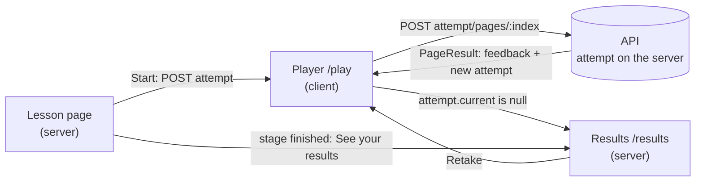
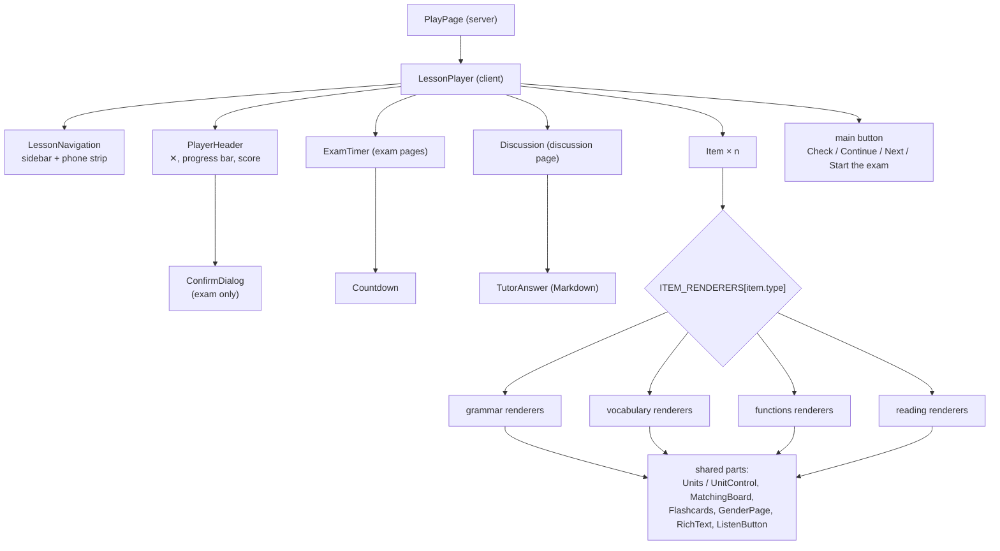
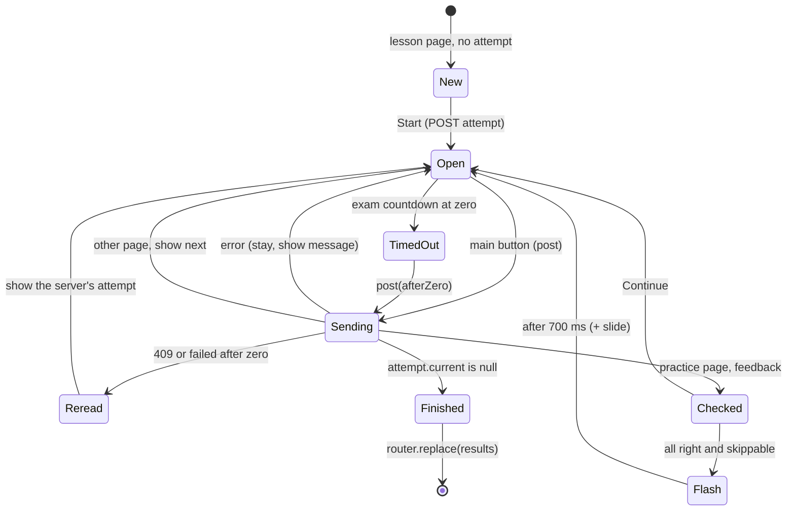
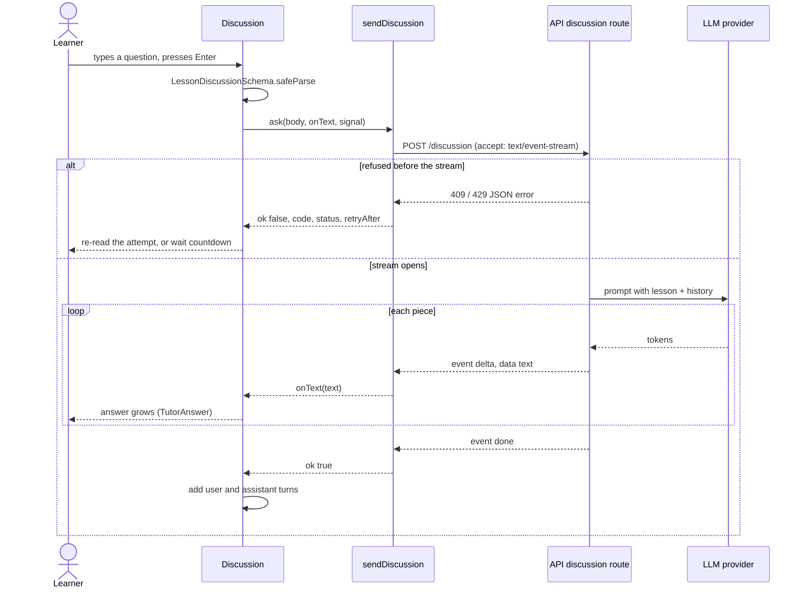

# Chapter 7 — The lesson player

In this chapter:

- The three pages of a lesson: the **lesson page** (start screen), the **player** (`/play`) and the **results** (`/results`).
- The shape of the lesson data the browser gets (the shared `lessons.player` schemas).
- How the player keeps its state: the server's **attempt** (with its **cursor**), the **drafts** (answers not sent yet), and the tab's memory.
- How answers are sent, how a practice page shows its feedback, and how the exam **timer** works.
- The building blocks in `components/lesson/`: unit controls, matching boards, flashcards, gender page, and the four lesson **kinds** (grammar, vocabulary, functions, reading).
- The results page and the XP breakdown.
- The AI tutor: streaming the answer (SSE read by hand with `fetch`) and showing its Markdown.
- Text-to-speech with the browser's Web Speech API.

---

## The big picture

### Three pages, one attempt

A learner plays a lesson in three steps, and each step has its own URL:

| URL | File | Rendered on | What it shows |
|---|---|---|---|
| `/learn/fr/lessons/fr-a1-01` | [page.tsx](<../../apps/web/app/[locale]/(dashboard)/learn/[lang]/lessons/[id]/page.tsx>) | server | title, objective, outline, the one main button |
| `/learn/fr/lessons/fr-a1-01/play` | [play/page.tsx](<../../apps/web/app/[locale]/(dashboard)/learn/[lang]/lessons/[id]/play/page.tsx>) + [play/player.tsx](<../../apps/web/app/[locale]/(dashboard)/learn/[lang]/lessons/[id]/play/player.tsx>) | server, then browser | one page of the lesson at a time |
| `/learn/fr/lessons/fr-a1-01/results` | [results/page.tsx](<../../apps/web/app/[locale]/(dashboard)/learn/[lang]/lessons/[id]/results/page.tsx>) | server | score, XP, every answer with its correction |

The important word is **attempt**. An attempt is one play of a lesson, saved on the server. It has an id (`attemptId`) and a **cursor**: the index of the page the learner is on. The cursor only moves forward. When the last page is sent, the attempt is finished and has results.

> Analogy: the attempt is like a **board game saved at the post office**. You never keep the board at home. Each move, you send a letter ("I play this page with these answers"), and the post office sends back the new board. If you lose your copy, you ask the post office again.

That is exactly the rule of the player, written at the top of [player.tsx](<../../apps/web/app/[locale]/(dashboard)/learn/[lang]/lessons/[id]/play/player.tsx>):

```tsx
/**
 * The player: renders the attempt the server sends and never scores.
 * Each move (Check, Continue, Start the exam, Next, the countdown at
 * zero) posts the page at the cursor and renders what comes back. Pages
 * inside the player never touch the history: Back leaves the player.
 */
```

So the browser **never decides** if an answer is right. It never even sees the right answer before the page is locked. The server scores; the browser draws.



### The three API routes

All lesson attempt calls go to one path, `/api/courses/:lang/lessons/:id/attempt` (see [chapter 8 of the API docs](../api/08-lessons.md)). The comment at the top of [view.ts](../../packages/shared/src/lessons/player/view.ts) lists them:

```ts
 *   GET  attempt              → AttemptRead
 *   POST attempt              StartAttempt → AttemptView
 *   POST attempt/pages/:index SubmitPage   → PageResult
```

Plus one more for the tutor: `POST /api/courses/:lang/lessons/:id/discussion`, which answers with a **stream** (more on this later).

---

## The lesson data shape (`lessons.player` in packages/shared)

The web app and the API share the same types. They live in [packages/shared/src/lessons/player/view.ts](../../packages/shared/src/lessons/player/view.ts) and are exported as `lessons.player` from `@ft/shared`. They are **zod** schemas: zod is a library that describes the shape of data and can check it at run time (`Schema.parse(data)` throws if the data does not fit).

Every schema is a `z.strictObject`. "Strict" means an unknown key makes the check fail. The comment explains why:

```ts
 * Two rules hold the keys back:
 * - **The keys only come after the lock.** Accepted answers, the right
 *   option or order, the faulty token and the explanations exist only in
 *   UnitFeedback (a practice page, once checked) and in Results (once the
 *   attempt is finished). PageView has none.
 * - **No authored id.** The ids of a lesson file carry answers
 *   (`gap-livre`, a unit ending in `/je`), so units, options, tokens and
 *   cards are named by a Ref instead: an HMAC of the internal id, valid
 *   in one attempt only (#145 computes it).
```

So: a page sent to the browser has **no answers in it**. Even the ids are hidden behind a **Ref**, a 16-character random-looking string (`RefSchema = z.string().regex(/^[A-Za-z0-9_-]{16}$/)`). A clever learner opening the dev tools learns nothing.

### The tree of types

```
AttemptRead                 GET attempt
├── outline: LessonOutline  same for every learner (title, sections, pages...)
└── attempt: AttemptView | null   null = never started
    ├── attemptId           uuid
    ├── current: PageView | null  the page at the cursor; null = finished
    │   ├── index, role, scored, instructions
    │   └── items: ItemView[]     one schema per item type
    │       └── units: UnitView[] text | choice | order | spot
    ├── remainingMs         exam pages only: time left (0 = ran out)
    ├── practice: Tally     the header score { earned, possible }
    └── results: Results | null   set once finished
```

| Type | What it is |
|---|---|
| `LessonOutline` | The lesson's "table of contents": `title`, `objective`, `minutes`, `sections` (each with numbered `points`), `pages` (each with `role`, `seconds`, `limitS`, `questions`, `step`), and kind fields (`words`, `newVerbs`, `situation`, `roles`). |
| `PageView` | The page at the cursor. Its `role` is one of `presentation`, `practice`, `discussion`, `examIntro`, `exam`. |
| `ItemView` | One block of a page. A **discriminated union** on `type` (a union where one field, here `type`, tells which shape it is): `grammar_explanation`, `vocabulary_flashcards`, `function_dialogue`, `reading_document`, … about 30 types. |
| `UnitView` | One answer to give, by `kind`: `text` (type it), `choice` (pick an option), `order` (put tokens in order), `spot` (find the wrong word and correct it). |
| `Answer` | What the learner sends for one unit: `{ text, gender? }`, `{ option }`, `{ tokens }` or `{ token, text }`. |
| `UnitFeedback` | The correction of one unit, after a practice page is checked: `outcome`, `points` (0, 0.5 or 1), `answer`, `explanation`, and helpers like `correct` (right options), `order`, `faulty`, `marks`. |
| `Results` | The whole finished attempt: `score`, `practice` and `exam` tallies, `steps`, one `row` per unit, and `finish` (XP, daily goal, best score). |

The four possible outcomes come from the shared scoring code: `fully_correct`, `orthography_only` (right but with a spelling/accent slip: half a point), `incorrect`, `unanswered`.

### The web-side contract: [components/lesson/types.ts](../../apps/web/components/lesson/types.ts)

This file first re-exports the shared types with short names (`ItemView`, `UnitView`, `Answer`, `Ref`, `LessonOutline`, `Localized`…). Then it defines what the player gives to **every** item renderer:

```ts
export interface AnswerProps {
  /** The course language, for the lang attribute of its texts. */
  lang: Language;
  /** The drafts of the page, by unit ref. */
  answers: Readonly<Record<Ref, Answer | undefined>>;
  /** Sets or clears one unit's draft. */
  onAnswer: (ref: Ref, answer: Answer | undefined) => void;
  /** The feedback of a checked practice page, by unit ref; null before, and on the exam. */
  feedback: ReadonlyMap<Ref, UnitFeedback> | null;
  /** No change any more: a request is running, the page was checked, or its time ran out. */
  locked: boolean;
  hold: (key: string, hold: Hold | null) => void;
  nudged: boolean;
  keep: { load: (key: string) => string | null; save: (key: string, value: string) => void };
  outline: LessonOutline;
}
```

The items hold **no answer state of their own**: the drafts come in through `answers`, and every change goes out through `onAnswer`. This is called a **controlled component** in React: the parent owns the value.

`Hold` lets an item **hold back the page's main button**:

| `kind` | Effect | Example |
|---|---|---|
| `block` | The button is disabled. | Flashcards: "Flip every card to continue." Matching: not every box is paired. |
| `nudge` | The first press only shows a note (`nudged` becomes true); the second press sends. | Translation exam: "type the article". |
| `step` | The button is lent to the item: it shows `label`, and a press calls `onStep`. | Dialogue: "Next line" until the last line. |

Finally, the **kind contract**:

```ts
export type ItemRenderers = { [T in ItemViewType]?: ComponentType<ItemProps<T>> };
export type StartField = ComponentType<{ outline: LessonOutline; lang: Language }>;
export type StartFact = (
  outline: LessonOutline,
  t: (key: string, values?: Record<string, string | number>) => string,
) => string | null;

export interface KindParts {
  kind: LessonKind;
  renderers: ItemRenderers;
  startFields: StartField[];
  startFacts?: StartFact[];
}
```

A **kind** (grammar, vocabulary, functions, reading) brings a map "item type → React component", plus some blocks for the lesson start page. The player looks things up in this map and never asks "which kind is this lesson?". We will see the registry in [kinds/index.ts](../../apps/web/components/lesson/kinds/index.ts) below.

---

## Server-side helpers: [lib/lesson.ts](../../apps/web/lib/lesson.ts)

The three pages start the same way, so they share `loadLesson`. It is the **guard** of the lesson pages:

```ts
export async function loadLesson(lang: string, id: string): Promise<LessonData> {
  const { courses } = await requireCourses();

  const parsedLang = LanguageSchema.safeParse(lang);
  const parsedId = LessonIdSchema.safeParse(id);
  if (!parsedLang.success || !parsedId.success) {
    notFound();
  }

  const course = findCourse(courses, parsedLang.data);
  if (course === null || course.level === null) {
    redirect(`/onboarding?lang=${parsedLang.data}`);
  }

  const { read, card } = await readLesson(parsedLang.data, parsedId.data);
  ...
```

In order: no session → `/login` (inside `requireCourses`); bad language or id → 404; no course or no level → onboarding; lesson unknown → 404; API down → it throws, so the error page shows. It returns `{ lang, id, card, read }`: the **card** (title, level, kind, status, best score; the same card the course page shows) and the **read** (`AttemptRead`: outline + attempt).

`readLesson` does the two API calls **in parallel** (`Promise.all`) and is wrapped in React's `cache()`:

```ts
const readLesson = cache(async function readLesson(lang: Language, id: string) {
  const base = `/api/courses/${lang}/lessons/${id}`;
  const [read, card] = await Promise.all([
    apiFind(lessons.player.AttemptReadSchema, `${base}/attempt`),
    apiFind(LessonCardSchema, base),
  ]);
  return { read, card };
});
```

`cache()` remembers the result **for one server request**. Why? `generateMetadata` (the browser tab title) and the page itself both need the card. With `cache`, the API is called once, not twice.

Other exports:

- `lessonTitle(lang, id)`: the title for the tab, or `null`. It never redirects: "metadata must not race" the page.
- `lessonPaths(lang, id)`: `{ page, play, results }` URLs.
- `lessonStage(attempt)`: where the learner is.

```ts
export type LessonStage = 'new' | 'running' | 'exam' | 'finished';

export function lessonStage(attempt: AttemptRead['attempt']): LessonStage {
  if (attempt === null) return 'new';
  if (attempt.current === null) return 'finished';
  return attempt.current.role === 'exam' ? 'exam' : 'running';
}
```

Tested in `lib/lesson.test.ts` (the guard order, the title, the stage).

### [lib/lesson-cursor.ts](../../apps/web/lib/lesson-cursor.ts)

A tiny file shared by the server pages and the browser code (so it imports neither):

```ts
export interface Cursor {
  attemptId: string;
  index: number | null;
}

export const cursorOf = (attempt: AttemptView | null): Cursor | null =>
  attempt === null ? null : { attemptId: attempt.attemptId, index: attempt.current?.index ?? null };
```

A cursor is "which attempt, which page" (`null` page = finished). It is used to compare "what the server rendered" with "what this tab saw last" (see `FreshOnReturn` below).

---

## The lesson page: [page.tsx](<../../apps/web/app/[locale]/(dashboard)/learn/[lang]/lessons/[id]/page.tsx>)

A **server component** (it is `async` and has no `'use client'`). `export const dynamic = 'force-dynamic'` tells Next.js never to cache it: it reads the session and the attempt on every request.

It draws the start card:

1. A back link to the course, the language / level, a chip with the kind.
2. The title (`lang={course}` so screen readers pronounce it in French, German…), the objective in the interface language (`pick(outline.objective, locale)`).
3. A facts line: "About 14 minutes · 8 words". The minutes come first, then each kind's **start facts**:

```tsx
{[
  t('aboutMinutes', { minutes: outline.minutes }),
  // Each kind's facts: "About 14 minutes · 8 words".
  ...START_FACTS.map((fact) => fact(outline, (key, values) => t(key, values))),
]
  .filter(Boolean)
  .join(' · ')}
```

4. Status and best score.
5. Each kind's **start fields** (`START_FIELDS.map((Field, n) => <Field ... />)`): a field draws nothing when the lesson does not have that data.
6. The outline: one row per section, with a letter (A, B, C…) and a colour from `SECTION_COLORS`, its minutes, and its numbered points. The exam section (no points) shows "N pages, M questions" instead.
7. `<LessonActions>`: the main button.

It also renders `<FreshOnReturn>` at the top (explained next).

---

## [lesson-actions.tsx](<../../apps/web/app/[locale]/(dashboard)/learn/[lang]/lessons/[id]/lesson-actions.tsx>) — the main button

A client file (`'use client'`) with three exports used by the lesson page and the results page.

### `useStartLesson` (private hook)

```ts
async function start() {
  setPending(true);
  setError(null);
  const result = await startAttempt(lang, id, LocaleSchema.catch('en').parse(locale));
  if (result.ok) {
    rememberAttempt(lang, id, result.data);
    // Pushed, so Back from the player comes to the page before it.
    preparePlayerNavigation(playPath);
    router.push(playPath);
    return;
  }
  setPending(false);
  setError(errorMessage(result.code, result.status));
}
```

It posts `POST attempt` with the locale (the locale fixes the learner's mother tongue for the translations). On success it writes the new attempt into the tab's memory (`rememberAttempt`), marks where the player was opened from (`preparePlayerNavigation`) and goes to `/play`. On failure it shows a translated error.

### `LessonActions`

One button, chosen by the stage:

| Stage | What shows |
|---|---|
| not `playable` | a disabled "Coming soon" (+ "See your results" if finished) |
| `new` | **Start** (a button, it needs JavaScript to POST) |
| `running` / `exam` | **Resume** / **Resume the exam** (a `<Link>`, works without JavaScript) |
| `finished` | **See your results** (link) + **Retake** |

### `RetakeLesson`

Retake replaces the results on show, so it asks first, with `<ConfirmDialog>`. `dialog.current?.showModal()` opens the native `<dialog>`; "yes" closes it and calls `start()`. Starting again on a finished lesson creates a new attempt on the server.

### `FreshOnReturn`

This one fixes a subtle problem. When you press **Back** in the browser, Next.js shows the page **from its router cache**, as it was first rendered. So after playing 5 pages and pressing Back, the lesson page could still say "Start" or show the old cursor.

```tsx
useEffect(() => {
  if (!isStale(lang, id, cursor)) {
    refreshed.current = false;
  } else if (refreshed.current) {
    forgetAttempt(lang, id);
    refreshed.current = false;
  } else {
    refreshed.current = true;
    router.refresh();
  }
}, [lang, id, cursor, router]);
```

- `cursor` is what the server rendered. `isStale` compares it with what this tab saw last (see `lesson-client.ts`).
- Stale → `router.refresh()` asks the server for a fresh render.
- If the fresh render is **still** different, the server is newer than the tab (for example a retake on another device). The tab forgets its memory, so it does not refresh forever.

It renders nothing (`return null`). It is a small "behaviour" component.

---

## Browser helpers for the attempt: [lib/lesson-client.ts](../../apps/web/lib/lesson-client.ts) (briefly)

Chapter [04-talking-to-the-api.md](04-talking-to-the-api.md) explains `clientGet` / `clientPost` and `ApiResult`. This file has three parts.

**1. The routes**: `startAttempt` (POST, body `{ locale }`), `readAttempt` (GET), and `submitPage`:

```ts
export function submitPage(
  lang: Language,
  id: string,
  index: number,
  attemptId: string,
  answers: Record<string, Answer>,
): Promise<ApiResult<PageResult>> {
  return clientPost(P.PageResultSchema, `${attemptPath(lang, id)}/pages/${index}`, {
    attemptId,
    answers,
  });
}
```

The page index **and** the attempt id are sent. If the server's cursor is somewhere else (another tab moved on, a retake), it answers **409 Conflict**, and the player re-reads the attempt.

**2. The tab's memory**: a module-level `Map` (`seen`) of "the last attempt this tab saw, and when". It lives as long as the tab (not across reloads; a reload asks the server anyway).

- `rememberAttempt`, `forgetAttempt`.
- `isStale(lang, id, rendered)`: true when the rendered cursor is behind what the tab saw (or a different attempt).
- `newerAttempt(lang, id, rendered, renderedAt)`: the newer of the two. Inside one attempt, the further cursor wins (attempts only move forward); a different attempt id is a retake, and the rendered one wins.

**3. The drafts in `localStorage`**: answers typed but not sent yet, so a reload keeps them. The key is `ft.lesson.drafts.<lang>.<id>.<attemptId>`.

- `loadDrafts(slot)` also **sweeps** old keys of the same lesson (other attempts), and checks each stored value with `AnswerSchema` and `RefSchema` (storage could hold anything).
- `saveDrafts`, `clearDrafts` (also removes the item notes).
- `loadKept` / `saveKept`: small notes an item wants to keep for a reload, stored at `<draftKey>:<key>` (for example how many dialogue lines are shown, or the skim countdown).

Every storage access is inside `try/catch`: storage can be off (private mode) or full, and the lesson must still work.

Tested in `lib/lesson-client.test.ts` ("the attempt routes", "the tab memory", "the drafts").

### [lib/lesson-history.ts](../../apps/web/lib/lesson-history.ts)

The ✕ button of the player should behave like Back **if** the player was opened from the lesson page, and otherwise go to the lesson page. This file remembers that, in the browser history entry itself:

```ts
export function preparePlayerNavigation(playPath: string) {
  const lessonPath = playPath.replace(/\/play$/, '');
  pendingSource = window.location.pathname.endsWith(lessonPath) ? window.location.pathname : null;
}

export function recordPlayerOrigin(pagePath: string) {
  if (pendingSource?.endsWith(pagePath) && window.location.pathname.endsWith(`${pagePath}/play`)) {
    window.history.replaceState({ ...window.history.state, [marker]: pendingSource }, '');
  }
  pendingSource = null;
}
```

1. Before navigating, `preparePlayerNavigation` notes "I come from the lesson page" (only if we really are on it; a retake from the results does not count).
2. When the player mounts, `recordPlayerOrigin` stores this in `history.state` under `ftLessonSource`. `history.state` survives a reload and Forward.
3. `playerHasLessonOrigin` reads it back.

Tested in `lib/lesson-history.test.ts`.

---

## The play route: [play/page.tsx](<../../apps/web/app/[locale]/(dashboard)/learn/[lang]/lessons/[id]/play/page.tsx>)

A short server component. It loads the lesson, then sends the learner back to the lesson page when there is nothing to play:

```tsx
const stage = lessonStage(read.attempt);
// A kind the browser cannot play yet: the lesson page says so.
if (
  read.attempt === null ||
  stage === 'new' ||
  stage === 'finished' ||
  !playable(read.outline.kind)
) {
  redirect(paths.page);
}

return (
  <LessonPlayer
    lang={course}
    id={card.id}
    outline={read.outline}
    initial={read.attempt}
    pagePath={paths.page}
    resultsPath={paths.results}
  />
);
```

So the player always starts with a real, running attempt (`initial`). The server already rendered the first page in HTML; the client part then takes over.

---

## The player: [play/player.tsx](<../../apps/web/app/[locale]/(dashboard)/learn/[lang]/lessons/[id]/play/player.tsx>)

This is the biggest file of the chapter. Let's look at it from the outside first.

### Component tree



### The state

The player keeps a lot of small pieces of state. Here they are, with what they mean:

| State | Kind | Meaning |
|---|---|---|
| `view` | `useState` | The `AttemptView` on show. `view.current` is the page at the cursor. |
| `activeView` | `useRef` | Same as `view`, but updated **at once** (a ref does not wait for a re-render). Used to ignore late answers. |
| `receivedAt` | `useState` | When (this tab's clock) the view was **asked for**. The exam deadline counts from it. |
| `drafts` | `useState` | `Record<Ref, Answer>`: the answers typed or picked, not sent yet. |
| `checked` | `useState` | After **Check** on a practice page: `{ feedback, next, at }`: the corrections, and the attempt the server already moved to. |
| `flash`, `flashDelay` | `useState` | The green "all right" flash, and how long it waits for the matching boxes to slide. |
| `pending`, `error` | `useState` | A request is running; the last error message. |
| `timedOut` | `useState` | The exam page whose countdown hit zero here: it stays locked. |
| `loaded` | `useState` | The drafts came from storage, so from now on they are saved back. |
| `holds`, `nudged` | `useState` | What items hold the main button with; whether the first press met a nudge. |
| `sent` | `useRef` | The page index a post is running for: a timer at zero and a click cannot both send it. |
| `moved`, `finished`, `flashTimer`, `top`, `heading` | `useRef` | Focus and scroll helpers, "attempt over", the flash's `setTimeout` id. |

> Why `useRef` for some values? A `useState` change triggers a re-render, and the new value is only seen in the **next** render. A `useRef` is a box whose `.current` changes right now and causes no render. The player uses refs for "guards" that must be correct even inside an `await` that started earlier.

### After hydration: pick the newer attempt and load the drafts

"Hydration" is when React in the browser attaches itself to the HTML the server sent. The first effect runs right after:

```tsx
useEffect(() => {
  const now = Date.now();
  const newer = newerAttempt(lang, id, initial, now);
  activeView.current = newer.view;
  if (newer.view.current === null) {
    router.replace(resultsPath);
    return;
  }
  setView(newer.view);
  setDrafts(loadDrafts({ lang, id, attemptId: newer.view.attemptId }));
  setLoaded(true);
  rememberAttempt(lang, id, newer.view, newer.at);

  const current = newer.view.current;
  if (current.role !== 'exam') {
    setReceivedAt(newer.at);
    return;
  }
  ...
```

1. Forward/Back can show the page as it was first rendered. So it takes the newer of `initial` and the tab memory.
2. If that attempt is already finished, it goes to the results.
3. It loads the drafts from `localStorage` (only now: the server has no `localStorage`).
4. On an **exam** page, the `remainingMs` that came with the HTML is old: it was counted before the HTML, the JavaScript download and the hydration. So it reads the attempt again (`readAttempt`) and notes `asked = Date.now()` **before** the request. Using the request start (not its arrival) means the tab's deadline is never later than the server's. Many checks (`live`, `activeView`, `sent`) make sure a late answer does not rewind a player that has already moved on.

Three more effects:

- Drafts follow the learner into storage: `saveDrafts(...)` every time `drafts` changes (once loaded, and until the attempt is over).
- When the page changes, the new page's `<h1>` takes the focus (`heading.current?.focus(...)`), so a screen reader says where the learner is.
- `useEffect(() => () => stopSpeech(), [pageIndex])`: when the page changes, any text being read aloud stops.

### Typing an answer

```tsx
function answer(ref: Ref, value: Answer | undefined) {
  setDrafts((current) => {
    const next = { ...current };
    if (value === undefined) delete next[ref];
    else next[ref] = value;
    return next;
  });
}
```

This is the `onAnswer` handed to every item. `undefined` clears the draft (an empty text box, an empty word order).

### Sending a page: `post()`

```tsx
async function post(afterZero = false) {
  if (!page || sent.current === page.index) return;
  sent.current = page.index;
  const refs = new Set(unitRefs(page));
  const answers = Object.fromEntries(
    Object.entries(drafts).filter(([ref]) => refs.has(ref)),
  ) as Record<Ref, Answer>;

  setPending(true);
  setError(null);
  const asked = Date.now();
  const result = await submitPage(lang, id, page.index, view.attemptId, answers);
  setPending(false);

  if (!result.ok) {
    sent.current = null;
    // After the countdown, the server may have closed the page already: its word counts.
    if (result.status === 409 || afterZero || timedOut === page.index) {
      return reread(result.code, result.status);
    }
    setError(errorMessage(result.code, result.status));
    return;
  }
  ...
```

Step by step:

1. **Guard**: `sent` stops a double send (the timer at zero and a click at the same moment).
2. Only the drafts of **this page's units** are sent (`unitRefs(page)` lists the refs of every unit of every item).
3. `submitPage` posts them.
4. On a **409** (the server is elsewhere) or a failure after the countdown, `reread()` reads the attempt again and shows it, with the error message.

Then on success:

```tsx
  const { feedback, attempt } = result.data;
  rememberAttempt(lang, id, attempt, asked);
  // The page is locked on the server: its drafts are done with.
  const rest = Object.fromEntries(Object.entries(drafts).filter(([ref]) => !refs.has(ref)));
  saveDrafts(slot, rest);

  if (feedback === null || page.role !== 'practice') {
    setDrafts(rest);
    show(attempt, asked);
    return;
  }

  const byRef = new Map(feedback.map((f) => [f.ref, f]));
  setChecked({ feedback: byRef, next: attempt, at: asked });
  // Right at once on a page whose items all allow it: a green flash, then on.
  const allRight = feedback.every((f) => f.outcome === 'fully_correct');
  const skip = page.items.every((item) => lessons.player.typeSkipsFeedbackWhenRight(item.type));
  if (allRight && skip) {
    const delay = page.items.some((item) => SLIDING_ITEMS.has(item.type)) ? MATCH_SLIDE_MS : 0;
    setFlashDelay(delay);
    setFlash(true);
    flashTimer.current = window.setTimeout(() => {
      flashTimer.current = null;
      setDrafts(rest);
      show(attempt, asked);
    }, delay + FLASH_MS);
  }
}
```

- Not a practice page (presentation, exam, discussion, exam intro): no feedback, go straight to the next page with `show()`.
- A practice page: keep the feedback in `checked`. The items now draw their corrections, and the main button becomes **Continue**. Note the server **already moved** the cursor: `checked.next` is the next attempt, waiting.
- All right, and every item type allows it (`typeSkipsFeedbackWhenRight`, from the shared kind traits): a green flash for `FLASH_MS = 700` ms, then on automatically. On a matching board, the flash first waits `MATCH_SLIDE_MS = 1200` ms for the boxes to slide.

`next()` is the Continue click: it drops the page's drafts and calls `show(checked.next, checked.at)`.

### `show()`: move to another page

```tsx
const show = useCallback(
  (next: AttemptView, askedAt: number) => {
    const changedAttempt = next.attemptId !== activeView.current.attemptId;
    if (changedAttempt) {
      setDrafts(loadDrafts({ lang, id, attemptId: next.attemptId }));
      setTimedOut(null);
      finished.current = false;
    }
    ...
    activeView.current = next;
    setChecked(null);
    setFlash(false);
    setError(null);
    setHolds({});
    setNudged(false);
    if (next.current === null) {
      finished.current = true;
      clearDrafts({ lang, id, attemptId: next.attemptId });
      // Replaced, so Back from the results goes to the lesson page.
      router.replace(resultsPath);
      return;
    }
    sent.current = null;
    moved.current = true;
    setView(next);
    setReceivedAt(askedAt);
    top.current?.scrollIntoView({ block: 'start' });
  },
  [lang, id, router, resultsPath],
);
```

It resets everything page-related. When the attempt is over (`current === null`), it clears the drafts and goes to the results with `router.replace` (not `push`): the player is replaced in history, so Back from the results goes to the lesson page, not to a dead player.

### State diagram of a lesson play



The `data-state` attribute on the player's root (`open`, `checked` or `flash`) mirrors this for CSS and tests.

### Holds and the main button

The items call `hold(key, value)`. The player keeps one `Hold` per key in `holds`, and the `hold` callback skips the update if nothing changed (so an item calling it in an effect does not loop). Then:

```tsx
// Holds only stand before the page is sent: Continue after a Check is never held.
const pageHolds = checked ? [] : Object.values(holds);
const blocked = pageHolds.some((h) => h.kind === 'block');
const nudging = pageHolds.some((h) => h.kind === 'nudge');
// A step lends the button to an item (Next line) before anything else.
const step = pageHolds.find((h) => h.kind === 'step' && h.onStep);
```

The button's label and action come from a small `switch`:

| Situation | Label | Action |
|---|---|---|
| `checked` | Continue | `next()` |
| an item's `step` | e.g. "Next line" | `step.onStep()` |
| `practice` | Check | `post()` |
| `examIntro` | Start the exam | `post()` |
| `exam` | Next / Finish the exam (last exam page) | `post()` |
| `discussion` | Continue to the exam | `post()` |
| other (`presentation`) | Continue | `post()` |

Two details in the click handler:

```tsx
onClick={(event) => {
  if (event.detail > 1) return;
  // A nudge lets the first press show its notes; the next one sends.
  if (nudging && !nudged && !step) {
    setNudged(true);
    return;
  }
  button.onClick();
}}
```

- `event.detail` is the click count. A double-click would land its second click on the **next** page's button and send it blank. So only single clicks count (a key press has `detail` 0).
- A nudge: the first press only sets `nudged`.

`locked` is true when `pending`, `checked`, the page ran out (`ranOut`) or timed out here. It is passed to every item so inputs are disabled.

### What the player renders

- `<LessonNavigation key={page.index} …/>` on the side.
- `<PlayerHeader>`: the ✕, the progress bar, the score.
- The task card: the step label, the instructions as `<h1>`, the `<ExamTimer>` on exam pages, a "time ran out" note.
- An **exam intro** card listing each exam page with its questions and seconds.
- On a **discussion** page: `<Discussion key={view.attemptId} …/>`.
- The items, inside `<div key={page.index}>`. The `key` makes React throw away the old items and build new ones on each page, so no state leaks from one page to the next. On an exam page with several typed answers, each item is a numbered card.
- The footer: error, hold message (a `role="status"` live region: "Line 3 of 8"), and the button.
- The flash overlay and a screen-reader-only status ("3 of 4 right").

`Item` picks the renderer from the registry, or shows "cannot be shown yet":

```tsx
function Item({ item, ...props }: Omit<ItemProps, 'item'> & { item: ItemView }) {
  const t = useTranslations('Lesson');
  const Renderer = ITEM_RENDERERS[item.type] as React.ComponentType<ItemProps> | undefined;
  if (!Renderer) {
    return (
      <ItemCard>
        <p className="text-slate-400">{t('unavailable')}</p>
      </ItemCard>
    );
  }
  return <Renderer item={item} {...props} />;
}
```

### `PlayerHeader`

- **✕ (leave)**: `leave()` calls `router.back()` if the player came from the lesson page (`playerHasLessonOrigin`), else `router.replace(pagePath)`. During the exam it asks first with a `ConfirmDialog` (the exam keeps running on the server).
- **Progress bar**: based on the outline's page `seconds`, not page count: `done / total` seconds. There is no Previous button; the bar only shows the way.
- **Header score**: the practice tally, scaled to the practice weight. When the lesson has an exam, practice is worth `POLICY.practiceWeight` (35) of 100 points; without an exam, 100. After Check, it already shows `checked.next.practice` (the page's points counted). The exam never moves this score.

```tsx
earned:
  practice.possible === 0
    ? 0
    : Math.round((10 * practiceWeight * practice.earned) / practice.possible) / 10,
possible: 100,
```

---

## The exam timer: [play/exam-timer.tsx](<../../apps/web/app/[locale]/(dashboard)/learn/[lang]/lessons/[id]/play/exam-timer.tsx>)

The server stores when each exam page started, and gives `remainingMs` with the view. The player computes a **deadline** in this tab's clock: `receivedAt + view.remainingMs`, and hands it to `ExamTimer`:

```tsx
export function ExamTimer({ deadline, ranOut, onZero, limitS }: { ... }) {
  const t = useTranslations('Lesson');
  const left = () => Math.max(0, Math.ceil((deadline - Date.now()) / 1000));
  const [seconds, setSeconds] = useState(left);
  const zero = useEffectEvent(onZero);

  useEffect(() => {
    if (ranOut) return;
    const interval = setInterval(() => {
      const now = Math.max(0, Math.ceil((deadline - Date.now()) / 1000));
      setSeconds(now);
      if (now === 0) {
        clearInterval(interval);
        zero();
      }
    }, 250);
    return () => clearInterval(interval);
  }, [deadline, ranOut]);

  return <Countdown label={t('timeLeft')} seconds={seconds} total={limitS} testId="time-left" />;
}
```

Why a deadline and not "count down 1 every second"? The comment says it: **a hidden tab gets its timers throttled** (the browser may run `setInterval` only once a minute in a background tab). Counting ticks would drift. Comparing with `Date.now()` is always right. It checks 4 times a second so the display changes close to the real second.

`useEffectEvent(onZero)` (a new React hook) wraps the callback so the effect always calls the **latest** `onZero` without listing it as a dependency (which would restart the interval on every render).

At zero, the player's `zero()` runs: it locks the page (`setTimedOut(page.index)`) and calls `post(true)`, which sends the drafts as they are. If the page arrived already at zero (`ranOut`: the learner came back too late), the timer does nothing: the learner first reads the "time ran out" note, then presses Next. The server also has a small grace time (`GRACE_MS = 2000` in the shared `attempt.ts`) for a post that arrives just after zero.

The player gives the timer `key={`${view.attemptId}:${page.index}`}`, so each exam page gets a fresh timer.

### [components/lesson/countdown.tsx](../../apps/web/components/lesson/countdown.tsx)

The box drawn by the exam timer and the reading skim page. It shows the label, the time as `m:ss` (`clock()` from `lib/clock`) and a bar. The last 10 seconds are red. For accessibility, the time has `role="timer"` and an `aria-label` like "Time left: 0:45"; the visible label is `aria-hidden` so it is not read twice. A timer is not a live region: nothing is announced every second.

---

## The navigation: [components/lesson/navigation.tsx](../../apps/web/components/lesson/navigation.tsx) and [lib/lesson-navigation.ts](../../apps/web/lib/lesson-navigation.ts)

The sidebar lists the lesson's **points** (numbered teaching points) and the final exam. The phone version is a strip of round markers with a tooltip.

`lessonPoints(outline)` connects pages to points. Several practice pages can belong to one point:

```ts
let pointIndex = -1;
outline.pages.forEach((page, index) => {
  if (page.role !== 'presentation' && page.role !== 'practice') return;
  const previous = outline.pages[index - 1];
  if (
    page.role === 'presentation' ||
    previous?.role !== 'practice' ||
    JSON.stringify(previous.step) !== JSON.stringify(page.step)
  ) {
    pointIndex += 1;
  }
  points[pointIndex]?.pages.push(index);
});
```

A new point starts with each presentation page, or with a practice page whose `step` label differs from the previous one. Each point also gets a colour from `SECTION_COLORS` (one per section). Tested in `lib/lesson-navigation.test.ts`.

`LessonNavigation` then builds rows: `current` (this page belongs to the point), `done` (we are past its last page), or "not yet open". **During the exam** the sidebar switches to one row per exam page ("Page 1 · 5 questions · 60 s", ✓ when answered) and a note that you cannot go back. The phone strip keeps the lesson rows; a tap on a marker toggles a tooltip, closed by a click outside or Escape (two `document` listeners in a `useEffect`).

`ExamFlag` is the little flag icon of the exam row.

---

## The building blocks in components/lesson/

### [units.tsx](../../apps/web/components/lesson/units.tsx)

- `Units`: the units of an item one under the other. For each unit it draws a `UnitControl`, then, once checked, its correction: nothing more for a text unit (the control shows it), a screen-reader-only status for a choice (the colours already show the right option), and a `FeedbackNote` for order and spot units. Each unit is in `<div data-unit={unit.ref}>`: the ref says nothing about the answer, so it is safe in the HTML (tests use it).
- `Hint`: an item's hint in the interface language.
- `ItemCard`: the `<section className="lesson-item">` wrapper.

### [controls.tsx](../../apps/web/components/lesson/controls.tsx) — one control per unit kind ("B1")

The comment says it all:

```ts
/*
 * B1, the unit controls: one per unit kind of the page view (text,
 * choice, order, spot), and the gap that puts a text or a choice inside
 * its sentence. They hold no state: the draft comes in as `value`, and
 * every change goes out through `onChange`. Once the feedback is there,
 * they lock and show it; the right answer only ever comes from it.
 */
```

| Export | What it does |
|---|---|
| `outcomeTone(outcome)` | Tailwind classes: green, amber (half point), red, or neutral. |
| `radioArrows(event)` | Arrow keys in a custom radio group: move to next/previous option and pick it, like native radios. |
| `rovingTab(chosen, index, anyChosen)` | "Roving tabindex": only the picked option (or the first) has `tabIndex=0`, so Tab enters the group once. |
| `useOrderFocus()` | In an order control, the button you tap moves to the other list and disappears. This hook puts the focus back on a sensible button (`useLayoutEffect`, before paint), so a keyboard user is not sent back to the top of the page. |
| `PlacedPieceLabel` | Hidden label "Remove *piece*", with only the piece tagged with the course `lang`. |
| `TextControl` | A text box, inside its sentence when the prompt has `before`/`after`. After Check it is coloured, shows the expected answer in green, and on a half point draws the **marks**: an overlay where wrong letters are underlined in amber (the real input text becomes transparent under it). |
| `PromptLine` | The course-language line and the mother-tongue line of a prompt. |
| `GapSentence` | A sentence with a blank that shows the picked option. |
| `ChoiceControl` | A `role="radiogroup"` of option buttons. After Check: right options green, a wrong pick red. An option with `lang: 'ui'` (a gender) is translated with the `Genders` messages. |
| `OrderControl` | "Your sentence" (placed tokens) and the "word bank". A tap moves a token between them. |
| `SpotControl` | Pick the wrong word (a radio group of words), then correct it (typed or with a `<select>`). It remembers what was typed per word in a ref, so going back to a word brings its correction back. |
| `FeedbackNote` | The correction text: outcome, "the answer was …", "… is accepted too", and the explanation. |
| `UnitControl` | A `switch` on `unit.kind` to pick one of the four controls. |

`TextControl` uses `gluedAfter` from [lib/lesson-gap.ts](../../apps/web/lib/lesson-gap.ts):

```ts
export function gluedAfter(after: string | undefined, lang: Language): boolean {
  if (!after) return false;
  return /^[.,…)]/u.test(after) || (lang !== 'fr' && /^[?!;:]/u.test(after));
}
```

It says whether the text after a gap must stick to it ("un ___." has no space before the dot). French typography keeps a space before `? ! ; :`, so those only stick in English and German. Also used by the results page. Tested in `lib/lesson-gap.test.ts`.

### [board.tsx](../../apps/web/components/lesson/board.tsx) — the matching board ("B2")

`MatchingBoard` is a board of choice units that share **one set of options**, each option used once. It has two layouts:

- `pairs` → `MatchingPairs` (next file).
- `drag` → `DragBoard` (in this file): a bank of options above the rows. You drag an option onto a row, or click an option then a row (or the other way round). `pair(unit, option)` empties the box that held that option before, so each option is used once. The comment notes a browser quirk: "Firefox never starts a drag from a `<button>`", so options are `<div role="button" tabIndex=0 draggable>` with their own Enter/Space handling. After Check the picked text slides in (`animate-lesson-slide`) and wrong rows show a `FeedbackNote`.

### [matching-pairs.tsx](../../apps/web/components/lesson/matching-pairs.tsx)

Two columns: options on the left, units' boxes on the right. Select one side, then the other, and a curve joins them (an SVG `<path>`). On phones, numbered badges replace the curves.

- `measure()` reads the position of every button (`getBoundingClientRect`) to draw the curves. A `ResizeObserver` calls it again when sizes change.
- While one side is selected, a "preview" curve follows the mouse (`onPointerMove`).
- It holds the page (`kind: 'block'`) until every box has a partner.
- After Check, `checkedRows()` (exported, pure) computes the new row of each right-hand box: a right pair keeps the row of its pick; a wrong box goes to the first free row of one of its right partners. Then each box **slides** to its new row: the first `useLayoutEffect` remembers every row's `top` before Check; the second one, once feedback arrives, uses the Web Animations API (`row.animate(...)`, `MATCH_SLIDE_MS = 1200` ms) and redraws the curves on every animation frame (`requestAnimationFrame`) so they move with the boxes. The player's green flash waits for this slide.
- With `speak`, a Listen button sits beside each box; with `persons`, there is a gap between singular and plural rows (the six persons of a verb).

### [flashcards.tsx](../../apps/web/components/lesson/flashcards.tsx) — "B3"

Cards with the translation on the front and the course-language word on the back (plus an optional explanation and example). The word and the example each have a Listen button. Two sets: `turned` (turned at least once: counts) and `back` (showing the back now). Until every card was turned, it holds the page:

```tsx
useEffect(() => {
  hold(`cards:${key}`, done ? null : { kind: 'block', message: t('flipEveryCard') });
  return () => hold(`cards:${key}`, null);
}, [hold, key, done, t]);
```

The cleanup (`return () => hold(..., null)`) removes the hold when the item goes away. Every item that holds does the same.

### [gender-page.tsx](../../apps/web/components/lesson/gender-page.tsx) — "B4"

One row per noun with a pill per gender (a radio group). Check waits until every noun has a gender (a `block` hold). Before Check only the bare word shows; the teaching form ("le cahier") and the translation come with the feedback. `useOptionLabel()` turns a `ui` option ("masculine") into the interface language.

### [rich-text.tsx](../../apps/web/components/lesson/rich-text.tsx)

The **lesson's own** teaching texts are written in a very small Markdown: paragraphs, lists, `**bold**` and `` `forms` `` in the course language. `lessons.parseRichText` (shared) turns the source into blocks and inlines; `RichText` draws them. A `learning` inline gets the course `lang` attribute and an indigo colour. No state, so it works on server or client. (The tutor's answers use a real Markdown library instead; see `TutorAnswer`.)

### [confirm-dialog.tsx](../../apps/web/components/lesson/confirm-dialog.tsx)

A question with two answers (Leave the exam? Retake?). It uses the native `<dialog>` element: opened with `showModal()`, it brings a focus trap and Escape for free. The "no" button is inside `<form method="dialog">`, so a click just closes the dialog. It is first, so the dialog opens on the **safe** choice. The red "yes" button calls `onYes`. The `ref` is passed as a normal prop (React 19 allows this).

---

## The four lesson kinds: components/lesson/kinds/

### The registry: [kinds/index.ts](../../apps/web/components/lesson/kinds/index.ts)

```ts
const KINDS: KindParts[] = [
  { kind: 'grammar', renderers: grammarRenderers, startFields: [NewVerbs] },
  {
    kind: 'vocabulary',
    renderers: vocabularyRenderers,
    startFields: [],
    startFacts: [wordCount],
  },
  { kind: 'functions', renderers: functionsRenderers, startFields: [Situation] },
  { kind: 'reading', renderers: readingRenderers, startFields: [KeyWords] },
];

export const ITEM_RENDERERS: ItemRenderers = Object.assign({}, ...KINDS.map((k) => k.renderers));
export const START_FIELDS: StartField[] = KINDS.flatMap((k) => k.startFields);
export const START_FACTS: StartFact[] = KINDS.flatMap((k) => k.startFacts ?? []);

export function playable(kind: LessonKind): boolean {
  return KINDS.some((k) => k.kind === kind);
}
```

> Analogy: a **plug board**. Each kind plugs in its own renderers. The player only looks up the socket by item type. Adding a fifth kind means adding one line here and changing nothing in the player.

`playable(kind)` is false for a kind with no parts: the lesson page shows "Coming soon" and `/play` redirects.

### The start screens

| File | Export | Shows on the lesson page |
|---|---|---|
| [grammar-start.tsx](../../apps/web/components/lesson/kinds/grammar-start.tsx) | `NewVerbs` (field) | a table "verb / translation" of `outline.newVerbs` |
| [vocabulary-start.tsx](../../apps/web/components/lesson/kinds/vocabulary-start.tsx) | `wordCount` (fact) | "· 8 words" after the minutes |
| [functions-start.tsx](../../apps/web/components/lesson/kinds/functions-start.tsx) | `Situation` (field) | the situation of the dialogue |
| [reading-start.tsx](../../apps/web/components/lesson/kinds/reading-start.tsx) | `KeyWords` (field) | "5 key words" |

Each one returns `null` when the outline has no such data, so all fields can be rendered for every lesson. The reading start screen shows **neither** the situation **nor** the genre: "either one would answer the skim question".

### [kinds/grammar.tsx](../../apps/web/components/lesson/kinds/grammar.tsx)

| Item type | Renderer |
|---|---|
| `grammar_explanation` | heading, `RichText`, a form table (subject / form / example), examples |
| `grammar_person_matching` | `MatchingBoard layout="pairs" persons` |
| `grammar_pronoun_form_match` | `MatchingBoard layout="drag"` |
| `grammar_pronoun_form_typing` | `Units` in a row layout |
| `grammar_gap_choice`, `grammar_gap_typing` | `Hint` + `Units` |
| `grammar_word_order`, `grammar_error_spotter` | `Units` (order / spot controls) |

Most renderers are three lines: the generic parts do the work.

### [kinds/vocabulary.tsx](../../apps/web/components/lesson/kinds/vocabulary.tsx)

| Item type | Renderer |
|---|---|
| `vocabulary_introduction` | `RichText` |
| `vocabulary_flashcards` | `Flashcards` |
| `vocabulary_matching` | `MatchingBoard layout="pairs" speak` |
| `vocabulary_gender_select` | `GenderPage` |
| `vocabulary_typed_gap` | four reference cards + a `TextControl` (the right card turns green after Check, named by `feedback.card`; then the full sentence with a Listen button) |
| `vocabulary_translation_exam` | `TranslationExam`: one `ExamWord` per unit |

`ExamWord` is the interesting one. A unit may want an article ("with article" badge). If the learner typed a word without one, the badge turns red at once, and the item puts a **nudge** hold: the first Next press shows "Type the article", the second sends anyway. For a French plural with "des", gender pills appear (the gender is part of the answer: `{ text, gender }`):

```tsx
useEffect(() => {
  // Not on a page whose time ran out: nothing can be typed any more.
  hold(`article:${unit.ref}`, missing && !locked ? { kind: 'nudge' } : null);
  return () => hold(`article:${unit.ref}`, null);
}, [hold, unit.ref, missing, locked]);
```

It also exports `useGenderLabel()` and `TranslationExam`, reused by the functions kind.

### [kinds/functions.tsx](../../apps/web/components/lesson/kinds/functions.tsx)

"Functions" lessons teach expressions through a dialogue between two roles (`outline.roles`).

| Item type | Renderer |
|---|---|
| `function_flashcards` | `Flashcards` (explanation = when to use it, or the genders) |
| `function_dialogue` | `Dialogue`: the model dialogue, one more line per **Next line** (a `step` hold), lines can be turned to show translation and note, expressions marked |
| `function_matching` | `MatchingBoard pairs speak` |
| `function_gender_select` | `GenderPage` |
| `function_dialogue_gap_choice` | the opening line (`Opener`), then the other role's reply as a choice |
| `function_word_order` | the opening line, then an order control with only the words |
| `function_listening_choice` | `ListeningChoice`: a Listen button plays the line; replies are "Reply 1, 2…" until "Show the text" or Check |
| `function_translation_exam` | reuses vocabulary's `TranslationExam` |
| `function_dialogue_gap_typing` | `DialogueGapTyping`: the exam dialogue, unrolled line by line, gaps typed |

Helpers: `splitLine` cuts "Marc: Bonjour !" into role and text; `otherRole` finds the role that answers; `Marked` wraps the highlights in `<strong>`; `useNewestLine` scrolls a newly added line into view. The dialogue lines have an `aria-live` region so a screen reader reads each new line.

`DialogueGapTyping` keeps the number of lines shown with `keep.save('lines:<ref>', ...)`, so a reload during the exam shows the same lines (the exam timer keeps running on the server, so you must not lose your place).

`ListeningChoice` always shows "Show the text": with no voice in the browser, it is the only way through.

### [kinds/reading.tsx](../../apps/web/components/lesson/kinds/reading.tsx) and [lib/reading.ts](../../apps/web/lib/reading.ts)

The browser-free logic is in `lib/reading.ts`, and the components only draw what it returns.

`markKeywords(paragraph, highlights)` cuts a paragraph into `{ text, mark }` segments. Rules from the comment: every occurrence is marked, the longest first when two overlap ("on se voit" before "on"), and only whole words ("avant" not inside "auparavant", using the Unicode class `[\p{L}\p{N}]`).

The **skim** page is special: the document is open for a short time, then it goes away and a question is asked **from memory**. The countdown is the browser's (the server stores no deadline), so it is kept with the drafts:

```ts
export type SkimState = { phase: 'reading'; deadline: number } | { phase: 'question' };

export function readSkim(kept: string | null, now: number, seconds: number): SkimState {
  if (kept === 'question') return { phase: 'question' };
  const match = /^reading:(\d+)$/.exec(kept ?? '');
  const deadline = match ? Number(match[1]) : now + seconds * 1000;
  // A deadline further away than a whole countdown was not written here: start again.
  if (!Number.isSafeInteger(deadline) || deadline > now + seconds * 1000) {
    return { phase: 'reading', deadline: now + seconds * 1000 };
  }
  return deadline <= now ? { phase: 'question' } : { phase: 'reading', deadline };
}
```

So a reload does not give the time back, and does not show the document again. `skimValue` writes the state as `"reading:<deadline>"` or `"question"`; `secondsLeft` is the same deadline maths as the exam timer. Tested in `lib/reading.test.ts`.

The renderers:

| Item type | Renderer |
|---|---|
| `reading_flashcards` | `Flashcards` (meanings on the front) |
| `reading_keyword_matching` | `MatchingBoard pairs speak` |
| `reading_document` | `ReadingDocument`: view `skim` → `SkimDocument`; `open` / `exam` → the document in a scrollable region beside the questions |
| `reading_skim_choice` | `SkimChoice`: "Answer from memory" + questions |
| `reading_choice`, `reading_true_false` | `Questions` (a `ChoiceControl` + `ReadingNote` per question) |
| `reading_order` | `OrderPieces`: an order control for whole sentences |

How do the skim document and its question (two separate items) coordinate? They don't talk. The document is marked `data-skim="reading"` while open, and CSS hides the question:

```css
.lesson-items:has([data-skim='reading']) .reading-skim-question { ... }
```

`SkimDocument` states: `null` before hydration (it draws an empty, `aria-busy` slot still marked reading, so the question stays hidden and Check held), `reading` (countdown + "I've finished reading" + document), `question` (hidden), and once checked the document comes back above the question. When the document goes away, the focus moves to the question's heading (unless the focus is somewhere else on the page, like a menu). `SkimOpen` is exported for the component test.

`reading.test.tsx` plays a sample reading lesson: it checks that it is playable, the start page facts, flashcards, the board, the skim flow, the questions and the ordering beside the document, the second document on the exam page, wrong answers, and a full play to the results.

---

## The tutor discussion

After the practice and before the exam there is a **discussion** page: the learner can ask an AI tutor about the lesson. The exam then runs with the tutor off.

### [lib/discussion-client.ts](../../apps/web/lib/discussion-client.ts) (briefly; see also [chapter 4](04-talking-to-the-api.md))

The server answers with **Server-Sent Events (SSE)**: a long HTTP response that sends small text events one after the other. The browser has a built-in `EventSource` for SSE, but it only does GET with no body. Here we must POST the message and history, so the code uses `fetch` and reads the body **by hand**:

```ts
const reader = response.body.getReader();
// stream: a character cut between two pieces of the body waits for the rest.
const decoder = new TextDecoder();
let buffer = '';
try {
  for (;;) {
    const { value, done } = await reader.read();
    if (done) return cut;
    buffer += decoder.decode(value, { stream: true });
    // A piece of the body can end in the middle of an event: the rest waits for the next one.
    let end: number;
    while ((end = buffer.indexOf('\n\n')) >= 0) {
      const event = readEvent(buffer.slice(0, end));
      buffer = buffer.slice(end + 2);
      if (event === null) continue;
      if (event.name === 'delta') onText(String(event.data.text ?? ''));
      else if (event.name === 'done') return { ok: true };
      else if (event.name === 'error') {
        return { ok: false, code: String(event.data.code ?? 'unknown'), status: response.status };
      }
    }
  }
} catch {
  // Stop, or the connection dropped while reading.
  return cut;
} finally {
  // Closes the response when we leave before its end; nothing to do after it.
  reader.cancel().catch(() => undefined);
}
```

- Each event ends with an empty line (`\n\n`) and looks like `event: delta` / `data: {"text":"…"}`.
- A network chunk can stop in the middle of an event (or even in the middle of a UTF-8 character: hence `decode(value, { stream: true })`), so the text is kept in `buffer` until a full event is there.
- `delta` → a piece of the answer, passed to `onText`. `done` → finished. `error` → a code.
- Lines starting with `:` are heartbeats; `readEvent` returns `null` for them.
- Refused **before** the stream (400, 404, 409, 429): a normal JSON error, with `retryAfter` on a 429.
- The connection ending without `done`, or the `AbortSignal` firing (Stop), returns `network.unreachable`. The `finally` cancels the reader so the response closes.

Tested in `lib/discussion-client.test.ts`.

### [components/lesson/discussion.tsx](../../apps/web/components/lesson/discussion.tsx)

The server **keeps nothing** between two messages. The turns live in this component's state, and each message sends back the last `DISCUSSION_LIMITS.historyTurns` (10) turns. When the page goes, the discussion is gone: it is never stored.

State: `turns` (past turns), `draft` (the textarea), `asking` (the message on its way + the answer so far + an error), `invalid`, `waitUntil`/`now`/`waitCode` (after a 429), and `running` (a ref to the `AbortController`).

`ask(message, fromBox)`:

1. Checks the body with the shared `LessonDiscussionSchema` (same rules as the API: 1–500 characters, max 10 history turns).
2. Creates an `AbortController`, empties the box if the message came from it, sets `asking`.
3. Calls `sendDiscussion`; each `onText` piece is appended to `answer` and pushed into `asking`, so the answer grows on screen.
4. Done **or** stopped: the turn pair joins `turns` (an answer stopped before any word puts the message back in the box).
5. 409 → `onStale` (the player re-reads the attempt). 429 → a countdown "too many questions / tutor busy / come back tomorrow", the message waits in the box. Other errors → the partial answer stays, dimmed, with "Try again".

There are three suggested prompts (explain my mistakes, a summary, an example). Enter sends, Shift+Enter is a new line, and nothing is sent while an input method is composing (`isComposing`, for Japanese/Chinese keyboards). The Stop and Send buttons have different `key`s: if they were the same element, the click that pressed Stop could end up submitting the form once the button turned into Send.

The answers list has `aria-live="polite"` and `aria-busy={streaming}`: a screen reader waits until the answer is complete and reads it once.

### Sequence: asking the tutor a question



### [components/lesson/tutor-answer.tsx](../../apps/web/components/lesson/tutor-answer.tsx)

The model writes Markdown (bold, lists, headings, tables). `TutorAnswer` renders it with **react-markdown** and the **remark-gfm** plugin (GitHub-flavoured Markdown: tables, ~~strikethrough~~). It is careful because the text comes from an LLM:

```tsx
<Markdown
  remarkPlugins={[remarkGfm]}
  components={components}
  disallowedElements={['img']}
  unwrapDisallowed
>
  {text}
</Markdown>
```

- No raw HTML: without the `rehype-raw` plugin, react-markdown shows a tag as plain text. Its default `urlTransform` drops `javascript:` links.
- No images (`disallowedElements={['img']}`): an image would load from anywhere the model points to.
- `components` maps each Markdown element to a styled one. Headings become a bold `<p>` (the page already has its own `<h1>`). Tables get a scroll wrapper for phones. External links open in a new tab with `rel="noopener noreferrer nofollow"`.
- `cut`: an answer stopped by an error ends with "…" on its last block.

`tutor-answer.test.tsx` renders it to static HTML and checks that no `*` or `#` is left, that tables and strikethrough render, that links open in a new tab (footnote links stay), that raw HTML, images and `javascript:` links never come through, and that a cut answer ends with "…".

---

## Text-to-speech: [components/lesson/speech.tsx](../../apps/web/components/lesson/speech.tsx) and [lib/voice.ts](../../apps/web/lib/voice.ts)

The **Web Speech API** has a part called `speechSynthesis`: the browser (or the operating system) reads text aloud. No server, no cost. Nothing in a lesson **needs** a voice: without one for the course language, the Listen buttons are simply not rendered.

### Reading the voice list

```tsx
function subscribe(onChange: () => void) {
  const s = synth();
  if (!s) return () => {};
  // Chromium fills the list late, and tells with voiceschanged.
  s.addEventListener('voiceschanged', onChange);
  return () => s.removeEventListener('voiceschanged', onChange);
}

export function useSpeech(lang: Language): ((text: string) => void) | null {
  // A string snapshot: getVoices may hand out new objects on every call.
  const uri = useSyncExternalStore(
    subscribe,
    () => voiceFor(lang)?.voiceURI ?? null,
    () => null,
  );
  ...
  return uri ? speak : null;
}
```

`useSyncExternalStore` is the React hook to read a value that lives **outside** React (here, the browser's voice list), with a `subscribe` function to be told when it changes. The third argument is the value on the server: `null` (no voice). The snapshot is a **string** (`voiceURI`), not the voice object, because `getVoices()` may return new objects each time, and React would think the value changed on every render.

`speak(text)` cancels what is playing, creates a `SpeechSynthesisUtterance` with the chosen voice, the voice's `lang`, and `rate = SPEECH_RATE` (0.85: a bit slower, so a learner hears every sound). `stopSpeech()` cancels; the player calls it when the page changes.

`ListenButton` is the speaker icon button. It calls `event.stopPropagation()`, because it often sits inside a clickable card (a flashcard) and should only speak.

### Choosing a good voice: `pickVoice`

Browsers list many voices, often the robotic ones first. `pickVoice` ranks every voice of the language and keeps the best:

```ts
function rank(voice: VoiceInfo, lang: Language): number[] {
  const regions = MAIN_REGIONS[lang];
  const region = regions.indexOf(lower(voice.lang));
  return [
    // 1. The course's main region, in its order, then any other region.
    region === -1 ? 0 : regions.length - region,
    // 2. A natural voice, then a female one, then an online one, then the default.
    NATURAL.test(voice.name) ? 1 : 0,
    FEMALE.test(voice.name) ? 1 : MALE.test(voice.name) ? -1 : 0,
    voice.localService ? 0 : 1,
    voice.default ? 1 : 0,
  ];
}
```

The rank is a list of numbers compared one by one (like sorting words letter by letter). Main region first (`fr-FR`, `de-DE`, `en-GB` then `en-US`); then "natural" names (Google, Natural, Neural, Enhanced, Premium, Online); then female voices (the API says nothing about gender, so it uses lists of known voice names); then online voices; then the default. Ties keep the browser's order.

`spokenText(text)` cleans the text before it is spoken: a blank (`___`) becomes a pause (`, `), `a / b` becomes `a, b`, and Markdown symbols are removed, so the voice does not say "underscore underscore".

Tested in `lib/voice.test.ts` (`pickVoice`, `spokenText`).

---

## The results page: [results/page.tsx](<../../apps/web/app/[locale]/(dashboard)/learn/[lang]/lessons/[id]/results/page.tsx>)

A server component. It loads the lesson; with no results (`read.attempt?.results ?? null`), it redirects to the lesson page. It also calls `loadXp(course)` for the rank bar of the XP card.

It renders `<FreshOnReturn>` and `<ResultsReview>` with:

- a **summary** slot: `<FinishXp>` (the XP card, from `components/gamification.tsx`) with the actions (Retake if playable, Back to the course), the daily goal progress, the best score, and the practice and exam tallies;
- one **panel per step** (`results.steps`), each a list of `ResultRow`s for the rows of that step.

`points(n)` shows at most one decimal ("7.5", "12"): half points exist.

`ResultRow` shows one answer:

- an icon (✓ / wavy line for half point / ✕) and the points;
- the prompt (with `___` for a gap, using `gluedAfter`);
- "Your answer": blank / "no answer" if timed out / the text, with the **marks** (wrong letters underlined in red) when they cover the typed answer;
- "Correct answer": `row.accepted ?? row.answer`;
- for a French plural with "des", the gender in brackets;
- the explanation in the interface language.

A row with `interfaceAnswer` is a **gender row** and goes to `GenderRow`: "cahier: ~~Feminine~~ → Masculine", then why. `TONE` gives each outcome a border colour.

### [components/lesson/results-review.tsx](../../apps/web/components/lesson/results-review.tsx)

A client component that wraps the panels with a sidebar menu: "Final exam" (score), each exam part if there are several, then each scored practice step. Each entry is a plain `<a href="#part-N">` link. The selected part comes from the URL **hash**:

```tsx
const hash = useSyncExternalStore(subscribeToHash, currentHash, serverHash);
const selected = resultPart(hash, results.steps.length, firstExam);
```

Again `useSyncExternalStore`, this time on `window.location.hash` with the `hashchange` event. Native anchors keep deep links, reloads and Back/Forward working, and even work **without JavaScript**: the CSS shows the `:target` panel (`.lesson-result-panel:target`). The server cannot see a hash, so it renders `''` and CSS handles the first paint.

Each panel has a banner with the part's score, coloured by its percentage.

### [lib/result-part.ts](../../apps/web/lib/result-part.ts) and [lib/result-score-tone.ts](../../apps/web/lib/result-score-tone.ts)

```ts
export function resultPart(hash: string, count: number, fallback: number): number {
  const match = /^#part-([1-9]\d*)$/.exec(hash);
  if (match === null) return fallback;
  const index = Number(match[1]) - 1;
  return Number.isSafeInteger(index) && index >= 0 && index < count ? index : fallback;
}
```

`#part-3` → index 2; anything invalid → the fallback (the first exam step). `resultScoreTone(score)` maps a percentage to a CSS class: ≥ 90 `score-excellent`, ≥ 70 `score-passed`, ≥ 50 `score-partial`, else `score-low`. Both have small tests.

### [lib/xp-breakdown.ts](../../apps/web/lib/xp-breakdown.ts)

The XP card says what the XP was made of. `xpBreakdown(finish)` splits `xpGained` into rows:

```ts
const goal = finish.goalJustMet ? GOAL_XP : 0;
const challenge = finish.challengeJustDone ? CHALLENGE_XP : 0;
if (finish.xpGained < goal + challenge) {
  return { rows: [], legacyGoal: finish.goalJustMet };
}
return {
  rows: [
    { source: 'lesson', xp: finish.xpGained - goal - challenge },
    ...(goal > 0 ? [{ source: 'goal' as const, xp: goal }] : []),
    ...(challenge > 0 ? [{ source: 'challenge' as const, xp: challenge }] : []),
  ],
  legacyGoal: false,
};
```

The lesson's share is what is left after the daily goal bonus (`GOAL_XP`) and the challenge bonus (`CHALLENGE_XP`). A special case: an old finish (made before XP existed) has `goalJustMet` but earned nothing. Then there are no rows (we do not show an amount that was never given), and `legacyGoal` says the goal was met. `FinishXp` in `components/gamification.tsx` only names the rows. Tested in `lib/xp-breakdown.test.ts`.

---

## Key ideas to remember

- **The server owns the attempt.** The player renders what comes back from each POST and never scores. The cursor only moves forward; a 409 means "another tab or device moved it": re-read and show.
- **No answer reaches the browser before the lock.** Page views have no keys and no authored ids (only per-attempt `Ref`s); corrections come in `UnitFeedback` after Check, or in `Results` at the end. The zod schemas are strict, so a leaked key fails loudly.
- **Drafts live in `localStorage`**, keyed by lesson and attempt id, so a reload keeps them; items can keep small notes (`keep`) beside them. Every storage call is in `try/catch`.
- **Back/Forward show cached pages.** The tab memory (`rememberAttempt`, `newerAttempt`, `isStale`) plus `FreshOnReturn` keep the lesson page and the player in sync.
- **Timers use deadlines, not ticks**, because hidden tabs throttle timers. The exam deadline is `receivedAt + remainingMs`, timed from the request start.
- **Items are controlled components** plugged in by item type (`ITEM_RENDERERS`). They talk to the player through `answers`/`onAnswer`, `feedback`, `locked` and `hold` (`block`, `nudge`, `step`).
- **The tutor stream is SSE read by hand** with `fetch` + `getReader()` + `TextDecoder`, because `EventSource` cannot POST. History lives only in the component.
- **LLM Markdown is rendered safely**: react-markdown without raw HTML, no images, safe links.
- **Speech is optional**: `useSyncExternalStore` watches the browser's voices, `pickVoice` chooses a natural one, and Listen buttons vanish when there is no voice.
- **Results work without JavaScript**: the server renders everything; the part menu uses `#part-N` anchors and CSS `:target`.

---

Previous: [06-learning-pages.md](06-learning-pages.md) · Next: [08-chat.md](08-chat.md) · [Back to index](README.md)
