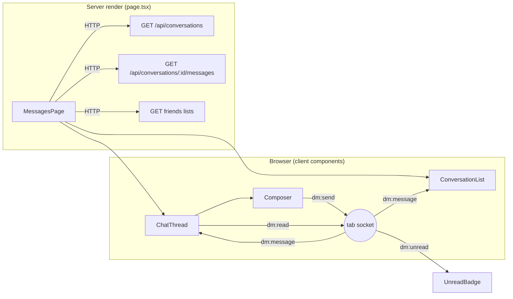
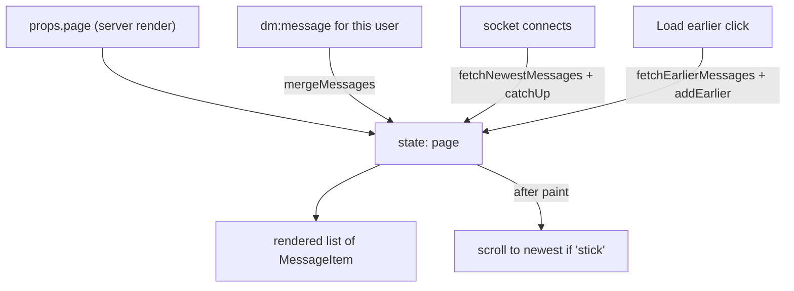
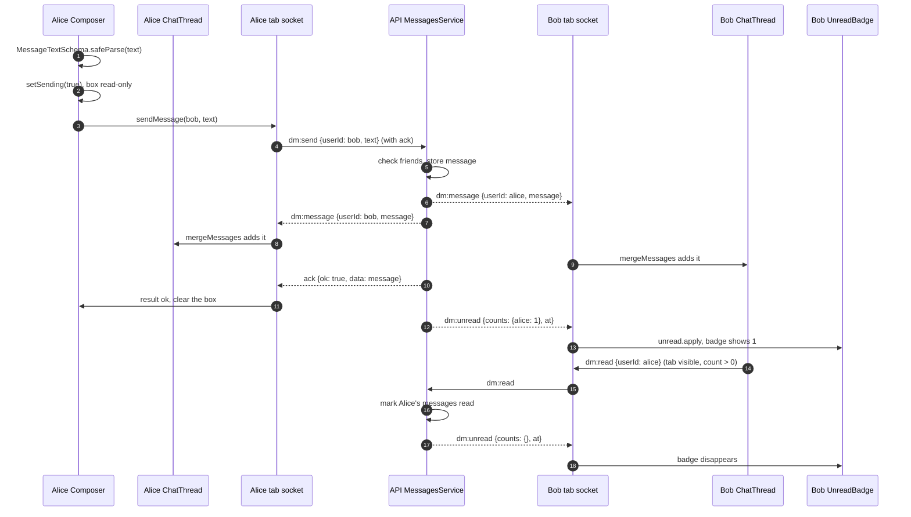
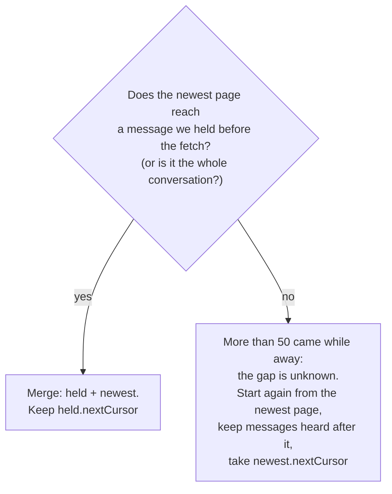
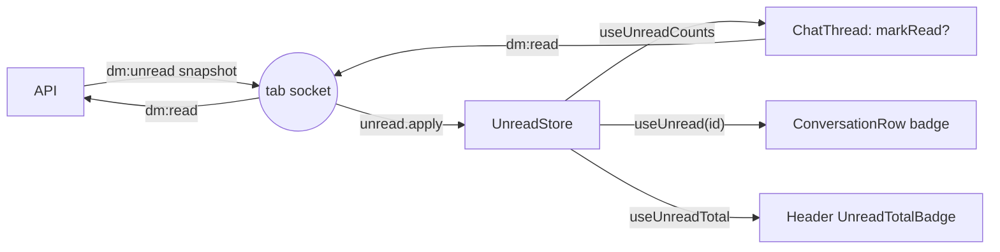
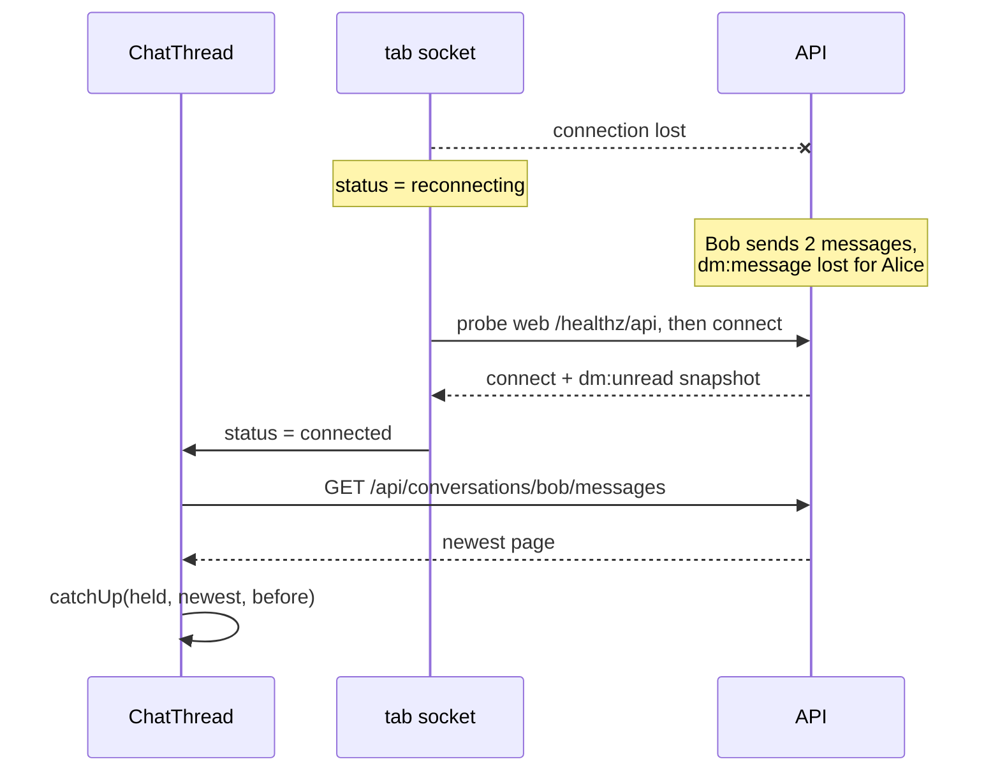

# Chapter 8 — The chat

In this chapter:

- How the `/chat` page is built: a list of conversations on the left, one thread on the right.
- How a message travels: from the text box, over the socket, to the server, and back to both people.
- What "optimistic UI" is, and why this chat does **not** use it.
- How new messages are merged into the thread without duplicates.
- How unread counts and the red badges stay correct, live.
- What happens when the connection is lost and comes back.

---

## The big picture

Think of the chat like a **post office with a loudspeaker**.

- When you send a letter, you give it to the counter (the server) and wait for a receipt (the **ack**).
- The post office stores the letter, then calls out on the loudspeaker to **both** people: "new letter in your
  conversation!" (the `dm:message` event).
- It also tells the reader "you now have 3 unread letters" (the `dm:unread` event).
- If you were away (your connection dropped), you missed the loudspeaker. So when you come back, you go to the
  counter and ask "give me the newest letters" (a normal HTTP request).

Two channels are used:

| Channel | Used for | Code |
|---|---|---|
| HTTP (`fetch`) | First paint of the page, "load earlier", catch-up after a reconnect | [conversations.ts](../../apps/web/lib/conversations.ts), [conversations-client.ts](../../apps/web/lib/conversations-client.ts) |
| WebSocket (socket.io) | Sending (`dm:send`), marking read (`dm:read`), receiving (`dm:message`, `dm:unread`) | [tab-socket.ts](../../apps/web/components/tab-socket.ts), [send-message.ts](../../apps/web/lib/send-message.ts) |

A **WebSocket** is a connection that stays open, so the server can push news to the browser at any time. HTTP is
"ask, then get an answer"; a WebSocket is "keep the phone line open". Chapter 3 explains the tab socket itself.



### The files in this chapter

```
apps/web/
├── app/[locale]/(messages)/
│   ├── layout.tsx                 the shell of the Messages group
│   └── chat/
│       ├── page.tsx               server component: loads everything, picks the open thread
│       ├── conversation-list.tsx  client: the list, reordered live
│       └── chat-thread.tsx        client: one thread + the text box
├── lib/
│   ├── conversations.ts           server half of the API calls
│   ├── conversations-client.ts    browser half of the API calls
│   ├── thread.ts                  pure functions: merge, catch up, load earlier, time format
│   ├── unread.ts                  the unread-count store
│   ├── send-message.ts            dm:send and its ack
│   ├── presence.ts                who is online (chapter 3)
│   ├── reconnect.ts               retry rules (chapter 3)
│   └── serial-queue.ts            not used by the chat (see the end)
└── components/
    ├── tab-socket.ts              the one socket of the tab (chapter 3)
    ├── unread-badge.tsx           the red number
    ├── presence-dot.tsx           the green/grey dot
    └── message-link.tsx           the "Message" button on /friends and profiles
```

---

## Theory: optimistic UI, and why this chat waits

**Optimistic UI** means: when the user clicks "Send", you show the message in the thread **at once**, before the
server answers. You are "optimistic" that it will work. If the server later says no, you remove it or mark it red.
It feels fast, but it is more complex: you need a temporary id, you must replace the fake message with the real one,
and you must undo it on failure.

**Pessimistic UI** (the opposite) means: wait for the server's answer, then show the result.

This chat is **not optimistic**. The comment on the `Composer` says it clearly:

> One send at a time: the box is read-only until the ack, so the text cleared after it is the text that was sent.
> On failure the text stays, to send again. The message joins the thread as a dm:message, which reaches the sending
> tab before the ack.

So the flow is:

1. You press Enter. The box becomes read-only, the button is disabled.
2. The server stores the message and sends `dm:message` to **both** users' rooms — your own tab too.
3. Your thread receives that `dm:message` and shows the message (with its real id and time).
4. Then the ack arrives. The box is cleared.

Why this choice? The server is fast, so the wait is short. And there is only **one** way a message enters the
thread (the `dm:message` event), whether you wrote it or the other person did. No fake message, no undo code, and
your other open tabs show it too. If the send fails, your text is still in the box so you can try again.

---

## `layout.tsx` — the Messages shell

[layout.tsx](<../../apps/web/app/[locale]/(messages)/layout.tsx>) wraps every page of the `(messages)` route group.
(A route group is a folder in parentheses: it groups pages under one layout without adding to the URL. See chapter 2.)

```tsx
export default function MessagesLayout({ children }: { children: ReactNode }) {
  return (
    <Shell brand={<Wordmark href="/learn" />} nav={<HeaderNav />} fill footer={<LegalFooter />}>
      {children}
    </Shell>
  );
}
```

- `fill` pins the shell to the screen height (from the `lg` size), so the list and the thread can **each** scroll in
  their own pane, like in most chat apps.
- There is no course switcher here. The comment explains why: no course is open on this page, and the switcher
  would cost one more API call on every render — and this page re-renders often (on friend events).

---

## `chat/page.tsx` — the server component

[page.tsx](<../../apps/web/app/[locale]/(messages)/chat/page.tsx>) runs **on the server**. It loads the data and
renders the two client components. The URL is `/chat` (list only) or `/chat?with=<userId>` (list + one thread).

```tsx
export const dynamic = 'force-dynamic';

export default async function MessagesPage({
  searchParams,
}: {
  searchParams: Promise<{ with?: string | string[] }>;
}) {
  const [me, conversations, lists] = await Promise.all([
    requireUser(),
    requireConversations(),
    requireFriends(),
  ]);
```

- `force-dynamic`: this page shows one person's private messages, so Next.js must never cache or prerender it.
- The three calls run **at the same time** with `Promise.all`: the user, the conversations, and the friends lists.
  Each `require...` sends a signed-out visitor to `/login` (see `settle` in chapter 4).

Then it picks who the open thread is with:

```tsx
  const parsed = UserIdInputSchema.safeParse((await searchParams).with);
  const withId = parsed.success ? parsed.data : null;
  // Someone you may write to, or share a conversation with: nobody else has a thread here.
  const friend = lists.friends.find((user) => user.id === withId);
  const other = friend ?? conversations.find(({ user }) => user.id === withId)?.user;
  const page = other === undefined ? null : await loadMessagePage(other.id);

  const friendsOnline = Object.fromEntries(lists.friends.map((user) => [user.id, user.online]));
```

- `?with=` is checked with a Zod schema. A bad value is simply ignored: you see the list alone, no error page.
- The other person must be **a friend** (you may write to them) **or** someone you already have a conversation
  with (an ex-friend: you can still read the old messages, but not write). Anyone else gets no thread.
- Only if there is someone, the newest page of messages is loaded (`loadMessagePage`).
- `friendsOnline` is a small map `{ userId: true/false }`, used for the dots. A non-friend is not in the map, so
  they get no dot.

The render:

```tsx
          <ChatThread
            key={other.id}
            user={other}
            online={friend?.online}
            page={page}
            me={me.id}
            timeZone={me.timeZone}
          />
```

- `key={other.id}`: when you open another conversation, React sees a new key and starts a **fresh** `ChatThread`
  (fresh state). But a refresh of the same conversation keeps the same key, so the state survives.
- `online={friend?.online}` is `undefined` for an ex-friend. The thread uses this to hide the dot **and** the text
  box.

On a phone, you see the list **or** the thread, never both (`max-lg:hidden` classes and an "All messages" link).

At the end there is `<RefreshOn events={FRIEND_EVENTS} />` (chapter 3). When a friendship starts or ends, the page
re-renders from the server, because that changes who you may write to.

---

## `lib/conversations.ts` and `lib/conversations-client.ts` — the HTTP calls

Like the other API files (chapter 4), there is a **server half** and a **browser half**.

[conversations.ts](../../apps/web/lib/conversations.ts) (server, used by `page.tsx`):

```ts
export async function requireConversations(): Promise<Conversation[]> {
  return settle(await apiGet(ConversationsSchema, '/api/conversations'), 'conversations')
    .conversations;
}

export async function loadMessagePage(userId: string): Promise<MessagePage> {
  return settle(
    await apiGet(MessagePageSchema, `/api/conversations/${userId}/messages`),
    'messages',
  );
}
```

[conversations-client.ts](../../apps/web/lib/conversations-client.ts) (browser, used by `chat-thread.tsx`):

```ts
export function fetchNewestMessages(userId: string): Promise<ApiResult<MessagePage>> {
  return clientGet(MessagePageSchema, messagesPath(userId));
}

export function fetchEarlierMessages(
  userId: string,
  cursor: string,
): Promise<ApiResult<MessagePage>> {
  return clientGet(MessagePageSchema, messagesPath(userId), { cursor });
}
```

The data shapes come from `@ft/shared` ([message.ts](../../packages/shared/src/schemas/message.ts)):

| Type | Fields | Meaning |
|---|---|---|
| `Message` | `id`, `senderId`, `text`, `createdAt` | One stored message |
| `MessagePage` | `messages` (oldest first), `nextCursor` | Up to 50 messages. `nextCursor` asks for the page **before** them; `null` when the first message is in |
| `Conversation` | `user`, `lastMessageAt`, `unread` | One row of the list |

A **cursor** is a bookmark: "give me the messages before this one". Here it is the id of the oldest message of the
page. It is better than "page number 3", because new messages do not shift the pages.

Tests: [conversations-client.test.ts](../../apps/web/lib/conversations-client.test.ts) checks the URL with and
without `cursor`, and that a failure comes back as a code.

---

## `chat/conversation-list.tsx` — the list, live

[conversation-list.tsx](<../../apps/web/app/[locale]/(messages)/chat/conversation-list.tsx>) is a client component.
It shows every conversation, the latest first, each with an avatar, a dot, the name and an unread badge.

The key part: when a new message arrives, its row moves to the top **without** asking the server again.

```tsx
  // The last message heard per conversation since the render, which may be later than its own.
  const [heard, setHeard] = useState<Partial<Record<string, string>>>({});

  useServerEvent(SERVER_EVENTS.DM_MESSAGE, ({ userId, message }) => {
    if (conversations.some(({ user }) => user.id === userId)) {
      setHeard((last) => ({ ...last, [userId]: message.createdAt }));
    } else {
      router.refresh();
    }
  });

  const latest = ({ user, lastMessageAt }: Conversation) =>
    Math.max(Date.parse(lastMessageAt), Date.parse(heard[user.id] ?? lastMessageAt));
  const ordered = [...conversations].sort((a, b) => latest(b) - latest(a));
```

- `useServerEvent` (from `tab-socket.ts`) runs the function each time `dm:message` arrives.
- If the conversation is **already in the list**, it only remembers "last heard at this time" in `heard`. The sort
  then uses the later of the two times (server's `lastMessageAt` or the heard one).
- If it is **someone new** (first message ever from them), the row needs their name and avatar, which the event does
  not carry. So it calls `router.refresh()` to re-render the page from the server.

Why not always refresh? The comment says: one render costs three or four API calls per tab, and messages come much
more often than friend events. So the cheap local re-sort is used whenever possible.

One more rule: if you opened a friend with `?with=` but never wrote to them, there is no conversation yet. The list
still adds them on top, so the list never says "nobody" next to their open thread:

```tsx
  if (open !== null && !conversations.some(({ user }) => user.id === open.id)) {
    rows.unshift({ user: open, unread: 0 });
  }
```

Each row (`ConversationRow`) gets its live count with `useUnread(user.id, unread)` — see the unread section below —
and its link has `prefetch={false}`: prefetching a whole list of people would cost one render each, against the API
rate limit.

---

## `chat/chat-thread.tsx` — one conversation

[chat-thread.tsx](<../../apps/web/app/[locale]/(messages)/chat/chat-thread.tsx>) is the biggest file. It holds:

- `ChatThread`: the messages and all the "stay current" logic.
- `MessageItem`: one bubble.
- `Composer`: the text box.
- Small helpers: `usePageVisible`, `atNewest`, `showNewest`.

The idea, from the top comment: **the props are where it starts; from there it keeps itself current.**



### State and refs

```tsx
  const status = useSocketStatus();
  const counts = useUnreadCounts();
  const visible = usePageVisible();
  const [page, setPage] = useState(rendered);
  ...
  const stick = useRef(true);
  const shown = useRef(page.messages);
  const anchor = useRef<string | null>(null);
```

- `page` (state): the messages shown, starting from the server's page.
- `stick` (ref): "after the next change, scroll to the newest message". `true` at first, so the first paint shows
  the bottom.
- `shown` (ref): a copy of the current messages, for the catch-up to read. It is a **ref**, not state, so a new
  message does not restart the catch-up effect.
- `anchor` (ref): the id of the message that was at the top before "Load earlier", to keep the reader's place.

A **ref** (`useRef`) is a box that keeps a value between renders, but changing it does **not** cause a new render.

### 1. A new message arrives live

```tsx
  useServerEvent(SERVER_EVENTS.DM_MESSAGE, ({ userId, message }) => {
    if (userId !== user.id) return;
    stick.current ||= message.senderId === me || atNewest(pane.current, bottom.current);
    setPage((held) => ({ ...held, messages: mergeMessages(held.messages, [message]) }));
  });
```

- `userId` in the event is **the other person** of the conversation (the server sends `{ userId: me }` to them and
  `{ userId: them }` to you). Events for other conversations are ignored.
- Scroll to the bottom if **you** sent it, or if you were already reading the newest message. If you scrolled up to
  read old messages, a new one does not yank you down.
- `mergeMessages` adds it, sorted, and **once only** (by id). This matters: the same message can come by the event
  and by a catch-up fetch.

### 2. Catch-up on every connect

```tsx
  useEffect(() => {
    if (status !== 'connected') return;
    let current = true;
    // Taken now: a message heard during the fetch says nothing about the gap.
    const before = shown.current;
    void fetchNewestMessages(user.id).then((result) => {
      if (!current || !result.ok) return;
      stick.current ||= atNewest(pane.current, bottom.current);
      setPage((held) => catchUp(held, result.data, before));
    });
    return () => {
      current = false;
    };
  }, [status, user.id]);
```

Each time the socket status becomes `connected` (the first time, and after every reconnect), the thread fetches
the newest page by HTTP. Why? While the socket was down, `dm:message` events were lost. The fetch fills the gap.
`current = false` in the cleanup ignores an answer that comes back after the component is gone or the status changed.
`catchUp` (in `thread.ts`, below) decides how to merge.

### 3. Mark as read

```tsx
  useEffect(() => {
    if (visible && status === 'connected' && (counts?.[user.id] ?? 0) > 0) markRead(user.id);
  }, [visible, status, counts, user.id]);
```

If the tab is in front (`visible`), connected, and this conversation has unread messages, send `dm:read`. The
server answers with a fresh `dm:unread` snapshot — **always**, even if nothing changed. That new snapshot is a new
`counts` object, so this effect runs again. If a message arrived while the read was on its way, it gets read too.
A hidden tab never marks anything read (`usePageVisible` uses `document.visibilityState`).

### 4. Scrolling

```tsx
  useEffect(() => {
    if (!stick.current) return;
    stick.current = false;
    showNewest(pane.current, bottom.current);
  }, [page.messages]);

  useLayoutEffect(() => {
    const id = anchor.current;
    if (id === null) return;
    anchor.current = null;
    pane.current?.querySelector(`[data-id="${id}"]`)?.scrollIntoView({ block: 'start' });
  }, [page.messages]);
```

- `useEffect` runs **after** paint. It is used to scroll to the bottom, after Next.js has done its own scroll to
  the top of a new page.
- `useLayoutEffect` runs **before** paint. After "Load earlier", the old first message is scrolled back to the top
  before the user sees anything, so the screen does not jump.

`atNewest` checks two things, because on a big screen the pane scrolls, and on a phone the whole page scrolls:
the pane is within 80 px (`NEAR_END_PX`) of its end, **and** the bottom of the thread is on screen.

### 5. Load earlier

```tsx
  async function loadEarlier(cursor: string) {
    const first = page.messages[0]?.id ?? null;
    setEarlier({ loading: true, error: null });
    const result = await fetchEarlierMessages(user.id, cursor);
    if (result.ok) {
      anchor.current = first;
      setPage((held) => addEarlier(held, cursor, result.data));
    }
    ...
  }
```

The button only shows when `page.nextCursor` is not `null`. An error shows under the button.

### The render

The messages are in a `<div role="log">`. `role="log"` tells a screen reader that new lines are added at the end,
so it reads them when they arrive. Each `MessageItem` is a bubble on the right (mine) or the left (theirs), with a
hidden "You:" or the name for screen readers, and a `<time>` formatted with `timeFormat`. The `<time>` has
`suppressHydrationWarning` because the server and the browser may format a time a tiny bit differently.

At the bottom: the `Composer` for a friend, or the text "only friends can write" for an ex-friend.

### The `Composer`

```tsx
  async function send() {
    if (sending) return;
    const parsed = MessageTextSchema.safeParse(text);
    if (!parsed.success) {
      setError(errorMessage(parsed.error.issues[0]?.message ?? 'unknown'));
      return;
    }

    setSending(true);
    const result = await sendMessage(userId, parsed.data);
    setSending(false);
    if (!result.ok) {
      setError(errorMessage(result.code));
      return;
    }
    setText('');
    setError(null);
  }
```

- The text is checked in the browser first with the **same** schema the server uses (`MessageTextSchema`: trimmed,
  1 to 1000 characters, no NUL character). An empty message never leaves the browser.
- `readOnly={sending}` on the `<textarea>` and `disabled={sending}` on the button: one send at a time.
- On success the box is cleared. On failure the text stays and an error is shown.

The keyboard:

```tsx
  function onKeyDown(event: KeyboardEvent<HTMLTextAreaElement>) {
    const { isComposing, keyCode } = event.nativeEvent;
    if (event.key !== 'Enter' || event.shiftKey || isComposing || keyCode === 229) return;
    event.preventDefault();
    event.currentTarget.form?.requestSubmit();
  }
```

Enter sends, Shift+Enter makes a new line. An **IME** is the tool used to type languages like Japanese or Chinese:
you type letters, then press Enter to confirm a word. That Enter must not send the message. `isComposing` catches it,
and `keyCode === 229` catches it on Safari.

---

## `lib/send-message.ts` — `dm:send` and its ack

[send-message.ts](../../apps/web/lib/send-message.ts) holds the send logic. It is kept outside `tab-socket.ts` so it
can be tested with a fake socket (the real one needs a browser). `tab-socket.ts` just calls it:

```ts
export function sendMessage(userId: string, text: string): Promise<SocketAck<Message>> {
  return sendMessageOver(socket(), userId, text);
}
```

An **ack** (acknowledgement) is socket.io's way to get an answer to one event, like a reply to a letter.
`emitWithAck` sends the event and returns a Promise of the answer.

```ts
export async function sendMessageOver(
  socket: SendSocket,
  userId: string,
  text: string,
): Promise<SocketAck<Message>> {
  if (!socket.connected) return UNREACHABLE;

  let answer: unknown;
  try {
    answer = await socket
      .timeout(SEND_TIMEOUT_MS)
      .emitWithAck(CLIENT_EVENTS.DM_SEND, { userId, text });
  } catch {
    return UNREACHABLE;
  }

  const parsed = AckSchema.safeParse(answer);
  if (!parsed.success) return { ok: false, code: 'unknown' };
  if (!parsed.data.ok && parsed.data.code === 'server.unexpected') {
    return { ok: false, code: 'unknown' };
  }
  return parsed.data;
}
```

- **Not connected → fail at once.** socket.io would otherwise keep the event and send it on reconnect, long after the
  page said "failed". The user would then see a message they thought was lost.
- **10 s timeout** (`SEND_TIMEOUT_MS`). If no answer: "network unreachable". The comment admits a small risk: the
  server may have stored it anyway, so a retry could show it twice. This is accepted.
- **The answer is checked with Zod** (`AckSchema`): either `{ ok: true, data: Message }` or `{ ok: false, code }`.
- `server.unexpected` is turned into `unknown`, because its translated text talks about an HTTP status, which a
  socket does not have.

`SendSocket` is a small interface: just `connected` and `timeout(...).emitWithAck(...)`. The test passes a fake
object with that shape.

Tests: [send-message.test.ts](../../apps/web/lib/send-message.test.ts) — success, refused while offline (nothing
sent), timeout, a refusal code, `server.unexpected`, and bad answers.

---

## Sequence: sending a message and the other person seeing it live

Here Alice writes to Bob. Both have the chat open. Bob's tab is also showing a badge in the header.



Notes on this diagram (from [messages.service.ts](../../apps/api/src/messages/messages.service.ts), see API
chapter 9):

- The server sends `dm:message` to **both rooms** before returning the ack. So Alice's own thread shows her message
  through the event, not through the ack.
- The unread count is sent with `void this.tellUnread(them)`: not awaited, so the ack never waits for the count.
- If Bob's chat were **not** open (he is on `/friends`), steps 9 and 14–18 would not happen: only his badge would
  show 1.

---

## `lib/thread.ts` — merging, kept pure

[thread.ts](../../apps/web/lib/thread.ts) holds the merge rules as **pure functions**: they only take values and
return new values, with no React, no network. That makes them easy to test.

### `mergeMessages`

```ts
function oldestFirst(a: Message, b: Message): number {
  const byTime = Date.parse(a.createdAt) - Date.parse(b.createdAt);
  if (byTime !== 0) return byTime;
  return a.id < b.id ? -1 : a.id > b.id ? 1 : 0;
}

export function mergeMessages(held: Message[], incoming: Message[]): Message[] {
  const byId = new Map(held.map((message) => [message.id, message]));
  for (const message of incoming) byId.set(message.id, message);
  return [...byId.values()].sort(oldestFirst);
}
```

A `Map` keyed by id removes duplicates. Then sort by time, and by id when two messages have the same millisecond
(the same order the server uses).

### `catchUp`

After a reconnect, the thread holds some messages, and the server gives the newest 50. Two cases:



```ts
export function catchUp(held: MessagePage, newest: MessagePage, before: Message[]): MessagePage {
  const ids = new Set(before.map((message) => message.id));
  const meets = newest.nextCursor === null || newest.messages.some(({ id }) => ids.has(id));

  if (meets) {
    return { messages: mergeMessages(held.messages, newest.messages), nextCursor: held.nextCursor };
  }
  const last = newest.messages.at(-1);
  const later = held.messages.filter(
    (message) => last !== undefined && oldestFirst(message, last) > 0,
  );
  return { messages: mergeMessages(newest.messages, later), nextCursor: newest.nextCursor };
}
```

`before` is what the thread held **when the fetch started**. A message heard live during the fetch may also be in
the newest page; it must not count as "we reached the old messages". In the "no" case, the older messages can be
loaded again with "Load earlier".

### `addEarlier`

```ts
export function addEarlier(held: MessagePage, cursor: string, earlier: MessagePage): MessagePage {
  if (held.nextCursor !== cursor) return held;
  return {
    messages: mergeMessages(earlier.messages, held.messages),
    nextCursor: earlier.nextCursor,
  };
}
```

If a catch-up restarted the thread while "Load earlier" was loading, the cursor changed, and the old page is
dropped.

### `timeFormat`

Returns `Intl.DateTimeFormat` options: only the time for a message of today, date and time otherwise. "Today" is
decided in the **reader's** time zone (from their account). If the browser does not know that zone name, it falls
back to the browser's own zone (`knownZone`).

Tests: [thread.test.ts](../../apps/web/lib/thread.test.ts) covers each case: duplicates, same millisecond, a catch-up
that meets or not, a message heard during the fetch, a dropped earlier page, and the time formats.

---

## Unread counts: `lib/unread.ts`, `tab-socket.ts`, `unread-badge.tsx`

### The store

[unread.ts](../../apps/web/lib/unread.ts) creates a small store that lives as long as the tab's socket (not one
page), so the header badge is right on **every** page.

The server always sends the **whole picture** (`dm:unread` = `{ counts: { userId: n }, at }`), never "+1". So a
snapshot replaces the last one. But two snapshots can cross on the way (a read and a new message at the same time).
The `at` time stamp decides who wins:

```ts
    apply(snapshot) {
      if (kept !== undefined && Date.parse(snapshot.at) < Date.parse(kept.at)) return;
      kept = snapshot;
      changed();
    },
```

- An older snapshot is ignored.
- Every kept snapshot tells the watchers, **even if the numbers did not change**. This is what makes the thread's
  "mark read" effect run again (see above).
- `clear()` on sign-out: the next person using this tab must not see these counts.

It also exports `badgeText` (`"99+"` above 99) and `unreadTotal` (sum of all conversations).

### The hooks in `tab-socket.ts`

`tab-socket.ts` creates one store and feeds it from the socket:

```ts
    created.on(SERVER_EVENTS.DM_UNREAD, (snapshot) => unread.apply(snapshot));
```

And gives React hooks to read it (with `useSyncExternalStore`, React's way to read a store that lives outside React):

```ts
export function useUnreadCounts(): UnreadCounts | undefined {
  return useSyncExternalStore(unread.subscribe, unread.get, () => undefined);
}

export function useUnread(userId: string, rendered: number): number {
  const counts = useUnreadCounts();
  return counts === undefined ? rendered : (counts[userId] ?? 0);
}
```

Before the first snapshot, `useUnread` uses `rendered`, the count the server put in the page. After that, the live
count wins. The server sends a `dm:unread` on every connect, so this switch happens quickly.

`markRead` sends `dm:read` only while connected, and never queues it: the thread asks again on the next connect.

### The badge

[unread-badge.tsx](../../apps/web/components/unread-badge.tsx):

```tsx
export function UnreadBadge({ count }: { count: number | undefined }) {
  const t = useTranslations('MessagesPage');

  if (count === undefined || count === 0) return null;
  return (
    <span className="inline-flex h-5 min-w-5 ...">
      <span aria-hidden>{badgeText(count)}</span>
      <span className="sr-only">{t('unread', { count })}</span>
    </span>
  );
}

export function UnreadTotalBadge() {
  return <UnreadBadge count={useUnreadTotal()} />;
}
```

- Nothing at 0, and nothing before the tab has heard. So a "0" never flashes on the first paint.
- The eye sees `99+`; a screen reader hears the full phrase with the exact number.
- `UnreadBadge` is used per row in the conversation list. `UnreadTotalBadge` is used twice in the header: on the
  menu button, so the count shows while the menu is closed ([header-menu.tsx](../../apps/web/components/header-menu.tsx)),
  and on the Messages row inside the menu ([session-nav.tsx](../../apps/web/components/session-nav.tsx)).



Tests: [unread.test.ts](../../apps/web/lib/unread.test.ts) — nothing before the first snapshot, replace not merge,
out-of-order snapshots, watchers told even when unchanged, clear, `badgeText`, `unreadTotal`.

---

## Presence: `presence-dot.tsx` and `lib/presence.ts`

Chapter 3 covers [presence.ts](../../apps/web/lib/presence.ts) and the socket listeners. In the chat it is used by
`AvatarWithDot` in [presence-dot.tsx](../../apps/web/components/presence-dot.tsx), in each list row and in the
thread header:

```tsx
export function AvatarWithDot({
  user,
  online,
  size,
}: {
  user: PublicUser;
  online?: boolean;
  size: number;
}) {
  return (
    <span className="relative shrink-0">
      <Avatar src={user.avatarUrl} name={user.displayName} size={size} />
      {online === undefined ? null : (
        <span className="absolute -right-0.5 -bottom-0.5 flex">
          <PresenceDot userId={user.id} online={online} />
        </span>
      )}
    </span>
  );
}
```

- `online === undefined` (not a friend) → no dot.
- `PresenceDot` uses `useFriendOnline(userId, online)`: the live value from the presence map, or the server's value
  until the tab has heard about this friend. Green when online, grey when not, with a label "Online"/"Offline" for
  screen readers.

Tests: [presence.test.ts](../../apps/web/lib/presence.test.ts).

---

## `message-link.tsx` — the way in

[message-link.tsx](../../apps/web/components/message-link.tsx) is the "Message" button on the
[friends page](<../../apps/web/app/[locale]/(main)/friends/page.tsx>) and on a
[user profile](<../../apps/web/app/[locale]/(main)/users/[id]/page.tsx>):

```tsx
export function MessageLink({ userId }: { userId: string }) {
  const t = useTranslations('FriendsPage');

  return (
    <Link href={`/chat?with=${userId}`} prefetch={false} className={SECONDARY_BUTTON}>
      {t('message')}
    </Link>
  );
}
```

It is a plain link to `/chat?with=<id>`. Its label does not contain the name, so it is never confused with the
profile link next to it. No prefetch, for the rate limit again.

---

## Reconnection: `lib/reconnect.ts` (short)

Chapter 3 explains the retry loop in detail. For the chat, what matters is:

| Event | Rule in [reconnect.ts](../../apps/web/lib/reconnect.ts) | What the chat sees |
|---|---|---|
| Connection lost | `afterDisconnect` → `'reconnect'` | status `reconnecting`; sends fail at once (`network.unreachable`) |
| Retry | `backoffMs`: 1, 2, 4, 8, then 10 s, ±25% random | `apiIsUp()` checks `/healthz/api` before dialing |
| Back online | `connect` event | status `connected` → the thread runs `fetchNewestMessages` + `catchUp`; a fresh `dm:unread` arrives; the mark-read effect runs again |
| Session over | `afterConnectError` → `'signedOut'` | unread store cleared |

So nothing is lost: while away, `dm:message` events are missed, but the catch-up fetch on reconnect brings them
back, and `mergeMessages` makes sure none shows twice.



Tests: [reconnect.test.ts](../../apps/web/lib/reconnect.test.ts).

---

## `lib/serial-queue.ts` — not part of the chat

[serial-queue.ts](../../apps/web/lib/serial-queue.ts) runs async tasks one after another, in order. It was listed
with the chat files, but the chat does **not** use it: the `Composer` allows one send at a time with its `sending`
flag instead. Its only user is [use-course-save.ts](../../apps/web/lib/use-course-save.ts) (chapter 6), so two saves
of the same setting reach the server in the order the learner made them. Chapter 9 walks through its test.

---

## Key ideas to remember

- `/chat` is a **server component** that loads the list, the friends and the newest page; the list and the thread are
  **client components** that keep themselves current over the socket.
- The chat is **not optimistic**: the box waits for the ack, and a message (yours or theirs) enters the thread only
  through the `dm:message` event, which the server sends to both people.
- `mergeMessages` dedupes by id and sorts by time then id, so a message that comes twice (event + fetch) shows once.
- On **every connect**, the thread fetches the newest page and uses `catchUp` to fill what was missed while away.
- Unread counts are **whole snapshots** with a time stamp; the latest one wins, whatever order they arrive in.
- A visible, connected thread with unread messages sends `dm:read`; the server always answers with a new snapshot,
  so the read repeats until the count is 0.
- The list re-sorts locally on a new message, and only refreshes from the server for a brand-new conversation.
- Sends fail at once while offline, so socket.io never delivers an old message late.
- The pure logic (`thread.ts`, `unread.ts`, `send-message.ts`, `reconnect.ts`, `presence.ts`) lives in `lib/` so it
  can be tested without a browser.

---

Previous: [Chapter 7 — The lesson player](07-lesson-player.md) · Next: [Chapter 9 — Testing the web app](09-tests.md) · [Back to index](README.md)
