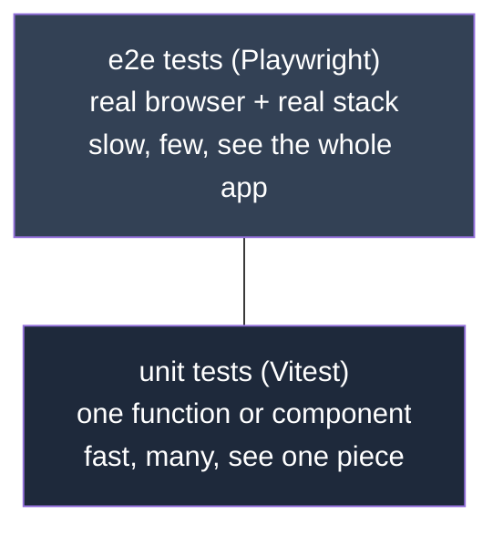
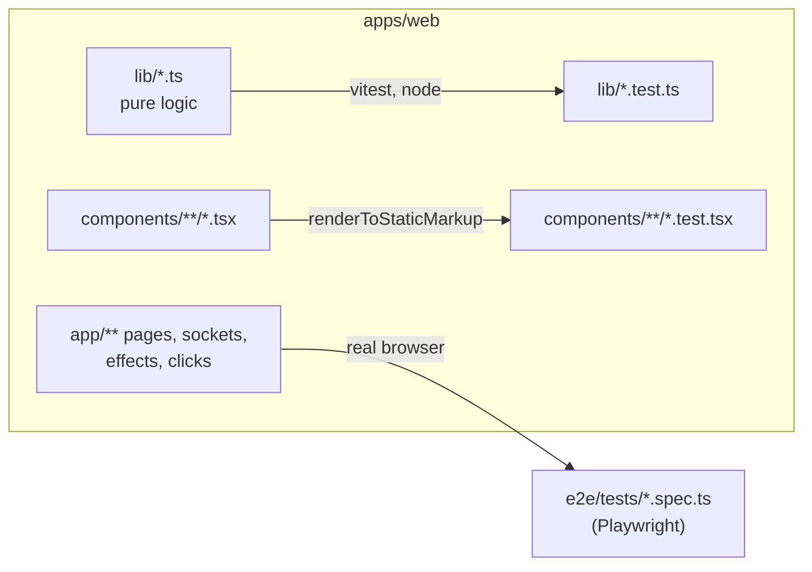
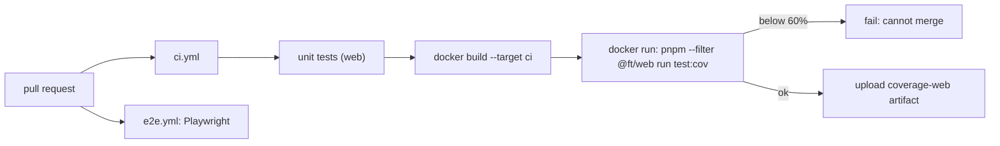

# Chapter 9 — Testing the web app

In this chapter:

- What a unit test is, and the words you will meet: test runner, assertion, mock, jsdom.
- Testing pure functions versus testing components.
- How the web app runs its tests: `vitest.config.mts`, the `package.json` scripts, turbo, `make`, CI.
- One library test and one component test, read line by line.
- A table of **every** test file in `apps/web`, with what it checks.
- The `coverage/` folder.
- The browser end-to-end tests (Playwright) in `e2e/` at the root.

---

## Theory: what is a test?

### The analogy: a kitchen taste test

A cook does not wait for the customer to say "too salty". Before a dish leaves the kitchen, the cook takes a spoon
and tastes it. If it is wrong, it never reaches the table.

A **test** is that spoon, for code. It is a small piece of code that:

1. **prepares** some input ("arrange"),
2. **runs** the code you want to check ("act"),
3. **checks** the result is what you expect ("assert").

If the check fails, the test fails, and you know something broke — before a user sees it.

A **unit test** tastes **one small part** (one function, one component) alone, very fast, with no real server, no
real database and no real browser. An **end-to-end (e2e) test** tastes the whole meal: a real browser clicks
through the real app.



### Words you will meet

| Word | Plain meaning |
|---|---|
| **Test runner** | The program that finds the test files, runs them and prints pass/fail. Here: **Vitest**. |
| `describe` | A group of tests with a title, e.g. `describe('mergeMessages', ...)`. |
| `it` (or `test`) | One test. Its title is a sentence: `it('keeps each message once, oldest first', ...)`. |
| `it.each` / `describe.each` | The same test run with several inputs, from a table. |
| `expect(x).toBe(y)` | An **assertion**: "x must be y". Fails the test if not. |
| **Mock** / **fake** | A pretend version of something the code uses (like `fetch` or a socket), so the test controls its answer and nothing real is called. |
| `vi.fn()` | Vitest's tool to make a fake function. It records every call, so you can check "was it called, and with what?". |
| `vi.stubGlobal('fetch', ...)` | Replaces a global (here `fetch`) with a fake for the test. `vi.unstubAllGlobals()` puts the real one back. |
| `vi.mock('next/headers', ...)` | Replaces a whole imported module with a fake. |
| **jsdom** | A fake browser page written in JavaScript. It gives Node a `document` and `window`, so you can click buttons in a test without a real browser. |
| **Coverage** | Which lines of your code were run by the tests, as a percentage. |

### Pure functions versus components

A **pure function** only takes inputs and returns an output. No network, no screen, no clock (or the clock is passed
in). Example: `mergeMessages(held, incoming)` from chapter 8. Testing it is easy: call it, compare the result.

A **component** draws HTML and may react to clicks, timers and effects. Testing it is harder: you need to render it
somewhere and look at the result. There are two common ways:

| Way | How | Sees effects and clicks? |
|---|---|---|
| **jsdom + Testing Library** | Render into a fake DOM, then "click" and read the page like a user | Yes |
| **`renderToStaticMarkup`** | Ask React for the HTML string, as the server would draw it | No: no DOM, effects do not run |

**This project chose the second way.** The comment in `vitest.config.mts` says:

> Components are tested with renderToStaticMarkup, as in packages/ui: no DOM.

So: **the web app does not use jsdom, and does not use Testing Library.** The test environment is plain Node.
That is why so much logic is moved out of components into `lib/` as pure functions (`thread.ts`, `unread.ts`,
`reconnect.ts`, `send-message.ts`...): there it can be tested without a browser. The parts that really need a browser
(the socket, scrolling, clicks) are checked by the Playwright e2e tests instead.



---

## `vitest.config.mts` — the test settings

[vitest.config.mts](../../apps/web/vitest.config.mts) tells Vitest how to run the web tests.

```ts
export default defineConfig({
  resolve: {
    alias: {
      '@': rootDir,
    },
  },
  // tsconfig keeps JSX for Next ("preserve"): the component tests need it compiled.
  oxc: { jsx: { runtime: 'automatic' } },
  test: {
    environment: 'node',
    // Components are tested with renderToStaticMarkup, as in packages/ui: no DOM.
    include: ['lib/**/*.test.ts', 'components/**/*.test.tsx'],
    coverage: {
      provider: 'v8',
      reporter: ['text-summary', 'lcov'],
      reportsDirectory: 'coverage',
      include: ['lib/**/*.ts'],
      exclude: ['lib/**/*.test.ts'],
      thresholds: {
        lines: 60,
        functions: 60,
      },
    },
  },
});
```

Line by line:

- `alias '@'`: so `import ... from '@/lib/thread'` works in tests, like in the app (tsconfig has the same alias).
- `oxc.jsx`: Next.js leaves JSX as is (`"jsx": "preserve"` in tsconfig) because Next compiles it itself. Vitest does
  not use Next, so it must compile the JSX of `.test.tsx` files. `oxc` is the fast compiler Vite uses.
- `environment: 'node'`: no fake browser. No `document`, no `window` (a test that needs `window` fakes it itself,
  see `lesson-history.test.ts`).
- `include`: only test files in `lib/` and `components/`. Nothing under `app/`.
- `coverage`:
  - `provider: 'v8'`: uses the coverage counter built into Node's engine (V8).
  - `reporter`: a short summary in the terminal (`text-summary`) and `lcov` files (see the coverage section).
  - `include: ['lib/**/*.ts']`: only `lib/` is measured. The comment explains: server components and route handlers
    need a browser and an RSC renderer to run; the logic they call lives in `lib/`, which is what the thresholds
    measure.
  - `thresholds`: if less than **60% of lines** or **60% of functions** in `lib/` are covered, the command **fails**.

---

## How tests are run

### The scripts

In [apps/web/package.json](../../apps/web/package.json):

```json
    "test": "vitest run",
    "test:cov": "vitest run --coverage"
```

- `vitest run` runs every test once and stops (without `run`, Vitest would watch the files and re-run on change).
- `--coverage` also measures coverage and checks the thresholds.

In the root [package.json](../../package.json), turbo runs the same script in **every** package:

```json
    "test": "turbo run test",
    "test:cov": "turbo run test:cov",
    "ci": "pnpm run format:check && turbo run lint typecheck test:cov build"
```

**turbo** is the monorepo task runner. In [turbo.json](../../turbo.json), `test` and `test:cov` depend on
`^build` (build the packages this one imports first, like `@ft/shared`) and `db:generate`. `test:cov` declares
`coverage/**` as its output, so turbo can cache it.

### Where they run

| Where | Command | What it runs for web |
|---|---|---|
| Your machine, one app | `pnpm --filter @ft/web test` (or `test:cov`) | Vitest in `apps/web` |
| Your machine, all | `make test` → `pnpm run test` | Every package's unit tests |
| `make ci` / `make` | `pnpm run ci` | format, lint, typecheck, `test:cov`, build |
| Docker `ci` stage | [apps/web/Dockerfile](../../apps/web/Dockerfile) `CMD`: `pnpm lint && pnpm typecheck && pnpm test:cov` | The same, inside the image |
| GitHub CI | [ci.yml](../../.github/workflows/ci.yml), job `unit tests (web)` | `pnpm --filter @ft/web run test:cov` inside the `ci` Docker stage |
| git pre-push hook | [.husky/pre-push](../../.husky/pre-push) | Only lint and typecheck, **not** tests (kept fast) |

In CI, the `unit-tests` job builds the `ci` stage of the Dockerfile and runs the tests **inside** that image, so
"it passes in CI" means "it passes in the same environment as production". The coverage folder is then copied out
and uploaded as an artifact named `coverage-web` (kept 7 days). The CI comment adds: the thresholds are a **merge
blocker** — the test command itself exits with an error below 60%.



---

## Walk-through 1: a library test — `lib/serial-queue.test.ts`

First the code under test, [serial-queue.ts](../../apps/web/lib/serial-queue.ts):

```ts
export function serialQueue() {
  let tail: Promise<unknown> = Promise.resolve();

  return function run<T>(task: () => Promise<T>): Promise<T> {
    const result = tail.then(task);
    tail = result.catch(() => undefined);
    return result;
  };
}
```

`serialQueue()` gives you a `run` function. Each task you give to `run` starts only after the one before has
finished (`tail.then(task)`). `tail = result.catch(...)` means a failed task does not block the next ones. It is
used by [use-course-save.ts](../../apps/web/lib/use-course-save.ts), so two saves reach the server in order.

Now the test, [serial-queue.test.ts](../../apps/web/lib/serial-queue.test.ts):

```ts
import { describe, expect, it } from 'vitest';

import { serialQueue } from './serial-queue';

const later = <T>(value: T, ms: number) =>
  new Promise<T>((resolve) => setTimeout(() => resolve(value), ms));
```

- Import the test tools from `vitest`, and the function to test.
- `later` is a helper: a Promise that gives `value` after `ms` milliseconds. It makes a "slow" task.

```ts
describe('serialQueue', () => {
  it('starts a task only once the one before it has finished', async () => {
    const run = serialQueue();
    const log: string[] = [];

    const slow = run(async () => {
      log.push('slow start');
      await later(null, 20);
      log.push('slow end');
      return 'slow';
    });
    const fast = run(async () => {
      log.push('fast start');
      return 'fast';
    });

    await expect(Promise.all([slow, fast])).resolves.toEqual(['slow', 'fast']);
    expect(log).toEqual(['slow start', 'slow end', 'fast start']);
  });
```

- **Arrange**: a new queue, and an empty `log` to record the order things happen.
- **Act**: queue a slow task (20 ms) and then a fast task.
- **Assert**:
  - Both give their own value back: `['slow', 'fast']`. `.resolves` waits for the Promise.
  - The log proves the order: the fast task did **not** start before the slow one ended. Without the queue, the log
    would be `['slow start', 'fast start', 'slow end']`.

```ts
  it('runs the next task after one that fails, and keeps the failure for its caller', async () => {
    const run = serialQueue();

    const failed = run(() => Promise.reject(new Error('refused')));
    const next = run(() => Promise.resolve('next'));

    await expect(failed).rejects.toThrow('refused');
    await expect(next).resolves.toBe('next');
  });
});
```

- The first task fails. The caller of that task still sees the error (`rejects.toThrow('refused')`).
- The second task still runs and succeeds. This checks the `tail = result.catch(...)` line.

No mock is needed: the function is pure apart from time, and real timers of 20 ms are fine.

### A test with a mock: `lib/conversations-client.test.ts`

Many `lib/*-client.test.ts` files follow the same pattern: replace `fetch` with a fake that returns a chosen answer,
call the function, then check both the result **and** how `fetch` was called.

```ts
function respondWith(status: number, body: unknown): typeof fetch {
  return vi.fn(
    async () =>
      new Response(JSON.stringify(body), {
        status,
        headers: { 'content-type': 'application/json' },
      }),
  ) as unknown as typeof fetch;
}

afterEach(() => {
  vi.unstubAllGlobals();
});

describe('fetchNewestMessages', () => {
  it('asks for the conversation with the other user, without a cursor', async () => {
    const fetchMock = respondWith(200, page);
    vi.stubGlobal('fetch', fetchMock);

    await expect(fetchNewestMessages(them)).resolves.toEqual({ ok: true, data: page });
    expect(fetchMock).toHaveBeenCalledWith(
      `/api/conversations/${them}/messages`,
      expect.objectContaining({ method: 'GET' }),
    );
  });
```

- `respondWith` builds a fake `fetch` with `vi.fn`, which always answers with this status and JSON body.
- `vi.stubGlobal('fetch', ...)` puts the fake in place of the real `fetch`; `afterEach` puts the real one back after
  every test, so tests do not affect each other.
- `toHaveBeenCalledWith` checks the URL and that the method was `GET`. `expect.objectContaining` means "at least these
  fields; others are allowed".

Other kinds of fakes used in this folder:

- [send-message.test.ts](../../apps/web/lib/send-message.test.ts) builds a **fake socket**: an object with
  `connected` and `timeout(...).emitWithAck(...)`, which is all `sendMessageOver` needs (see chapter 8).
- [api.test.ts](../../apps/web/lib/api.test.ts) and [session.test.ts](../../apps/web/lib/session.test.ts) use
  `vi.mock('next/headers', ...)` and `vi.mock('next/navigation', ...)` to fake cookies, headers and `redirect`
  (which here throws an error with the path, so the test can check where it would go).

---

## Walk-through 2: a component test — `components/lesson/tutor-answer.test.tsx`

The component, [tutor-answer.tsx](../../apps/web/components/lesson/tutor-answer.tsx) (chapter 7), shows the AI
tutor's answer. The answer is Markdown written by an LLM, so it must look nice (bold, lists, tables) **and** be safe
(no raw HTML, no `javascript:` links, no images).

The test, [tutor-answer.test.tsx](../../apps/web/components/lesson/tutor-answer.test.tsx):

```tsx
import { renderToStaticMarkup } from 'react-dom/server';
import { describe, expect, it } from 'vitest';

import { TutorAnswer } from './tutor-answer';

/** The answer as the server draws it: no DOM, as the other component tests. */
const html = (text: string, cut = false) =>
  renderToStaticMarkup(<TutorAnswer text={text} cut={cut} />);
```

- `renderToStaticMarkup` (from React) turns a component into an HTML **string**. No browser needed.
- `html(text)` is a helper so every test is one short line: give Markdown, get HTML.

### Test 1: Markdown becomes real HTML

```tsx
  it('renders the Markdown the model writes, with no * or # left', () => {
    const out = html(
      [
        '### Your mistakes',
        '',
        'You wrote **je suis allé** but *elle*:',
        '',
        '* the participle agrees',
        '* with the subject',
        '',
        '1. first',
        '2. second',
      ].join('\n'),
    );
    expect(out).toContain('<strong class="font-semibold text-slate-100">je suis allé</strong>');
    expect(out).toContain('<em class="italic">elle</em>');
    expect(out).toMatch(/<ul [^>]*list-disc[^>]*>\s*<li>the participle agrees<\/li>/);
    expect(out).toMatch(/<ol [^>]*list-decimal/);
    expect(out).toContain('>Your mistakes</p>');
    expect(out).not.toMatch(/[*#]/);
  });
```

- `toContain` checks an exact piece of the HTML; `toMatch` checks with a regular expression (more flexible about the
  class order).
- `>Your mistakes</p>`: a heading `###` becomes a `<p>`, not an `<h3>` (the page has its own headings).
- `not.toMatch(/[*#]/)`: no leftover Markdown symbols in the output.

### Tests 4 and 5: safety

```tsx
  it('shows raw HTML as text, never as markup', () => {
    const out = html('Look: <script>alert(1)</script> and ');
    expect(out).not.toContain('<script');
    expect(out).not.toContain(' {
    const out = html(' [click](javascript:alert(1))');
    expect(out).not.toContain('` must appear as text (`&lt;script&gt;`), never as a tag.

### The other tests

- A GFM table and `~~strikethrough~~` render as `<table>`, `<th>`, `<td>`, `<del>`, with alignment kept.
- A normal link opens in a new tab with `rel="noopener noreferrer nofollow"`; a footnote link stays on the page.
- A cut answer (`cut = true`) gets a CSS class that adds `…` after its last block.

What this style of test **cannot** do: click, type, or run effects (`useEffect` does not run in
`renderToStaticMarkup`). For a component with translations, the test wraps it in `NextIntlClientProvider`, as
[reading.test.tsx](../../apps/web/components/lesson/kinds/reading.test.tsx) does with `messages/en.json`.

---

## Every test file in `apps/web`

37 files: 35 in `lib/`, 2 in `components/`.

### `components/`

| File | What it checks |
|---|---|
| [lesson/tutor-answer.test.tsx](../../apps/web/components/lesson/tutor-answer.test.tsx) | The tutor's Markdown renders as styled HTML (bold, lists, tables, strikethrough), links are safe, raw HTML/images/`javascript:` never render, a cut answer ends with `…`. |
| [lesson/kinds/reading.test.tsx](../../apps/web/components/lesson/kinds/reading.test.tsx) | Plays the sample reading lesson "Lire un SMS" through the shared lesson core and renders each page: key word cards, matching board, skim countdown, detail questions, ordering, exam page; wrong answers marked right; score 100 when all right, 0 when all wrong. |

### `lib/` — API layer and session

| File | What it checks |
|---|---|
| [api.test.ts](../../apps/web/lib/api.test.ts) | API base URL (fallback, trim, slashes), `buildApiUrl`, `describeFetchError`; `fetchSession` forwards the cookie and address, reads 401 as signed out and 429/500/204/bad JSON/timeout as "unavailable". |
| [api-client.test.ts](../../apps/web/lib/api-client.test.ts) | `clientGet`/`clientPost`: schema validation, credentials, error codes and status, network failure, 204, query parameters, JSON vs `FormData` bodies, headers, refusing a path with `?`. |
| [session.test.ts](../../apps/web/lib/session.test.ts) | `currentUser` forwards cookies and address, gives `null` when the API is down; `requireUser` returns the user, redirects to login, or throws when the API is down. |
| [auth-client.test.ts](../../apps/web/lib/auth-client.test.ts) | Sign up, log in (one factor or 202 for 2FA), logout and 2FA disable (204), verify, enrol, profile patch, avatar upload/remove; errors and dead network become codes. |
| [friends-client.test.ts](../../apps/web/lib/friends-client.test.ts) | Send, accept, delete a friend request, remove a friend: right URL and method, errors as codes. |
| [friends.test.ts](../../apps/web/lib/friends.test.ts) | `relationTo`: someone is a friend, a received request, a sent request, or nobody. |
| [conversations-client.test.ts](../../apps/web/lib/conversations-client.test.ts) | Newest page without cursor, earlier page with cursor, failure as a code. |
| [courses-client.test.ts](../../apps/web/lib/courses-client.test.ts) | `startCourse` and `setCourseLevel`: result, language in the path, conflict/missing course as codes, bad response refused. |
| [placement-client.test.ts](../../apps/web/lib/placement-client.test.ts) | Start, answer (including `null` when time ran out), result, quit the placement exam; conflict and onboarding codes; bad payloads refused. |
| [placement-schema.test.ts](../../apps/web/lib/placement-schema.test.ts) | The placement state schema accepts/refuses shapes, keeps reading passages; `isPlacementResult` tells a result from a question. |
| [lesson-client.test.ts](../../apps/web/lib/lesson-client.test.ts) | Attempt routes (start, post a page, stale page, no answer key leaked), the tab's memory of attempts, and the saved drafts in storage. |
| [discussion-client.test.ts](../../apps/web/lib/discussion-client.test.ts) | The tutor discussion stream: pieces handed over as they come, error events, cut connection, 429 with wait time, refusals, network failure. |

### `lib/` — chat and socket

| File | What it checks |
|---|---|
| [send-message.test.ts](../../apps/web/lib/send-message.test.ts) | `sendMessageOver` with a fake socket: stored message back, refused at once offline, timeout as unreachable, refusal codes, `server.unexpected` reworded, bad acks. |
| [thread.test.ts](../../apps/web/lib/thread.test.ts) | `mergeMessages` (dedupe, order by id in the same millisecond), `catchUp` (meets or restarts, messages heard during the fetch), `addEarlier` (drops a stale page), `timeFormat` (today, older, reader's zone, fallback zone). |
| [unread.test.ts](../../apps/web/lib/unread.test.ts) | Unread store: nothing before the first snapshot, replace not merge, the later snapshot wins, watchers told every time, clear, unsubscribe; `badgeText` 99+; `unreadTotal`. |
| [presence.test.ts](../../apps/web/lib/presence.test.ts) | Presence map: unknown until heard, latest status kept, watchers told only on change, forget, clear, unsubscribe. |
| [reconnect.test.ts](../../apps/web/lib/reconnect.test.ts) | `backoffMs` (doubling, spread, cap), `afterDisconnect`, `afterConnectError`, `apiIsUp` (up, down, bad body, failed request, no cache). |

### `lib/` — courses, lessons and results

| File | What it checks |
|---|---|
| [courses.test.ts](../../apps/web/lib/courses.test.ts) | `findCourse`, which course to land on (cookie, then `activeLang`, then first), `landingPath`, reading the language from a `/learn/...` path. |
| [onboarding.test.ts](../../apps/web/lib/onboarding.test.ts) | Which onboarding step to show: language choice, level choice, newest unfinished course, the course the learner came from. |
| [level.test.ts](../../apps/web/lib/level.test.ts) | `nextLevel` (one above, C2 stays C2, beginner at A1) and `masteredBelow`, round trip for every level. |
| [lesson.test.ts](../../apps/web/lib/lesson.test.ts) | `loadLesson`: card and attempt, 404 for bad/not-ready lessons, onboarding redirect, login redirect; `lessonTitle`; the lesson stage. |
| [lesson-list.test.ts](../../apps/web/lib/lesson-list.test.ts) | Lesson list URL filters, grouping rows by status and day, `previousDay` across months and leap days. |
| [lesson-navigation.test.ts](../../apps/web/lib/lesson-navigation.test.ts) | The lesson timeline: practice pages on one point, repeated explanations separate, one colour per section. |
| [lesson-history.test.ts](../../apps/web/lib/lesson-history.test.ts) | The player's "back" target is remembered in browser history (fake `window`), never back to results on retake or off site. |
| [lesson-gap.test.ts](../../apps/web/lib/lesson-gap.test.ts) | `gluedAfter`: punctuation glued to a gap, the French space before `?` and `!`. |
| [reading.test.ts](../../apps/web/lib/reading.test.ts) | `markKeywords` (every match, longest wins, whole words) and the skim countdown (deadline kept across reload, m:ss). |
| [result-part.test.ts](../../apps/web/lib/result-part.test.ts) | Results page `#part-N` fragments map to the right practice or exam part. |
| [result-score-tone.test.ts](../../apps/web/lib/result-score-tone.test.ts) | Score bands: low below 50, partial, passed from 70, excellent from 90. |
| [xp-breakdown.test.ts](../../apps/web/lib/xp-breakdown.test.ts) | XP rows for a finish (goal, challenge) add up to `xpGained`; old finishes and plain finishes. |
| [voice.test.ts](../../apps/web/lib/voice.test.ts) | `pickVoice` (region order, natural/female/online preferences) and `spokenText` (blanks as pauses, Markdown dropped). |

### `lib/` — texts, translations and small helpers

| File | What it checks |
|---|---|
| [messages.test.ts](../../apps/web/lib/messages.test.ts) | `messages/en.json`, `fr.json`, `de.json` have exactly the same keys, translate every error code, every achievement/challenge, and no empty text. |
| [legal.test.ts](../../apps/web/lib/legal.test.ts) | Privacy and terms pages: long enough, unique stable anchors, no empty section, fixed date, metadata, same anchors in every language. |
| [localized.test.ts](../../apps/web/lib/localized.test.ts) | `pick`: the text in the interface language, with fallbacks. |
| [avatar.test.ts](../../apps/web/lib/avatar.test.ts) | Avatar initial (upper case, never half a character, fallback) and colour (stable per name, in range). |
| [serial-queue.test.ts](../../apps/web/lib/serial-queue.test.ts) | Tasks run one after another; a failure does not stop the next one. |

`messages.test.ts` deserves a note: next-intl does **not** fail the build when a translation is missing — it shows the
key path on the live page. This test is the only thing that catches a missing translation before a human does.

---

## The `coverage/` folder

When you run `pnpm --filter @ft/web test:cov`, Vitest writes `apps/web/coverage/`:

```
apps/web/coverage/
├── lcov.info          the raw numbers, one block per file (for tools and CI)
└── lcov-report/       a website: open index.html in a browser
    ├── index.html     a table of every lib/ file with its % of lines, functions, branches
    ├── lib/           one page per file, lines coloured green (run) or red (never run)
    └── *.css, *.js    the report's own style and scripts
```

- It is **generated**: never edit it. It is in the root `.gitignore`, and `make clean` deletes it.
- It only covers `lib/**/*.ts` (see the config). Component files are not counted.
- In CI it is uploaded as the `coverage-web` artifact, so you can download the HTML report from the run page.
- The terminal also prints a `text-summary` line; if lines or functions are under 60%, the command fails.

Coverage tells you what code was **run**, not that it was **checked** well. A test that calls a function but asserts
nothing still counts. Use the red lines in the report to find logic no test touches.

---

## Browser end-to-end tests: `e2e/` (Playwright)

Yes, there are real browser tests, in their own workspace package `@ft/e2e` at the repo root:

```
e2e/
├── playwright.config.ts    projects (chromium, firefox, webkit), base URL, no retries
├── package.json            test:e2e, test:e2e:restart, report
├── support/                shared helpers: sign-up session fixtures, console guard, live socket wait...
└── tests/*.spec.ts         29 spec files: auth, friends, messages, lesson, console, legal, i18n, ...
```

**Playwright** drives a real browser (Chromium, Firefox and WebKit/Safari): it opens pages, types, clicks and reads
what is on screen, like a person. These tests run against the **production** stack (built with Docker Compose),
never against `next dev`.

Main rules from [playwright.config.ts](../../e2e/playwright.config.ts):

- No `webServer`: Docker Compose starts the stack, Playwright only visits `E2E_BASE_URL` (default
  `https://localhost`).
- `retries: 0`: a test that passes only the second time means a flaky **app**, so it must fail.
- `forbidOnly` in CI: a forgotten `test.only` would silently run one test and still look green.
- Every spec runs on the three browsers.
- `restart.spec.ts` (tagged `@restart`) restarts the API under an open page, so it runs alone afterwards.

Two specs are special gates:

- [console.spec.ts](../../e2e/tests/console.spec.ts): visits every route and fails on **any** console error, warning,
  uncaught exception or failed request.
- [legal.spec.ts](../../e2e/tests/legal.spec.ts): `/privacy` and `/terms` answer 200 with real content.

For the chat (chapter 8), [messages.spec.ts](../../e2e/tests/messages.spec.ts) checks what the unit tests cannot:
two real browsers, one writes, the other sees the message and the unread count arrive live, opening the thread clears
the count, Shift+Enter makes a new line, a message sent while the socket was down arrives when it is back, an
ex-friend's thread has no box, and times show in the account's time zone.

How to run them:

| Where | Command |
|---|---|
| Local, stack already up | `make playwright` (Chromium) or `make playwright-all` (three browsers) |
| Local, start the stack too | `make test-e2e` |
| Last report | `make report` (serves `e2e/playwright-report` on port 9323) |
| GitHub | [e2e.yml](../../.github/workflows/e2e.yml): 3 browsers x 2 parts (`lesson.spec.ts` alone, and the rest), each on its own stack; a final `playwright (production stack)` gate job |

On failure, CI uploads `e2e/playwright-report` and `e2e/test-results` (traces and screenshots).

Note: the API has its own tests too (Jest unit tests and Supertest e2e), explained in
[API chapter 10](../api/10-tests.md).

---

## Key ideas to remember

- A unit test is arrange → act → assert, on one small piece, fast and with no real server.
- The web app uses **Vitest** in a plain **Node** environment: **no jsdom, no Testing Library**.
- Components are tested with `renderToStaticMarkup`: you check the HTML string; effects and clicks do not run.
- Logic is moved into pure functions in `lib/` so it can be tested easily; that is also what coverage measures.
- Mocks replace what the code talks to: `vi.fn`, `vi.stubGlobal('fetch', ...)`, `vi.mock(module)`, or a small fake
  object (the fake socket).
- `pnpm --filter @ft/web test` runs the tests; `test:cov` adds coverage with a **60% lines / 60% functions** gate on
  `lib/`.
- CI runs `test:cov` inside the Docker `ci` stage and uploads `coverage/` as an artifact.
- `coverage/` is generated (`lcov.info` + an HTML report); never edit or commit it.
- Real browser behaviour (sockets, scrolling, clicks, console errors) is checked by **Playwright** in `e2e/`, against
  the production stack, on three browsers.

---

Previous: [Chapter 8 — The chat](08-chat.md) · [Back to index](README.md)
