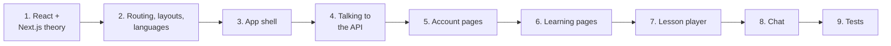

# The web app, explained from zero

This folder explains **`apps/web`**, the website people use: mainly `app/`, `components/`, `lib/`
and `i18n/`. It is written in simple English and starts with no knowledge of React.
Read the chapters in order.

## The chapters

| #   | Chapter                                               | What you learn                                                                      | Main folders                                    |
| --- | ----------------------------------------------------- | ----------------------------------------------------------------------------------- | ----------------------------------------------- |
| 1   | [React and Next.js](01-react-and-nextjs.md)           | Components, props, state, hooks, server and client components, the App Router, tools | `apps/web/` root files                          |
| 2   | [Routing, layouts, i18n](02-routing-layouts-i18n.md)  | How a URL becomes a page, the layouts, the three languages                          | `app/`, `i18n/`, `messages/`, `proxy.ts`        |
| 3   | [The app shell](03-shell-components.md)               | Header, menus, the socket per tab, small sync helpers                               | `components/` (shared pieces)                   |
| 4   | [Talking to the API](04-talking-to-the-api.md)        | How pages and buttons call the API, and how errors become sentences                 | `lib/` (API layer)                              |
| 5   | [Account pages](05-account-pages.md)                  | Home, sign up, log in, onboarding, profile, 2FA, friends                            | `app/[locale]/(main)`                           |
| 6   | [Learning pages](06-learning-pages.md)                | Dashboard, course page, daily goal, lesson search, placement exam                   | `app/[locale]/(dashboard)`                      |
| 7   | [Lesson player](07-lesson-player.md)                  | Playing a lesson, results, XP, the AI tutor, speech                                 | `lessons/[id]`, `components/lesson`             |
| 8   | [Chat](08-chat.md)                                    | Conversations, live messages, unread counts                                         | `app/[locale]/(messages)`                       |
| 9   | [Tests](09-tests.md)                                  | Vitest, testing functions and components, coverage                                 | `*.test.ts(x)`                                  |

The API that this website talks to has its own guide: [docs/api](../api/README.md).
